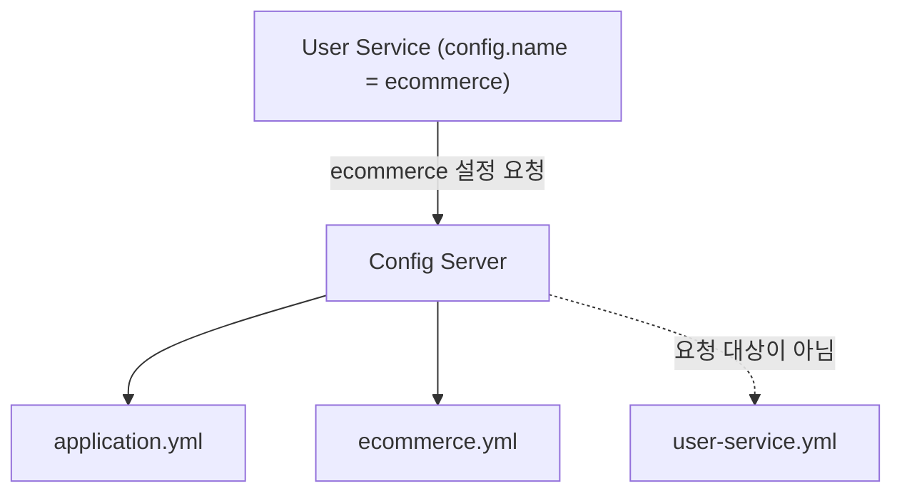
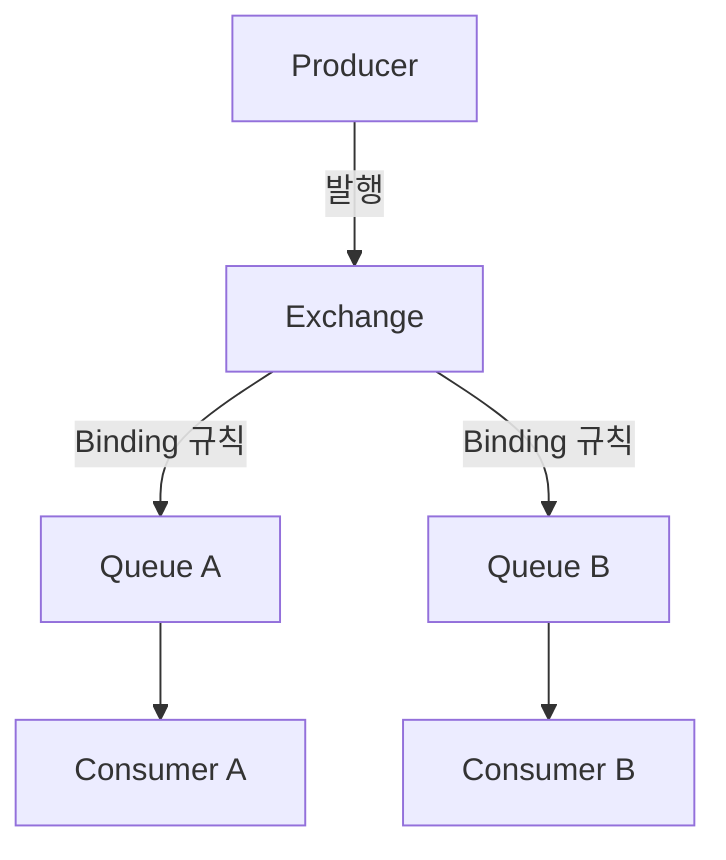
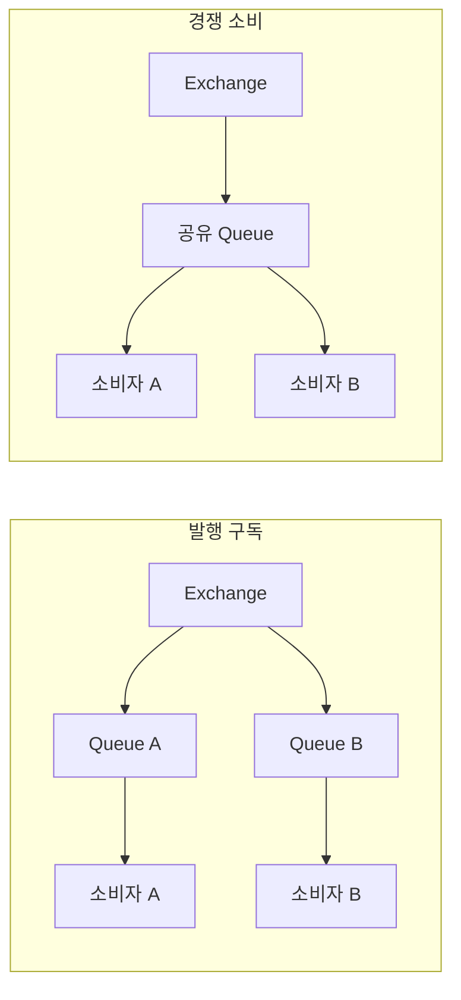
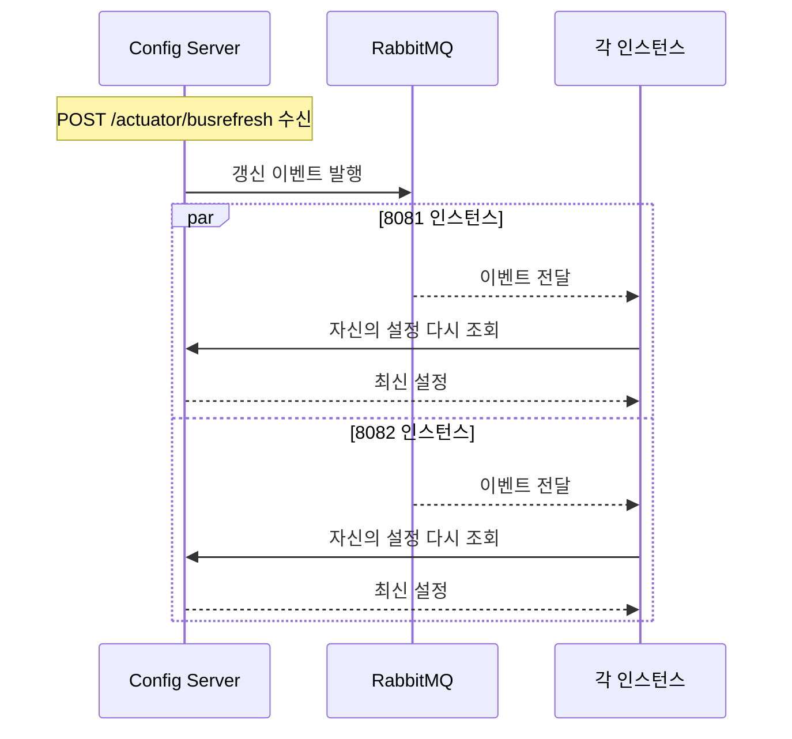

오늘은 여러 서비스가 함께 쓰는 설정을 Spring Cloud Config로 한곳에 모으고, 실행 중인 서비스가 바뀐 설정을 다시 읽게 하는 방법을 Actuator refresh에서 Spring Cloud Bus까지 넓혀 학습했다. Bus가 갱신 알림을 전달할 때 쓰는 RabbitMQ와 AMQP, Erlang의 관계를 정리했고, 설정 저장소에 들어가는 비밀값을 대칭키와 RSA 키로 암호화하는 과정까지 이어서 살펴봤다.

마지막으로 갱신과 암호화가 실제 인증에 닿는 지점인 JWT 비밀키 변경을 다뤘다. 키를 바꾸면 왜 기존 토큰이 401이 되는지, 그리고 중앙 설정을 운영할 때 무엇을 함께 지켜야 하는지 정리했다.

> 설정을 한곳에 보관하는 일, 바뀐 설정을 실행 중인 서비스에 알리는 일, 비밀값을 보호하는 일은 서로 다른 문제이며 Config Server, Spring Cloud Bus, 설정 암호화가 각각 하나씩 맡는다.

## 🎯 오늘의 학습 목표

- Config Server가 설정 이름·Profile·Label과 우선순위로 값을 고르는 규칙을 설명할 수 있다.
- 저장소 원본, `Environment`, Bean 필드의 차이를 근거로 refresh와 busrefresh의 적용 범위를 구분할 수 있다.
- RabbitMQ의 Exchange·Queue·Binding 구조와 Bus의 갱신 이벤트 전파 흐름을 연결해 설명할 수 있다.
- 암호화·해싱·인코딩·서명을 구분하고, `{cipher}` 값의 저장·복호화 흐름과 JWT 키 변경 후 401이 나는 이유를 설명할 수 있다.

## 📌 오늘의 핵심 요약

| 주제 | 핵심 내용 |
| --- | --- |
| 설정 외부화 | 코드와 설정을 분리하면 같은 실행 파일을 여러 환경에서 재사용하지만, 보관·갱신·보호라는 세 문제가 남는다. |
| Config Server | 저장소의 설정을 설정 이름·Profile·Label로 찾고 우선순위에 따라 합쳐 Client에 제공한다. |
| 설정 반영 | 원본이 바뀌어도 실행 중인 서비스는 refresh 같은 계기와 갱신 가능한 Bean이 있어야 새 값을 쓴다. |
| 메시지 브로커 | RabbitMQ는 Exchange·Queue·Binding으로 메시지를 분류·보관·전달하는 AMQP 브로커 제품이다. |
| Spring Cloud Bus | busrefresh는 "다시 읽으라"는 이벤트를 퍼뜨리고, 각 인스턴스가 Config Server에서 설정을 다시 가져온다. |
| 설정 암호화 | 저장소에는 `{cipher}` 암호문을 두고, Config Server가 대칭키나 RSA 개인키로 복호화해 제공한다. |
| JWT 키와 운영 | 검증 키가 바뀌면 이전 키로 서명한 토큰은 401이 될 수 있으므로 키의 역할과 교체 순서를 구분한다. |

## 🔄 오늘 학습 흐름

```text
설정을 코드 밖으로 꺼내 여러 서비스가 공유한다
    ↓ 공유할 설정을 한곳에 보관하고 찾아 줄 서버가 필요하다
Config Server가 설정 이름·Profile·Label로 설정을 제공한다
    ↓ 원본을 바꿔도 실행 중인 서비스는 이미 읽은 값을 쓴다
Actuator refresh로 한 인스턴스의 설정을 다시 읽는다
    ↓ 인스턴스가 많으면 알림을 대신 나눠 줄 통로가 필요하다
RabbitMQ가 메시지를 분류해 각 수신자에게 전달한다
    ↓ 브로커 위에서 갱신 이벤트를 한 번에 퍼뜨린다
Spring Cloud Bus의 busrefresh로 여러 인스턴스를 갱신한다
    ↓ 함께 공유하는 설정 안의 비밀값은 그대로 두면 노출된다
암호화 개념을 구분하고 Config Server로 비밀값을 보호한다
    ↓ 갱신되는 비밀값이 인증 동작에 직접 영향을 준다
JWT 비밀키 변경과 운영 기준을 정리한다
```

**본문 찾아보기**

1. [설정을 코드 밖에서 관리하는 이유와 기본 용어](#1-설정을-코드-밖에서-관리하는-이유와-기본-용어)
2. [Config Server로 설정을 한곳에서 제공하기](#2-config-server로-설정을-한곳에서-제공하기)
3. [실행 중인 서비스에 새 설정 반영하기](#3-실행-중인-서비스에-새-설정-반영하기)
4. [메시지 브로커와 RabbitMQ의 동작 원리](#4-메시지-브로커와-rabbitmq의-동작-원리)
5. [Spring Cloud Bus로 여러 인스턴스 한 번에 갱신하기](#5-spring-cloud-bus로-여러-인스턴스-한-번에-갱신하기)
6. [암호화 개념과 Config Server의 비밀값 보호](#6-암호화-개념과-config-server의-비밀값-보호)
7. [JWT 비밀키 변경과 운영에서 지킬 기준](#7-jwt-비밀키-변경과-운영에서-지킬-기준)

## 📚 학습 내용

### 1. 설정을 코드 밖에서 관리하는 이유와 기본 용어

쇼핑몰에 회원·주문·상품 서비스가 있고, 각 서비스가 자신의 `application.yml`에 DB 주소, 토큰 설정, 외부 API 주소를 직접 적어 두었다고 하자. 서비스가 하나일 때는 문제가 없지만, 서비스와 실행 인스턴스가 늘어나면 같은 값을 여러 곳에서 고치고, 고친 값을 실행 중인 프로그램에 반영하고, 비밀값을 지키는 일이 모두 어려워진다.

이 장에서는 그 문제를 정확히 나누고, 이후 모든 장에서 반복해서 쓰는 설정·인스턴스·YAML·환경변수 용어를 먼저 정리한다.

#### 1.1 코드는 동작 규칙이고 설정은 실행 조건이다

**코드(Code)**는 무엇을 어떻게 처리할지 정한 프로그램의 동작 규칙이다. **설정(Configuration)**은 같은 코드가 어떤 조건으로 실행될지 정하는 값이다.

| 구분 | 정의 | 예시 |
| --- | --- | --- |
| 코드 | 무엇을 어떻게 처리할지 정한 동작 규칙 | 주문 금액을 합산하고 결제를 요청하는 로직 |
| 설정 | 같은 코드가 실행될 조건을 정하는 값 | DB 주소, 제한 시간, 로그 수준, 외부 API 주소 |

설정을 프로그램 안에 고정하지 않고 외부 파일, 환경변수, 설정 서버 등에서 가져오는 방식을 **외부화된 설정(Externalized Configuration)**이라고 한다. 이렇게 하면 같은 실행 파일을 개발·검증·운영 환경에서 그대로 재사용하고, 환경마다 다른 DB 주소는 설정만 바꿔 맞출 수 있다.

Config Server는 이미 만들어진 코드가 사용하는 값을 관리한다. 새 API나 새 Java 메서드를 배포하는 도구가 아니므로, 코드 변경은 여전히 빌드와 배포를 거쳐야 한다.

#### 1.2 서비스가 늘어날 때 생기는 세 가지 문제

| 문제 | 구체적인 상황 | 맡는 도구 |
| --- | --- | --- |
| 같은 설정을 여러 곳에서 수정 | 회원 서비스 5개와 Gateway 2개가 같은 토큰 검증 설정을 쓰면 수정할 대상도 함께 늘어난다. | Config Server |
| 수정한 값이 바로 반영되지 않음 | 파일이 바뀌어도 실행 중인 프로그램은 이미 읽어 둔 값을 계속 쓴다. | Actuator refresh, Spring Cloud Bus |
| 비밀값이 저장소에 남음 | 설정을 공유하려다 DB 비밀번호와 비밀키까지 평문으로 노출할 수 있다. | 설정 암호화 |

설정의 보관, 설정의 갱신, 비밀값의 보호는 서로 다른 역할이다. 그래서 Config Server 하나만 띄운다고 세 문제가 함께 해결되지는 않는다.

여러 지점이 있는 식당이 조리 지침을 바꾸는 상황에 비유하면 각 구성 요소의 역할이 선명해진다.

**식당 비유로 보는 구성 요소**

| 구성 요소 | 식당에 비유하면 |
| --- | --- |
| 설정 저장소 | 본사의 조리 지침 원본 |
| Config Server | 원본을 찾아 각 지점에 전달하는 담당자 |
| 각 서비스 | 지침을 받아 일하는 지점 |
| Actuator refresh | 특정 지점에 최신 지침을 다시 받으라는 요청 |
| Spring Cloud Bus | 여러 지점에 재확인 알림을 한 번에 보내는 체계 |
| RabbitMQ | 알림을 실어 나르는 통신 시설 |
| 암호화 키 | 비밀 지침을 읽을 수 있게 하는 열쇠 |

본사가 지침 원본을 고쳤다는 사실과 모든 지점이 새 지침대로 일하고 있다는 사실은 다르다. 이 차이가 오늘 학습 전체의 출발점이다.

#### 1.3 서비스와 인스턴스를 구분해야 갱신 범위가 보인다

| 용어 | 뜻 |
| --- | --- |
| 애플리케이션(Application) | 실행할 수 있는 하나의 프로그램 |
| 서비스(Service) | 회원·주문처럼 특정 기능을 담당하는 프로그램 또는 기능 단위 |
| 인스턴스(Instance) | 같은 프로그램을 실제로 실행한 하나의 복사본 |
| 프로세스(Process) | 운영체제가 관리하는 실행 중인 프로그램 단위 |
| 노드(Node) | 분산 시스템에 참여하는 구성 요소를 가리키는 넓은 표현으로, 문맥에 따라 서버·프로세스·인스턴스를 뜻한다. |

회원 서비스 코드를 세 번 실행하면 서비스는 하나지만 인스턴스는 세 개가 된다. 일반적인 Spring Boot 애플리케이션은 인스턴스마다 별도의 JVM 프로세스로 실행되므로, 각 인스턴스는 자기만의 메모리와 설정 값을 가진다.

예를 들어 User Service가 `8081`과 `8082`에서 실행 중이라면 서비스 종류는 하나, 인스턴스는 두 개다. 그래서 8081의 설정을 갱신했다고 8082까지 함께 갱신되지는 않는다.

#### 1.4 함께 등장하는 서버들은 서로 다른 질문에 답한다

오늘 내용에는 여러 서버가 함께 등장한다. 모두 '중앙'에 있는 것처럼 느껴져도 각자 답하는 질문이 다르다.

| 구성 요소 | 답하는 질문 |
| --- | --- |
| Config Server | 이 서비스가 사용할 설정은 무엇인가? |
| Eureka(Service Discovery) | 지금 실행 중인 서비스는 어디에 있는가? |
| API Gateway | 외부 요청을 어느 서비스로 보내야 하는가? |
| RabbitMQ | 발행된 메시지를 어떤 소비자에게 전달할 것인가? |
| Spring Cloud Bus | 설정 갱신 같은 관리 이벤트를 어떤 인스턴스들에 퍼뜨릴 것인가? |

API Gateway는 라우팅 외에도 인증 확인과 공통 필터를 수행할 수 있다. Spring Cloud Bus는 따로 띄우는 중앙 프로그램이 아니라 참여하는 각 애플리케이션에 들어가는 라이브러리이며, RabbitMQ나 Kafka 같은 브로커에 연결해 동작한다.

> [!WARNING]
> Eureka는 Config Server를 대신하지 않고, RabbitMQ는 설정 파일을 보관하지 않는다. Gateway를 거친다고 해서 대상 서비스의 설정이 자동으로 최신화되지도 않는다.

#### 1.5 YAML은 들여쓰기로 설정의 계층을 표현한다

YAML은 사람이 읽기 쉽게 key와 value를 적는 설정 형식이다. `application.yml`과 `application.yaml`은 확장자만 다를 뿐 둘 다 YAML 파일이다.

```yaml
server:
  port: 8081

token:
  expiration_time: 86400000
```

들여쓰기는 부모와 자식 관계를 나타내며, 위 YAML을 점으로 이어 읽으면 다음과 같다. 코드에서 설정을 찾을 때도 이 점 표기 이름을 쓴다.

```properties
server.port=8081
token.expiration_time=86400000
```

key는 값을 구분하는 이름, value는 실제로 사용할 내용이고, 이 둘의 쌍을 **프로퍼티(Property)**라고 부른다. 들여쓰기에는 탭을 쓰지 않고 공백을 쓰며, 이 노트의 예시는 단계마다 공백 두 칸을 사용한다.

**같은 최상위 키를 두 번 쓰는 실수**

```yaml
spring:
  application:
    name: user-service
spring:
  rabbitmq:
    host: 127.0.0.1
```

한 문서에 `spring`이 두 번 나오면 Spring Boot의 YAML 로더는 중복 키를 허용하지 않아 시작 단계에서 오류를 낼 수 있고, 다른 YAML 도구에서는 한쪽 값이 덮이기도 한다. 같은 부모 아래로 합쳐야 한다.

```yaml
spring:
  application:
    name: user-service
  rabbitmq:
    host: 127.0.0.1
```

뒤에서 Bus와 RabbitMQ 설정을 추가할 때 이 실수가 가장 흔하다. 새 설정을 붙여 넣을 때는 기존 `spring`, `management` 블록 안에 합친다.

**자주 쓰는 YAML 표기**

| 표기 | 의미 | 예시 |
| --- | --- | --- |
| `#` | 뒤쪽 내용을 주석으로 처리한다. | `# 로컬 실습용 설정` |
| `---` | 한 파일 안에서 문서를 구분한다. | 프로필별 문서 나누기 |
| `- 항목`, `[항목1, 항목2]` | 리스트를 표현한다. | `[health, info]` |
| 따옴표 | 특수 문자로 시작하는 값을 문자열로 고정한다. | `'{cipher}...'`, `'*'` |

YAML에서 `{`로 시작하는 값은 객체 표기의 시작으로, 단독으로 쓴 `*`는 별칭 표기로 해석될 수 있다. 그래서 `{cipher}`로 시작하는 암호문이나 모든 항목을 뜻하는 `*`는 반드시 따옴표로 감싼다.

#### 1.6 환경변수와 `${...}` 자리 표시로 값을 주입한다

**환경변수(Environment Variable)**는 실행 환경이 프로그램에 전달하는 이름과 값이다. `DB_PASSWORD`, `ENCRYPT_KEY`, `SPRING_PROFILES_ACTIVE` 같은 이름이 대표적이다.

```yaml
spring:
  datasource:
    password: ${DB_PASSWORD}
server:
  port: ${APP_PORT:8081}
```

| 표기 | 의미 |
| --- | --- |
| `${DB_PASSWORD}` | `DB_PASSWORD`라는 이름의 값을 찾아 넣는다. 기본값이 없다. |
| `${APP_PORT:8081}` | `APP_PORT`가 있으면 그 값을, 없으면 콜론 뒤의 `8081`을 쓴다. |

자리 표시가 값을 찾는 곳은 운영체제 환경변수 하나가 아니라 Spring의 `Environment`다. **`Environment`**는 YAML 파일, 시스템 프로퍼티, 명령행 인수, 환경변수, 원격 설정 같은 여러 설정 출처를 묶어 하나의 이름으로 값을 찾게 해 주는 객체이며, 3장에서 설정 갱신을 이해하는 핵심이 된다.

> [!WARNING]
> 비밀값에 편의용 기본값을 넣으면 값이 빠진 운영 환경에서도 그 기본값으로 실행될 수 있으므로 비밀키에는 기본값을 두지 않는다. 다만 값을 쓰는 방식에 따라 해석되지 못한 `${...}` 문자열이 그대로 들어가 DB 접속 단계에서야 실패할 수도 있으니, 필수값 검증도 함께 고려한다.

> 설정은 코드와 분리된 실행 조건이며, 원본 설정을 바꾸는 일과 실행 중인 각 인스턴스가 그 값을 쓰는 일은 별개의 사건이다.

### 2. Config Server로 설정을 한곳에서 제공하기

여러 서비스가 같은 설정을 각자 들고 있으면 값 하나를 바꿀 때마다 모든 프로젝트를 고쳐야 한다. **Config Server**는 설정 원본을 별도의 저장소에 두고, 서비스가 요청하면 알맞은 설정을 찾아 제공해 이 첫 번째 문제를 해결한다.

이 장은 설정 파일이 놓이는 위치에서 시작해 저장소 방식, 서버 실행, 조회 주소 읽기, Client 연결, 우선순위 순서로 진행한다. 예시는 Java 17 이상과 Spring Boot 3.x를 기준으로 하며, Config Server `8888`, User Service `8081`·`8082`, Gateway `8000`, RabbitMQ `5672`(통신)·`15672`(관리 화면) 포트를 약속으로 쓴다.

#### 2.1 설정 파일이 놓이는 세 위치

Config Server를 처음 구성할 때 가장 많이 헷갈리는 것은 "`ecommerce.yml`을 어디에 둬야 하는가"이다. 먼저 역할이 다른 세 위치를 구분한다.

| 위치 | 역할 |
| --- | --- |
| Config Server 프로젝트 | 서버 자신의 포트와 설정 저장소 위치를 정한다. |
| 설정 저장소 | User Service와 Gateway에 제공할 설정값을 보관한다. |
| User Service 프로젝트 | 서비스 이름과 Config Server 접속 방법 같은 초기 정보를 둔다. |

```text
Config Server 프로젝트
  src/main/resources/application.yml

설정 저장소 디렉터리
  application.yml
  ecommerce.yml
  ecommerce-dev.yml
  ecommerce-prod.yml
  user-service.yml

User Service 프로젝트
  src/main/resources/application.yml
```

위 목록은 각 위치에 어떤 종류의 파일이 들어가는지 보여주는 예시이며, 모든 파일이 반드시 필요한 것은 아니다. 핵심은 `ecommerce.yml`이 **Config Server가 바라보는 설정 저장소** 안에 있어야 한다는 점이다. Git 방식이면 `git.uri`가 가리키는 저장소(하위 폴더를 쓰면 `search-paths` 아래)에, Native 방식이면 `native.search-locations`가 가리키는 위치에 둔다.

> [!WARNING]
> 이름이 같은 `application.yml`이라도 Config Server 프로젝트의 파일은 서버 자신의 실행 설정이고, 설정 저장소의 파일은 모든 Client에 제공할 공통 설정이다. User Service 폴더에 `ecommerce.yml`을 복사해 두는 것도 Config Server의 기본 동작 방식이 아니다.

Config Server 프로젝트 폴더를 옮겨도 저장소 경로는 바뀌지 않는다. 저장소 `uri`가 절대 경로라면 여전히 이전 폴더를 가리키고 있지 않은지 확인해야 한다.

| 접두사 | 가리키는 곳 | 파일을 바꾸려면 |
| --- | --- | --- |
| `classpath:` | Java가 클래스와 리소스 파일을 찾는 경로 목록(빌드한 실행 파일인 JAR 내부 포함) | `src/main/resources`에 넣어 JAR에 포함했다면 보통 다시 패키징해야 한다. |
| `file:` | 파일 시스템의 실제 파일이나 디렉터리 | 해당 파일을 직접 수정한다. |

#### 2.2 설정 저장소 방식: Local Git·Remote Git·Native

Config Server는 여러 종류의 저장소에서 설정을 읽을 수 있다. 오늘은 내 컴퓨터의 Git 저장소, 원격 Git 저장소, Git 없는 파일 디렉터리 세 가지를 비교했다.

| 방식 | 설정을 읽는 곳 | 변경을 확정하는 방법 | 특징 |
| --- | --- | --- | --- |
| Local Git | 내 컴퓨터의 Git 저장소 | 파일 수정 후 `commit` | 외부 서버 없이 이력 관리까지 실습할 수 있다. |
| Remote Git | GitHub 같은 원격 Git 저장소 | `commit` 후 서버가 보는 브랜치로 `push` | 비공개 저장소는 토큰이나 SSH 키 인증이 필요하다. |
| Native | 파일 시스템이나 클래스패스 디렉터리 | 파일 저장 | Git 커밋 이력이 자동으로 생기지 않는다. |

**Local Git 저장소 만들기**

macOS·Linux·WSL에서는 다음처럼 저장소를 만든다. Windows에서는 예를 들어 `C:/Work/git-config-repo` 폴더를 만들고, Git이 설치된 터미널에서 그 폴더로 이동해 `git init -b main`을 실행한다.

```bash
mkdir -p "$HOME/Desktop/Work/git-config-repo"
cd "$HOME/Desktop/Work/git-config-repo"
git init -b main
```

그 폴더에 Client에게 제공할 첫 설정 파일을 만든다. `demo.message`와 `demo.config-version`은 갱신 여부를 눈으로 확인하기 위한 실습용 값이다.

```yaml title="ecommerce.yml"
demo:
  message: "Config Server에서 받은 첫 번째 메시지"
  config-version: "v1"
token:
  expiration_time: 86400000
```

```bash
git add ecommerce.yml
git commit -m "Add ecommerce configuration"
```

`git add`는 변경 내용을 커밋 후보로 올리고, `git commit`은 그 변경을 저장소의 이력으로 확정한다. commit은 원격 서버로 보내는 작업이 아니며, 원격 전송은 `git push`가 맡는다.

실습은 커밋한 상태를 기준으로 검증한다. 구현이나 작업 트리(커밋하기 전 폴더의 실제 파일 상태)에 따라 커밋하지 않은 변경이 보이는 경우가 있더라도, 그 동작에 기대어 설정을 관리하지 않는다.

**Remote Git 저장소 연결하기**

다음은 Config Server의 `application.yml`에서 원격 저장소를 지정하는 형식이다. `example.com` 주소는 형식 설명용이므로 실제 저장소 주소로 바꾼다.

```yaml title="application.yml"
spring:
  cloud:
    config:
      server:
        git:
          uri: https://example.com/team/config-repo.git
          default-label: main
          username: ${CONFIG_GIT_USERNAME}
          password: ${CONFIG_GIT_TOKEN}
```

공개 저장소라면 인증 항목이 필요 없을 수 있고, 비공개 저장소는 토큰이나 SSH 키처럼 저장소가 지원하는 인증이 필요하다. 원격 방식에서는 내 컴퓨터에서 commit만 한 값은 아직 원격 저장소의 값이 아니므로, Config Server가 보는 브랜치로 push했는지 확인한다.

Git 방식의 Config Server는 원격 저장소를 로컬에 복제해 두고 요청에 따라 갱신하며, `spring.cloud.config.server.git.refresh-rate`로 그 갱신 빈도를 조절한다. 이 값은 **Config Server가 저장소를 다시 확인하는 주기**일 뿐, Client가 알아서 자신의 설정을 바꾸게 만드는 기능이 아니다. 설정 파일이 저장소의 `config/` 폴더에 있다면 `search-paths: config`로 검색 경로를 지정한다.

**Native 방식으로 파일 디렉터리 읽기**

```yaml title="application.yml"
spring:
  profiles:
    active: native
  cloud:
    config:
      server:
        native:
          search-locations: file://${user.home}/Desktop/Work/native-config-repo/
```

Windows에서는 `search-locations: file:///C:/Work/native-config-repo/`처럼 지정한다. 이 디렉터리에 `ecommerce.yml` 등을 넣으면 되고, 파일을 수정할 때 `git commit`이나 `git push`가 필요 없다. 다만 실행 중인 Client의 값을 갱신하는 문제는 그대로 남는다.

여기서 Config Server의 `native` 프로필은 "Git 대신 파일 저장소를 쓴다"는 서버 쪽 선택이다. User Service까지 `native` 프로필을 써야 한다는 뜻이 아니며, Native 저장소에서도 `/ecommerce/dev`처럼 dev 설정을 요청할 수 있다. Git 방식과 Native 방식은 실습 단계에 맞춰 하나만 선택하고, Native 실습에 Git 커밋 절차를 필수 조건으로 붙이지 않는다.

#### 2.3 Config Server를 띄우고 첫 조회하기

Spring Boot는 자동 설정과 Starter로 Spring 애플리케이션을 쉽게 구성·실행하게 돕고, Spring Cloud는 설정 관리·서비스 발견·Gateway·분산 이벤트처럼 여러 애플리케이션이 함께 동작할 때 생기는 공통 문제를 돕는다.

**Starter**는 특정 기능에 필요한 의존성과 자동 설정을 묶은 패키지이고, **BOM**은 함께 쓸 라이브러리 버전을 맞춰 주는 버전 목록이다. Spring Cloud는 여러 라이브러리가 협력하므로, 개별 Starter를 임의의 최신 버전으로 섞지 말고 Spring Boot와 호환되는 Spring Cloud 조합을 의존성 관리에서 맞춘다.

여기서 의존성(Dependency)은 프로젝트가 가져다 쓰는 외부 라이브러리를 뜻하며, 3장의 의존성 주입과는 다른 말이다. 기존 Spring Boot 프로젝트의 `dependencies` 안에 다음 의존성을 추가한다. 이 조각만으로 완전한 `pom.xml`이 되지는 않는다.

```xml title="pom.xml"
<dependency>
    <groupId>org.springframework.cloud</groupId>
    <artifactId>spring-cloud-config-server</artifactId>
</dependency>
```

시작 클래스에는 Config Server 기능을 켜는 애너테이션을 붙인다.

```java title="ConfigServiceApplication.java" {6}
import org.springframework.boot.SpringApplication;
import org.springframework.boot.autoconfigure.SpringBootApplication;
import org.springframework.cloud.config.server.EnableConfigServer;

@SpringBootApplication
@EnableConfigServer
public class ConfigServiceApplication {
    public static void main(String[] args) {
        SpringApplication.run(ConfigServiceApplication.class, args);
    }
}
```

강조한 6번째 줄의 `@EnableConfigServer`가 이 애플리케이션을 설정을 제공하는 서버로 활성화한다. Config Client 프로젝트에 붙이는 애너테이션이 아니다.

다음은 Local Git 저장소를 읽는 Config Server 자신의 `application.yml`이다.

```yaml title="application.yml" {12-13}
server:
  port: 8888
  address: 127.0.0.1

spring:
  application:
    name: config-service
  cloud:
    config:
      server:
        git:
          uri: file://${user.home}/Desktop/Work/git-config-repo
          default-label: main
```

강조한 두 줄이 저장소 위치와 기본으로 읽을 브랜치를 정한다. `${user.home}`은 Java가 인식하는 사용자 홈 디렉터리로 macOS에서는 `/Users/taein` 같은 경로로 바뀌며, Windows는 `uri: file:///C:/Work/git-config-repo`처럼 실제 경로를 직접 쓰는 편이 이해하기 쉽다.

`server.address: 127.0.0.1`은 서버가 요청을 기다릴 주소를 같은 컴퓨터로 묶는(바인딩하는) 실습 설정이다. 다른 컴퓨터나 컨테이너의 서비스가 접근해야 한다면 도달 가능한 주소로 바인딩하고, 인증과 접근 제한도 함께 구성한다.

서버를 실행하면 Client를 만들기 전에 설정 조회부터 확인한다.

```bash
curl http://127.0.0.1:8888/ecommerce/default/main
```

응답의 `propertySources` 안에 `demo.message`가 보이면 저장소 조회에 성공한 것이다. 이 단계에서는 User Service가 실행 중일 필요가 없으며, 여기서 값이 보이지 않는다면 User Service의 코드를 고치기 전에 저장소 경로·브랜치·파일 이름부터 점검한다.

서버가 정상적으로 시작됐더라도 저장소 경로, 브랜치, Git 인증 오류는 첫 조회 요청에서 드러날 수 있다. 또 Config Server 자신의 `spring.application.name`인 `config-service`는 저장소에서 찾을 설정 이름이 아니므로 둘을 혼동하지 않는다.

#### 2.4 조회 주소를 설정 이름·Profile·Label로 읽기

주소를 읽을 때는 각 부분이 어디에 연결하는지를 먼저 나눈다.

| URL 요소 | 예시 | 나타내는 것 |
| --- | --- | --- |
| 통신 방식 | `http` | 어떤 규약으로 통신하는가 |
| 주소 | `127.0.0.1` | 어느 컴퓨터에 연결하는가(요청을 보내는 환경 자신) |
| 포트 | `8888` | 그 컴퓨터의 어느 프로그램에 연결하는가 |
| 경로 | `/ecommerce/dev/main` | 그 프로그램의 어느 기능을 호출하는가 |

Config Server는 경로를 다음 형식으로 해석한다.

```text
GET /{application}/{profile}
GET /{application}/{profile}/{label}
```

**경로 `/ecommerce/dev/main` 나누어 읽기**

| 경로 요소 | 예시 값 | 묻는 질문 |
| --- | --- | --- |
| `{application}` | `ecommerce` | 어떤 이름의 설정인가? |
| `{profile}` | `dev` | 어느 환경의 설정인가? |
| `{label}` | `main` | 어느 버전의 설정인가? |

여기서 `application`은 요청할 **설정 이름**이다. DB 이름, 폴더 이름, Eureka에 등록된 서비스 주소를 뜻하지 않는다.

**Profile은 실행 환경에 따른 설정 선택이다**

**Profile(프로필)**은 개발·검증·운영처럼 실행 조건에 따라 사용할 설정을 고르는 이름표다.

| Profile | 의미 |
| --- | --- |
| `dev` | 개발 환경 |
| `uat` | 사용자 인수 테스트(User Acceptance Testing) 환경으로, 회사에 따라 `test`, `staging`이라고도 부른다. |
| `prod` | 실제 운영 환경 |
| `default` | 프로필을 지정하지 않았을 때 쓰는 기본 프로필 |

`default`는 "설정이 없다"는 뜻이 아니라 기본 프로필로 조회한다는 뜻이다. 파일 이름에서는 `ecommerce-dev.yml`처럼 설정 이름 뒤에 프로필을 붙여 dev 전용 설정을 표현한다.

Client는 `spring.profiles.active: dev`로 프로필을 활성화하거나, 실행할 때 `java -jar user-service.jar --spring.profiles.active=dev`처럼 명령행으로 고를 수 있다. 운영에서는 환경변수나 배포 설정으로 정할 수도 있으며, 프로필 이름 자체에 환경을 격리하는 기능이 들어 있지는 않다.

프로필 선택은 재시작을 기준으로 확인한다. 프로필은 단순한 값뿐 아니라 Bean 생성 조건에도 관여할 수 있으므로, 실행 중에 프로필만 바꿔 전체 Bean 구성이 자동으로 전환된다고 가정하지 않는다.

**Label은 어느 버전의 설정을 읽을지 정한다**

Git 기반 Config Server에서 **Label**은 브랜치, 태그, 커밋 ID 같은 버전 식별자다. 위 경로는 "main 버전에서 ecommerce의 dev 설정을 찾아 달라"는 요청이 된다.

`main`과 `master`는 저장소의 브랜치 이름일 뿐이므로 자신의 저장소에 맞춘다. 버전마다 다른 기본 브랜치를 추측하지 말고 Client의 `spring.cloud.config.label`이나 서버의 `default-label`로 명시하는 편이 안전하다. Native 저장소에서도 Label을 경로 구분에 활용할 수 있지만, Git 커밋 이력이 자동으로 생기지는 않는다.

**응답 JSON에서 보는 항목**

| 필드 | 의미 |
| --- | --- |
| `name` | 요청한 설정 이름 |
| `profiles` | 요청에 적용된 프로필 |
| `label` | 요청한 버전 식별자 |
| `version` | Git 기준 버전 정보로, 보통 커밋 ID다. Git 방식이 아니면 `null`일 수 있다. |
| `propertySources` | 설정 출처(`name`)와 그 출처의 값(`source`) 목록 |

다음은 `ecommerce`의 dev 설정을 요청했을 때의 응답 구조를 보여주는 설명용 예시다. 실제 `name` 표기는 저장소 방식과 버전에 따라 다르다.

```json
{
  "name": "ecommerce",
  "profiles": ["dev"],
  "label": "main",
  "version": "커밋_ID",
  "propertySources": [
    { "name": "<저장소 위치>/ecommerce-dev.yml",
      "source": { "demo.message": "쇼핑몰 개발값" } },
    { "name": "<저장소 위치>/ecommerce.yml",
      "source": { "demo.message": "쇼핑몰 기본값" } }
  ]
}
```

`propertySources`의 `name`은 "어디서 가져온 설정인가"를, `source` 안의 `demo.message` 같은 키는 실제 설정 항목을 나타낸다. 목록에서 **앞에 있는 출처**일수록 우선순위가 높다.

`/ecommerce/dev`는 `ecommerce-dev.yml` 하나만 돌려주는 주소가 아니라 적용 가능한 기본 설정과 프로필 설정을 함께 돌려준다. YAML이나 properties 형식으로 돌려주는 조회 경로도 있지만, 처음 디버깅할 때는 출처가 보이는 JSON 경로가 이해하기 쉽다.

Config Server는 찾는 설정이 없어도 `propertySources`가 빈 응답을 `200 OK`로 돌려줄 수 있다. 상태 코드만 보고 필요한 값이 존재한다고 판단하지 말고, 원하는 키가 실제로 들어 있는지 확인한다.

파일을 고쳤는데 Config Server도 예전 값을 준다면 응답의 `propertySources` 경로와 `version`부터 본다. 다른 저장소나 다른 Label을 보고 있지 않은지, 원격 push가 빠지지 않았는지, 저장소 갱신 주기와 더 우선하는 프로필 값이 있는지를 차례로 확인한다.

#### 2.5 Config Client를 Config Data 방식으로 연결하기

Config Server가 설정을 제공할 준비가 되었으면 User Service를 **Config Client**로 만든다. Config Client는 시작할 때 Config Server에서 설정을 가져와 자신의 `Environment`에 추가하는 애플리케이션이다.

```xml title="pom.xml"
<dependency>
    <groupId>org.springframework.cloud</groupId>
    <artifactId>spring-cloud-starter-config</artifactId>
</dependency>
```

Spring Boot 2.4 이후의 기본 방식인 Config Data 방식에서는 `application.yml`의 `spring.config.import`에 접속 정보를 적는다.

```yaml title="application.yml" {9,12-13}
server:
  port: 8081
  address: 127.0.0.1

spring:
  application:
    name: user-service
  config:
    import: "configserver:http://127.0.0.1:8888"
  cloud:
    config:
      name: ecommerce
      label: main
```

9번째 줄은 시작할 때 접속할 Config Server를, 12~13번째 줄은 요청할 설정 이름과 버전을 정한다. 이 방식에서는 별도의 `bootstrap.yml`이 필요 없으며, Native 실습이라면 `label: main`을 생략하고 시작하는 편이 간단하다.

Config Client 의존성만 추가하고 접속 정보를 적지 않으면 "No spring.config.import property has been defined" 같은 시작 오류가 날 수 있다. 이때 오류를 숨기는 옵션부터 추가하지 말고, Config Data 방식이면 `spring.config.import`를, Legacy 방식이면 bootstrap 활성화와 `uri`를 확인한다.

Config Data 방식은 기본 프로필 조회 뒤 활성 프로필 조회처럼 여러 단계로 설정을 읽으므로, 시작할 때 Config Server 요청이 여러 번 보일 수 있다. 요청이 두 번 보인다는 이유만으로 실행 인스턴스가 두 개라고 판단하지 않는다.

**`optional:` 접두사가 허용하는 실패**

| 표기 | 원격 설정을 가져오지 못하면 |
| --- | --- |
| `configserver:` | 필수 설정으로 취급해 시작을 중단한다. |
| `optional:configserver:` | 그 import 실패만으로는 시작을 중단하지 않는다. |

`optional:`이 모든 시작 오류를 무시하는 옵션은 아니다. 필수 설정이 빠져 `${demo.message}` 같은 자리 표시를 해석하지 못하거나 DB 연결 같은 다음 단계에서 실패하면, 애플리케이션은 여전히 시작하지 못한다.

운영에서 반드시 받아야 하는 설정이라면 `optional:`을 빼서 실패를 빨리 드러내는 편이 적절할 수 있다. `spring.cloud.config.fail-fast=true`를 지정해도 Config Server 접속 실패를 시작 실패로 드러낼 수 있으며, 이 경우 `optional:`이 붙어 있어도 시작이 중단될 수 있다. 또 `import`에 적은 주소가 실제 접속 위치를 결정하므로, 다른 곳에 `spring.cloud.config.uri`를 써 두고 접속 위치가 바뀌었다고 생각하면 안 된다. Client가 연결 거부를 받으면 Config Server가 실행 중인지, `import` 주소가 이전 포트를 가리키지 않는지, 컨테이너 안의 `localhost`를 호스트로 착각하지 않았는지, `server.address` 바인딩 제한이 없는지를 확인한다.

Config Server 주소나 그 서버에 접속하는 비밀번호를 원격 설정 안에만 두면, 처음 접속할 정보가 없어 설정을 가져올 수 없다. 첫 조회에 필요한 정보와 `spring.main.*`처럼 초기화에 이미 필요한 설정은 로컬 설정이나 실행 환경으로 미리 제공한다.

#### 2.6 실행 이름과 요청할 설정 이름은 다를 수 있다

| 설정 키 | 의미 | 주로 쓰이는 곳 |
| --- | --- | --- |
| `spring.application.name` | 실행 애플리케이션의 이름 | Eureka 등록, 로그 구분, Bus 인스턴스 식별 |
| `spring.cloud.config.name` | Config Server에 요청할 설정 이름 | 지정하지 않으면 보통 `spring.application.name`을 기준으로 요청한다. |

앞의 User Service는 애플리케이션 이름이 `user-service`지만 `spring.cloud.config.name`을 `ecommerce`로 지정했다. 그래서 원격 설정은 `ecommerce` 이름으로 찾으며, 기본 프로필에서는 `ecommerce.yml`과 공통 `application.yml`을 읽는다.



이 구성에서는 저장소에 `user-service.yml`을 추가해도 읽는 파일이 자동으로 바뀌지 않는다. 서비스 전용 파일을 쓰려면 Client가 `user-service` 설정을 요청하도록 설정 이름을 맞춰야 한다.

Gateway도 `config.name`을 `ecommerce`로 지정하면 같은 설정 묶음을 받는다. 공통 설정을 공유하기는 쉽지만, 서비스별 DB 비밀번호까지 한 파일에 모아 모든 서비스에 제공하는 구조는 신중히 설계해야 한다.

여러 설정 이름을 함께 요청하는 구성도 가능하다. 다만 공통 `application.yml`과 서비스별 파일을 쓰는 기본 구조를 먼저 이해한 뒤, 여러 이름을 쓸 때의 순서와 우선순위를 응답으로 확인하며 확장한다.

#### 2.7 같은 키가 여러 곳에 있을 때 선택되는 값

같은 키가 여러 출처에 있으면 우선순위가 높은 값 하나가 선택된다. 우선순위는 두 질문으로 나누어 생각한다.

1. Config Server가 저장소 안의 파일들을 어떤 순서로 합치는가?
2. Client가 그 원격 설정과 자신의 로컬 설정 중 무엇을 선택하는가?

**원격 파일끼리의 우선순위**

네 파일에 `demo.message`를 서로 다르게 적고 `ecommerce`의 dev 설정을 요청했다고 하자. 표는 위쪽일수록 우선순위가 높다.

| 파일 | `demo.message` 값 | 역할 |
| --- | --- | --- |
| `ecommerce-dev.yml` | 쇼핑몰 개발값 | `ecommerce` 이름의 dev 전용 설정 |
| `application-dev.yml` | 공통 개발값 | 모든 Client에 제공하는 dev 전용 공통 설정 |
| `ecommerce.yml` | 쇼핑몰 기본값 | `ecommerce` 이름의 기본 설정 |
| `application.yml` | 공통 기본값 | 모든 Client에 제공하는 공통 기본값 |

일반적인 구성에서는 "쇼핑몰 개발값"이 선택된다. 프로필 전용 파일에 없는 키는 다른 적용 가능한 출처에서 가져오므로, 전용 파일을 추가했다고 기본 파일 전체가 사라지지는 않는다.

헷갈리기 쉬운 곳은 두 번째와 세 번째 줄이다. Spring Boot 2.4 이후에는 프로필 전용 파일이 일반 파일보다 항상 우선하므로, 공통 파일이라도 프로필 전용인 `application-dev.yml`이 이름 전용 기본 파일인 `ecommerce.yml`보다 앞선다. 여러 이름이나 여러 프로필을 쓰면 순서가 더 복잡해지므로 실제 순서는 `propertySources`로 확인한다.

**로컬 설정과 원격 설정 사이의 우선순위**

Config Data 방식의 기본 원리는 `spring.config.import`로 가져온 값이 그것을 import한 문서의 값보다 우선한다는 것이다. 다만 프로필 전용 로컬 문서, import 위치, 여러 import, 환경변수와 명령행 인수도 결과에 영향을 준다.

일반적인 구성에서는 명령행 인수, 시스템 프로퍼티, 환경변수가 파일 기반 설정보다 우선할 수 있다. Legacy bootstrap 방식에는 원격 설정을 로컬에서 덮어쓸 수 있는지 정하는 `allowOverride`, `overrideNone`, `overrideSystemProperties` 같은 별도 규칙이 있으므로, 두 방식의 규칙을 하나의 고정 순서로 외우지 않는다.

**최종 값을 확인하는 순서**

1. 서로 다른 출처의 `demo.message`를 각각 다른 문장으로 설정한다.
2. Config Server 응답에서 원격 파일 사이의 선택 결과를 확인한다.
3. Client의 확인용 주소(3장의 `/config-check`)에서 최종 값을 확인한다.
4. 예상과 다르면 활성 프로필과 import가 들어 있는 문서를 확인한다.

**dev 프로필 선택을 확인하는 순서**

저장소에 dev 전용 파일을 추가하고 Git에 확정한다.

```yaml title="ecommerce-dev.yml"
demo:
  message: "dev 프로필에서 선택한 메시지"
  config-version: "dev-v1"
```

```bash
curl http://127.0.0.1:8888/ecommerce/default/main
curl http://127.0.0.1:8888/ecommerce/dev/main
```

두 응답의 `propertySources`를 비교하면 dev 요청에만 `ecommerce-dev.yml`이 앞에 붙는 것을 확인할 수 있다. 이어 User Service를 `--spring.profiles.active=dev`로 새로 시작해 `/config-check`가 dev 메시지를 쓰는지 확인한다.

파일이 읽혔다는 사실과 그 값이 최종 우선순위를 얻었다는 사실은 다르다. 예를 들어 dev 프로필로 실행 중일 때 `ecommerce.yml`의 `demo.message`만 고치면 `ecommerce-dev.yml`의 값이 더 우선하므로 화면에 변경이 보이지 않을 수 있는데, 이것은 갱신 실패가 아니라 정상적인 우선순위 선택이다.

#### 2.8 강의의 bootstrap.yml 방식과 구분하기

강의 코드는 본 애플리케이션 설정보다 먼저 bootstrap 단계에서 원격 설정을 가져오는 **Legacy Bootstrap** 방식을 사용한다. 강의 코드를 읽으려면 이 구조를 알아야 하지만, 최신 프로젝트에서는 따로 활성화해야 동작한다.

```yaml title="bootstrap.yml"
spring:
  application:
    name: user-service
  cloud:
    config:
      uri: http://127.0.0.1:8888
      name: ecommerce
```

bootstrap 단계를 켜려면 `spring-cloud-starter-bootstrap` 의존성을 추가하거나, 애플리케이션 시작 전에 시스템 프로퍼티나 환경변수로 활성화한다.

```bash
java -Dspring.cloud.bootstrap.enabled=true -jar user-service.jar
```

| 비교 항목 | Config Data 방식 | Legacy Bootstrap 방식 |
| --- | --- | --- |
| 접속 정보 위치 | `application.yml`의 `spring.config.import` | `bootstrap.yml`의 `spring.cloud.config.uri` |
| 추가 활성화 | 필요 없다. | 의존성 추가 또는 bootstrap 활성화 속성이 필요하다. |
| 원격 설정 실패 처리 | `optional:` 유무와 `spring.cloud.config.fail-fast` 설정이 함께 영향을 준다. | `spring.cloud.config.fail-fast` 설정 등으로 제어한다. |
| 로컬 덮어쓰기 규칙 | 가져온 값이 import한 문서보다 우선한다. | `allowOverride` 같은 별도 규칙을 따른다. |

> [!WARNING]
> 최신 프로젝트에 `bootstrap.yml` 파일만 만들어 두면 항상 읽힌다고 생각하면 안 된다. bootstrap 활성화 여부부터 확인하고, 활성화 옵션을 이미 늦게 읽히는 설정에만 넣지 않는다. 두 방식을 설명 없이 섞으면 중복 요청과 우선순위 해석이 어려워지므로 처음에는 한 방식만 선택한다.

> Config Server는 설정 이름·Profile·Label로 저장소의 파일을 찾아 우선순위대로 합쳐 준다. 파일이 읽혔는지와 그 값이 최종적으로 선택됐는지는 `propertySources`와 Client의 최종 값으로 따로 확인한다.

### 3. 실행 중인 서비스에 새 설정 반영하기

2장에서 Config Server가 새 값을 제공하게 만들었다. 그런데 저장소의 `demo.message`를 바꾸고 Config Server 조회에서 새 값이 보여도, 이미 실행 중인 User Service는 예전 값을 그대로 응답할 수 있다.

이 장은 설정이 서비스 안에서 어디에 머무르는지부터 정리하고, Java 코드가 설정을 읽는 방식에 따라 갱신 결과가 왜 달라지는지 비교한다. 이어 갱신을 요청하는 관리 창구인 Spring Boot Actuator와 refresh의 적용 범위를 다룬다.

#### 3.1 설정은 원본·Environment·객체의 세 상태로 존재한다

| 상태 | 위치 | 예시 |
| --- | --- | --- |
| 원본 값 | 설정 저장소 | `ecommerce.yml`에 적힌 `demo.message` |
| 읽어 온 값 | Client의 `Environment` | User Service가 시작할 때 가져온 값 |
| 적용된 값 | Bean의 필드와 연결 자원 | `@Value` 필드에 들어간 문자열, DB 연결 풀 |

원본 `demo.message`를 "첫 번째"에서 "두 번째"로 바꿨다고 하자. Config Server 조회에는 "두 번째"가 보이지만, User Service의 일반 `@Value` 필드에는 여전히 "첫 번째"가 들어 있을 수 있다. 저장소 조회는 성공했지만 실행 중인 애플리케이션의 적용은 아직 끝나지 않은 상태다.

설정 변경이 실제 기능까지 이어지는 순서는 다음과 같다.

```text
설정 저장소의 파일을 수정한다
    ↓ Git은 commit, 원격 Git은 push까지 해야 확정된다
Config Server가 새 버전의 값을 조회할 수 있게 된다
    ↓ 재시작이나 refresh 같은 계기가 있어야 Client가 다시 읽는다
Client의 Environment가 새 값을 가져온다
    ↓ 갱신 가능한 Bean과 설정 객체만 새 값을 받아들인다
Bean의 필드와 설정 객체가 새 값을 사용한다
    ↓ 마지막으로 실제 요청 결과를 확인한다
실제 기능이 새 값으로 동작한다
```

Native 방식에서는 첫 단계의 Git 작업을 생략한다. 핵심은 세 번째와 네 번째 단계가 Config Server가 있다는 이유만으로 저절로 일어나지 않는다는 점이다.

문제가 생겼을 때도 이 흐름을 앞에서부터 따라간다. 설정 원본, Config Server 응답, Client의 원격 설정 조회, 갱신 이벤트 처리, Bean과 연결 자원의 적용, 실제 업무 결과 중 어디서 멈췄는지 먼저 좁히고, 한 번에 여러 설정을 무작위로 바꾸지 않는다.

#### 3.2 Bean과 싱글톤이 예전 값을 계속 쓰는 이유

**Bean**은 Spring 컨테이너가 만들고 관리하는 객체다. Controller, Service, 설정 객체 등이 Bean이 될 수 있으며, 객체가 필요로 하는 다른 객체나 값을 Spring이 전달해 주는 방식을 **의존성 주입(Dependency Injection)**이라고 한다.

대부분의 일반 Bean은 애플리케이션이 실행되는 동안 하나를 만들어 계속 재사용하는 **싱글톤(Singleton)**이다. 여기서 싱글톤은 해당 Spring 컨테이너 안에서 공유된다는 뜻이며, 여러 서비스 인스턴스가 하나의 Java 객체를 공유한다는 뜻이 아니다.

싱글톤 Bean이 만들어질 때 필드에 복사해 둔 값은 나중에 원본이 바뀌어도 저절로 바뀌지 않는다. 본사 지침이 바뀌어도 이미 출력해 둔 지침서 사본의 글자가 바뀌지 않는 것과 같다.

#### 3.3 호출할 때 읽는 `Environment`와 생성할 때 넣는 `@Value`

다음은 실습 안내에 제시된 설명용 예제로, `Environment`에서 값을 읽는다. import 문은 생략했다.

```java title="EnvironmentCheckController.java" {11}
@RestController
public class EnvironmentCheckController {
    private final Environment environment;

    public EnvironmentCheckController(Environment environment) {
        this.environment = environment;
    }

    @GetMapping("/environment-check")
    public String check() {
        return environment.getProperty("demo.message", "기본 메시지");
    }
}
```

강조한 11번째 줄은 메서드가 호출될 때마다 `Environment`에 들어 있는 `demo.message`를 읽고, 값이 없으면 "기본 메시지"를 돌려준다. 이 코드는 요청마다 Config Server에 HTTP 요청을 보내지 않으므로, 로컬 `Environment`가 refresh 등으로 갱신되어야 새 값이 보인다.

`environment` 객체를 필드에 보관하는 것과 조회 결과를 필드에 복사해 두는 것은 다르다. 생성자에서 `String` 값으로 복사해 두면 그 뒤로는 복사본을 쓰게 된다. 또 `getProperty()`에는 실제 키 이름을 정확히 적어야 하며, 뒤에서 볼 `@ConfigurationProperties`의 유연한 이름 연결 규칙을 그대로 기대하지 않는다.

`@Value`는 설정값을 필드나 생성자 인수에 주입한다.

```java
@Value("${demo.message:기본 메시지}")
private String message;
```

콜론 뒤의 "기본 메시지"는 값이 없을 때 쓸 기본값이다. 일반 싱글톤 Bean의 필드에 주입한 문자열은 **Bean을 만들 때의 값**이므로, `Environment`가 새 값을 갖게 되어도 이 필드가 다시 주입되지는 않는다.

그래서 일반 Bean의 `@Value` 필드가 바뀌지 않는 현상은 Config Server 접속 실패만으로 설명할 수 없다. 값을 읽는 Bean이 어떤 방식으로 갱신되는지도 함께 봐야 한다.

#### 3.4 새 설정으로 Bean을 다시 준비하는 `@RefreshScope`

Bean을 언제 만들고 얼마나 공유할지 정하는 규칙을 scope라고 하며, 싱글톤이 기본 scope다. **RefreshScope**는 설정이 갱신된 뒤 대상 Bean을 새 설정으로 다시 만들 수 있게 하는 scope다. Spring은 실제 Bean 앞에 요청을 대신 받아 연결하는 중간 객체인 **프록시(Proxy)**를 두고, 그 뒤의 실제 Bean을 관리한다.

```text
처음 사용할 때 설정을 반영한 실제 Bean을 준비한다
    ↓ refresh나 busrefresh로 갱신이 실행된다
기존 대상 Bean의 캐시를 무효화한다
    ↓ 다음 요청이 프록시를 거쳐 들어온다
최신 설정으로 대상 Bean을 다시 만든다
```

다음은 실습 안내에 제시된, 갱신 여부를 확인하는 설명용 Controller다. import 문은 생략했으며, 길이를 고려해 클래스의 필드 부분과 조회 메서드 부분으로 나누어 보인다. 이 클래스는 User Service 시작 클래스가 컴포넌트 스캔할 수 있는 패키지에 두어야 등록된다.

**갱신 대상 클래스와 설정 필드**

```java title="ConfigCheckController.java" {1,6,9}
@RefreshScope
@RestController
public class ConfigCheckController {
    private final Environment environment;

    @Value("${demo.message:설정을 받지 못했습니다}")
    private String message;

    @Value("${demo.config-version:unknown}")
    private String configVersion;

    public ConfigCheckController(Environment environment) {
        this.environment = environment;
    }
```

**같은 클래스의 확인용 조회 메서드**

```java title="ConfigCheckController.java"
    @GetMapping("/config-check")
    public Map<String, String> check() {
        return Map.of(
            "application", environment.getProperty(
                "spring.application.name", "unknown"),
            "message", message,
            "configVersion", configVersion,
            "actualPort", environment.getProperty(
                "local.server.port", "unknown")
        );
    }
}
```

첫 블록 1번째 줄의 `@RefreshScope`가 이 Controller를 갱신 대상 범위에 넣는다. 그래서 refresh 뒤 다음 요청에서 Bean이 다시 만들어지고, 6번째와 9번째 줄의 `@Value` 필드에도 새 값이 주입된다.

`local.server.port`는 설정 파일에 적은 값이 아니라 실제로 실행 중인 포트다. 응답에는 갱신 여부를 확인할 메시지와 버전만 담고, `token.secret`이나 `spring.datasource.password` 같은 비밀값은 넣지 않는다.

User Service를 8081에서 시작하고 `GET http://127.0.0.1:8081/config-check`를 호출하면 다음과 같은 구조의 응답을 기대할 수 있다. JSON 키의 순서는 달라질 수 있다.

```json
{
  "application": "user-service",
  "message": "Config Server에서 받은 첫 번째 메시지",
  "configVersion": "v1",
  "actualPort": "8081"
}
```

여기의 `configVersion`은 실습 안내에서 정의한 사용자 정의 설정값이며, Config Server 응답의 `version`(Git 커밋 ID)과는 다른 항목이다.

> [!WARNING]
> `@RefreshScope`를 붙였다고 파일 변경 감지가 시작되지는 않으며, refresh나 busrefresh 같은 갱신 계기가 반드시 필요하다. 또 `@Configuration` 클래스에 붙였다고 그 안의 모든 `@Bean`이 자동으로 RefreshScope가 되는 것은 아니고, 다른 객체가 예전 값을 별도 필드에 복사해 두었다면 그 객체도 따로 검토해야 한다.

#### 3.5 관련 설정을 객체로 묶는 `@ConfigurationProperties`

설정이 많아지면 문자열 키를 코드 곳곳에 직접 적기보다, 관련 설정을 하나의 객체에 연결하는 편이 관리하기 쉽다. 설정값을 객체의 필드와 연결하는 작업을 **바인딩(Binding)**이라고 하며, 2.3의 네트워크 주소 바인딩이나 4장의 RabbitMQ Binding과는 다른 뜻이다.

```yaml
demo:
  message: "안녕하세요"
  timeout: 3s
```

다음은 `demo`로 시작하는 설정을 묶는 설명용 예제다. import 문은 생략했다.

```java title="DemoProperties.java" {2}
@Component
@ConfigurationProperties(prefix = "demo")
public class DemoProperties {
    private String message;
    private Duration timeout;

    public String getMessage() { return message; }
    public void setMessage(String message) { this.message = message; }
    public Duration getTimeout() { return timeout; }
    public void setTimeout(Duration timeout) { this.timeout = timeout; }
}
```

2번째 줄의 `prefix = "demo"`에 따라 `demo.message`는 `message` 필드에, `demo.timeout`의 `3s`는 `Duration` 타입의 `timeout` 필드에 연결된다. 이름을 유연하게 맞추는 **relaxed binding** 덕분에 `config-version` 같은 키도 `configVersion` 필드에 연결할 수 있으며, 새 설정 이름은 소문자와 하이픈 형식으로 일관되게 쓰면 읽기 쉽다.

Spring Cloud는 설정 변경을 처리할 때 이런 일반적인 변경 가능한 `@ConfigurationProperties` Bean을 다시 바인딩할 수 있다. 하지만 `record`나 생성자로 값을 받는 불변 객체가 같은 방식으로 갱신된다고 가정하지 않으며, 이 설정으로 이미 연결 풀 같은 자원을 만들었다면 설정 객체가 바뀌어도 그 자원은 자동으로 다시 구성되지 않는다.

**설정을 쓰는 방식별 refresh 이후 결과**

| 사용 방식 | refresh 이후 새 값을 쓰는 조건 |
| --- | --- |
| `Environment.getProperty()` 호출 | 로컬 `Environment`가 갱신되면 다음 호출부터 새 값을 읽는다. |
| 일반 Bean의 `@Value` 필드 | 자동으로 다시 주입되지 않는다. |
| `@RefreshScope` Bean의 `@Value` 필드 | 다음 사용 시 Bean이 새로 만들어질 때 새 값이 들어간다. |
| 변경 가능한 `@ConfigurationProperties` Bean | 환경 변경 처리에서 다시 바인딩될 때 새 값을 갖는다. |
| 설정값으로 이미 만든 연결 풀·스레드 풀 | 별도의 재구성이나 재시작이 필요하다. |

`Environment` 갱신, 필드 재주입, 설정 객체 재바인딩, 외부 연결 재생성은 모두 별도의 단계다. "설정을 갱신했다"는 말 하나로 이 단계들이 전부 보장되지는 않는다.

#### 3.6 Actuator는 실행 중인 애플리케이션의 관리 창구다

지금까지 본 갱신은 refresh 같은 계기가 있어야 시작된다. 그 계기를 HTTP로 호출하게 해 주는 것이 **Spring Boot Actuator**이며, 실행 중인 애플리케이션의 상태와 관리 기능을 엔드포인트로 제공한다. 일반 사용자에게 주문 목록을 주는 API와는 목적이 다르다.

```xml title="pom.xml"
<dependency>
    <groupId>org.springframework.boot</groupId>
    <artifactId>spring-boot-starter-actuator</artifactId>
</dependency>
```

**엔드포인트(Endpoint)**는 외부에서 호출할 수 있도록 열어 둔 기능의 접점이다. 같은 경로라도 HTTP 메서드에 따라 동작이 다르므로 메서드와 경로를 함께 봐야 한다.

| 엔드포인트 | 역할 |
| --- | --- |
| `GET /actuator/health` | 애플리케이션과 구성 요소의 상태를 보여 준다. |
| `GET /actuator/info` | 제공하도록 구성한 애플리케이션 정보를 보여 준다. |
| `GET /actuator/beans` | 등록된 Spring Bean 정보를 보여 준다. |
| `GET /actuator/metrics` | 메모리, 요청 수 같은 계측 정보를 보여 준다. |
| `GET /actuator/env` | 설정 출처와 환경 정보를 보여 준다. |
| `GET /actuator/httpexchanges` | 기록해 둔 HTTP 요청·응답 교환 정보를 보여 준다. |
| `POST /actuator/refresh` | 현재 애플리케이션의 설정을 갱신한다. |
| `POST /actuator/busrefresh` | Bus를 통해 갱신 이벤트를 전파한다. |

`refresh`는 Actuator만 넣으면 생기는 Spring Boot 기본 기능이 아니라, Config Client와 함께 들어오는 Spring Cloud Context(refresh와 RefreshScope를 제공하는 기반 모듈) 같은 관련 기능이 있어야 제공된다. `busrefresh`도 Bus 라이브러리가 있어야 생긴다.

**HTTP 메서드와 응답 코드**

`GET`은 주로 정보 조회에, `POST`는 처리 요청이나 상태 변경에 쓴다. 브라우저 주소창에 주소를 입력하면 일반적으로 GET 요청이 전송되므로, refresh처럼 POST가 필요한 기능은 Postman이나 `curl -X POST`로 호출한다.

| 응답 코드 | 의미 |
| --- | --- |
| `200 OK` | 요청이 성공했고 응답 내용이 있을 수 있다. |
| `204 No Content` | 요청이 성공했고 응답 본문이 없다. |
| `401 Unauthorized` | 유효한 인증 정보가 없거나 인증에 실패했다. |
| `403 Forbidden` | 권한이 부족하거나 CSRF(7.9 참고) 같은 보안 정책이 요청을 거부했다. |
| `404 Not Found` | 해당 경로나 리소스를 찾지 못했다. |
| `405 Method Not Allowed` | 경로는 있지만 HTTP 메서드가 맞지 않는다. |
| `500 Internal Server Error` | 서버 내부 처리에 실패했다. |
| `503 Service Unavailable` | 지금은 해당 기능을 제공하기 어려운 상태다. |

#### 3.7 엔드포인트 노출과 보안 허용은 다른 설정이다

웹으로 사용할 엔드포인트는 다음처럼 지정한다.

```yaml title="application.yml"
management:
  endpoints:
    web:
      exposure:
        include: health,info,refresh
```

`include`는 HTTP로 노출할 엔드포인트 ID를 고르는 설정이다. 로그인과 권한 검사를 맡는 Spring 보안 라이브러리인 Spring Security의 검사를 자동으로 풀어 주지는 않으므로, 노출과 허용을 별개의 단계로 확인해야 한다.

**관리 기능 호출이 실패할 때 확인할 단계**

| 단계 | 확인할 내용 |
| --- | --- |
| 기능 제공 | 관련 기능과 의존성이 들어 있는가? |
| 활성화와 접근 정책 | 엔드포인트가 활성화되어 있고 접근 정책이 허용하는가? |
| 웹 노출 | `exposure.include`에 포함되어 있는가? |
| 보안 허용 | Spring Security와 CSRF 정책이 요청을 허용하는가? |
| 정확한 호출 | 주소, 포트, HTTP 메서드가 맞는가? |

최근 Spring Boot에서는 엔드포인트 access 정책도 결과에 영향을 준다. access가 read-only라면 POST 관리 기능이 허용되지 않을 수 있으므로, 강의에 나온 설정 이름이 자신이 쓰는 버전에서 지원되는지도 확인한다.

노출된 엔드포인트 목록은 구성에 따라 `GET /actuator`로 확인할 수 있다. `include: '*'`는 모든 엔드포인트를 노출한다는 뜻이며 YAML에서 따옴표가 필요하지만, 처음에는 필요한 항목만 노출해 각각의 역할을 확인하는 편이 좋다.

**증상으로 실패 지점 좁히기**

| 증상 | 먼저 확인할 것 |
| --- | --- |
| `404` | 의존성, 노출 목록, 관리 포트·기본 경로 변경, Gateway 경로 변환 |
| `405` | 브라우저 주소창의 GET으로 POST 기능을 호출하지 않았는가 |
| `401`·`403` | 인증 정보, 권한, CSRF 정책, Gateway 보안 필터 |

Gateway의 영향을 분리하려면 서비스의 직접 주소로 POST 요청을 먼저 보내 본다. 403을 모두 잘못된 비밀번호 때문이라고 단정하지 않는다.

> [!WARNING]
> 강의의 `/actuator/**` 전체 허용(`permitAll`)은 학습 중 기능을 빠르게 확인하기 위한 시연용 설정으로 이해한다. refresh는 실행 중인 설정을 바꾸고 env·beans는 내부 구성을 드러내므로, 운영에서는 관리 기능에 인증과 접근 제한을 적용한다.

#### 3.8 재시작·refresh·busrefresh가 갱신하는 범위

| 방법 | 갱신되는 대상 | 특징 |
| --- | --- | --- |
| 서비스 재시작 | 다시 시작한 인스턴스 | 설정을 읽고 객체를 새로 구성하지만, 인스턴스가 하나면 중단 시간이 생길 수 있다. |
| `POST /actuator/refresh` | 호출을 받은 인스턴스 하나 | 업무 코드 전체를 다시 로딩하지 않으며, 다른 인스턴스로 전파하지 않는다. |
| `POST /actuator/busrefresh` | Bus에 연결된 대상 인스턴스들 | 연결된 각 인스턴스가 이벤트를 받아 스스로 갱신한다. |

비슷해 보이는 네 단어도 구분해서 쓴다.

| 용어 | 뜻 |
| --- | --- |
| 빌드(Build) | 코드를 실행 파일로 만드는 과정 |
| 배포(Deploy) | 실행 파일과 설정을 실행 환경에 전달하는 과정 |
| 재시작(Restart) | 실행 중인 프로세스를 다시 시작하는 과정 |
| 갱신(Refresh) | 실행 중인 애플리케이션이 일부 설정을 다시 읽고 적용하는 과정 |

**로컬 refresh로 한 인스턴스 갱신하기**

User Service에 Actuator를 추가하고 `refresh`를 노출한 뒤, 저장소의 메시지와 `config-version`을 v2로 바꿔 커밋한다. 그다음 아래 순서로 호출한다.

```bash
curl -X POST http://127.0.0.1:8081/actuator/refresh
curl http://127.0.0.1:8081/config-check
```

refresh 응답에는 보통 변경된 설정 키 이름의 목록이 담긴다. 다음은 응답 형태를 보여주는 설명용 예시이며, Git 저장소를 쓰면 설정 버전을 뜻하는 `config.client.version`도 함께 보일 수 있다.

```json
["demo.message", "demo.config-version"]
```

이 목록은 바뀐 키의 이름일 뿐 새 값 자체나 기능 테스트 결과가 아니다. 8081의 `/config-check`가 새 메시지와 v2를 보여주면 그 인스턴스의 갱신이 확인된 것이다.

User Service를 8082에서도 실행하고 있었다면, 8081에만 refresh한 경우 8082는 여전히 이전 값을 사용한다. 또 `@RefreshScope`를 잠시 빼고 같은 순서를 반복하면 `/environment-check`는 새 값을 보여도 `@Value` 필드는 이전 값에 머무는 차이를 직접 비교할 수 있으며, 비교가 끝나면 필요한 범위에 다시 적용한다.

#### 3.9 refresh로 바뀌지 않는 값과 실제 포트

refresh는 이미 만들어진 자원까지 다시 구성해 주지 않는다. 그래서 어떤 값이 갱신 대상인지 먼저 구분해야 한다.

**비교적 단순하게 갱신되는 값**

- 응답 문구
- 실행할 때마다 읽는 업무 제한값
- 갱신 가능한 설정 객체로 읽는 기능 플래그
- 환경 변경 처리로 반영되는 로그 수준

**재구성이나 재시작을 검토할 값**

- 서버가 이미 바인딩한 HTTP 포트
- DB 연결 풀과 이미 열린 연결
- 스레드 풀, 스케줄 등록, 메시지 연결 자원
- 시작할 때 조건에 따라 만든 Bean의 구성
- Java 코드 자체의 변경

예를 들어 `server.port`를 바꿔도 실행 중인 HTTP 서버가 기존 포트를 닫고 새 포트로 다시 바인딩하지는 않는다. 이런 값은 재시작이 필요한지, 별도의 재등록 코드가 필요한지를 판단해야 하며, `@RefreshScope`를 모든 자원에 붙여 해결하려 하지 않는다. 또 기본으로 많이 쓰는 `HikariDataSource`는 Spring Cloud RefreshScope의 갱신 대상에서 제외되는 구현이므로, DB 비밀번호 변경을 일반 문자열 변경처럼 다루면 안 된다.

설정 키를 삭제한 뒤 refresh해도 필드에서 그 값이 기대한 대로 사라지지 않을 수 있다. 기능을 끄고 싶다면 키를 지우기보다 명시적인 `false` 같은 상태를 설계하는 편이 안전하다. 그리고 일반 JVM 애플리케이션의 갱신 기능을 GraalVM 같은 Native Image 실행 파일에도 그대로 가정하지 않는데, 이 Native Image는 Config Server의 Native 저장소와 전혀 다른 개념이다.

**`server.port: 0`과 실제 포트**

`server.port: 0`은 사용 가능한 포트를 운영체제가 고르게 하라는 뜻이다. 실제로 54390 포트로 실행됐다면 두 값은 다르다.

```properties
server.port=0
local.server.port=54390
```

refresh 요청은 설정 파일에 적힌 0이 아니라 실제로 실행 중인 포트로 보낸다. 실제 포트는 IDE 콘솔의 서버 시작 로그나 서비스 등록 정보에서 확인한다.

서비스를 껐다 켰을 때 Eureka에 이전 인스턴스가 잠깐 남는 현상은 등록 정보의 취소·만료·정리 처리나 비정상 종료의 영향이다. Config Server가 설정을 여러 번 만들었기 때문이라고 단정하지 말고, 실제 실행 중인 프로세스와 등록 목록을 따로 확인한다. Eureka의 자기 보호 모드도 대규모 heartbeat 손실 때 잘못된 일괄 제거를 막는 동작일 뿐, 설정 갱신과는 별개의 주제다.

#### 3.10 Gateway를 거쳐 Actuator를 호출할 때 구분할 것

같은 `/actuator/refresh`라도 어느 주소로 보내느냐에 따라 갱신되는 대상이 달라진다.

| 호출 주소 | 실제 대상 |
| --- | --- |
| `POST http://127.0.0.1:8081/actuator/refresh` | 8081에서 실행 중인 User Service |
| `POST http://127.0.0.1:8000/actuator/refresh` | 8000에서 실행 중인 Gateway 자신 |
| `POST http://127.0.0.1:8000/user-service/actuator/refresh` | Gateway의 라우팅 규칙이 선택한 User Service 인스턴스 |

세 번째 주소가 동작하려면 Gateway 라우트가 `/user-service` 접두사를 제거해 `/actuator/refresh`로 보내도록 `StripPrefix`나 `RewritePath`가 맞아야 한다. 그 뒤에도 Gateway 보안, 대상 서비스 보안, POST 전달 여부가 결과에 영향을 준다.

부하 분산 라우트로 refresh를 호출하면 여러 인스턴스 중 하나만 선택될 수 있으므로, 그 결과를 모든 인스턴스를 갱신한 증거로 삼지 않는다. 운영용 관리 기능은 외부 사용자용 Gateway 경로와 접근 정책을 분리한다.

**httpexchanges의 "최근 100개"가 뜻하는 것**

강의의 Gateway 예시는 HTTP 교환 기록을 보기 위해 다음 Bean을 등록한다. import 문은 생략했다.

```java title="HttpExchangeConfig.java" {5}
@Configuration
public class HttpExchangeConfig {
    @Bean
    public HttpExchangeRepository httpExchangeRepository() {
        return new InMemoryHttpExchangeRepository();
    }
}
```

5번째 줄의 `InMemoryHttpExchangeRepository`는 HTTP 요청·응답 교환 기록을 메모리에 보관하며, 노출 설정에 `httpexchanges`를 추가하면 그 기록을 조회할 수 있다. 기본 보관 수는 **최근 100개**의 교환 기록이다.

이 100개는 Config Server가 연결할 수 있는 서비스의 최대 개수가 아니라, HTTP 요청과 응답을 메모리에 얼마나 기록하는지에 관한 값이다. 메모리 기반이라 재시작하면 기록이 사라지므로 운영 로그나 분산 추적 시스템을 대신하는 영구 저장소로 보지 않는다.

옛 강의의 `httptrace`와 최근 예시의 `httpexchanges`는 버전 차이를 고려해야 한다. 오래된 이름을 최신 프로젝트에 그대로 넣으면 엔드포인트가 생기지 않을 수 있다.

> refresh는 호출을 받은 인스턴스 하나에서 설정을 다시 읽고, 갱신 가능한 Bean만 새 값으로 다시 준비한다. 원본 변경, `Environment` 갱신, 객체 반영, 연결 자원 재구성은 각각 따로 확인해야 하는 단계다.

### 4. 메시지 브로커와 RabbitMQ의 동작 원리

3장의 refresh는 한 번에 한 인스턴스만 갱신한다. User Service 5개와 Gateway 2개가 실행 중이라면 refresh를 7번 호출해야 하고, 대상이 많을수록 일부를 빠뜨리거나 주소를 잘못 고르기 쉽다.

여러 대상에게 "설정을 다시 읽으라"는 알림을 한 번에 보내려면 알림을 대신 받아 나눠 주는 중간 시설이 필요하다. 다음 장의 Spring Cloud Bus는 그 시설로 RabbitMQ나 Kafka 같은 **메시지 브로커**를 사용하므로, 이 장에서 브로커의 동작 원리를 먼저 정리한다.

#### 4.1 메시지·이벤트·브로커의 관계

| 용어 | 뜻 | 예시 |
| --- | --- | --- |
| 메시지(Message) | 프로그램 사이에서 전달하는 데이터 | "설정을 갱신해 달라" |
| 이벤트(Event) | 어떤 일이 발생했다는 사실을 표현한 알림 | "주문 번호 100번이 생성됐다" |
| 메시지 브로커(Message Broker) | 메시지를 받아 규칙에 맞게 보관하거나 전달하는 중간 시스템 | RabbitMQ, Kafka |
| Producer·Publisher | 메시지를 보내거나 발행하는 쪽 | 갱신 이벤트를 발행하는 애플리케이션 |
| Consumer·Subscriber | 메시지를 받아 처리하거나 구독하는 쪽 | 갱신 이벤트를 받는 User Service |

모든 메시지가 이벤트인 것은 아니다. "이 작업을 처리해 달라"처럼 작업 요청을 담은 메시지도 있다. 브로커가 중간에 있으면 발신자가 수신자의 주소와 처리 속도를 모두 직접 관리하는 부담이 줄어든다.

직접 HTTP 호출은 상대방에게 전화를 걸어 대화하는 방식에, 메시지 브로커는 우편을 접수해 분류하고 배달하는 체계에 가깝다. 다만 비유일 뿐이므로 모든 HTTP 호출이 동기이고 모든 메시지 전송이 비동기라고 단정하지 않으며, 브로커의 확인을 기다리는 발행도 가능하다.

#### 4.2 동기·비동기 처리와 결합도

| 구분 | 흐름 |
| --- | --- |
| 동기 처리 | 다음 단계로 가기 위해 해당 처리 결과를 기다린다. |
| 비동기 처리 | 요청을 시작한 흐름과 결과를 처리하는 시점을 분리한다. |

메시지를 이용하면 수신자가 잠시 느리더라도 발신자는 메시지를 전달한 뒤 자신의 작업을 계속하도록 구성할 수 있다. 중간 큐에 메시지를 쌓아 두고 수신자가 자신의 속도로 처리하게 만들 수도 있다.

**결합도(Coupling)**는 한 요소가 다른 요소의 주소, 상태, 구현에 얼마나 의존하는지의 정도다. 브로커는 서비스 사이의 직접 연결을 줄여 주지만, 메시지 형식과 브로커 자체에 대한 의존은 여전히 남는다.

브로커를 도입한다고 시스템이 항상 단순해지지는 않는다. 재시도, 중복 처리, 순서, 모니터링처럼 새로 관리해야 할 문제가 함께 생긴다.

#### 4.3 AMQP·RabbitMQ·Erlang·Spring 라이브러리 구분하기

| 이름               | 정체                  | 역할                                                                          |
| ---------------- | ------------------- | --------------------------------------------------------------------------- |
| AMQP             | 통신 규약(프로토콜)         | 메시징 시스템이 메시지를 주고받는 형식과 절차를 정한다.                                             |
| RabbitMQ         | 메시지 브로커 제품          | AMQP 등을 지원하며 메시지를 분류·보관·전달한다.                                               |
| Erlang/OTP       | 프로그래밍 언어와 실행 환경 생태계 | RabbitMQ 서버가 실행되는 기반이다.                                                     |
| Spring AMQP      | Java/Spring 라이브러리   | Spring 애플리케이션에서 AMQP 통신을 편리하게 쓰게 한다.                                        |
| Spring Cloud Bus | Spring Cloud 기능     | 브로커 종류와 관계없이 메시지를 주고받게 하는 Spring Cloud Stream을 이용해 관리 이벤트를 여러 애플리케이션에 전파한다. |

**프로토콜(Protocol)**은 서로 통신할 때 지키는 데이터 형식과 절차의 약속이다. HTTP도 프로토콜이고, AMQP(Advanced Message Queuing Protocol)도 프로토콜이다.

AMQP 0-9-1과 AMQP 1.0은 구분해야 하는 서로 다른 프로토콜 버전이며, 이 장의 Exchange·Queue 설명과 일반적인 Spring AMQP 실습은 0-9-1 모델을 기준으로 한다. AMQP 자체가 모든 통신에 TLS(네트워크 전송을 암호화하는 보안 프로토콜)를 자동으로 적용하지는 않는다.

**Erlang은 무엇이고 왜 설치하는가**

**Erlang(얼랭)**은 많은 작업의 동시 처리, 분산 처리, 장애 대응을 중요하게 설계한 언어와 실행 환경의 생태계로, 통신 시스템 분야에서 발전했다. Erlang 계열 코드를 실행하는 가상 머신을 BEAM, 안정적인 시스템을 만들기 위한 라이브러리와 도구 묶음을 OTP(Open Telecom Platform)라고 부르며, OTP는 이름과 달리 통신 서비스에만 쓰지 않는다.

RabbitMQ의 핵심 서버는 Erlang/OTP 위에서 실행된다. 그래서 운영체제에 RabbitMQ를 직접 설치할 때는 호환되는 Erlang 런타임이 필요하고, Docker 이미지에는 필요한 실행 환경이 함께 들어 있다.

Java 서비스가 RabbitMQ를 쓰려고 Erlang 코드를 작성할 필요는 없다. Java 서비스는 Java 클라이언트 라이브러리로 RabbitMQ와 통신한다.

Erlang의 process는 BEAM이 관리하는 가벼운 실행 단위로, 운영체제의 프로세스와 같은 뜻이 아니다. Erlang은 동시 처리 중 장애가 난 작업을 감독하고 다시 시작하는 구조도 제공한다.

#### 4.4 Exchange·Queue·Binding으로 메시지가 이동하는 길

AMQP 0-9-1에서 생산자는 메시지를 큐에 직접 넣지 않고 **Exchange**로 보낸다. Exchange는 Binding 규칙에 따라 메시지를 알맞은 Queue로 보내고, 소비자는 Queue에서 메시지를 받아 처리한다.



| 구성 요소 | 역할 | 우체국에 비유하면 |
| --- | --- | --- |
| Exchange | 메시지를 어느 큐로 보낼지 분류하는 접점 | 우편물 분류 센터 |
| Queue | 소비자가 처리할 메시지를 보관하는 공간 | 받는 사람의 우편함 |
| Binding | Exchange와 Queue를 연결하는 전달 규칙 | 분류 센터의 배달 규칙 |
| Routing Key | 메시지를 분류할 때 쓰는 이름표 | 우편물에 적힌 주소 표기 |

연결과 관련된 용어도 함께 정리한다.

| 용어 | 뜻 |
| --- | --- |
| Connection | 애플리케이션과 브로커 사이의 실제 네트워크 연결 |
| Channel | 하나의 연결 위에서 쓰는 논리적인 통신 경로 |
| Virtual Host(vhost) | 하나의 RabbitMQ 안에서 큐, Exchange, 권한 등을 나누는 논리 공간으로, 기본값은 `/`다. |

Exchange는 분류, Queue는 보관, Binding은 연결 규칙으로 기억한다. Spring Cloud Bus는 필요한 큐와 바인딩을 라이브러리 설정으로 구성하므로, 처음 실습에서 모든 큐를 직접 만들 필요는 없다.

#### 4.5 같은 큐를 나눠 쓰는 소비와 모두 받는 구독



| 구조 | 메시지 1건을 받는 대상 | 어울리는 일 |
| --- | --- | --- |
| 경쟁 소비 | 같은 큐를 공유하는 소비자 A와 B 중 한쪽 | 주문 처리 작업처럼 한 명만 처리하면 되는 일 |
| 발행·구독 | 각자 큐를 가진 소비자 A와 B 모두 | 설정 갱신 알림처럼 모두 알아야 하는 일 |

같은 큐를 공유하면 모든 소비자가 같은 메시지를 받는다고 생각하기 쉽지만, 보통은 한 소비자만 처리하는 **경쟁 소비** 구조가 된다. 모든 대상이 받아야 한다면 대상마다 별도의 큐를 두고 같은 발행을 받도록 구성해야 하며, Bus의 목적도 대상 인스턴스 각각에 이벤트가 전달되게 하는 것이다.

**Exchange 종류별 전달 규칙**

| 종류 | 전달 규칙 |
| --- | --- |
| `direct` | 라우팅 키가 맞는 바인딩의 큐로 전달한다. |
| `topic` | 패턴에 맞는 라우팅 키의 메시지를 전달한다. |
| `fanout` | 연결된 큐들에 메시지를 전파한다. |

`fanout`도 같은 큐 안의 모든 소비자에게 메시지를 하나씩 복사해 주는 방식은 아니다. 전파의 단위는 소비자가 아니라 큐다.

#### 4.6 Ack·재전달·멱등성

브로커를 쓸 때는 "무엇이 확인되었는가"를 정확히 구분해야 한다. **Ack(Acknowledgement)**는 메시지를 받았거나 처리했다는 확인 신호인데, 누가 무엇을 확인하는지에 따라 의미가 달라진다.

| 개념 | 확인하는 사실 |
| --- | --- |
| Publisher Confirm | 브로커가 발행을 처리했다는 사실을 생산자에게 알린다. |
| Consumer Ack | 소비자가 메시지 처리를 확인했다는 사실을 브로커에 알린다. |
| Durable·Persistent | 브로커 재시작 후에도 큐와 메시지를 유지하는 것과 관련된 설정이다. |

Publisher Confirm은 최종 소비자의 업무 처리가 끝났다는 확인이 아니다. 큐의 내구성 하나만 설정한다고 메시지 손실 문제가 모두 해결되지도 않으며, 메시지 지속성, 복제 방식, 발행 확인이 함께 영향을 준다.

메시지를 처리했지만 Ack를 보내기 전에 연결이 끊기면 같은 메시지가 다시 전달될 수 있다. 반대로 알맞은 저장·확인 설정이 없으면 메시지가 사라질 수도 있어, 브로커를 쓴다는 사실만으로 "정확히 한 번 처리"가 보장되지 않는다.

그래서 **멱등성(Idempotency)**이 중요하다. 같은 요청을 여러 번 처리해도 최종 결과가 불필요하게 달라지지 않는 성질로, 예를 들어 이벤트 ID를 기록해 같은 결제를 두 번 실행하지 않도록 설계할 수 있다.

| 용어 | 뜻 |
| --- | --- |
| DLQ(Dead Letter Queue) | 반복해서 실패하거나 만료된 메시지를 따로 다루는 큐. 실제 이동 조건은 큐 종류와 dead-letter 설정에 따라 다르다. |
| Backpressure(역압) | 처리량보다 입력이 많을 때 소비 속도와 입력을 조절하는 문제. 큐가 있다고 메시지를 무한히 안전하게 보관할 수 있는 것은 아니다. |

Bus 갱신은 같은 설정을 다시 조회하는 성격이라 중복 전달의 영향이 비교적 작다. 하지만 사용자 정의 이벤트로 결제 같은 부수 효과를 만든다면 중복 처리를 반드시 고려해야 한다.

#### 4.7 RabbitMQ와 Kafka는 메시지를 다루는 방식이 다르다

| 비교 항목 | RabbitMQ | Kafka |
| --- | --- | --- |
| 기본 모델 | Exchange가 메시지를 큐로 라우팅하고 소비자에게 전달한다. | 이벤트를 Topic의 Partition에 로그처럼 기록한다. |
| 읽는 방식 | 큐에 보관된 메시지를 소비자가 받아 처리한다. | 소비자가 Offset이라는 읽은 위치를 관리하며 가져온다. |
| 다시 읽기 | Stream 같은 별도 기능으로 구성할 수 있다. | 보관 정책 안에서 이전 위치부터 다시 읽을 수 있다. |
| 잘 맞는 구성 | 작업 큐와 다양한 전달 규칙 | 기록해 둔 이벤트를 나중에 다시 읽는 흐름 |

| Kafka 용어 | 뜻 |
| --- | --- |
| Topic | 이벤트를 구분해 저장·전달하는 주제 또는 논리적인 흐름 |
| Partition | Topic을 나누어 저장하고 병렬 처리하는 단위로, 순서는 보통 파티션 단위로 생각한다. |
| Offset | 파티션 안에서 이벤트의 위치를 식별하는 값 |
| Consumer Group | 이벤트 처리를 함께 분담하는 소비자 묶음. 같은 그룹은 나눠 받고, 다른 그룹은 같은 Topic을 독립적으로 읽는다. |

> [!WARNING]
> "RabbitMQ는 초당 20개, Kafka는 초당 10만 개" 같은 숫자를 제품의 고정 한계로 외우면 안 된다. 처리량은 메시지 크기, 하드웨어, 배치, 확인 방식, 복제, 저장 방식, 지연 요구에 따라 크게 달라지며, Kafka도 생산자의 `acks`와 복제 설정으로 확인 수준을 정하므로 "Kafka는 확인을 기다리지 않는다"는 설명도 부정확하다.

Kafka는 Java와 Scala 코드로 발전한 프로젝트이며, 언어 이름은 Scalar가 아니라 Scala다. Bus는 RabbitMQ 기반 Starter와 Kafka 기반 Starter 중 하나로 구성할 수 있고, 오늘 실습은 RabbitMQ를 이벤트 전달 기반으로 사용한다.

#### 4.8 RabbitMQ 실행하기: Docker와 직접 설치

Docker를 쓰면 RabbitMQ와 Erlang을 따로 설치하는 부담이 줄어든다. 먼저 Docker가 실제로 동작하는지 확인한다.

```bash
docker version
docker info
```

Docker CLI는 명령을 보내는 프로그램이고, Docker daemon은 실제 컨테이너를 실행하는 백그라운드 프로그램이다. CLI가 설치되어 있어도 daemon이 꺼져 있으면 "Cannot connect to the Docker daemon" 오류와 함께 컨테이너를 시작할 수 없으므로, Docker Desktop을 실행해 Engine이 준비됐는지 확인한다. 연결 대상은 `docker context ls`로도 확인할 수 있다.

다음은 macOS·Linux·Git Bash용 실행 예시다. 비밀번호는 로컬 학습용이므로 운영에서 그대로 쓰지 않는다.

```bash
docker run -d --name study-rabbitmq \
  -p 127.0.0.1:5672:5672 \
  -p 127.0.0.1:15672:15672 \
  -e RABBITMQ_DEFAULT_USER=study \
  -e RABBITMQ_DEFAULT_PASS=study-local-only \
  rabbitmq:4-management
```

| 옵션 | 의미 |
| --- | --- |
| `-d` | 컨테이너를 백그라운드로 실행한다. |
| `--name` | 컨테이너 이름을 정한다. |
| `-p 127.0.0.1:5672:5672` | 내 컴퓨터의 loopback 5672를 컨테이너의 5672에 연결한다. |
| `-e` | 컨테이너에 환경변수를 전달한다. |
| `rabbitmq:4-management` | 관리 플러그인을 포함한 RabbitMQ 4 계열 이미지 태그다. |

포트를 자기 자신을 가리키는 loopback 주소 `127.0.0.1`에 묶으면 다른 컴퓨터에 공개하지 않고 로컬에서만 접근할 수 있다. PowerShell에서는 줄 끝의 역슬래시를 지우고 한 줄로 실행하거나 PowerShell의 줄 연결 문법에 맞추며, 정확한 재현이 필요하면 실제 사용할 버전의 고정 태그를 선택한다.

```bash
docker ps
docker ps -a
docker logs study-rabbitmq
docker stop study-rabbitmq
docker start study-rabbitmq
```

이미 만든 컨테이너는 같은 이름으로 `docker run`을 다시 실행하지 않고 `docker start`로 다시 켠다. 계정 초기값 환경변수는 데이터가 이미 있는 환경에서 계정을 매번 바꿔 주는 옵션이 아니므로, 기존 사용자 변경은 관리 기능으로 처리한다.

**운영체제에 직접 설치할 때**

macOS에서 Homebrew를 쓰는 경우의 예시다.

```bash
brew install rabbitmq
brew services start rabbitmq
export PATH="$(brew --prefix)/sbin:$PATH"
rabbitmq-plugins enable rabbitmq_management
```

`brew services`는 RabbitMQ를 백그라운드 서비스로 관리하고, `rabbitmq-server`를 직접 실행하면 실행한 터미널에 묶인다. 두 방식으로 같은 브로커를 중복 실행하면 포트 충돌이 생길 수 있다. Intel Mac과 Apple Silicon Mac은 Homebrew 설치 경로가 다르므로 강의의 `/usr/local/sbin`이 모든 Mac에 맞지는 않으며, Homebrew 설치 오류가 Xcode Command Line Tools와 관련 있다면 개발 도구 설치 상태부터 확인한다.

Windows에서는 다음 순서로 설치한다.

1. 설치할 RabbitMQ와 호환되는 Erlang/OTP를 설치한다.
2. RabbitMQ를 설치한다.
3. Windows 서비스 관리에서 RabbitMQ 서비스가 실행 중인지 확인한다.
4. 필요하면 RabbitMQ `sbin` 경로를 PATH에 추가한다.
5. 관리 플러그인을 활성화하고 15672에 접속한다.

```powershell
rabbitmq-plugins.bat enable rabbitmq_management
rabbitmq-diagnostics.bat status
```

Erlang과 RabbitMQ는 지원 버전을 맞춰야 하며, "둘 다 최신이면 항상 호환된다"고 가정하지 않는다. 환경변수를 바꿨다면 새 터미널에서 확인하고, 명령 도구와 Windows 서비스의 계정 환경이 달라 Erlang cookie 같은 내부 인증 정보가 맞지 않으면 관리 명령이 실패할 수 있다.

#### 4.9 5672와 15672, 그리고 localhost가 가리키는 곳

| 포트 | 용도 | 사용하는 곳 |
| --- | --- | --- |
| `5672` | Java 애플리케이션의 AMQP 메시징 연결 | `spring.rabbitmq.port` |
| `15672` | management 플러그인의 HTTP 관리 화면과 관리 API | 브라우저의 `http://127.0.0.1:15672` |

위 Docker 예시라면 관리 화면에 `study` / `study-local-only`로 로그인한다. 관리 화면이 열린다는 사실과 Java 애플리케이션의 메시징 연결이 성공한다는 사실은 다르며, `spring.rabbitmq.port`에 15672를 넣으면 AMQP 연결에 실패할 수 있다.

| 관리 화면 탭 | 확인하는 것 |
| --- | --- |
| Connections | 연결된 애플리케이션 |
| Exchanges | 메시지 전달 접점 |
| Queues | 큐와 소비자, 쌓인 메시지 |
| Admin | 사용자와 권한 |

**localhost는 요청을 보내는 환경 자신이다**

서비스가 어디서 실행되느냐에 따라 같은 `localhost`가 가리키는 대상이 달라진다.

| 서비스 실행 위치 | RabbitMQ 실행 위치 | 연결 주소 |
| --- | --- | --- |
| 내 컴퓨터 | 5672를 공개한 Docker 컨테이너 | `localhost:5672` |
| Docker 컨테이너 | 같은 Docker 네트워크의 컨테이너 | `rabbitmq:5672`처럼 컨테이너·서비스 이름 |
| Docker 컨테이너 | 내 컴퓨터 | Docker Desktop이라면 `host.docker.internal:5672` |

서비스가 컨테이너 안에서 실행 중이라면 그 서비스의 `localhost`는 서비스 컨테이너 자신이므로 다른 RabbitMQ 컨테이너를 가리키지 않는다. 컨테이너끼리 연결할 때는 보통 호스트에 공개한 포트가 아니라 컨테이너 내부 포트를 쓰며, `host.docker.internal`은 Linux 환경에서 추가 설정이 필요할 수 있다.

#### 4.10 guest 계정과 vhost 권한

일반적인 RabbitMQ의 기본 `guest` 계정은 loopback 접속으로 제한된다. 컨테이너나 원격 환경에서는 실제 연결 경로가 loopback이 아닐 수 있고 이미지 설정에 따른 예외도 있으므로, `guest`의 원격 접속에 의존하지 않고 `study` 같은 별도 사용자를 만들어 쓰는 편이 구분하기 쉽다.

사용자를 만들었다고 모든 vhost와 큐에 권한이 자동으로 생기지는 않는다. RabbitMQ 권한은 configure, write, read 범위로 나뉘며, 관리 화면의 `administrator` 태그는 관리 UI 기능에 관한 권한이므로 메시징 리소스에 대한 vhost 권한과 구분해야 한다.

**연결 오류를 좁히는 기준**

| 증상 | 확인할 것 |
| --- | --- |
| connection refused가 반복된다 | 브로커 실행 여부(`docker ps`, `docker logs`), host·port, 컨테이너 네트워크, 같은 포트를 쓰는 다른 프로세스 |
| `ACCESS_REFUSED` 같은 인증 오류 | 앱의 username·password와 실제 계정, `guest` 원격 제한, 사용하는 vhost의 configure·write·read 권한 |
| 관리 화면이 열리지 않는다 | management 포함 이미지인지, `rabbitmq_management` 플러그인, 15672 포트 매핑 |

관리 화면에 로그인된다는 사실만으로 메시징 권한이 충분하다고 보지 않는다. 브로커 계정의 비밀번호를 바꿨다면 연결하는 Config Server, User Service, Gateway의 설정도 함께 맞춰야 하고, 이미 만들어진 연결에 반영하려면 재연결이나 재시작이 필요할 수 있다.

> Exchange는 분류하고 Queue는 보관하며, 모든 대상이 알아야 하는 알림은 대상마다 큐를 따로 두는 구독 구조로 전달한다. 브로커는 전달을 돕지만 정확히 한 번 처리되는 것까지 보장하지는 않는다.

### 5. Spring Cloud Bus로 여러 인스턴스 한 번에 갱신하기

3장의 refresh는 한 인스턴스를 갱신하는 방법이었고, 4장의 메시지 브로커는 하나의 알림을 여러 대상에게 전달하는 방법이었다. **Spring Cloud Bus**는 이 둘을 연결해, 한곳에서 갱신을 요청하면 브로커에 연결된 여러 인스턴스가 각자 설정을 다시 읽게 만든다.

#### 5.1 인스턴스마다 refresh를 반복하는 방식의 한계

User Service 5개와 Gateway 2개가 실행 중이라면 설정을 바꿀 때마다 각 인스턴스의 `/actuator/refresh`를 7번 호출해야 한다. 인스턴스가 늘수록 일부를 빠뜨리거나, `server.port: 0`처럼 실제 포트를 따로 확인해야 하는 경우 주소를 잘못 고르기 쉽다.

Bus는 여러 애플리케이션을 메시지 브로커로 연결해, 한곳에서 발생한 관리 이벤트를 다른 대상에도 전달한다. 이렇게 여러 대상에게 전파하는 것을 **브로드캐스트(Broadcast)**라고 하며, 여기서 대상은 Bus와 브로커 연결에 참여한 인스턴스들이다. 네트워크상의 모든 Spring 프로그램에 무조건 알림이 가는 것은 아니다.

#### 5.2 busrefresh는 알림을 보내고 설정은 각자 다시 가져온다



운영자나 자동화가 Bus에 참여한 애플리케이션의 `busrefresh`를 호출하면, 호출을 받은 애플리케이션이 갱신 이벤트를 발행한다. RabbitMQ가 이벤트를 참여 인스턴스들에게 전달하면 각 인스턴스는 자신의 설정을 다시 읽고, 갱신 가능한 설정 객체와 RefreshScope 대상이 새 값을 사용하게 된다.

| 전달되는 것 | 전달 방식 |
| --- | --- |
| 갱신 알림 | 메시지 이벤트로 각 인스턴스에 밀어 준다(Push). |
| 실제 설정 | 각 서비스가 Config Server에서 다시 당겨 온다(Pull). |

busrefresh가 전달하는 것은 "설정을 다시 읽으라"는 **이벤트**다. 수정한 `application.yml` 전체를 브로커로 보내 그대로 복사하는 방식이 아니며, 각 Config Client는 자신의 설정 이름·Profile·Label에 맞춰 설정을 다시 조회한다.

그래서 Bus가 연결되어 있어도 수신 인스턴스가 Config Server에 접근할 수 없다면, 이벤트를 받았다는 사실만으로 새 설정 적용이 끝나지 않는다. 알림의 전파와 설정의 조회가 둘 다 성공해야 갱신이 완료된다.

#### 5.3 Bus에 참여할 애플리케이션 준비하기

RabbitMQ 기반 Bus를 쓰려면 참여하는 애플리케이션마다 다음 의존성을 추가한다.

```xml title="pom.xml"
<dependency>
    <groupId>org.springframework.cloud</groupId>
    <artifactId>spring-cloud-starter-bus-amqp</artifactId>
</dependency>
```

| 프로젝트 | 핵심 의존성 |
| --- | --- |
| Config Server | `spring-cloud-config-server`, `spring-boot-starter-actuator`, `spring-cloud-starter-bus-amqp` |
| User Service | `spring-boot-starter-web`, `spring-cloud-starter-config`, `spring-boot-starter-actuator`, `spring-cloud-starter-bus-amqp` |
| Gateway | 버전과 종류에 맞는 Gateway Starter, `spring-cloud-starter-config`, `spring-boot-starter-actuator`, `spring-cloud-starter-bus-amqp` |

Gateway는 요청마다 스레드를 쓰는 servlet 방식의 MVC 기반과, 적은 스레드로 비동기 처리하는 reactive 방식의 WebFlux 기반을 구분해야 한다. reactive Gateway 프로젝트에 servlet web 의존성을 무작정 추가하지 않는다.

**참여 애플리케이션에 공통으로 넣는 메시징 설정**

Config Server와 User Service의 `application.yml`에 다음 설정을 추가한다. 기존 `spring` 블록이 이미 있으므로 새 `spring:`을 하나 더 쓰지 말고 같은 블록 안에 합친다.

```yaml
spring:
  cloud:
    bus:
      destination: springCloudBus-study
  rabbitmq:
    host: 127.0.0.1
    port: 5672
    username: study
    password: study-local-only
```

`spring.cloud.bus.destination`은 참여 애플리케이션이 함께 쓰는 메시징 채널 이름이므로 모두 같은 값이어야 한다. 브로커 비밀번호는 로컬 실습용 값이며, 운영에서는 환경변수 등으로 제공한다. Gateway도 자신의 이름과 포트는 유지한 채 같은 메시징 설정을 적용한다. 강의처럼 `bootstrap.yml`을 쓰는 구성이라면 destination 설정도 bootstrap 설정에 두는지 확인한다.

**애플리케이션별 노출 엔드포인트**

| 애플리케이션 | `management.endpoints.web.exposure.include` |
| --- | --- |
| Config Server | `health,info,busrefresh` |
| User Service | `health,info,refresh,busrefresh` |

`busrefresh`는 Bus 기능, 브로커 연결, 엔드포인트 노출과 보안 권한이 준비된 참여 애플리케이션이라면 어디서든 호출할 수 있다. 이 실습 구성은 User Service에서도 직접 호출해 볼 수 있게 노출하도록 되어 있지만, 운영에서는 호출할 위치를 Config Server처럼 한곳으로 정해 두면 관리하기 편하다.

Config Server에만 Bus를 추가했다고 Client에 수신 기능까지 설치되는 것은 아니므로, 이벤트를 받을 서비스도 Bus에 참여해야 한다. 반대로 이벤트를 받기만 하는 Client는 관리용 HTTP 엔드포인트를 외부에 노출할 필요가 없는데, 메시지 수신과 HTTP 노출은 서로 다른 경로이기 때문이다.

#### 5.4 refresh·busrefresh·busenv 비교하기

| 엔드포인트 | 하는 일 | 구분할 점 |
| --- | --- | --- |
| `refresh` | 현재 애플리케이션의 설정을 갱신한다. | 다른 인스턴스로 자동 전파하지 않는다. |
| `busrefresh` | 대상 인스턴스들이 자신의 설정을 다시 읽도록 이벤트를 전파한다. | 설정 저장소를 기준으로 값을 관리할 때 주로 쓴다. |
| `busenv` | 요청한 key·value를 대상 인스턴스의 `Environment`에 전달한다. | Git 파일을 수정하고 커밋하는 API가 아니다. |

`busenv` 요청 본문은 다음과 같은 형식이다.

```json
{
  "name": "demo.message",
  "value": "임시로 전달한 메시지"
}
```

`Environment`에 값을 넣는 것과 모든 일반 `@Value` 필드를 다시 만드는 것은 다르므로, busenv를 모든 Bean을 재생성하는 기능으로 보지 않는다. 재시작이나 다음 갱신 이후 값이 유지되는 방식도 저장소 관리와 다르므로, 영구적인 설정 변경은 원본 저장소를 고치는 흐름으로 처리한다.

#### 5.5 전체 대상과 특정 서비스만 골라 갱신하기

| 요청 | 갱신 대상 |
| --- | --- |
| `POST /actuator/busrefresh` | Bus에 연결된 전체 대상 |
| `POST /actuator/busrefresh/user-service:**` | `user-service`의 모든 인스턴스 |
| `POST /actuator/busrefresh/user-service:8081` | Bus ID의 두 번째 부분이 8081인 인스턴스 |

각 인스턴스는 **Bus ID**로 구분되며, 일반적으로 "애플리케이션 이름:인덱스 또는 포트:고유 식별값" 형태로 만들어진다.

```text
user-service:8081:임의의고유값
user-service:8082:다른고유값
```

`user-service:**`의 `**`는 뒤에 오는 여러 식별 부분까지 포함해 매칭하는 패턴이다. 콜론이 하나 이하인 대상에는 Bus가 뒤에 `:**`를 덧붙이므로 `/busrefresh/user-service`만 써도 모든 인스턴스가 대상이 되고, `user-service:8081`처럼 쓰면 고유값까지 적지 않아도 그 인스턴스를 고를 수 있다. 실제 Bus ID와 자신이 쓰는 버전의 대상 지정 규칙은 직접 확인한다.

> [!WARNING]
> `spring.cloud.bus.destination`은 공통 메시징 채널 이름이고, URL의 `/busrefresh/user-service:**`는 갱신 대상 ID 패턴이다. 또 `spring.cloud.config.name`이 `ecommerce`여도 Bus ID는 애플리케이션 이름인 `user-service`를 기준으로 만들어지므로 대상도 그 이름으로 지정한다.

여러 인스턴스의 Bus ID를 같은 고정값으로 복사하면 중복 처리 방지 과정에서 이벤트가 무시되는 등의 문제가 생길 수 있다. 인스턴스마다 구분되는 ID를 유지한다.

#### 5.6 실행 순서와 두 인스턴스 갱신 확인

```text
RabbitMQ를 실행한다
    ↓ Bus 이벤트를 주고받을 브로커가 먼저 준비되어야 한다
Config Server를 실행한다
    ↓ Client가 시작할 때 원격 설정을 조회할 수 있어야 한다
Eureka를 실행한다
    ↓ Eureka 연동 실습일 때만 필요한 단계다
User Service와 Gateway를 실행한다
```

Gateway가 필요 없는 최소 실습이라면 Gateway와 Eureka를 생략해도 된다. Config와 Bus 자체는 Eureka에 의존하지 않는다.

**시작 로그에서 확인할 것**

- Config Server에서 설정을 읽어 왔는가?
- 요청한 name, profile, label이 맞는가?
- RabbitMQ 연결 오류가 반복되지 않는가?
- 실제 실행 포트는 무엇인가?

> [!TIP]
> RabbitMQ 관리 화면의 Connections와 Queues에서 참여 애플리케이션의 연결과 소비자가 만들어졌는지 확인할 수 있다. Bus는 보통 인스턴스마다 별도의 큐를 만들어 같은 Exchange에 연결하므로, 4장의 발행·구독 구조처럼 각 인스턴스가 이벤트를 따로 받는다.

**두 인스턴스로 확인하는 순서**

Bus 의존성과 연결 설정을 넣었다면 Config Server와 User Service를 다시 시작해야 반영된다. User Service를 8081과 8082에서 실행한다. 두 번째 인스턴스는 IDE 실행 옵션에 `--server.port=8082`를 주면 되고, 두 인스턴스가 같은 프로필과 설정 이름을 쓰는지 확인한다. 먼저 두 인스턴스의 `/config-check`가 같은 값을 보여주는지 확인한 뒤, 저장소의 `ecommerce.yml`에서 `message`와 `config-version`을 v3 내용으로 바꾼다.

```yaml title="ecommerce.yml"
demo:
  message: "Bus로 갱신한 세 번째 메시지"
  config-version: "v3"
token:
  expiration_time: 86400000
```

```bash
# 1) 설정 저장소에서 변경 확정
git add ecommerce.yml
git commit -m "Update demo configuration to v3"

# 2) Config Server가 새 원본을 제공하는지 확인
curl http://127.0.0.1:8888/ecommerce/default/main

# 3) Bus 갱신 요청은 한 번만 보낸다
curl -X POST http://127.0.0.1:8888/actuator/busrefresh

# 4) 인스턴스별 적용 결과 확인
curl http://127.0.0.1:8081/config-check
curl http://127.0.0.1:8082/config-check
```

원격 저장소를 쓰는 경우 commit 뒤에 push도 하고, Native 방식이면 파일을 저장한 뒤 바로 다음 단계로 진행한다. 성공 기준은 두 인스턴스의 `message`와 `configVersion`이 모두 새 값으로 바뀌고, 콘솔에 브로커 연결 오류가 반복되지 않는 것이다.

busrefresh의 응답은 `204 No Content`처럼 본문 없는 성공 응답일 수 있다. 빈 응답은 오류가 아니지만, 그 성공 응답만으로 모든 대상이 새 값을 적용했다는 사실이 증명되지는 않는다.

이벤트 전파는 비동기이므로 두 인스턴스가 같은 순간에 바뀌지 않을 수 있다. 일정 시간이 지나도 이전 값이면 수신 인스턴스의 로그와 브로커 연결 상태를 확인한다.

특정 서비스만 갱신할 때는 다음처럼 호출한다. 셸이 `*`를 해석하지 않도록 주소를 따옴표로 감싸며, PowerShell에서는 `curl.exe`를 쓰거나 Postman으로 POST 요청을 보낸다.

```bash
curl --globoff -X POST \
  "http://127.0.0.1:8888/actuator/busrefresh/user-service:**"
```

**일부 인스턴스만 바뀔 때 확인할 것**

먼저 한 인스턴스에 `POST /actuator/refresh`를 보내 비교한다. 로컬 refresh는 되는데 Bus만 안 된다면 브로커 연결과 이벤트 경로를 우선 점검한다.

| 원인 후보 | 확인 방법 |
| --- | --- |
| 수신 앱에 Bus가 없다 | 의존성과 시작 로그의 브로커 연결을 확인한다. |
| 브로커·vhost·destination이 다르다 | 각 앱의 `spring.rabbitmq.*`와 `spring.cloud.bus.destination`을 비교한다. |
| Bus ID가 중복되었다 | 인스턴스마다 구분되는 ID인지 확인한다. |
| 대상 패턴이 맞지 않는다 | 실제 Bus ID와 요청한 패턴을 비교한다. |
| Config Server 재조회에 실패했다 | 수신 인스턴스 로그에서 설정 조회 오류를 확인한다. |
| Bean의 갱신 방식이 다르다 | `@RefreshScope`와 설정을 읽는 방식을 확인한다. |

`/actuator/busrefresh` 자체가 404라면 Bus 의존성과 `busrefresh` 노출 여부를 확인한다. 최근 예시의 이름은 `busrefresh`이며, 옛 `bus-refresh`나 `/bus/refresh` 경로와 혼동하지 않는다.

#### 5.7 브로커가 멈추면 health가 DOWN이 되는 이유

Bus를 추가하면 애플리케이션이 RabbitMQ라는 외부 구성 요소에 연결된다. 이때 `/actuator/health`의 결과도 브로커 상태의 영향을 받는다.

health의 `UP`은 건강 상태 검사에서 사용 가능하다고 판단했다는 뜻이다. 모든 API의 업무 결과가 정확하다거나 최신 설정이 적용됐다는 보장은 아니다.

RabbitMQ가 중지되면 Rabbit 관련 **HealthIndicator**가 `DOWN`이 될 수 있고, 이를 포함한 전체 health도 `DOWN`과 HTTP 503으로 응답할 수 있다. HealthIndicator는 특정 구성 요소의 상태를 조사하는 검사기이며, 업무 API가 RabbitMQ를 전혀 쓰지 않는다면 그 API는 계속 처리될 수도 있다.

| 구분 | 확인하는 질문 |
| --- | --- |
| Liveness | 애플리케이션 자체가 살아 있는가, 재시작이 필요한가? |
| Readiness | 지금 사용자 요청을 받아도 되는가? |

health가 `DOWN`이라는 것과 JVM이 종료됐다는 것은 같은 뜻이 아니다. 외부 브로커 장애를 무조건 프로세스 재시작으로 해결하려 하면 브로커는 그대로인데 서비스만 계속 재시작하는 문제가 생길 수 있으므로, 전체 상태에 포함할 의존성과 readiness 정책을 운영 목적에 맞게 정한다.

#### 5.8 commit만으로 자동 갱신되지 않는 이유

Config Server와 Bus를 구성했다고 Git 변경이 자동으로 감지되어 전파되지는 않는다. 기본 실습에서는 busrefresh를 직접 호출해야 하며, 다음 네 사실은 각각 따로 일어난다.

```text
설정 파일을 저장했다
    ↓ commit과 push로 확정해야 Config Server가 새 값을 볼 수 있다
Git 저장소에 변경이 확정됐다
    ↓ busrefresh 같은 계기가 있어야 갱신 알림이 나간다
갱신 이벤트가 발행됐다
    ↓ 각 인스턴스가 이벤트를 처리하고 설정을 다시 읽어야 한다
각 서비스가 새 값을 적용했다
```

자동화하려면 설정 변경 배포 작업이 busrefresh를 호출하게 하거나, Git Webhook과 Config Monitor(저장소 Webhook을 받아 Bus 갱신을 발행하는 모듈) 등을 연계하고, 접근 권한과 갱신 대상을 관리하는 별도 운영 흐름을 갖춰야 한다.

| 방식 | 뜻 |
| --- | --- |
| Webhook(웹훅) | 특정 사건이 생기면 미리 정한 HTTP 주소로 알림을 보낸다. 예를 들어 저장소에 push가 생기면 관리 서버로 변경 알림을 전송한다. |
| Polling(폴링) | 변경되었는지 일정 간격으로 직접 확인한다. |

#### 5.9 개발과 운영의 Bus를 분리하기

`spring.profiles.active: dev`라고 썼다고 메시징 채널까지 격리되지는 않는다. 개발과 운영이 같은 브로커, vhost, Bus destination을 공유하면 한 환경의 갱신 이벤트가 다른 환경으로 전달될 수 있다.

**분리 방법**

- 개발과 운영의 브로커 자체를 분리한다.
- vhost와 계정을 나누고 권한을 제한한다.
- Bus destination을 `springCloudBus-dev`, `springCloudBus-prod`처럼 분리한다.

강의 그림에서 DEV와 PROD가 나뉘어 있는 것은 환경 구분의 개념 설명이다. 실제 접근 권한과 메시지 통로까지 자동으로 분리되었다는 뜻은 아니다.

> busrefresh는 설정 내용이 아니라 "다시 읽으라"는 이벤트를 퍼뜨리고, 각 인스턴스는 Config Server에서 자신의 설정을 다시 가져온다. 204 응답은 요청이 처리됐다는 뜻일 뿐이므로 적용 결과는 인스턴스별로 확인한다.

### 6. 암호화 개념과 Config Server의 비밀값 보호

설정 저장소에는 DB 비밀번호나 외부 API 비밀값이 들어갈 수 있다. 이를 평문으로 Git에 넣으면 현재 파일뿐 아니라 이전 커밋 이력에도 남기 때문에, 설정을 공유하는 순간 비밀값도 함께 퍼질 수 있다.

Config Server는 저장소에 암호문을 보관하고 필요한 값을 복호화해 제공하는 기능을 갖고 있다. 이 기능을 정확히 쓰려면 먼저 암호화, 해싱, 인코딩, 서명이 각각 무엇을 위한 기능인지 구분해야 한다.

#### 6.1 평문·암호문·키·알고리즘

| 용어 | 뜻 |
| --- | --- |
| 평문(Plaintext) | 원래의 읽을 수 있는 데이터. 예를 들어 실제 DB 접속 비밀번호 |
| 암호문(Ciphertext) | 암호화하여 키 없이는 내용을 알아보기 어렵게 만든 데이터 |
| 암호화(Encryption) | 키와 알고리즘으로 평문을 암호문으로 바꾸는 작업 |
| 복호화(Decryption) | 알맞은 키로 암호문에서 평문을 되살리는 작업 |
| 키(Key) | 암호화나 복호화 같은 암호 연산을 제어하는 중요한 값으로, 자물쇠의 열쇠에 해당한다. |
| 알고리즘(Algorithm) | 암호 연산을 수행하는 정해진 계산 방법 |

알고리즘 이름을 숨기는 것보다 **키를 안전하게 관리하는 것**이 더 중요하다. 좋은 암호 알고리즘은 계산 방법이 공개되어 있어도 키가 없으면 풀 수 없도록 설계된다.

암호문을 저장한다고 비밀값이 완전히 사라지는 것은 아니다. 애플리케이션은 필요한 순간에 평문을 되살려 쓰므로, 저장소뿐 아니라 키 보관, 전송, 로그, 실행 환경까지 함께 생각해야 한다.

#### 6.2 대칭키 암호화와 비대칭키 암호화

| 비교 항목 | 대칭키 암호화 | 비대칭키 암호화 |
| --- | --- | --- |
| 사용하는 키 | 암호화와 복호화에 같은 비밀키를 쓴다. | 수학적으로 연결된 공개키와 개인키 쌍을 쓴다. |
| 내용을 숨길 때의 방향 | 같은 키로 잠그고 같은 키로 연다. | 공개키로 암호화하고 짝이 되는 개인키로 복호화한다. |
| 대표 알고리즘 | AES | RSA |
| 장점 | 큰 데이터를 효율적으로 처리하기 좋고 키 구조가 단순하다. | 공개키를 나눠 줘도 개인키 없이는 열 수 없다. |
| 어려운 점 | 복호화할 쪽도 같은 키를 알아야 하고, 키가 유출되면 그 키로 보호한 값이 위험해진다. | 임의의 대용량 데이터를 직접 암호화하기에 적합하지 않다. |

비대칭키는 누구나 물건을 넣고 잠글 수 있는 자물쇠를 공개해 두고, 잠긴 상자를 여는 열쇠는 소유자만 가진 상황에 비유할 수 있다. 공개할 수 있는 키를 공개키(Public Key), 소유자가 비밀로 지키는 키를 개인키(Private Key), 수학적으로 연결된 둘의 묶음을 키 쌍(Key Pair)이라고 한다.

AES-128, 192, 256의 숫자는 키 길이를 bit 단위로 나타낸 것이다. 256글자 비밀번호가 필요하다는 뜻이 아니며, Config Server의 `encrypt.key` 문자열 길이와 내부 암호 알고리즘의 키 길이도 같은 숫자로 단순 비교하지 않는다.

> [!WARNING]
> 공개키로 암호화한 내용은 공개키로 다시 풀 수 없다. "개인키로 암호화하고 공개키로 푼다"를 디지털 서명의 정의로 외우지 않아야 하며, 암호화와 서명은 목적과 연산 방식이 다른 기능이다.

실제 암호 시스템은 대칭키와 비대칭키를 조합하는 하이브리드 방식도 사용한다. 그래서 Config Server의 RSA 기반 암호화 출력도 RSA 계산 한 번의 결과로 단정해 설명하지 않는다.

#### 6.3 해싱과 인코딩은 비밀을 되살리는 암호화가 아니다

| 기능 | 목적 | 원래 데이터로 되돌릴 수 있는가 | 대표 예 |
| --- | --- | --- | --- |
| 암호화 | 권한 없는 사람이 내용을 읽지 못하게 한다. | 알맞은 키가 있으면 복호화할 수 있다. | AES, RSA |
| 해싱 | 같은 입력인지, 내용이 바뀌었는지 확인한다. | 원문을 복구하는 기능을 제공하지 않는다. | SHA-256, BCrypt |
| 인코딩 | 전달·저장하기 쉬운 형식으로 바꾼다. | 키 없이 누구나 되돌릴 수 있다. | Base64, UTF-8 |

**해싱과 비밀번호 저장**

**해싱(Hashing)**은 입력을 해시값으로 바꾸는 계산이다. 파일이 바뀌었는지 확인할 때 해시를 비교하고, 로그인할 때는 입력한 비밀번호가 저장된 검증값과 맞는지 확인한다.

회원 비밀번호 저장에는 BCrypt, Argon2, PBKDF2 같은 비밀번호 전용 방식을 쓴다. 이 방식들은 추측 공격의 비용을 높이도록 설계되어, 빠른 해시 한 번으로 끝내는 방식과 구분된다.

| 용어 | 뜻 |
| --- | --- |
| Salt(솔트) | 해싱 과정에 추가하는 값. 같은 비밀번호라도 저장 결과가 달라지고 미리 계산한 공격이 어려워진다. |
| Work Factor·Cost | 해싱에 들이는 계산 비용. 클수록 공격 비용이 커지지만 서비스의 계산 비용도 늘어난다. |

다음은 BCrypt를 쓰는 `PasswordEncoder`의 사용 흐름을 보여주는 설명용 예제다.

```java
// 가입: 저장할 검증값을 만든다
String stored = passwordEncoder.encode(rawPassword);
// 로그인: 입력값과 저장된 검증값이 맞는지 확인한다
boolean matched = passwordEncoder.matches(inputPassword, stored);
```

로그인할 때 다시 `encode()`한 문자열을 저장된 문자열과 단순 비교하면, 새 Salt 때문에 결과가 달라져 실패할 수 있다. 그래서 반드시 `matches()` 같은 검증 API를 사용한다.

회원 비밀번호는 원문을 다시 알아내지 않고도 일치 여부만 확인하면 된다. 반면 **DB 접속 비밀번호**는 DB에 접속할 때 실제 값을 보내야 하므로, 두 비밀번호는 같은 저장 문제로 다루지 않는다.

**인코딩과 Base64**

**인코딩(Encoding)**은 데이터를 전달하거나 저장하기 편한 형식으로 바꾸는 작업이다. Base64는 이진 데이터를 텍스트로 표현하는 인코딩이라 키 없이 디코딩해 원래 데이터로 되돌릴 수 있고, UTF-8도 한글 같은 문자를 바이트로 표현하는 문자 인코딩일 뿐 비밀을 지키는 알고리즘이 아니다.

암호문을 텍스트로 전달하려고 Base64로 한 번 더 표현하는 경우가 많다. 그래서 모양이 Base64처럼 생겼다고 암호화 여부를 판단하지 않으며, 이때의 보안은 Base64가 아니라 그 앞의 암호 연산에서 나온다.

#### 6.4 서명·HMAC과 보안이 지키는 성질

**디지털 서명(Digital Signature)**은 개인키로 만든 서명을 공개키로 검증하는 방식이다. 내용이 변조되지 않았는지, 해당 키의 소유자가 서명했는지 확인하는 데 쓰며, 데이터를 비밀로 감추는 기능과는 구분한다.

**HMAC**은 같은 비밀키를 아는 쪽이 메시지의 인증 코드를 만들고 검증하는 방식이다.

| 방식 | 만드는 키와 검증하는 키 | JWT 알고리즘 예 |
| --- | --- | --- |
| 디지털 서명 | 서명은 개인키, 검증은 공개키로 서로 다르다. | RS256(RSA 기반 서명) |
| HMAC | 생성과 검증에 같은 비밀키를 쓴다. | HS256(HMAC-SHA-256) |

Config Server의 암호화 방식을 RSA로 바꿨다고 애플리케이션의 JWT 서명 방식이 HS256에서 RS256으로 자동으로 바뀌지는 않는다. 둘은 서로 다른 목적의 키를 쓰는 별개의 기능이다.

**보안이 지키려는 성질**

| 성질 | 뜻 |
| --- | --- |
| 기밀성(Confidentiality) | 권한 없는 사람이 내용을 읽지 못하게 한다. |
| 무결성(Integrity) | 내용이 의도치 않게 변조되었는지 확인한다. |
| 인증(Authentication) | 요청자나 대상이 누구인지 확인한다. |
| 인가(Authorization) | 확인된 대상이 어떤 행동을 할 수 있는지 결정한다. |

암호화가 모든 경우에 무결성과 인증까지 보장하지는 않는다. AES-GCM 같은 인증된 암호화 방식은 기밀성과 변조 검증을 함께 다루므로, 알고리즘 이름만 보고 실제 모드와 인증 처리를 생략하지 않는다.

IV와 Nonce는 같은 입력이 반복될 때 생기는 보안 문제를 막으려고 쓰는 초기값 또는 한 번만 쓰는 값이다. 그래서 같은 키로 같은 평문을 암호화해도 암호문이 매번 달라질 수 있으며, 암호문이 다르다는 이유만으로 원문이 바뀌었다고 단정하지 않는다. 결과를 같게 만들려고 IV나 Nonce를 임의로 고정해서도 안 된다.

#### 6.5 Config Server가 비밀값을 보호하는 흐름

```text
원래 비밀값을 Config Server의 /encrypt에 보낸다
    ↓ 서버가 자신의 키로 암호문을 만들어 돌려준다
암호문 앞에 {cipher}를 붙여 설정 저장소에 기록한다
    ↓ Client가 평소처럼 설정을 요청한다
Config Server가 {cipher} 값을 복호화한다
    ↓ 복호화한 실제 값을 응답에 담는다
Client가 일반 설정값처럼 실제 값을 사용한다
```

이것이 기본적인 **서버 측 복호화** 흐름이다. 복호화를 Client에서 수행하는 구성도 가능하지만, 그 경우 키 배포와 추가 설정이 필요하므로 기본 실습과 구분한다.

이 흐름에서는 Config Server의 조회 응답에 복호화된 평문이 나타날 수 있다. 이는 암호화 실패가 아니라 정상 동작이며, 동시에 Config Server를 누가 조회할 수 있는지가 매우 중요해진다는 뜻이다.

| 보호할 상태 | 뜻 | 주로 쓰는 보호 수단 |
| --- | --- | --- |
| 저장 중(At Rest) | Git이나 파일에 보관된 상태 | 설정 암호화(`{cipher}`) |
| 전송 중(In Transit) | 네트워크로 전달되는 상태 | HTTPS/TLS와 접근 통제 |
| 사용 중(In Use) | 실행 메모리 등에서 값을 사용하는 상태 | 실행 환경에 대한 접근 통제 |

설정 암호화는 주로 저장소의 비밀값을 보호한다. DB 암호화, TLS, 비밀번호 해싱은 서로를 대신하지 않으며, 실습에서 쓰는 HTTP와 loopback 주소를 외부 운영 환경에 그대로 적용하지 않는다. 설정 조회와 `/encrypt`, `/decrypt`에는 권한을 갖춘 대상만 접근하게 한다.

#### 6.6 대칭키를 준비하고 암호화·복호화 확인하기

대칭키 방식은 `encrypt.key` 설정이나 `ENCRYPT_KEY` 환경변수로 키를 준다. Config Server를 실행하는 IDE의 실행 설정 환경변수에 `ENCRYPT_KEY`를 넣으면 되며, 이 값은 Config Server 프로세스가 시작할 때 읽을 수 있어야 한다.

```yaml title="application.yml"
encrypt:
  key: ${ENCRYPT_KEY}
```

`encrypt`는 `spring` 아래가 아니라 최상위 설정이다. 키는 충분히 예측하기 어려운 비밀값을 쓰고 원격 설정 저장소와 분리해 관리하며, Legacy bootstrap을 활성화한 Config Server라면 `encrypt.key`를 bootstrap 단계에서 제공해야 하는지 확인한다.

> [!WARNING]
> 원격 `ecommerce.yml`에 암호문과 `encrypt.key`를 함께 넣는 것은 자물쇠 옆에 열쇠를 걸어 두는 것과 같다. 기본 서버 측 복호화에서는 일반 Client에 마스터 암호화 키를 줄 필요가 없으며, "abc123"이나 강의에서 공유한 문자열을 운영 키로 쓰지 않는다.

**`/encrypt`로 암호문 만들기**

`POST /encrypt`의 요청 본문은 암호화할 평문 자체다. JSON 객체가 아니라 raw text로 보내는 것이 가장 이해하기 쉽다.

| Postman 항목 | 값 |
| --- | --- |
| 메서드 | `POST` |
| 주소 | `http://127.0.0.1:8888/encrypt` |
| Body | raw / Text |
| 헤더 | `Content-Type: text/plain` |
| 본문 | `demo-db-password` |

```bash
curl -sS -X POST \
  -H "Content-Type: text/plain; charset=utf-8" \
  --data-binary 'demo-db-password' \
  http://127.0.0.1:8888/encrypt
```

`demo-db-password`는 설명용 가짜 값이며, 실제 비밀값을 셸 인수나 명령 기록에 남길지는 실행 환경에 맞게 관리한다. 응답으로 돌아온 문자열이 암호문이고, 형식은 선택한 암호화 방식에 따라 다르므로 항상 같은 길이나 접두사를 기대하지 않는다.

**`/decrypt`로 되돌려 확인하기**

`POST /decrypt`의 본문에는 `/encrypt`가 돌려준 암호문을 `{cipher}` 없이 그대로 넣는다. 아래의 `실제로_반환받은_암호문`은 자리 표시이므로 자신의 실제 암호문으로 바꾼다.

```bash
curl -sS -X POST \
  -H "Content-Type: text/plain" \
  --data-binary '실제로_반환받은_암호문' \
  http://127.0.0.1:8888/decrypt
```

복호화 결과가 원문과 같으면 암호화와 복호화의 연결이 확인된 것이다. `/encrypt`와 `/decrypt`는 Config Server의 별도 엔드포인트이므로 `/actuator/encrypt`로 호출하지 않으며, Actuator의 `exposure.include`에 `encrypt`를 추가하는 문제와도 다르다.

RSA 기반 암호문에는 `+`, `/`, `=` 같은 문자가 들어갈 수 있다. 폼 인코딩으로 보내면 `+`가 공백으로 해석되는 등 값이 훼손될 수 있으므로, `text/plain`과 `--data-binary`로 보내고 암호문 앞뒤의 공백이나 줄바꿈도 확인한다.

#### 6.7 저장소에 `{cipher}` 값을 넣고 응답 확인하기

YAML에서는 전체 값을 따옴표로 감싸고, properties 파일에서는 따옴표 없이 쓴다.

```yaml
spring:
  datasource:
    password: '{cipher}실제로반환받은암호문'
```

```properties
spring.datasource.password={cipher}실제로반환받은암호문
```

`{cipher}`는 "이 값은 복호화 대상인 암호문"이라는 표시일 뿐이다. 이 표시를 붙인다고 임의의 문자열이 암호문으로 바뀌지는 않으므로, 먼저 `/encrypt` 등으로 정상적인 암호문을 만들어야 한다.

암호문을 여러 줄로 나눠 붙이지 않는다. 화면에서 길게 줄바꿈되어 보이는 것과 실제 개행 문자가 들어 있는 것은 다르다. 저장한 뒤 Git이면 commit, 원격 Git이면 push까지 하고, Config Server 조회와 대상 서비스 갱신은 별도로 수행한다.

**가짜 비밀값으로 서버 측 복호화 확인하기**

`ENCRYPT_KEY`를 제공한 상태로 Config Server를 다시 시작하고, `/encrypt`에 가짜 값 `demo-secret-value`를 보내 받은 암호문을 저장소에 넣는다.

```yaml title="ecommerce.yml" {4}
demo:
  message: "암호화 기능 확인 중"
  config-version: "crypto-v1"
  secret: '{cipher}실제로반환받은암호문'
```

Git에 확정한 뒤 `GET /ecommerce/default/main`을 호출하면, 4번째 줄의 암호문이 복호화되어 `demo.secret` 값으로 `demo-secret-value`가 나타나는지 확인할 수 있다. 실제 운영 비밀값은 화면이나 응답으로 반복 출력하지 않는다.

Client에서 이 값을 쓰게 만들면 다시 갱신 경로가 필요하다. DB 연결 풀에 적용하는 단계는 일반 문자열보다 따로 검토할 것이 많으므로, 가짜 값으로 암호화 흐름을 먼저 확인한 뒤 DB 실습으로 확장한다.

#### 6.8 H2 DB 비밀번호 실습이 확인하는 것

다음은 서비스별 원격 파일 `user-service.yml`에 DB 접속 정보를 두는 예시다.

```yaml title="user-service.yml" {6}
spring:
  datasource:
    driver-class-name: org.h2.Driver
    url: jdbc:h2:mem:testdb
    username: sa
    password: '{cipher}실제_DB비밀번호를_암호화한_결과'
```

이 파일을 쓰려면 Client가 `user-service` 설정을 요청해야 한다. 2.6에서 본 것처럼 `config.name`이 `ecommerce`로 고정되어 있으면 `user-service.yml`을 추가해도 읽는 파일이 바뀌지 않는다. 필요한 의존성은 실제 데이터 접근 방식에 따라 추가하며, 예를 들어 JPA 실습에서는 `spring-boot-starter-data-jpa`와 H2 runtime을 쓴다.

이 실습은 DB에 저장된 회원 비밀번호의 BCrypt 해시를 암호화하는 것이 아니다. **Java 애플리케이션이 DB에 접속할 때 쓰는 자격 증명**을 보호하는 실습이며, 6번째 줄에서 암호화한 원문은 DB가 실제로 인정하는 비밀번호와 일치해야 한다. Config Server에서 암호화했다는 사실만으로 DB 계정의 비밀번호가 바뀌지는 않는다.

| H2 표기 | 뜻 |
| --- | --- |
| `jdbc:h2:mem:testdb` | 해당 실행 환경의 메모리 DB |
| `jdbc:h2:file:...` | 파일에 저장하는 DB |
| `sa` | 예시에서 쓰는 DB 사용자 이름 |

다른 프로세스에서 `mem:testdb`라는 같은 이름을 입력했다고 반드시 같은 메모리 DB에 연결되지는 않는다. H2 콘솔에는 서비스의 실제 JDBC URL, 사용자, 평문 비밀번호를 입력하며 `{cipher}` 암호문을 넣지 않는다. 또 `sa` 사용자의 비밀번호는 빈 값일 수도, 따로 설정한 값일 수도 있으므로 언제나 같은 값이라고 외우지 않는다.

복호화한 원문이 실제 DB 비밀번호와 다르거나 이미 만들어진 연결 풀에 새 값이 반영되지 않으면, 암호화가 성공해도 DB 로그인은 실패할 수 있다. 이때는 DB URL, 사용자, 실제 자격 증명, 그리고 갱신 가능한 자원인지를 차례로 확인한다.

#### 6.9 복호화 실패와 `invalid` 항목 읽기

암호문이 손상되었거나 올바른 키가 없으면 복호화에 실패한다. 이때 일반적인 Config Server는 해당 값을 제거하고, 같은 키 앞에 `invalid`를 붙인 진단용 항목을 응답에 추가한다.

```properties
invalid.spring.datasource.password=<n/a>
```

이 항목은 "복호화에 실패해 사용할 값을 제공하지 못했다"는 뜻이다. `<n/a>`가 DB 비밀번호로 바뀌었다는 뜻이 아니며, 다른 우선순위의 설정에 같은 키가 남아 있으면 그 값으로 대체될 수도 있으므로 원래 키와 최종 적용값이 있는지 함께 확인한다.

**복호화 실패를 점검하는 순서**

| 확인 항목 | 이유 |
| --- | --- |
| `{cipher}` 표시가 정확한가? | 표시가 없거나 틀리면 복호화 대상으로 인식하지 않는다. |
| 암호문을 끝까지 복사했는가? | 일부가 잘리면 복호화할 수 없다. |
| `+`, `/`, `=`, 공백, 줄바꿈이 바뀌지 않았는가? | 한 글자만 달라져도 다른 데이터가 된다. |
| 암호화할 때와 복호화할 때의 키가 같은가? | 다른 키로는 열 수 없다. |
| 다른 서버나 방식으로 만든 암호문을 섞지 않았는가? | 대칭키로 만든 암호문은 RSA 키로 풀 수 없다. |
| 서버 시작 단계에서 암호화 설정이 로딩됐는가? | 키가 없으면 `/encrypt`부터 키가 없다는 오류가 난다. |

가장 빠른 확인 방법은 같은 서버의 현재 키로 가짜 값을 `/encrypt`와 `/decrypt`에 왕복시켜 보는 것이다. 왕복이 성공하면 키 설정은 정상이므로, 저장소에 넣은 암호문이 키를 바꾸기 전에 만든 것인지, 형식이 훼손되지 않았는지를 의심하면 된다.

`/encrypt`에서 키가 없다는 오류가 나면 Config Server의 실행 환경변수와 로딩 방식, `encrypt`가 최상위에 있는지, Legacy bootstrap에서 초기에 제공됐는지를 확인한다. 원격 저장소에만 키를 넣어 두고 처음부터 읽을 수 있다고 기대하지 않는다.

#### 6.10 keytool로 RSA 키 쌍과 Keystore 만들기

RSA 방식은 공개키·개인키 쌍을 **Keystore**에 담아 Config Server에 연결한다. 키를 만드는 `keytool`은 JDK에 포함된 도구이며, JDK는 개발 도구와 Java 실행 환경을 포함한 개발 키트, JRE는 Java 실행에 필요한 환경, JVM은 Java 바이트코드를 실행하는 가상 머신이다.

| 용어 | 뜻 |
| --- | --- |
| Keystore(키 저장소) | 키와 인증서를 저장하는 파일 또는 저장 체계. Config Server의 설정 파일 저장소와는 다른 종류다. |
| Alias(별칭) | Keystore 안에서 사용할 키 항목을 가리키는 이름 |
| Store Password | Keystore 파일을 열 때 쓰는 비밀번호 |
| Key Password·Secret | 개인키 항목을 사용할 때 필요한 비밀번호. 저장 형식에 따라 Store Password와 같아야 하는 등 제약이 있을 수 있다. |
| Certificate(인증서) | 공개키와 관련된 신원 정보를 담은 데이터 |

keytool로 키 쌍을 만들면 학습용 자체 서명 인증서가 함께 만들어질 수 있지만, 운영용 HTTPS 인증서를 발급받았다는 뜻은 아니다.

**JKS와 PKCS12**

JKS는 Java에서 써 온 Keystore 형식이고, PKCS12는 여러 환경에서 쓰는 표준적인 키 저장 형식이다. JDK 9부터 keytool의 기본 저장 형식은 PKCS12이므로, 파일 이름을 `.jks`로 지었다고 실제 형식이 JKS라고 확정되지 않는다. 생성 옵션의 `-storetype`과 Config Server의 `key-store.type`을 반드시 일치시킨다.

아래 명령은 강의의 JKS 흐름을 재현하려고 JKS를 명시한다. 키 파일을 둘 외부 디렉터리로 이동한 뒤 실행하며, PKCS12를 쓰려면 생성 옵션과 서버의 `type`을 함께 PKCS12로 바꾼다.

```bash
keytool -genkeypair \
  -alias apiEncryptionKey \
  -keyalg RSA \
  -keysize 2048 \
  -validity 365 \
  -storetype JKS \
  -keystore config-encryption.jks \
  -dname "CN=Config Encryption, OU=Study, O=Local, L=Seoul, C=KR"
```

| 옵션 | 의미 |
| --- | --- |
| `-genkeypair` | 공개키와 개인키 쌍을 만든다. |
| `-alias` | 키 항목의 별칭을 정한다. |
| `-keyalg RSA` | 키 알고리즘으로 RSA를 쓴다. |
| `-keysize 2048` | 키 크기를 2048 bit로 정한다. |
| `-validity 365` | 함께 만들어지는 인증서의 유효기간을 일 단위로 정한다. |
| `-storetype` | Keystore 저장 형식을 정한다. |
| `-keystore` | 생성할 파일 경로를 정한다. |
| `-dname` | 인증서에 넣을 이름 정보를 정한다. |

`-dname`의 CN은 일반 이름, OU는 조직 단위, O는 조직, L은 지역, C는 국가 코드다. 이 문자열은 암호화할 비밀값이나 개인키가 아니며, `-validity`를 바꾼다고 DB 비밀번호나 JWT 만료시간이 바뀌지도 않는다.

명령이 비밀번호를 물어보면 입력한다. 처음 실습에서는 Store Password와 Key Password를 같게 두면 두 비밀번호를 혼동해 생기는 오류를 줄일 수 있으며, Windows PowerShell에서는 줄 연결 문법을 맞추거나 한 줄로 실행한다. JKS를 지정하면 최신 keytool이 PKCS12로 옮기기를 권장하는 안내를 출력할 수 있는데, 이는 실패가 아니라 형식에 대한 권고다.

```bash
keytool -list -v -keystore config-encryption.jks -storetype JKS
```

이 명령으로 파일 경로, 실제 형식, alias, 개인키 항목이 있는지 확인한다. 같은 alias로 키를 다시 만들면 기존 항목과 충돌할 수 있으므로, 이미 있는 키 파일을 무심코 새로 만들거나 덮어쓰지 않는다.

#### 6.11 Config Server를 RSA Keystore로 전환하기

Config Server의 초기 설정에 다음을 넣는다. 기존 `encrypt.key` 대칭키 설정은 제거해 한 방식만 명확하게 선택한다.

```yaml title="application.yml"
encrypt:
  key-store:
    location: file:///실제/절대경로/config-encryption.jks
    type: JKS
    password: ${KEYSTORE_PASSWORD}
    alias: apiEncryptionKey
    secret: ${KEY_PASSWORD}
```

| 설정 | 의미 |
| --- | --- |
| `location` | Keystore 파일 위치 |
| `type` | 파일의 실제 저장 형식 |
| `password` | Keystore를 여는 값(Store Password) |
| `alias` | 사용할 키 항목 |
| `secret` | 개인키 항목을 쓰기 위한 값(Key Password) |

`location`은 실제 절대 경로로 바꾼다. Windows는 `file:///C:/Work/keystore/config-encryption.jks`, macOS는 `file:///Users/사용자명/Work/keystore/config-encryption.jks` 같은 형식이며, 앞 단계에서 두 비밀번호를 같게 만들었다면 `KEYSTORE_PASSWORD`와 `KEY_PASSWORD`도 같게 지정한다.

Legacy bootstrap이 활성화된 구성이라면 이 설정을 초기 bootstrap 설정에 제공한다. 키 파일과 비밀번호는 암호문이 들어 있는 설정 저장소와 분리해 관리한다.

**대칭키에서 RSA로 바꾼 뒤의 절차**

```text
RSA Keystore를 서버가 읽을 수 있는 위치에 준비한다
    ↓ 암호화 방식을 key-store 설정으로 바꾼다
Config Server를 다시 시작한다
    ↓ 선택한 암호화 설정이 로딩됐는지 가짜 값으로 확인한다
/encrypt와 /decrypt로 왕복을 확인한다
    ↓ 대칭키로 만든 기존 암호문은 RSA 키로 풀 수 없다
기존 비밀값을 새 방식으로 다시 암호화한다
    ↓ 저장소의 {cipher} 값을 새 암호문으로 교체한다
설정 조회와 Client 반영을 확인한다
```

같은 가짜 원문이라도 RSA로 바꾼 뒤에는 돌아오는 암호문의 형식이나 길이가 달라질 수 있다. 서로 다른 방식과 키로 만든 암호문은 그에 맞는 복호화 구성이 필요하다. 성공 기준은 키 파일의 위치·타입·alias·비밀번호가 맞고, 서버가 그 키 쌍으로 암호화와 복호화를 수행하며, 저장소에 평문 마스터 키가 함께 기록되지 않는 것이다.

운영에서는 전환하는 동안에도 기존 암호문을 읽을 수 있어야 한다. 키를 한 번에 없애기보다 여러 alias를 활용한 단계적 전환과 롤백 가능성을 검토하며, 처음 실습의 재시작 절차와 무중단 운영 전환은 다른 수준의 문제다. 또 보관용 암호화 키를 교체해도 암호화하는 원래 DB 비밀번호는 같을 수 있으므로, 보관용 키 교체와 DB 계정 비밀번호 교체를 구분한다.

**Keystore 관련 오류 점검**

| 증상 | 확인할 것 |
| --- | --- |
| Keystore 파일을 찾지 못한다 | 상대 경로와 실행 위치 차이, `file:`과 `classpath:` 혼동, 컨테이너 마운트 누락, 운영체제별 경로 형식 |
| 비밀번호 오류나 개인키를 꺼내지 못한다 | Store Password와 Key Password 혼동, 잘못된 alias, `type`과 실제 저장 형식의 불일치 |

호스트에 파일이 있다고 컨테이너 안에도 있는 것은 아니다. 형식과 alias는 `keytool -list`로 확인하고, `.jks`라는 확장자만으로 저장 형식을 추측하지 않는다.

#### 6.12 JCE와 최신 JDK의 암호 정책

| 이름 | 뜻 |
| --- | --- |
| JCA(Java Cryptography Architecture) | 암호 연산과 관련된 Java API와 Provider 구조 |
| JCE(Java Cryptography Extension) | 암호화와 키 관련 기능을 제공하는 구성. 현재는 JDK에 포함되어 JCA의 일부로 이해할 수 있다. |
| Provider | 실제 암호 알고리즘 구현을 제공하는 모듈 |

| 대표 API | 역할 |
| --- | --- |
| `Cipher` | 암호화·복호화 |
| `MessageDigest` | 해시 계산 |
| `Signature` | 디지털 서명과 검증 |
| `Mac` | 키 기반 메시지 인증 코드 |
| `KeyStore` | 키 저장소 접근 |
| `SecureRandom` | 보안 목적의 난수 생성 |

API가 있다는 사실과 특정 알고리즘·파라미터가 지원된다는 사실은 다르다.

**강의의 Unlimited Strength 정책 파일**

예전 일부 JDK 환경에서는 암호 키 길이에 제한이 있어 정책 파일을 따로 교체해야 했고, 그때 "Illegal key size or default parameters" 또는 "Unsupported keysize or algorithm parameters" 같은 오류가 났다. 하지만 JDK 8u161 이후와 JDK 9 이상은 기본 정책이 unlimited이므로, 오래된 `local_policy.jar`, `US_export_policy.jar`를 JDK 17·21 같은 최신 JDK에 복사하는 것을 필수 절차로 이해하지 않는다.

```bash
java -version
jshell
```

jshell 안에서 다음을 입력해 실제 정책을 확인한다.

```java
import javax.crypto.Cipher;
import java.security.Security;
Cipher.getMaxAllowedKeyLength("AES");
Security.getProperty("crypto.policy");
```

정책 제한이 없는 환경이라면 첫 조회는 매우 큰 정수로, 두 번째 조회는 `unlimited`로 나타날 수 있다. 이 큰 정수는 AES가 그만큼 긴 키를 실제로 지원한다는 뜻이 아니라 정책상 허용 한도이므로, 알고리즘이 지원하는 실제 키 길이와 구분한다.

터미널의 `java -version`을 바꿨다고 IDE의 Project SDK나 실행 설정의 JDK가 바뀌지는 않는다. 암호 오류가 나면 모든 원인을 "JCE 파일 부족"으로 보지 말고, IDE와 터미널이 쓰는 JDK가 같은지, 오래된 JDK로 실행되고 있지 않은지, 알고리즘·키 길이·Provider·파라미터와 key-store 타입·비밀번호가 맞는지 차례로 확인한다.

> `{cipher}`는 저장소에 보관된 값을 지키는 표시이고, Config Server는 자신의 키로 복호화한 실제 값을 Client에 준다. 그래서 키를 어디에 두는지와 Config Server를 누가 조회할 수 있는지가 비밀값 보호의 핵심이다.

### 7. JWT 비밀키 변경과 운영에서 지킬 기준

이제 `token.secret` 같은 값을 Config Server로 공유하고, Bus로 여러 서비스에 한 번에 갱신하고, `{cipher}`로 저장소에서 보호할 수 있게 되었다. 그런데 이 값이 로그인 토큰을 검증하는 키라면, 값을 바꾸는 순간 이미 발급된 토큰이 받아들여지는지도 함께 바뀐다.

이 장은 JWT 비밀키 변경이 401로 이어지는 인과관계를 정리하고, 중앙 설정을 운영할 때 함께 지켜야 할 기준을 모은다.

#### 7.1 JWT는 누구나 읽을 수 있는 서명된 토큰이다

**JWT(JSON Web Token)**는 정보를 JSON 기반 토큰 형식으로 전달하기 위한 규격이다. 로그인에서 흔히 쓰는 서명된 JWT는 점으로 구분된 세 부분으로 표현된다.

```text
Header.Payload.Signature
```

| 부분 | 담는 정보 |
| --- | --- |
| Header | 토큰 형식과 서명 알고리즘 같은 정보 |
| Payload | 사용자 식별자, 발급 시각, 만료 시각 같은 Claim |
| Signature | 토큰 내용이 변조되지 않았는지 확인하기 위한 서명 또는 인증 코드 |

**Claim(클레임)**은 토큰 안에 담는 개별 정보 항목이다. 대표적으로 `sub`(주체), `exp`(만료 시각), `iss`(발급자), `aud`(대상)가 있다.

일반적인 서명 JWT의 Header와 Payload는 Base64URL로 표현되어 누구나 내용을 읽을 수 있다. 서명이 있다고 Payload가 암호화된 것은 아니므로 민감한 비밀번호를 토큰에 넣지 않으며, 암호화된 토큰 형식인 JWE 등은 별도로 구분한다.

#### 7.2 키를 바꾸면 기존 토큰이 401이 되는 이유

다음은 HS256처럼 발급과 검증에 같은 비밀키를 쓰는 방식에서 강의가 보여준 흐름이다.

```text
User Service가 키 A로 로그인 토큰을 발급한다
    ↓ Gateway도 키 A로 검증하므로 요청이 통과한다
설정 저장소의 token.secret를 키 B로 바꾼다
    ↓ Bus 갱신으로 Gateway가 키 B를 쓰게 된다
예전에 키 A로 만든 토큰을 다시 보낸다
    ↓ 키 B로 검증하면 서명이 맞지 않는다
Gateway가 401 Unauthorized로 응답한다
```

설정이 바뀌어도 기존 토큰이 새 키에 맞게 자동으로 다시 서명되지 않기 때문이다. User Service도 키 B로 갱신된 상태에서 다시 로그인하면, 새 토큰을 키 B로 만들고 Gateway도 같은 키 B로 검증할 수 있다.

> [!WARNING]
> 재로그인만으로 모든 401이 해결되지는 않는다. 발급자와 검증자의 키, 알고리즘, 만료시간, 대상 정책이 모두 맞아야 하며, 갱신 시점의 차이로 두 서비스가 잠시 서로 다른 키를 쓰는 상황도 생길 수 있다.

강의의 필터는 요청을 처리할 때 `Environment`에서 키를 읽는다. 다른 구현에서는 키 객체를 시작할 때 한 번 만들어 보관할 수 있는데, 이 경우 `Environment` 값이 바뀌어도 검증 키가 바뀌지 않을 수 있다. 3장에서 본 "값을 언제 읽는가"의 차이가 인증에서도 그대로 나타나는 셈이다.

**강의 프로젝트에서 인과관계를 확인하는 순서**

이미 로그인 발급과 Gateway 검증이 구현된 강의 프로젝트에서 수행하는 확인 절차다. 앞의 최소 Config 실습만으로 로그인 기능이 새로 생기지는 않는다.

1. 기존 키로 로그인해 토큰을 받는다.
2. 보호된 API가 정상 호출되는지 확인한다.
3. `token.secret`의 실제 평문 값을 새 값으로 바꾼다.
4. 발급 서비스와 Gateway에 변경을 반영한다.
5. 기존 토큰으로 요청했을 때 검증에 실패하는지 확인한다.
6. 다시 로그인해 새 토큰으로 요청한다.

관찰할 것은 세 가지다. 키의 평문이 실제로 바뀐 것인지 암호문만 다시 만들어진 것인지, 발급자와 검증자가 모두 새 키를 쓰는지, 그리고 만료나 Authorization 헤더 누락 같은 다른 실패 이유는 없는지다. 키 값을 응답이나 로그에 출력해 비교하는 방식은 쓰지 않는다.

#### 7.3 이름이 비슷한 네 종류의 비밀값

| 비밀값 | 사용하는 곳 | 역할 |
| --- | --- | --- |
| `token.secret` | User Service, Gateway | JWT 인증 코드를 만들고 검증한다. |
| `encrypt.key` 또는 RSA 개인키 | Config Server | 저장소의 `{cipher}` 값을 암호화·복호화한다. |
| `spring.datasource.password` | DB에 접속하는 서비스 | DB 계정으로 접속한다. |
| Keystore Password·Key Password | Config Server | 키 파일과 개인키 항목을 연다. |

`token.secret`을 `{cipher}`로 저장하면 Config Server의 암호화 키는 JWT 비밀값을 보관 상태에서 보호하고, 서비스는 복호화된 JWT 비밀값으로 별도의 토큰 연산을 수행한다. Config Server 보관용 키와 JWT 업무용 키는 역할이 다르므로, RSA 암호화 키와 RSA JWT 서명 키도 따로 설계하고 같은 비밀값을 여러 용도로 재사용하지 않는다.

같은 `token.secret` 평문을 다시 암호화해 암호문만 달라졌다면 JWT 검증 키의 실제 값은 그대로다. 따라서 그 이유로 기존 토큰이 무효화되지는 않으며, 기존 토큰에 영향을 주는 것은 **최종적으로 사용하는 검증 키와 정책**이다.

#### 7.4 토큰 만료시간의 단위 계산

강의의 `token.expiration_time`은 사용자가 정의한 설정 이름이다. Spring Boot가 자동으로 JWT 수명을 바꿔 주는 표준 설정 키가 아니므로, 토큰 발급 코드가 이 값을 읽어 만료 시각을 계산해야 의미가 생긴다.

| 기간 | 밀리초(ms) |
| --- | --- |
| 1초 | 1,000 |
| 1분 | 60,000 |
| 1시간 | 3,600,000 |
| 1일 | 86,400,000 |
| 10일 | 864,000,000 |

`86400000`과 `864000000`은 0 하나 차이지만 1일과 10일로 다르다. JWT의 `exp` 자체는 표준에서 초 단위의 NumericDate로 표현하므로, 설정값의 단위와 라이브러리 API가 받는 시간 형식을 구분한다.

새 설정 이름은 `expiration-millis`처럼 단위를 드러내거나, `Duration` 바인딩을 써서 `30m`, `1h`처럼 표현할 수 있다. 기존 설정 키 이름을 바꿀 때는 그 값을 읽는 Java 코드도 함께 맞춘다.

시간 계산에는 `long`과 알맞은 날짜 API를 쓴다. 다음 설명용 예제처럼 `int` 곱셈으로 긴 기간을 계산하면 범위를 넘어 엉뚱한 값이 된다.

```java
int wrong = 30 * 24 * 60 * 60 * 1000;    // int 범위를 넘어 음수가 된다
long right = 30L * 24 * 60 * 60 * 1000;  // 2,592,000,000
```

30일은 2,592,000,000ms(약 26억)라서 `int`의 최댓값인 2,147,483,647(약 21억)을 넘고, 그 결과 -1,702,967,296이 된다. 첫 값을 `30L`처럼 `long`으로 시작해야 곱셈 전체가 `long`으로 계산된다.

#### 7.5 기존 토큰을 살리며 키를 교체하는 순서

키를 한 번에 교체하면 기존 토큰이 모두 검증에 실패할 수 있다. 서비스를 멈추지 않고 전환해야 한다면, 새 키와 이전 키를 잠시 함께 검증하는 구조를 설계한다.

```text
검증자들이 새 키도 인식하도록 먼저 준비한다
    ↓ 새 키를 받아들일 곳이 준비된 뒤에 발급을 바꾼다
발급자가 새 키로 토큰을 발급한다
    ↓ 이전 키로 만든 토큰이 아직 남아 있다
기존 토큰이 만료되는 동안 이전 키 검증을 유지한다
    ↓ 정책에 맞춰 정리한다
이전 키를 검증 목록에서 제거한다
```

**kid(Key ID)**는 토큰을 검증할 때 사용할 키를 식별하는 Header 항목이다. kid가 있다고 토큰이 자동으로 신뢰되는 것은 아니며, 허용된 키 목록과 알고리즘, 발급자·대상 정책에 따라 검증해야 한다.

키 유출에 대응해야 할 때처럼 기존 토큰을 즉시 무효화해야 하는 상황은, 서비스를 계속 제공하기 위한 점진적 교체와 목표가 다르다. 일반적인 키 교체와 사고 대응의 요구를 구분한다.

강의의 `user_token` 같은 짧은 키는 개념 시연용이다. 실제 HMAC 키는 선택한 알고리즘에 맞는 충분한 크기와 무작위성을 가져야 하며, 예를 들어 HS256은 최소 256 bit의 키가 필요하다. 옛 JJWT의 `parser()`, `setSigningKey(String)` 같은 코드는 최신 API와 다를 수 있으므로 라이브러리 버전, 키 바이트 해석, 알고리즘을 함께 확인한다.

#### 7.6 중앙 설정의 장애 지점과 시작 실패 처리

설정을 중앙에서 관리하면 중복 수정과 버전 불일치를 줄일 수 있다. 반면 시작과 갱신이 설정 서버에 의존하게 되므로 가용성도 고려해야 한다.

Config Server가 멈췄다고 이미 실행 중인 서비스가 즉시 멈추지는 않으며, 각 서비스는 이미 읽은 값을 계속 쓸 수 있다. 하지만 새로 시작하거나 갱신하는 시점에는 설정을 가져오지 못할 수 있고, 새로 시작한 서비스가 동작해도 실제 업무에 필요한 DB나 브로커가 정상인지는 따로 확인해야 한다.

**고가용성(High Availability)**은 일부 구성 요소가 실패해도 전체 기능을 계속 제공하도록 하는 설계다. Config Server를 여러 인스턴스로 운영하거나 여러 접속 위치를 구성할 수 있으며, 이때 저장소와 암호화 키도 인스턴스 간에 일관되게 준비해야 한다. 서버마다 키가 다르면 어느 서버가 요청을 받았는지에 따라 복호화가 실패할 수 있다.

| 방식 | 뜻 |
| --- | --- |
| Fail Fast | 필수 조건을 만족하지 못하면 잘못된 상태로 계속 진행하지 않고 실패를 빨리 드러낸다. |
| Retry | 일시적인 실패 뒤 다시 요청한다. |
| Backoff | 재시도 사이에 간격을 둔다. 지수형 backoff는 실패가 반복될수록 간격을 늘린다. |
| Jitter | 여러 서비스가 같은 순간에 재시도하지 않도록 간격에 변화를 준다. |

Config Data 방식에서는 `optional:`을 빼거나 `spring.cloud.config.fail-fast=true`를 지정해 원격 설정 실패를 시작 실패로 드러낼 수 있다. Client 재시도는 fail-fast를 켠 상태에서 spring-retry, AOP 같은 관련 구성이 함께 있어야 동작하므로, 설정 이름만 넣었다고 자동으로 적용된다고 보지 않는다.

서비스 수십 개가 동시에 시작하거나 설정을 다시 조회하면 짧은 시간에 Config Server와 Git 저장소로 요청이 몰릴 수 있다. Bus 전파가 설정 조회 비용 자체를 없애 주지는 않는다.

#### 7.7 비동기 전파와 일시적인 설정 차이

Bus는 모든 인스턴스를 같은 순간에 하나의 트랜잭션으로 바꾸는 기능이 아니다. 어떤 인스턴스는 먼저, 어떤 인스턴스는 조금 늦게 적용하며, 일부는 연결 실패로 적용하지 못할 수도 있다.

**Eventually Consistent(최종적으로 일치하는 상태)**는 전파에 시간이 걸리더라도 이후에 일치하는 것을 목표로 하는 방식이다. "결국 항상 성공한다"는 보증과 같은 말은 아니다.

일반 문구 변경은 잠깐 차이가 나도 문제가 작을 수 있다. 하지만 JWT 검증 키, 주문 정책, DB 접속 자격 증명은 일시적인 차이도 장애가 될 수 있으므로, 설정 종류마다 적용 방식과 전환 전략을 따로 정한다.

**적용 상태를 확인할 때 볼 것**

| 확인 대상 | 이유 |
| --- | --- |
| Config Server가 실제로 제공하는 설정 버전 | 원본이 의도한 값인지 확인한다. |
| 서비스별 적용 버전과 인스턴스 ID | 어느 인스턴스까지 반영됐는지 확인한다. |
| Bus 이벤트 처리 여부와 브로커 연결 오류 | 알림 경로의 문제를 찾는다. |
| 변경 전후의 오류율과 실제 기능 결과 | 값이 바뀐 뒤 실제 동작이 정상인지 확인한다. |

| 관찰 수단 | 뜻 |
| --- | --- |
| 로그(Log) | 어떤 사건과 처리가 발생했는지 남기는 기록 |
| 메트릭(Metric) | 요청 수, 오류 수, 연결 수, 메모리처럼 상태를 숫자로 표현한 값 |
| 분산 추적(Distributed Tracing) | 여러 서비스를 거친 하나의 요청이 어디서 어떻게 처리됐는지 연결한 정보 |

Gateway로 한 번 조회하면 부하 분산 때문에 한 인스턴스만 확인될 수 있으므로, 필요하면 직접 주소나 인스턴스 식별 정보를 쓴다. 확인할 때 암호문 전체나 평문 비밀값을 로그로 남기지 말고, 가짜 실습값과 공개해도 되는 버전 표시, 성공·실패 상태로 검증한다.

#### 7.8 변경 검증·롤백·비밀 관리

Git 설정 저장소를 쓰면 누가 어떤 값을 왜 바꿨는지 이력을 관리할 수 있으므로, 설정 변경도 코드 변경처럼 검토와 검증을 거치게 할 수 있다.

**설정 변경 전에 검증할 것**

- YAML 문법이 맞는가?
- 필수 키가 모두 있는가?
- 제한 시간이나 만료시간의 범위와 단위가 맞는가?
- 운영 설정이 개발 DB를 가리키고 있지 않은가?
- 비밀값이 평문으로 들어가지 않았는가?
- 기존 코드가 새 키 이름을 읽을 수 있는가?

`@ConfigurationProperties`에 `@Validated`와 Bean Validation을 함께 적용하면 필수값과 범위를 검증하도록 설계할 수 있다. 이때 검증 애너테이션, validation 의존성, 실제 바인딩 방식이 함께 준비되어야 한다.

**롤백(Rollback)**은 잘못된 변경에서 이전 정상 상태로 되돌리는 작업이다. Git에서는 `git revert`로 되돌리는 새 커밋을 만들거나 이전 Label을 지정할 수 있지만, 저장소를 되돌렸다고 서비스까지 즉시 되돌아가지는 않으므로 다시 갱신하거나 재시작한 뒤 실제 동작을 확인한다. 이전 암호문을 쓰려면 그 암호문을 풀 이전 키도 여전히 쓸 수 있어야 한다.

**비밀 관리 도구와의 관계**

| 용어 | 뜻 |
| --- | --- |
| Secret(시크릿) | DB 비밀번호, API 비밀키처럼 접근을 제한해야 하는 값 |
| Secret Manager·Vault | 비밀값의 보관, 접근 권한, 감사, 교체를 관리하는 도구나 서비스 |
| KMS(Key Management Service) | 암호화 키와 그 키를 쓰는 연산을 관리하는 서비스 |

Config Server의 `{cipher}`는 저장된 비밀값을 보호하는 기능이다. 비밀 관리 시스템이 제공하는 접근 정책, 자동 자격 증명 발급, 감사 기능까지 그대로 제공하는 것으로 생각하지 않는다.

> [!WARNING]
> 환경변수도 그 자체로 암호화된 저장 공간은 아니며, 실행 환경과 프로세스 조회 권한에 따라 읽힐 수 있다. 평문 비밀값이 이미 Git 이력에 들어갔다면 현재 파일에서 지우는 것만으로 노출이 사라지지 않으므로 실제 비밀값 교체를 검토하고, 암호문·Keystore·Keystore 비밀번호를 한 묶음으로 누구나 읽게 두지 않는다.

#### 7.9 관리 API 보안과 Kubernetes 설정과의 관계

설정 변경, 환경 조회, Bean 정보 같은 관리 기능을 운영에서 누구나 호출하게 두면 안 된다. 일반 사용자 인증과 운영 관리자 인증을 구분하고, `management.server.port`로 관리 포트를 분리할 때는 바인딩 주소와 네트워크 접근도 함께 설정한다.

**CSRF(Cross-Site Request Forgery)**는 사용자의 인증 상태를 악용해 원치 않는 요청을 보내게 하는 공격 유형이며, 브라우저 쿠키 기반 인증인지 등에 따라 방어 방식이 달라진다. POST refresh가 403이라면 CSRF나 권한 정책을 확인하되, 해결책을 모든 경로의 보안 해제로 일반화하지 않고 현재 인증 방식과 필요한 관리 경로에 맞는 `SecurityFilterChain`을 구성한다.

| 환경 | 보안 설정의 중심 |
| --- | --- |
| Spring Boot 3·Spring Security 6 | `SecurityFilterChain`, `authorizeHttpRequests`, `requestMatchers` |
| 옛 예제 | `WebSecurityConfigurerAdapter`, `antMatchers`로 버전 차이가 있다. |
| reactive Gateway | `SecurityWebFilterChain` 같은 reactive 보안 구성 |

servlet용 보안 코드를 reactive Gateway에 그대로 복사하지 않는다. HTTP Basic은 사용자명과 비밀번호를 Base64로 표현해 보내는 인증 방식이고 Base64는 암호화가 아니므로, 실제 운영 전송에는 TLS가 필요하다.

**Kubernetes의 ConfigMap·Secret과의 관계**

Kubernetes의 ConfigMap은 일반 설정을, Secret은 비밀 데이터를 컨테이너에 제공하는 리소스다. Secret의 데이터가 Base64로 표현된다는 사실만으로 암호화 보호가 보장되지는 않으므로, 저장 암호화와 접근 제어는 따로 구성한다.

파일 마운트의 값이 바뀌거나 환경변수로 값을 제공했다는 사실과, 실행 중인 Java 객체가 그 값을 다시 읽는지는 다르다. 환경변수는 이미 실행 중인 프로세스에서 자동으로 새 값으로 바뀌지 않으므로 필요한 재로딩이나 재배포 흐름을 설계해야 하며, 설정 제공 수단이 바뀌어도 "원본 변경과 실행 중인 값 반영은 다르다"는 원리는 그대로 적용된다.

> 키를 바꾸는 일은 설정값 하나를 고치는 일이 아니라 이미 발급된 토큰과 서비스 간 검증 관계를 바꾸는 일이다. 설정 종류마다 갱신 방식과 전환 순서를 정하고, 적용 결과는 인스턴스별로 확인한다.

## 🧠 오늘 이해한 핵심

1. **설정을 바꾸는 일과 실행 중인 서비스가 그 값을 쓰는 일은 서로 다른 단계다.** 저장소 원본, Client의 `Environment`, Bean과 연결 자원은 각각 따로 갱신되며, refresh 같은 계기와 갱신 가능한 구조가 있어야 새 값이 실제 동작에 반영된다.
2. **Bus는 설정을 실어 나르지 않고 "다시 읽으라"는 알림을 퍼뜨린다.** RabbitMQ가 인스턴스마다 이벤트를 전달하면 각 인스턴스가 자신의 설정 이름·Profile·Label로 Config Server에서 설정을 다시 가져오므로, 브로커 연결과 Config Server 접근이 모두 정상이어야 갱신이 끝난다.
3. **비밀값을 다루는 기능은 목적에 따라 나뉜다.** 암호화는 되돌릴 수 있게 숨기고, 해싱은 원문 없이 일치만 확인하며, 인코딩은 형식만 바꾸고, 서명은 변조를 확인한다. `{cipher}`는 저장소의 값을 지키지만 Config Server 응답에는 복호화된 값이 담기므로 키 보관과 조회 권한이 함께 중요하다.
4. **설정 저장소를 보호하는 키와 업무에 쓰는 키는 역할이 다르다.** `token.secret`의 평문이 바뀌면 이전 키로 서명한 토큰은 401이 될 수 있지만, 같은 평문을 다시 암호화해 암호문만 바뀐 경우에는 검증 키가 그대로다.
