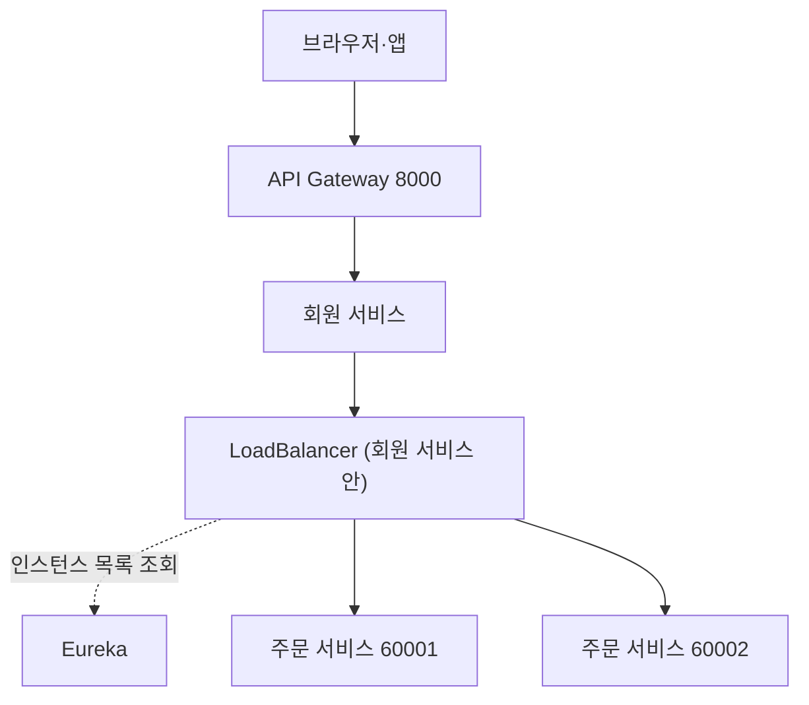
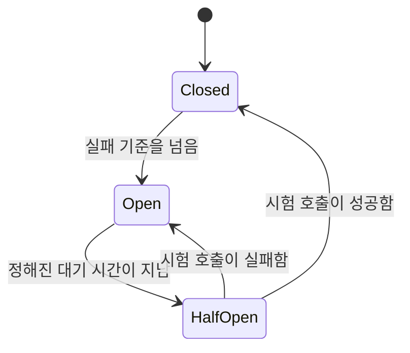
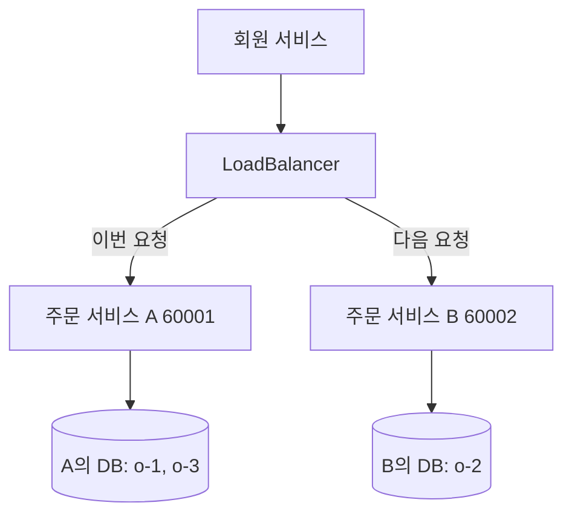

오늘은 회원 서비스가 주문 서비스의 주문 목록을 가져와 회원 정보와 함께 응답하는 과정을 따라가며 마이크로서비스 사이의 통신을 학습했다. 수업에서 같은 조회를 RestTemplate으로 구현하는 방법을 배운 뒤 서비스 이름 기반 호출과 OpenFeign으로 바꾸는 흐름을 따라갔고, Feign의 로그·예외·ErrorDecoder와 예외 메시지 갱신까지 이어서 정리했다.

후반에는 주문 서비스를 두 개 실행하면 요청마다 주문 목록이 달라지는 현상을 통해, 요청 분산과 데이터 공유가 서로 다른 문제라는 점을 다뤘다. 이를 해결하는 공유 DB 방식과 메시지·Kafka Connect 기반 동기화 방식의 차이도 함께 살펴봤다.

> 원격 호출은 메서드처럼 보여도 네트워크를 건너는 요청이고, 서버를 늘리는 일은 요청을 나눌 뿐 데이터를 맞춰 주지 않는다.

## 🎯 오늘의 학습 목표

- 같은 프로그램의 메서드 호출과 원격 HTTP 호출의 차이를 설명하고, 동기·비동기와 블로킹·논블로킹을 구분할 수 있다.
- Gateway·Eureka·LoadBalancer·Config Server·Bus의 역할을 구분하고, 서비스 이름 주소가 실제 인스턴스 주소로 바뀌는 과정을 설명할 수 있다.
- RestTemplate과 OpenFeign으로 주문 목록을 조회하고, 주문 0건과 조회 실패를 구분하는 오류 처리를 설계할 수 있다.
- 주문 서비스를 여러 개 실행했을 때 데이터가 달라지는 이유와 공유 DB·메시지 기반 동기화의 차이를 설명할 수 있다.

## 📌 오늘의 핵심 요약

| 주제 | 핵심 내용 |
| --- | --- |
| 원격 호출 | 서비스를 나누면 다른 서비스의 데이터는 API로 가져와야 하며, 네트워크 지연과 실패를 새로 설계해야 한다. |
| 통신 방식과 흐름 | 동기 HTTP는 결과를 기다리고 메시지는 일을 전달하며, 회원 조회는 회원 서비스가 두 출처를 코드에서 조합한다. |
| RestTemplate | `exchange`와 타입 정보로 주문 목록을 받고, `@LoadBalanced`로 서비스 이름을 실제 인스턴스 주소로 바꾼다. |
| OpenFeign | 인터페이스에 요청 계약을 선언하면 프록시가 HTTP 호출로 실행하지만, 동기 원격 호출이라는 성격은 같다. |
| 실패 처리 | 원격 404를 주문 0건으로 해석하지 않고, ErrorDecoder로 외부 오류 응답을 우리 예외로 바꾼다. |
| 장애 전파 방지 | 타임아웃, 신중한 재시도, 회로 차단기로 느리거나 실패하는 상대가 우리 자원을 소모하지 않게 한다. |
| 다중 인스턴스 | 로드밸런서는 요청만 나누므로, 같은 데이터를 보려면 공유 DB나 명시적인 동기화가 필요하다. |

## 🔄 오늘 학습 흐름

```text
서비스를 나누면 다른 서비스의 데이터를 원격 호출로 가져와야 한다
    ↓ 호출 방식과 요청이 지나가는 구성 요소를 먼저 구분한다
동기 HTTP·메시지 통신과 회원 조회 한 번의 흐름을 이해한다
    ↓ 실제 HTTP 요청을 코드로 보내야 한다
RestTemplate과 @LoadBalanced로 주문 서비스를 호출한다
    ↓ 반복되는 호출 코드를 인터페이스 계약으로 줄인다
OpenFeign으로 같은 호출을 선언형으로 바꾼다
    ↓ 원격 호출은 언제든 실패할 수 있다
FeignException과 ErrorDecoder로 실패의 의미를 구분한다
    ↓ 느린 상대가 우리 서비스까지 멈추게 할 수 있다
타임아웃·재시도·회로 차단기로 장애 전파를 막는다
    ↓ 처리량을 늘리려고 주문 서비스를 두 개 실행한다
인스턴스마다 DB가 다르면 데이터가 달라지는 문제를 해결한다
```

**본문 찾아보기**

1. [서비스를 나누면 원격 호출이 필요해지는 이유](#1-서비스를-나누면-원격-호출이-필요해지는-이유)
2. [통신 방식과 회원 조회 요청이 지나가는 길](#2-통신-방식과-회원-조회-요청이-지나가는-길)
3. [RestTemplate과 서비스 이름으로 주문 조회하기](#3-resttemplate과-서비스-이름으로-주문-조회하기)
4. [OpenFeign으로 HTTP 호출을 인터페이스로 선언하기](#4-openfeign으로-http-호출을-인터페이스로-선언하기)
5. [원격 호출 실패를 구분하고 ErrorDecoder로 다루기](#5-원격-호출-실패를-구분하고-errordecoder로-다루기)
6. [장애 전파를 막는 타임아웃·재시도·회로 차단기](#6-장애-전파를-막는-타임아웃재시도회로-차단기)
7. [인스턴스를 늘려도 데이터가 같아지지 않는 이유](#7-인스턴스를-늘려도-데이터가-같아지지-않는-이유)

## 📚 학습 내용

### 1. 서비스를 나누면 원격 호출이 필요해지는 이유

오늘 학습은 "회원 서비스에서 주문 정보를 가져오려면 어떻게 해야 할까?"라는 질문에서 출발한다. 회원 정보와 주문 정보가 서로 다른 서비스에 있으면, 회원 조회 화면 하나를 만들 때도 두 서비스가 데이터를 주고받아야 한다.

이 장에서는 서비스를 나눈 뒤 무엇이 달라지는지 정리하고, 이후 모든 장에서 쓰는 HTTP·JSON·DTO 기초를 먼저 다진다.

#### 1.1 마이크로서비스는 업무별로 나눈 독립 실행 단위다

**마이크로서비스(MSA)**는 큰 서비스를 업무별로 나누어 각각 따로 실행하고 배포하는 구조다. 예를 들어 쇼핑 서비스를 다음처럼 나눌 수 있다.

| 서비스 | 담당 업무 |
| --- | --- |
| 회원 서비스 | 회원 가입, 회원 정보, 인증 관련 기능 |
| 주문 서비스 | 주문 생성, 주문 목록, 주문 상태 |
| 상품 서비스 | 상품 정보와 상품 검색 |
| 결제 서비스 | 결제 요청과 결제 결과 |

한 사람이 모든 일을 하던 가게가 회원 담당, 주문 담당, 결제 담당을 따로 둔 조직으로 바뀐 것과 비슷하다. 담당자가 나뉘었으므로 서로 필요한 정보를 주고받는 방법이 필요해진다.

#### 1.2 메서드 호출과 원격 호출은 실패하는 방식이 다르다

같은 프로그램 안에서는 다른 객체의 메서드를 바로 호출할 수 있다.

```java
orderService.getOrders(userId);
```

일반적인 로컬 호출이라면 같은 JVM(Java 프로그램이 실행되는 가상 머신) 안의 객체로 실행이 이동한다. 반면 주문 서비스가 별도의 프로세스(실행 중인 프로그램 하나)에서 실행 중이면 회원 서비스는 주문 서비스의 객체를 직접 참조할 수 없으므로, HTTP 요청이나 메시지를 보내야 한다.

| 비교 항목 | 로컬 메서드 호출 | 원격 호출 |
| --- | --- | --- |
| 실행 위치 | 같은 JVM 안의 객체 | 네트워크 건너편의 다른 프로세스 |
| 데이터 전달 | 객체를 그대로 넘긴다. | JSON 같은 형식으로 바꿔 보내고 다시 객체로 만든다. |
| 주로 생각할 실패 | 코드와 데이터 처리 오류 | 여기에 네트워크 지연, 연결 실패, 상대 서버 종료, 타임아웃, 응답 형식 변경이 더해진다. |

> [!WARNING]
> 뒤에서 배울 Feign 호출은 메서드처럼 보이지만 실제로는 HTTP 요청을 보낸다. 코드 모양이 로컬 호출과 같아져도 원격 호출의 실패 가능성은 그대로 남는다.

#### 1.3 다른 서비스의 DB를 직접 읽지 않는 이유

회원 서비스가 주문 서비스의 DB를 직접 읽는 것도 기술적으로는 가능할 수 있다. 하지만 그렇게 하면 서비스 사이의 경계가 약해진다.

- 주문 테이블의 이름이나 컬럼이 바뀌면 회원 서비스도 함께 수정해야 한다.
- 주문 서비스가 지켜야 하는 규칙을 회원 서비스가 우회할 수 있다.
- 누가 어떤 데이터를 책임지는지 불명확해진다.

그래서 일반적으로 주문 데이터의 **소유자**는 주문 서비스로 정하고, 회원 서비스는 주문 API나 주문 이벤트로 필요한 정보를 얻는다. 이는 같은 주문 서비스의 인스턴스 여러 개가 주문 DB 하나를 함께 쓰는 것과는 다른 이야기이며, 그 차이는 7장에서 다시 다룬다.

#### 1.4 클라이언트와 서버는 역할이고 API는 약속이다

**클라이언트**는 요청하는 쪽, **서버**는 요청을 받아 응답하는 쪽이다. 고정된 직업이 아니라 상황에 따른 역할이므로, 브라우저가 회원 조회를 요청할 때 회원 서비스는 서버지만 회원 서비스가 주문 조회를 요청할 때는 클라이언트가 된다.

API는 다른 프로그램이 기능을 사용하는 약속이고, HTTP API의 엔드포인트는 그 기능을 호출하는 구체적인 접점이다.

```http
GET /order-service/u-100/orders
```

| 부분 | 의미 |
| --- | --- |
| `GET` | 데이터를 조회하겠다는 HTTP 메서드 |
| `/order-service/u-100/orders` | 요청할 경로 |
| `u-100` | 주문을 조회할 회원의 식별자 |
| 기대하는 응답 | 이 회원의 주문 목록을 담은 JSON |

같은 경로라도 GET과 POST는 서로 다른 동작으로 연결될 수 있다. API를 확인할 때는 URL만 보지 말고 HTTP 메서드도 함께 확인한다.

#### 1.5 HTTP 요청·응답의 구성과 상태 코드

| 부분 | 요청에 들어가는 것 | 응답에 들어가는 것 |
| --- | --- | --- |
| 첫 줄 | 메서드(GET, POST, PUT, PATCH, DELETE 등)와 주소 | 처리 결과를 나타내는 상태 코드 |
| 헤더 | 인증 토큰, 원하는 응답 형식 같은 부가 정보 | 응답의 자료 형식, 캐시 관련 정보 |
| 본문 | 전송할 실제 데이터. 조회 GET에서는 보통 쓰지 않는다. | 조회 결과 또는 오류 설명 |

`Content-Type: application/json`은 "이 본문은 JSON 형식이다"라는 뜻이고, `Accept: application/json`은 "가능하면 JSON 형식으로 응답받고 싶다"는 뜻이다.

**먼저 알아둘 상태 코드**

| 상태 코드 | 의미 |
| --- | --- |
| `200 OK` | 조회 등 요청이 성공했다. |
| `201 Created` | 새 자원이 생성됐다. |
| `202 Accepted` | 요청을 접수했지만 처리가 끝났다는 뜻은 아니다. |
| `204 No Content` | 요청이 성공했고 응답 본문이 없다. |
| `400 Bad Request` | 요청 형식이나 입력 값이 잘못됐다. |
| `401 Unauthorized` | 유효한 인증 정보가 필요하거나 인증에 실패했다. |
| `403 Forbidden` | 요청을 허용하지 않는다. 권한 문제일 수 있다. |
| `404 Not Found` | 요청한 자원을 찾지 못했다. |
| `405 Method Not Allowed` | 경로는 있어도 요청 메서드가 허용되지 않는다. |
| `429 Too Many Requests` | 호출 횟수 제한에 걸렸다. |
| `500 Internal Server Error` | 서버 내부에서 예상하지 못한 오류가 났다. |
| `502 Bad Gateway` | 중간 서버가 상위 서버에서 유효하지 않은 응답을 받았다. |
| `503 Service Unavailable` | 일시적으로 요청을 처리할 수 없다. |
| `504 Gateway Timeout` | 중간 서버가 상위 서버의 응답을 제시간에 받지 못했다. |

우리 API에서 502·503·504 중 무엇을 쓸지는 오류의 성격과 서비스 계약을 기준으로 정한다. 모든 Feign 오류를 500 하나로 바꾸거나, 상대 서버의 상태를 무조건 그대로 전달하지 않는다.

#### 1.6 JSON 직렬화·역직렬화와 빈 배열·null·빈 본문

JSON은 데이터를 문자열 형태로 표현하는 형식이다. 객체는 `{}`, 배열은 `[]`로 표현한다.

```json
[
  {
    "orderId": "o-1",
    "productId": "CATALOG-001",
    "qty": 2,
    "unitPrice": 3000,
    "totalPrice": 6000
  }
]
```

| 용어 | 뜻 |
| --- | --- |
| 직렬화(Serialization) | Java 객체를 전송 가능한 JSON 등의 형태로 바꾸는 것 |
| 역직렬화(Deserialization) | 받은 JSON 등의 형태를 Java 객체로 복원하는 것 |

주문 서비스의 `List<ResponseOrder>` 객체 자체가 네트워크를 순간이동하는 것은 아니다. 주문 서비스의 객체가 JSON으로 바뀌고, 회원 서비스가 받은 JSON으로 자기 JVM 안에 객체를 새로 만든다.

| 응답 본문 | 의미 |
| --- | --- |
| `[]` | 요소가 0개인 JSON 배열 |
| `null` | 값이 없음을 나타내는 JSON 값 |
| 본문 없음 | 응답에 데이터 자체가 없음 |

세 가지는 모두 다른 응답이다. 이 구분은 5장에서 "주문 0건"과 "주문 조회 실패"를 나눌 때 다시 중요해진다.

#### 1.7 Entity·DTO와 의존성 주입

| 객체 | 역할 |
| --- | --- |
| Entity | 주로 DB에 저장할 데이터와 매핑되는 객체 |
| DTO | 계층이나 시스템 사이에 데이터를 전달하는 객체 |
| 응답 DTO | 클라이언트에게 공개할 필드만 담는 객체 |

수업에서는 다음 이름이 등장한다.

| 수업의 클래스 | 역할 |
| --- | --- |
| `UserEntity` | 회원 DB에서 조회한 회원 객체 |
| `UserDto` | 회원 서비스 내부에서 정보를 전달하는 객체 |
| `ResponseOrder` | 주문 서비스 응답을 받을 객체 |
| `ResponseUser` | 최종 회원 조회 응답 객체 |

ModelMapper는 이름과 설정에 따라 한 객체의 필드 값을 다른 객체로 옮기는 도구다. HTTP 요청을 보내거나 DB를 자동으로 조회하지 않으므로, 객체 매핑과 서비스 통신을 구분한다.

> [!WARNING]
> 회원 응답에 비밀번호나 비밀번호 해시가 섞이지 않도록 응답 DTO의 공개 필드를 명확하게 정한다. Entity를 그대로 응답하면 내부 필드까지 노출될 수 있다.

**Bean**은 Spring이 생성과 연결을 관리하는 객체이고, **의존성 주입(DI)**은 필요한 객체를 스스로 만들지 않고 외부에서 전달받는 방식이다.

```java
public UserServiceImpl(OrderServiceClient orderServiceClient) {
    this.orderServiceClient = orderServiceClient;
}
```

`UserServiceImpl`이 `OrderServiceClient`를 스스로 `new`하지 않고, Spring이 준비한 객체를 생성자로 받는다는 뜻이다. 생성자가 하나라면 보통 `@Autowired`를 생략할 수 있고, 테스트에서는 실제 HTTP 클라이언트 대신 가짜 구현이나 mock을 넣어 실패 상황을 쉽게 재현할 수 있다.

> 서비스를 나누면 업무 책임은 분리되지만, 다른 서비스의 데이터는 네트워크를 건너는 API로 가져와야 한다. 그래서 지연과 실패, 데이터 형식의 약속이 새로운 설계 문제가 된다.

### 2. 통신 방식과 회원 조회 요청이 지나가는 길

1장에서 원격 호출이 필요하다는 것을 확인했다. 이 장에서는 원격 호출의 두 방식인 동기 HTTP와 메시지 통신을 구분하고, Spring Cloud 구성 요소들이 각각 어떤 질문에 답하는지 정리한다.

그다음 사용자의 회원 조회 요청 하나가 실제로 어떤 순서로 처리되는지 따라가고, 그 과정에서 쓰이는 주소를 부분별로 읽는 방법까지 익힌다.

#### 2.1 동기 HTTP 통신은 상대의 결과를 기다린다

**동기 통신**은 상대의 처리 결과가 있어야 현재 작업을 완성하는 방식이다. 회원 조회에서 "회원 정보 + 최신 주문 목록"을 한 번에 응답하려면 주문 조회 결과를 받은 뒤에야 최종 응답을 만들 수 있다.

```text
회원 서비스가 주문 조회 요청을 보낸다
    ↓
주문 서비스가 주문 DB를 조회한다
    ↓
주문 서비스가 주문 목록을 응답한다
    ↓ 응답이 올 때까지 회원 서비스는 기다린다
회원 서비스가 받은 목록을 회원 응답에 넣는다
```

수업의 RestTemplate과 기본 OpenFeign 호출은 이 흐름을 따른다. 호출한 스레드(프로그램 안에서 작업을 실행하는 흐름 단위)는 응답이나 오류가 돌아올 때까지 기다린다.

#### 2.2 메시지 기반 비동기 통신은 일을 전달한다

**메시지 기반 비동기 통신**은 상대의 최종 처리를 즉시 기다리지 않고 메시지로 일을 전달하는 방식이다. 주문 생성 후 알림 발송을 예로 들면, 주문 서비스는 주문을 저장하고 "주문이 생성되었다"는 메시지를 브로커(메시지를 받아 보관하고 소비자에게 전달하는 중간 시스템)에 전달하며, 알림 서비스가 그 메시지를 받아 알림을 보낸다.

| 비교 항목 | 동기 HTTP | 메시지 기반 비동기 |
| --- | --- | --- |
| 기다리는 것 | 상대의 처리 결과 | 메시지 발행의 확인 정도 |
| 장점 | 요청과 결과의 연결이 직관적이고 즉시 결과를 주기 쉽다. | 업무를 분리하고 순간적인 요청 증가를 완충하기 쉽다. |
| 설계할 문제 | 상대의 지연이나 장애가 우리 응답에도 영향을 준다. | 처리 지연, 중복 메시지, 재처리, 순서를 설계해야 한다. |
| 어울리는 예 | 회원 화면에 지금 조회한 주문 목록이 필요할 때 | 주문 생성 후 알림·통계를 따로 처리할 때 |

메시지 발행 자체를 확인하는 대기 시간은 생길 수 있고, 브로커가 메시지를 받은 것과 소비자가 업무 처리를 끝낸 것은 서로 다르다. 그래서 "비동기니까 아무것도 기다리지 않는다"라고 외우면 부정확하다.

AMQP는 메시지를 주고받기 위한 통신 프로토콜이고, RabbitMQ는 AMQP 등을 지원하는 메시지 브로커 제품이다. Kafka는 이벤트를 저장하고 전달하는 분산 이벤트 플랫폼으로 일반적인 Kafka 클라이언트는 Kafka 자체 프로토콜을 쓰므로, Kafka를 AMQP의 다른 이름으로 이해하면 안 된다.

브로커가 메시지를 받아 두더라도 설정과 실패 처리에 따라 메시지가 유실되거나 다시 전달될 수 있다. 브로커를 설치했다는 사실만으로 업무가 정확히 한 번 처리되는 것은 아니다.

#### 2.3 동기·비동기와 블로킹·논블로킹은 다른 기준이다

**동기·비동기**는 작업 결과를 언제 어떻게 이어받는지에 관한 기준이다. **블로킹·논블로킹**은 기다리는 동안 호출한 스레드가 묶이는지에 관한 기준이므로, 둘을 같은 단어처럼 쓰지 않는다.

| 도구 | 일반적인 성격 | 주의할 점 |
| --- | --- | --- |
| RestTemplate, 기본 OpenFeign | 동기 + 블로킹 | 호출한 스레드가 응답이나 오류까지 기다린다. |
| WebClient | 논블로킹 호출을 구성할 수 있다. | `.block()`으로 결과를 기다리면 호출한 스레드는 블로킹된다. |
| RabbitMQ·Kafka 이벤트 | 서비스의 업무 흐름을 비동기로 분리한다. | 클라이언트 API나 확인 방식에 따라 내부 대기는 있을 수 있다. |
| `@Async` | Spring 메서드를 별도 실행기에 넘긴다. | 그 안에서 RestTemplate을 쓰면 별도 스레드가 응답을 기다리며, 서비스 간 메시지 전달이나 안정적인 재처리와는 다르다. |

Feign으로 코드를 줄여도 **동기 HTTP라는 성격은 바뀌지 않는다.** 코드의 길이와 통신 방식은 서로 다른 문제다.

#### 2.4 Gateway·Eureka·LoadBalancer·Config·Bus의 역할

다섯 가지 구성 요소와 HTTP 클라이언트가 각각 어떤 질문에 답하는지 구분하면 Spring Cloud의 구조가 훨씬 쉬워진다.



| 구성 요소 | 답하는 질문 | 하지 않는 일 |
| --- | --- | --- |
| API Gateway | 외부 요청을 어느 서비스로 보낼까? | 모든 내부 통신이 반드시 거쳐야 하는 경유지는 아니다. |
| Eureka | 그 서비스가 어디에 실행 중일까? | 주문 조회를 대신 실행하거나 주문 응답을 중계하지 않는다. |
| Spring Cloud LoadBalancer | 발견한 여러 인스턴스 중 어디로 보낼까? | 여러 서버의 응답을 모두 받아 합치지 않는다. |
| Config Server | 어떤 설정값으로 동작할까? | 다른 서비스의 실행 주소 목록을 관리하지 않는다. |
| Spring Cloud Bus | 설정 갱신 이벤트를 여러 서비스에 어떻게 전할까? | 주문 테이블의 데이터를 동기화하지 않는다. |
| HTTP Client | 선택한 대상에 실제 HTTP 요청을 어떻게 보낼까? | 서비스 이름의 실제 위치를 스스로 알지 못한다. |

예를 들어 Gateway는 8000번 포트로 들어온 `/user-service/**` 요청을 회원 서비스로 전달하고, Eureka에는 `order-service`의 60001번과 60002번 인스턴스가 등록될 수 있다. Gateway는 인증 검사, 공통 필터, 호출 제한도 구성할 수 있지만, 회원 서비스가 주문 서비스를 직접 호출하는 구조도 가능하다.

Bus 이벤트와 실제 설정값은 구분한다. 이벤트를 받은 서비스가 설정을 다시 가져와 필요한 Bean을 갱신하는 흐름이지 모든 Java 객체의 값이 저절로 바뀌는 것은 아니며, 설정 갱신과 업무 데이터 동기화는 다른 문제다.

#### 2.5 회원 조회 요청 한 번에 일어나는 일

사용자는 회원 조회 API를 한 번 호출한다.

```http
GET http://localhost:8000/user-service/users/u-100
```

최종 응답에는 회원 정보와 주문 목록이 함께 들어간다. 이처럼 한 API가 여러 서비스의 결과를 묶어 반환하는 방식을 **API Composition**이라고 부를 수 있다.

```json
{
  "userId": "u-100",
  "name": "학습용 회원",
  "email": "learner@example.com",
  "orders": [
    {
      "orderId": "o-1", "productId": "CATALOG-001",
      "qty": 2, "unitPrice": 3000, "totalPrice": 6000
    }
  ]
}
```

이 응답이 만들어지는 내부 순서는 다음과 같다.

```text
Gateway가 회원 서비스로 요청을 전달한다
    ↓
회원 Controller가 userId를 전달받는다
    ↓ 회원 정보부터 확인한다
회원 Service가 Repository로 회원 DB를 조회한다
    ↓ 회원이 없으면 여기서 회원 없음 오류로 끝난다
회원 서비스가 주문 서비스로 HTTP 조회 요청을 보낸다
    ↓ 네트워크를 건너 다른 프로세스로 이동한다
주문 Controller가 userId를 받는다
    ↓
주문 서비스가 자기 DB에서 해당 회원의 주문을 조회한다
    ↓
주문 서비스가 주문 목록을 JSON 배열로 응답한다
    ↓ 회원 서비스가 JSON을 주문 응답 객체 목록으로 바꾼다
회원 정보와 주문 목록을 묶어 최종 응답을 반환한다
```

회원 DB와 주문 DB를 SQL JOIN한 것이 아니다. 회원 서비스가 서로 다른 두 출처의 결과를 애플리케이션 코드에서 조합했다.

#### 2.6 호출 대상 찾기와 전체 응답 시간

서비스 이름으로 호출할 때는 DiscoveryClient(Eureka 같은 등록 서버에서 인스턴스 목록을 가져오는 클라이언트)와 LoadBalancer가 주문 서비스의 인스턴스 목록을 이용해 실제 대상 주소를 고른다. 실제 주문 요청과 응답은 회원 서비스와 선택된 주문 서비스 사이에서만 오간다.

> [!NOTE]
> Eureka Client에는 등록 정보의 로컬 캐시가 있을 수 있고, LoadBalancer 쪽에도 캐시가 있을 수 있다. 그래서 주문 요청마다 Eureka Server에 새로 HTTP 조회를 보낸다고 생각하면 안 되며, Eureka는 업무 응답이 지나가는 중간 경유지도 아니다.

순차적으로 처리한다면 전체 응답 시간은 대략 다음 시간이 합쳐진 값이다.

```text
전체 응답 시간 ≈ 회원 DB 조회 시간 + 주문 원격 호출 시간 + 변환·응답 처리 시간
```

주문 원격 호출 시간에는 네트워크 이동, 상대 서버의 대기, 상대 DB 조회, 응답 전송이 모두 들어간다. Feign 메서드 호출이 한 줄이어도 이 비용은 그대로 존재하며, 여러 서비스를 차례로 호출하면 지연과 장애 의존성도 함께 누적된다.

#### 2.7 URL을 호스트·포트·경로로 나누어 읽기

```text
http://127.0.0.1:60001/order-service/u-100/orders
```

| URL 부분 | 예시 | 의미 |
| --- | --- | --- |
| 통신 방식 | `http` | 어떤 규약으로 통신하는가 |
| 호스트 | `127.0.0.1` | 접속할 위치. 여기서는 현재 컴퓨터 자신을 가리키는 루프백 주소다. |
| 포트 | `60001` | 그 컴퓨터에서 어느 프로그램의 접수 창구인지 구분한다. |
| 경로 | `/order-service/u-100/orders` | 그 창구에서 요청할 업무 |

호스트는 건물 주소, 포트는 건물 안의 창구 번호, 경로는 그 창구에서 요청할 업무에 비유할 수 있다.

`localhost`와 `127.0.0.1`은 "현재 실행 환경 자신"을 가리킨다. 그래서 컨테이너 안에서 `localhost`는 일반적으로(호스트 네트워크 모드가 아니라면) 그 컨테이너 자신이며, 회원 서비스 컨테이너가 `localhost:60001`로 주문 서비스를 부르면 자기 컨테이너의 60001 포트로 접속하게 된다. 로컬 IDE에서 되던 주소가 Docker에서 실패한다면 "누구 입장에서 localhost인가?"부터 확인하고, 컨테이너 네트워크 이름이나 실제 접속 가능한 주소를 쓴다.

#### 2.8 수업에 등장하는 세 가지 주소

| 주소의 종류 | 예시 | 특징 |
| --- | --- | --- |
| Gateway 경유 | `http://127.0.0.1:8000/order-service/u-100/orders` | 8000번 Gateway의 라우팅 규칙에 따라 주문 서비스로 전달된다. |
| 특정 인스턴스 직접 | `http://127.0.0.1:60001/order-service/u-100/orders` | 60001번만 호출하므로 60002번으로 자동 분산되지 않는다. |
| 서비스 이름 논리 주소 | `http://order-service/order-service/u-100/orders` | 서비스 발견과 로드밸런싱을 적용한 HTTP 클라이언트가 실제 IP·포트로 바꿔 호출한다. |

세 번째 주소를 브라우저 주소창에 넣는다고 Eureka가 적용되지는 않는다. 일반 브라우저는 기본적으로 DNS로 호스트를 찾으며, Eureka의 서비스 이름은 DNS 이름과 같은 개념이 아니다.

**`order-service`가 두 번 나오는 이유**

| 위치 | 역할 |
| --- | --- |
| 첫 번째 `order-service` | 어느 서비스의 인스턴스를 찾을지 나타내는 호스트 부분 |
| 두 번째 `/order-service` | 주문 애플리케이션의 Controller가 받는 실제 요청 경로의 일부 |

두 역할은 서로 독립적이며, 이름이 같아 보일 뿐 URL이 중복된 오류가 아니다. 만약 주문 Controller가 `/users/{userId}/orders`를 받는다면 `http://order-service/users/u-100/orders`가 맞는 주소이므로, 서비스 이름이 `order-service`라고 경로도 `/order-service`로 시작해야 하는 것은 아니다.

#### 2.9 Controller 경로와 Gateway 경로를 따로 확인하기

주문 서비스 안의 매핑이 다음과 같다면, 직접 호출할 실제 경로는 클래스와 메서드의 경로를 합친 `/order-service/{userId}/orders`다.

```java
@RequestMapping("/order-service")
@GetMapping("/{userId}/orders")
```

Gateway에서 `/order-service` 접두사를 없애는 `StripPrefix`나 `RewritePath`를 쓴다면, 전달된 경로가 Controller 매핑과 일치하는지 따로 확인해야 한다. 외부 URL의 경로와 내부 Controller의 경로는 설정에 따라 달라질 수 있다.

> [!WARNING]
> Feign이나 RestTemplate의 직접 호출은 Gateway의 경로 변환을 거치지 않는다. 또 Gateway 설정의 `lb://order-service`는 Gateway 라우팅용 URI이므로 RestTemplate 호출에 그대로 복사하지 않으며, 수업의 클라이언트 호출은 `http://order-service/...` 형식을 쓴다.

> 회원 조회 하나에도 Gateway, Eureka, LoadBalancer, HTTP 클라이언트가 각자 다른 질문에 답한다. 실제 주문 요청과 응답은 회원 서비스와 선택된 주문 인스턴스 사이에서만 오가며, 그 비용은 코드가 짧아져도 사라지지 않는다.

### 3. RestTemplate과 서비스 이름으로 주문 조회하기

2장의 흐름 중 "회원 서비스가 주문 서비스로 HTTP 조회 요청을 보낸다"는 단계를 이제 코드로 구현한다. 먼저 RestTemplate으로 특정 주문 인스턴스의 주소를 직접 호출하고, 그 주소를 설정 파일로 옮긴 뒤, 마지막으로 서비스 이름만으로 여러 인스턴스 중 하나를 고르게 만든다.

#### 3.1 RestTemplate은 HTTP 호출의 공통 절차를 대신한다

**RestTemplate**은 Spring에서 동기 HTTP 요청을 보낼 때 쓰는 클라이언트다. HTTP 메서드와 주소, 요청 데이터, 응답 타입을 지정하면 요청 전송과 응답 변환을 처리해 준다.

이름에 Template이 들어가는 이유는 HTTP 호출의 공통 절차를 미리 제공하고 개발자는 필요한 값만 채우는 형태이기 때문이다. 다만 RestTemplate 자체가 서비스 주소록을 가진 것은 아니므로, 서비스 이름을 해석하려면 3.8의 로드밸런싱 구성이 추가로 필요하다.

다음은 주문을 호출하는 회원 서비스에 작성하는 설명용 예제로, 실제 호스트와 IP로 호출하는 기본 Bean이다.

```java title="HttpClientConfiguration.java"
import org.springframework.context.annotation.Bean;
import org.springframework.context.annotation.Configuration;
import org.springframework.web.client.RestTemplate;

@Configuration
public class HttpClientConfiguration {

    @Bean
    public RestTemplate restTemplate() {
        return new RestTemplate();
    }
}
```

서비스 이름을 쓰는 Bean은 3.8의 `@LoadBalanced` 예제로 교체한다. 같은 이름의 Bean 두 개를 함께 등록하지 않는다.

#### 3.2 수업 흐름으로 exchange 호출 읽기

다음은 수업의 주문 목록 조회 흐름을 정리한 예제다. `ResponseOrder` DTO가 있고 RestTemplate을 주입받았다고 가정한다.

```java {7}
String orderUrl = "http://127.0.0.1:60001/order-service/{userId}/orders";

ResponseEntity<List<ResponseOrder>> response = restTemplate.exchange(
        orderUrl,
        HttpMethod.GET,
        null,
        new ParameterizedTypeReference<List<ResponseOrder>>() {},
        userId
);

List<ResponseOrder> orders = response.getBody();
```

`exchange`의 인자를 차례로 읽으면 다음과 같다. 필요한 import는 `java.util.List`, `ParameterizedTypeReference`, `HttpMethod`, `ResponseEntity`다.

| 순서 | 인자 | 의미 |
| --- | --- | --- |
| 첫째 | `orderUrl` | 요청 URL 또는 URI 템플릿 |
| 둘째 | `HttpMethod.GET` | GET 요청을 보낸다. |
| 셋째 | `null` | 요청 헤더와 본문을 담을 `HttpEntity`. 여기서는 따로 지정하지 않는다. |
| 넷째 | `new ParameterizedTypeReference<...>() {}` | 응답 본문을 어떤 타입으로 바꿀지 알려 주는 정보 |
| 다섯째 | `userId` | `{userId}` 자리에 넣을 실제 값 |

셋째 인자가 `null`이라고 헤더가 하나도 없다는 뜻은 아니다. 기본 클라이언트와 변환기가 필요한 헤더를 추가할 수 있다.

회원 서비스를 고치기 전에는 주문 API를 먼저 직접 호출해 본다. `GET http://localhost:60001/order-service/u-100/orders`가 200과 JSON 배열을 돌려주는지 확인한 뒤에 회원 서비스의 연결을 확인하면, 문제가 어느 쪽에 있는지 빨리 좁힐 수 있다.

#### 3.3 응답을 담는 ResponseEntity와 제네릭 타입 정보

**ResponseEntity**는 HTTP 상태, 헤더, 본문을 함께 담는 객체다.

| 메서드 | 확인하는 것 |
| --- | --- |
| `getStatusCode()` | 응답 상태 |
| `getHeaders()` | 응답 헤더 |
| `getBody()` | 실제 본문 데이터 |

주문 DTO 목록만 필요하면 `getBody()`를 꺼내지만, 본문이 없는 응답이면 `null`일 수 있다. 목록 조회 API를 "200 + JSON 배열"로 약속했다면 주문 0건은 `[]`로 응답하도록 정하는 것이 다루기 쉽다.

> [!WARNING]
> 이 계약에서 본문이 없는 응답을 `[]`로 조용히 바꾸면 상대 서비스의 잘못된 응답을 숨기게 된다. 빈 목록은 "주문이 없다는 사실을 확인했다"는 의미이므로 실패를 대신하는 값으로 쓰지 않는다.

`ResponseOrder.class`는 "응답 한 개가 `ResponseOrder`"라는 정보다. `List.class`는 "목록"이라는 정보만 있을 뿐 요소의 타입을 표현하지 못하는데, Java의 제네릭 타입 정보는 실행 시점에 일부가 지워지기 때문이다.

그래서 앞 코드의 강조한 7번째 줄처럼 `new ParameterizedTypeReference<List<ResponseOrder>>() {}`로 목록과 요소 타입을 함께 전달한다. 맨 뒤의 `{}`는 익명 하위 클래스를 만드는 Java 문법이며, 이 방식으로 지워지지 않는 타입 정보를 남긴다.

타입 정보가 부족한 상태로 JSON 배열을 받으면 요소가 `ResponseOrder` 대신 `Map` 형태로 만들어질 수 있다. 이때 강제 형변환을 해도 JSON 구조가 DTO로 바뀌지는 않는다.

#### 3.4 DTO는 이름과 자료형이 모두 맞아야 한다

응답의 `qty`가 숫자인데 DTO에서 예상하지 못한 타입으로 선언했거나 날짜 형식이 맞지 않으면 역직렬화 오류가 날 수 있다.

| 확인 항목 | 볼 것 |
| --- | --- |
| 필드 이름 | `productId`, `qty`, `totalPrice` 등이 약속과 일치하는가 |
| 숫자 범위 | `int`와 `long`, 금액 표현 방식 |
| 날짜 | 문자열 형식과 타임존, `Instant`와 `LocalDateTime`의 구분 |
| 목록 구조 | JSON 배열인지, `{"orders": [...]}`처럼 목록을 감싼 객체인지 |

응답 DTO는 다음처럼 Java record로 표현할 수도 있다. 보충용 설명 예제이므로, 수업의 기존 `ResponseOrder` 클래스가 있다면 중복해서 만들지 않는다.

```java title="ResponseOrder.java"
import java.math.BigDecimal;
import java.time.Instant;

public record ResponseOrder(
        String orderId,
        String productId,
        Integer qty,
        BigDecimal unitPrice,
        BigDecimal totalPrice,
        Instant createdAt
) {}
```

**record**는 값을 담는 타입을 간결하게 선언하는 Java 문법이다. record의 접근자는 `qty()`처럼 만들어지므로 기존 JavaBean의 `getQty()` 호출과 섞어 쓰지 않으며, `Instant`는 타임라인의 한 시점을 표현하므로 실제 응답의 날짜 형식과 JSON 변환 지원이 맞는지 확인한다.

돈 계산에 소수점이 들어간다면 보통 `BigDecimal`을 검토한다. `float`·`double`은 이진 부동소수점 오차가 있어 금액 계산에 그대로 쓰지 않고, 원 단위 정수 금액이라면 범위를 고려해 정수 타입을 쓸 수 있다.

#### 3.5 RestTemplate의 기본 오류 동작

RestTemplate은 기본 오류 처리기에서 HTTP 4xx·5xx 응답을 예외로 바꾼다. 모든 상태의 응답이 정상 `ResponseEntity`로 돌아오는 것은 아니다.

| 상황 | 대표 예외 |
| --- | --- |
| 4xx 응답을 받음 | `HttpClientErrorException` |
| 5xx 응답을 받음 | `HttpServerErrorException` |
| 연결 실패, 읽기 타임아웃 | `ResourceAccessException` 등 |

정확한 원인은 예외 안에 중첩된 cause와 로그를 함께 확인한다. 외부 오류 응답을 제어하려면 `ResponseErrorHandler`나 호출 계층의 예외 처리로 정책을 정하며, 이는 5장의 Feign ErrorDecoder와 역할이 비슷하지만 같은 인터페이스는 아니다.

#### 3.6 호출 주소를 설정 파일과 Environment로 관리하기

로컬, 개발, 운영 환경은 접속 주소와 포트가 다를 수 있다. 주소를 코드에 직접 쓰면 환경을 바꿀 때마다 코드를 고쳐야 하므로, 설정으로 분리해 코드와 환경값의 책임을 나눈다.

수업은 `order_service.url` 설정을 읽고 `%s` 자리에 `userId`를 넣는다.

```yaml title="application.yml"
order_service:
  url: "http://127.0.0.1:8000/order-service/%s/orders"
```

```java
String template = env.getRequiredProperty("order_service.url");
String orderUrl = String.format(template, userId);
```

`getRequiredProperty`는 설정이 없으면 바로 실패한다. 설정 누락을 뒤늦게 잘못된 주소나 `NullPointerException`으로 발견하는 것보다 원인을 명확히 알 수 있다.

**Environment**는 `application.yml`, 외부 설정, 환경 변수 등에서 구성된 프로퍼티를 조회하는 Spring의 창구다. `Environment`를 쓰는 메서드가 설정 파일을 직접 여는 것이 아니라, Spring이 관리하는 프로퍼티 소스에서 값을 찾는다.

**값을 넣는 표기는 도구마다 다르다**

| 표기 | 값을 넣는 주체 | 쓰는 곳 |
| --- | --- | --- |
| `%s` | Java의 `String.format` | 수업의 `order_service.url` |
| `{userId}` | Spring의 URI 템플릿 | `restTemplate.exchange(..., userId)` |
| `{userId}`와 `@PathVariable` | Feign이 메서드 인자를 경로에 넣는다. | 4장의 Feign 인터페이스 |

YAML의 들여쓰기 계층은 점으로 이어 하나의 키가 된다. 예를 들어 수업의 `order_service:` 아래 `exception:` 아래에 `orders_is_empty`를 두면 키는 `order_service.exception.orders_is_empty`가 되며, `exception`이 `order_service` 아래인지 최상위인지에 따라 키가 달라지고 들여쓰기에는 탭 대신 공백을 쓴다. 보충 예제에서는 다음처럼 하이픈 표기로 통일하며, 이때 메시지 키는 `order-service.exception.lookup-failed-message`가 된다.

```yaml title="application.yml"
order-service:
  url: "http://order-service/order-service/{userId}/orders"
  exception:
    lookup-failed-message: "주문 정보를 불러오지 못했습니다."
```

수업의 밑줄 키와 보충 예제의 하이픈 키를 섞지 않는다. 바인딩의 완화된 이름 해석을 모든 조회 방식에서 기대하지 말고, 작성한 실제 키와 조회 코드를 일치시키는 것이 가장 확실하다.

설정을 코드 밖으로 뺐다고 실행 중에 자동으로 갱신되는 것은 아니다. Config Server의 파일만 고쳐서는 실행 중인 서비스의 값이 바로 바뀌지 않으며, `@Value`로 한 번 주입한 필드와 호출할 때마다 `Environment`에서 읽는 값은 갱신 방식도 다르다. 이 차이는 5장에서 예외 메시지 갱신으로 다시 확인한다.

#### 3.7 Eureka와 클라이언트 측 로드밸런싱

**서비스**는 회원 관리, 주문 관리처럼 논리적인 기능 단위이고, **인스턴스**는 그 서비스의 프로그램이 실제로 실행된 한 개체다. `order-service`를 두 번 실행하면 "주문 서비스 한 종류, 실행 인스턴스 두 개"이며, 두 인스턴스의 `spring.application.name`은 같아야 같은 대상으로 발견되고 각 인스턴스 ID와 실행 주소는 구분되어야 한다.

| 방식 | 대상을 고르는 곳 | 예 |
| --- | --- | --- |
| 클라이언트 측 로드밸런싱 | 요청하는 쪽이 후보 목록을 받아 직접 고른다. | 회원 서비스 안의 Spring Cloud LoadBalancer |
| 서버 측 로드밸런싱 | 외부 프록시나 전용 로드밸런서가 요청을 받아 분배한다. | 별도의 로드밸런서·프록시 |

Spring Cloud LoadBalancer는 일반적인 기본 구성에서 인스턴스를 순서대로 고르는 **라운드로빈** 방식을 쓴다. 하지만 설정, 여러 클라이언트의 개별 상태, 동시 요청, 캐시와 인스턴스 변경 때문에 전체 요청이 항상 정확히 1:1로 번갈아 간다고 가정하지 않는다.

#### 3.8 서비스 이름 호출을 여는 `@LoadBalanced`

다음은 서비스 이름 호출용 Bean의 설명용 예제다. import 문은 생략했으며, 3.1의 일반 Bean을 이 Bean으로 교체한다.

```java title="HttpClientConfiguration.java" {5,9-10}
@Configuration
public class HttpClientConfiguration {

    @Bean
    @LoadBalanced
    public RestTemplate restTemplate() {
        SimpleClientHttpRequestFactory factory =
                new SimpleClientHttpRequestFactory();
        factory.setConnectTimeout(1000);
        factory.setReadTimeout(2000);
        return new RestTemplate(factory);
    }
}
```

5번째 줄의 `@LoadBalanced`가 이 RestTemplate에 서비스 이름 해석과 인스턴스 선택 기능을 연결한다. 9~10번째 줄은 연결과 응답 읽기에 허용할 대기 시간이며 단위는 밀리초이고, 그 역할은 6장에서 설명한다.

이제 3.2의 `exchange`에서 URL을 `http://order-service/order-service/{userId}/orders`로 바꿀 수 있다. 이 호출이 동작하려면 다음 조건이 필요하다.

- Spring Cloud LoadBalancer 의존성이 있다.
- Eureka Client 같은 서비스 발견 구성이 있다.
- `order-service` 인스턴스가 정상 등록되어 있다.
- 등록된 인스턴스 주소에 회원 서비스가 실제로 접근할 수 있다.

`@LoadBalanced`는 이름을 해석하고 대상을 고르는 기능을 연결할 뿐이다. 주문 데이터 복제, 인증, 모든 실패에 대한 자동 재시도를 함께 보장하는 애너테이션은 아니다.

**일반 주소 호출과 서비스 이름 호출을 함께 쓸 때**

`@LoadBalanced` RestTemplate은 URL의 호스트를 서비스 ID로 다룬다. 그래서 외부 API의 실제 도메인을 이 Bean으로 호출하면 의도와 다르게 서비스 목록에서 그 이름을 찾을 수 있다.

필요하면 Bean을 `plainRestTemplate`(외부의 실제 호스트 호출)과 `serviceRestTemplate`(서비스 이름 기반 내부 호출)으로 나누고, 주입할 때 `@Qualifier("serviceRestTemplate")` 등으로 대상을 명확히 정한다. 같은 타입의 Bean이 여러 개인데 구분하지 않으면 `NoUniqueBeanDefinitionException` 같은 주입 오류가 날 수 있다.

#### 3.9 Eureka에 UP이어도 호출이 실패하는 경우

Eureka 화면에 UP으로 보여도 다음 이유로 호출이 실패할 수 있다.

- 등록된 주소가 잘못되었거나 방화벽으로 막혀 있다.
- 서비스가 아직 준비되지 않았거나 특정 API만 실패한다.
- 이미 종료된 인스턴스가 캐시에 잠깐 남아 있다.

서비스 등록 상태, 네트워크 연결 가능 여부, 해당 API의 정상 동작은 각각 따로 확인해야 한다. 정상 종료할 때 등록 해제를 시도하더라도 화면과 클라이언트 캐시에 반영되기까지 시간이 걸리고, 강제 종료는 더 늦게 반영될 수 있다.

Eureka의 **자기 보호 모드**는 대규모 연결 문제가 생겼을 때 등록 정보를 과도하게 지우지 않으려는 장치다. 업무 요청의 성공을 보장하는 기능이 아니다.

**증상으로 실패 단계 좁히기**

오류를 만나면 "설정 로딩 → Bean 생성 → 대상 발견 → 네트워크 접속 → API 매핑 → 응답 변환 → 업무 데이터" 중 어느 단계에서 멈췄는지부터 나눈다.

| 증상 | 먼저 확인할 것 |
| --- | --- |
| RestTemplate Bean을 찾을 수 없음 | `@Bean` 등록, 설정 클래스가 Component Scan(Bean 후보 클래스를 찾아 등록하는 과정) 범위에 있는지, 같은 타입이 여러 개일 때의 `@Qualifier` |
| `UnknownHostException: order-service` | `@LoadBalanced` 적용 여부, 실제로 주입된 Bean, LoadBalancer 의존성, Feign에 고정 `url`을 지정해 서비스 발견을 우회하지 않았는지 |
| No instances available | 주문 서비스의 실행·등록, 서비스 이름 일치, 회원 서비스의 Eureka 주소와 등록 정보 조회 설정, 캐시 반영 대기 |
| Connection refused | 해당 호스트·포트의 실제 수신 여부, 등록 포트와 시작 로그 포트, 이전 인스턴스 주소, 컨테이너 안의 `localhost` |
| `405 Method Not Allowed` | Controller는 GET인데 호출 쪽이나 Postman에서 POST로 보내지 않았는지. 메서드와 경로를 한 쌍으로 비교한다. |
| JSON 변환 실패, `ClassCastException` | 응답이 JSON 배열인지 목록을 감싼 객체인지, HTML 오류 페이지를 받지 않았는지, DTO 필드·자료형·날짜 형식, `List<ResponseOrder>`의 타입 정보 전달 여부 |

`UnknownHostException: order-service`는 일반 HTTP 클라이언트가 `order-service`를 DNS 이름으로 찾으려 했다는 신호일 수 있다. 연결 거부는 실제 연결 대상이 없거나 연결을 거절한 문제이므로, HTTP 경로 오타로 생기는 404와는 발생 단계가 다르다. JSON 변환 실패를 `Map` 요소의 강제 캐스팅으로 덮지 말고 응답 구조부터 확인한다.

서비스 발견에 성공해도 API 약속이 맞지 않으면 호출은 실패한다. 새 주문 버전이 필드 타입이나 경로를 바꾸면 기존 회원 서비스가 변환에 실패할 수 있으므로, "주소를 모른다"와 "주소는 알지만 요청 약속이 다르다"를 구분하고 하위 호환, 필드 추가·삭제 처리, 버전 정책, 계약 테스트를 검토한다.

> RestTemplate은 주소·메서드·응답 타입을 호출 코드에 직접 적는 방식이고, `@LoadBalanced`를 붙여야 서비스 이름이 실제 인스턴스 주소로 바뀐다. 이름 해석에 성공해도 등록 상태, 네트워크, API 동작은 따로 확인해야 한다.

### 4. OpenFeign으로 HTTP 호출을 인터페이스로 선언하기

RestTemplate에서는 URL, HTTP 메서드, 응답 타입을 호출할 때마다 코드에 적었다. OpenFeign은 이 정보를 인터페이스에 한 번 선언해 두고 메서드 호출만으로 HTTP 요청을 보내게 해, 같은 주문 조회를 더 짧고 읽기 쉬운 코드로 바꾼다.

#### 4.1 선언형 HTTP 클라이언트와 프록시

Feign에서는 인터페이스에 "어디로, 어떤 방식으로, 무엇을 받고 무엇을 반환할지"를 선언하고, 개발자는 다음처럼 호출한다.

```java
List<ResponseOrder> orders = orderServiceClient.getOrders(userId);
```

Feign이 이 호출을 HTTP 요청으로 바꾸고 응답을 Java 객체로 변환한다. 수행 절차를 모두 작성하기보다 원하는 계약을 선언하는 방식이라 **선언형 HTTP 클라이언트**라고 부른다.

인터페이스에 구현 클래스가 없어도 되는 이유는 Spring Cloud OpenFeign이 실행 시점에 인터페이스를 구현한 **프록시**를 만들어 Bean으로 등록하기 때문이다. 프록시는 호출을 중간에서 받아 실제 동작을 대신 수행하는 객체이며, 여기서는 메서드 호출을 HTTP 요청으로 바꾼다.

개발자가 `OrderServiceClientImpl`을 직접 작성할 필요는 없다. 하지만 Feign이 상대 서버의 API를 만들어 주지는 않으므로, 주문 서비스의 Controller와 API는 실제로 존재해야 한다.

#### 4.2 의존성 추가와 Feign Client 검색 활성화

다음은 Spring Cloud BOM이 현재 Spring Boot 버전과 호환되게 이미 설정되어 있다는 전제의 Gradle 의존성 예시다. **BOM**은 여러 라이브러리의 호환 버전을 묶어 관리하는 장치이며, 아래 목록만으로 완전한 빌드 설정이 되지는 않는다.

```groovy title="build.gradle"
dependencies {
    implementation 'org.springframework.boot:spring-boot-starter-web'
    implementation 'org.springframework.cloud:spring-cloud-starter-openfeign'
    implementation 'org.springframework.cloud:spring-cloud-starter-loadbalancer'
    implementation 'org.springframework.cloud:spring-cloud-starter-netflix-eureka-client'
}
```

Maven에서는 다음 의존성을 추가하며, 마찬가지로 호환되는 Spring Cloud BOM이 필요하다.

```xml title="pom.xml"
<dependency>
    <groupId>org.springframework.cloud</groupId>
    <artifactId>spring-cloud-starter-openfeign</artifactId>
</dependency>
```

OpenFeign을 추가했다고 Eureka 서버, LoadBalancer, 주문 API가 모두 자동으로 갖춰지는 것은 아니다. 사용할 기능마다 필요한 조건을 확인한다.

다음은 호출하는 회원 서비스의 시작 클래스 예제다.

```java title="UserServiceApplication.java" {6}
import org.springframework.boot.SpringApplication;
import org.springframework.boot.autoconfigure.SpringBootApplication;
import org.springframework.cloud.openfeign.EnableFeignClients;

@SpringBootApplication
@EnableFeignClients(basePackages = "com.example.userservice.client")
public class UserServiceApplication {
    public static void main(String[] args) {
        SpringApplication.run(UserServiceApplication.class, args);
    }
}
```

6번째 줄의 `@EnableFeignClients`가 Feign 인터페이스를 찾아 등록하게 한다. `basePackages`에는 실제 Feign 인터페이스의 패키지를 적으며, 기본 검색 범위 안에 있다면 `@EnableFeignClients`만 써도 된다.

수업에 등장하는 `@EnableDiscoveryClient`는 서비스 발견 기능을 명시하는 애너테이션이다. 최근의 일반적인 자동 구성에서는 관련 스타터와 설정만으로 발견·등록이 구성될 수 있으며, 이 애너테이션과 `@EnableFeignClients`는 서로를 대체하지 않는다.

#### 4.3 주문 조회 인터페이스 작성하기

다음은 수업 흐름을 정리한 설명용 예제다.

```java title="OrderServiceClient.java" {8,11,13}
package com.example.userservice.client;

import java.util.List;
import org.springframework.cloud.openfeign.FeignClient;
import org.springframework.web.bind.annotation.GetMapping;
import org.springframework.web.bind.annotation.PathVariable;

@FeignClient(name = "order-service")
public interface OrderServiceClient {

    @GetMapping("/order-service/{userId}/orders")
    List<ResponseOrder> getOrders(
            @PathVariable("userId") String userId
    );
}
```

`ResponseOrder`는 현재 프로젝트의 DTO를 import해서 쓴다. 강조한 세 줄이 각각 어느 서비스를, 어떤 요청으로, 어떤 값을 넣어 호출할지 정한다.

| 요소 | 의미 |
| --- | --- |
| `@FeignClient(name = "order-service")` | 서비스 발견에 쓸 논리 이름 |
| `@GetMapping(...)` | 원격으로 보낼 요청의 메서드와 경로 |
| `@PathVariable("userId")` | 전달받은 Java 값을 경로의 `{userId}`에 넣는다. |
| `List<ResponseOrder>` | 응답의 JSON 배열을 변환할 Java 타입 |

Controller의 `@GetMapping`은 들어오는 요청을 받는 선언이고, Feign 인터페이스의 `@GetMapping`은 밖으로 보낼 요청의 선언이다. 같은 모양의 애너테이션이어도 붙는 위치에 따라 역할이 정반대다.

`@PathVariable("userId")`처럼 파라미터 이름을 명시하면 컴파일러의 이름 보존 설정에 덜 의존할 수 있다. `name`에 적은 서비스 이름과 주문 서비스의 실제 `spring.application.name`도 같은 서비스로 해석되도록 일관되게 작성한다.

#### 4.4 서비스 계층에서 Feign Client로 회원 응답 조합하기

다음은 수업의 `UserRepository`, `UserEntity`, `UserDto`, `ResponseOrder`, ModelMapper가 이미 있다는 전제의 설명용 예제다. import와 기존 인터페이스 연결은 생략했으며, 길이를 고려해 생성자 주입 부분과 조회 메서드 부분으로 나누어 보인다.

**생성자 주입**

```java title="UserServiceImpl.java"
@Service
public class UserServiceImpl {

    private final UserRepository userRepository;
    private final OrderServiceClient orderServiceClient;

    public UserServiceImpl(UserRepository userRepository,
                           OrderServiceClient orderServiceClient) {
        this.userRepository = userRepository;
        this.orderServiceClient = orderServiceClient;
    }
```

**같은 클래스의 회원 조회 메서드**

```java title="UserServiceImpl.java" {8,9-12}
public UserDto getUserByUserId(String userId) {
    UserEntity entity = userRepository.findByUserId(userId);
    if (entity == null) {
        throw new ResponseStatusException(
                HttpStatus.NOT_FOUND, "회원이 없습니다.");
    }
    UserDto userDto = new ModelMapper().map(entity, UserDto.class);
    List<ResponseOrder> orders = orderServiceClient.getOrders(userId);
    if (orders == null) {
        throw new ResponseStatusException(
                HttpStatus.BAD_GATEWAY, "주문 서비스의 응답 본문이 없습니다.");
    }
    userDto.setOrders(orders);
    return userDto;
}
```

8번째 줄이 Feign을 통해 주문 서비스를 호출하는 부분이다. 회원이 없으면 주문 서비스를 부르기 전에 404로 끝나므로 불필요한 원격 호출을 하지 않는다.

9~12번째 줄은 목록 API의 약속이 "200 + JSON 배열"이라는 전제에서 `null`을 잘못된 응답으로 처리한다. API가 다른 계약을 쓴다면 그 계약에 맞추며, 실제 운영에서는 공통 예외·응답 정책을 적용한다.

수업처럼 Controller에서 `UserDto`를 `ResponseUser`로 바꾸고 `ResponseEntity.ok(...)`로 반환하면 최종 회원 응답이 만들어진다. 이때 응답 객체에도 `orders` 필드가 있어야 목록이 최종 JSON에 포함된다.

#### 4.5 url을 고정하면 서비스 이름 분산이 꺼진다

```java
@FeignClient(name = "order-service", url = "http://localhost:60001")
```

이렇게 `url`을 지정하면 Feign은 그 주소로만 호출한다. `name`이 있더라도 Eureka에서 발견한 여러 인스턴스로 나누어 보내는 방식이 아니다.

> [!WARNING]
> 서비스 이름 기반 분산이 목적이라면 보통 명시적인 `url`을 주지 않고 발견된 인스턴스로 호출되게 구성한다. `spring.cloud.openfeign.client.config.order-service.url` 설정에 주소를 넣는 경우에도 같은 차이가 생기므로, 고정 주소인지 서비스 이름인지를 먼저 확인한다.

Feign은 HTTP 호출 코드의 작성량을 줄여 줄 뿐, 다음 책임은 여전히 따로 설계해야 한다.

- 타임아웃과 실패 처리
- 서비스 발견과 인스턴스 선택
- 인증 정보 전달
- 응답 DTO의 계약 유지
- 재시도와 중복 처리
- 여러 DB의 데이터 정합성

#### 4.6 Feign 로그를 켜는 두 가지 설정

Feign 로그를 보려면 서로 다른 두 설정이 모두 필요하다. 첫째는 해당 Feign 인터페이스 로거의 레벨을 DEBUG로 두는 것이고, 둘째는 Feign이 어느 범위까지 기록할지 정하는 `Logger.Level`이다.

DEBUG만 켜도 `Logger.Level`이 `NONE`이면 요청 로그가 나오지 않는다. 반대로 `FULL`만 설정하고 로거가 INFO면 Feign 로그를 볼 수 없는데, Feign 로그는 DEBUG 레벨에서만 출력되기 때문이다.

다음은 현재 Spring Cloud OpenFeign 프로퍼티로 두 설정을 함께 적은 설정 예시다.

```yaml title="application.yml" {9,13}
spring:
  cloud:
    openfeign:
      client:
        config:
          order-service:
            connectTimeout: 1000
            readTimeout: 2000
            loggerLevel: full

logging:
  level:
    com.example.userservice.client.OrderServiceClient: DEBUG
```

9번째 줄이 기록 범위를, 13번째 줄이 특정 인터페이스의 로거 레벨을 정한다. 타임아웃 단위는 밀리초이며, 패키지 전체를 DEBUG로 둘 수도 있지만 인터페이스를 지정하면 로그 범위를 좁힐 수 있다. 이미 `spring:` 설정이 있다면 그 안에 `cloud` 이하를 합치고, 같은 최상위 키를 반복하지 않는다.

수업은 Java Bean 방식으로 기록 범위를 정한다.

```java
@Bean
public Logger.Level feignLoggerLevel() {
    return Logger.Level.FULL;
}
```

여기서 `Logger`는 `feign.Logger`이며, 이름이 같은 `org.slf4j.Logger`와는 용도가 다르다. Java 설정과 프로퍼티 설정을 함께 쓰면 우선순위의 영향을 받을 수 있으므로 학습할 때는 한 방식을 기준으로 확인하고, 애플리케이션 전역 Bean은 여러 Feign Client에 영향을 줄 수 있다는 점도 기억한다.

| `Logger.Level` | 기록하는 범위 |
| --- | --- |
| `NONE` | 요청·응답 로그를 기록하지 않는다(기본값). |
| `BASIC` | 요청 메서드와 URL, 응답 상태와 소요 시간 |
| `HEADERS` | BASIC 정보와 요청·응답 헤더 |
| `FULL` | 헤더와 본문, 관련 메타데이터 |

> [!WARNING]
> 개발 중에는 FULL이 오류 원인을 찾는 데 도움이 되지만, 운영에서는 인증 토큰, 회원 정보, 요청 본문이 로그에 남을 수 있다. 로그 수준과 마스킹, 접근 권한, 보관 정책을 함께 정한다.

#### 4.7 Feign 로그를 읽는 순서

다음은 FULL 로그의 모양을 설명하기 위한 학습용 가상 로그다.

```text
[OrderServiceClient#getOrders] ---> GET http://order-service/...
[OrderServiceClient#getOrders] <--- HTTP/1.1 200 (45ms)
[OrderServiceClient#getOrders] content-type: application/json
[OrderServiceClient#getOrders] [{"orderId":"o-1", ...}]
```

1. 실제 요청 메서드가 GET인가?
2. 경로에 `userId`가 올바르게 들어갔는가?
3. 응답 상태가 200인가, 404인가, 500인가?
4. 응답이 오래 걸렸는가?
5. 본문의 JSON 구조가 DTO와 맞는가?

Feign 로그에는 `order-service` 같은 논리 서비스 이름 주소가 표시될 수 있으므로, 이것만으로 실제 어느 포트가 처리했는지 단정하지 않는다. 인스턴스별 서버 로그나 추적 ID를 함께 본다.

분산 추적에서는 같은 요청의 **traceId**를 여러 서비스의 로그에 연결해 "회원 서비스의 이 요청이 주문 서비스의 어느 요청인가"를 찾는다. Feign FULL 로그를 켜는 것과 전체 분산 추적을 구성하는 것은 다른 작업이다.

**Feign 설정 단계의 증상**

| 증상 | 먼저 확인할 것 |
| --- | --- |
| Feign Client Bean을 찾을 수 없음 | openfeign 의존성, `@EnableFeignClients`, 인터페이스가 검색 패키지 범위 안에 있는지, `@FeignClient`를 실제 인터페이스에 붙였는지 |
| 로드밸런싱용 Feign Client가 없다는 시작 오류 | LoadBalancer 스타터, Spring Boot와 Spring Cloud의 버전 조합, 옛 Ribbon 설정과의 혼용 |
| Feign 로그가 나오지 않음 | 인터페이스 전체 패키지 이름의 DEBUG 설정, `Logger.Level`이 `NONE`인지, `feign.Logger` import, 다른 profile의 설정 덮어쓰기 |

인터페이스에 `@Component`만 붙여서 구현 객체가 만들어지기를 기대하지 않는다. Eureka Client를 추가했다는 이유만으로 모든 HTTP 클라이언트의 분산 구성이 완성되는 것도 아니다.

#### 4.8 내부 호출의 인증 정보와 CORS

**인증(Authentication)**은 누구인지 확인하는 것이고, **인가(Authorization)**는 이 작업이나 데이터 접근을 허용할지 판단하는 것이다. URL에 `userId`가 있다고 그 회원의 주문을 조회할 권한이 생기지 않으므로, 토큰의 사용자와 요청 `userId`의 관계, 관리자 권한 등을 업무 규칙에 따라 검증해야 한다.

브라우저가 회원 서비스에 보낸 `Authorization` 헤더가 회원 서비스의 Feign 요청에 기본으로 모두 복사되지는 않는다. 내부 통신의 인증 방식은 따로 선택한다.

| 호출의 성격 | 전달할 인증 정보 |
| --- | --- |
| 사용자 권한이 필요한 호출 | 필요한 사용자 인증 정보를 전달한다. |
| 서비스 자체의 권한이 필요한 호출 | 서비스 간 인증 토큰 등을 쓴다. |

Feign의 `RequestInterceptor` 등으로 필요한 헤더를 구성할 수 있지만, 요청의 모든 헤더를 무조건 넘기지 않고 대상과 토큰 범위, 실행 컨텍스트를 고려한다. 비동기 실행이라면 원래 요청의 정보를 어떻게 전달할지도 추가로 설계해야 한다.

서비스 이름을 찾았다고 호출할 권한까지 확인된 것은 아니며, 내부망 호출이라고 중요한 API의 권한 확인이 없어지는 것도 아니다. Gateway가 인증을 검사하는 구조에서 내부 직접 호출 경로도 있다면 그 경로의 신뢰와 인증 정책을 따로 정한다.

**CORS**는 브라우저가 서로 다른 출처(Origin)의 API에 접근할 때 적용하는 정책이다. 회원 서비스의 Feign이나 RestTemplate이 주문 서비스를 부르는 서버 간 통신은 일반적으로 브라우저 CORS 정책에 막히지 않으므로, 서버 간 연결 거부나 잘못된 경로를 CORS 설정 변경으로 해결하려 하지 않는다.

#### 4.9 RestTemplate·OpenFeign·RestClient·WebClient 비교

| 도구 | 작성 방식 | 일반적인 실행 | 학습·사용 관점 |
| --- | --- | --- | --- |
| RestTemplate | 메서드 호출에 주소·HTTP 메서드·응답 타입을 직접 전달한다. | 동기·블로킹 | HTTP 호출의 구성 요소와 기존 코드 이해 |
| Spring Cloud OpenFeign | Java 인터페이스와 애너테이션으로 요청 계약을 선언한다. | 동기·블로킹 | 프록시, 선언형 호출, ErrorDecoder, Client별 설정 |
| RestClient | `get().uri(...).retrieve()` 같은 연결형 API로 요청을 구성한다. | 동기·블로킹 | 새 동기 HTTP 호출 코드의 표현 방식 |
| WebClient | 리액티브 API로 요청과 결과 처리 흐름을 구성한다. | 논블로킹 흐름을 만들 수 있다. | `Mono`·`Flux`, 구독, 오류·시간 제한 처리 |

RestTemplate은 수업과 기존 시스템을 이해하는 데 유용하지만, Spring 팀은 Framework 7.0에서 RestTemplate의 사용 중단 계획을 알리고 7.1에서 공식적으로 deprecated 표시, 8.0에서 제거할 계획을 밝혔다. 새 동기 HTTP 호출을 설계할 때는 RestClient를 우선 검토한다.

Spring Cloud OpenFeign은 기능이 완성된 프로젝트로 취급되어 버그 수정 위주로 유지되며, 공식 문서는 Spring의 HTTP Service Client로 옮겨 가는 것을 제안한다. 이는 지금 쓸 수 없다는 뜻이 아니라 신규 선택에서 비교할 대상이 있다는 뜻이다.

**HTTP Service Client**는 인터페이스에 `@HttpExchange` 계열 애너테이션으로 HTTP 계약을 선언하고 프록시로 호출하는 Spring 자체 방식이다. Feign과 선언형이라는 공통점은 있지만 애너테이션, 구성 방법, Spring Cloud 연동 조건이 다르므로 `@FeignClient` 코드를 이름만 바꿔 그대로 쓸 수는 없다.

수업에서는 Feign을 Spring Cloud Netflix 라이브러리로 설명하는데, 이는 역사적으로 연결되는 설명이고 현재 의존성은 Spring Cloud OpenFeign이다. 옛 자료의 Ribbon·Hystrix와 현재의 LoadBalancer·CircuitBreaker를 그대로 섞어 설정하지 않으며, WebClient라고 무조건 빠르거나 Feign이라고 무조건 느린 것도 아니다.

> Feign은 인터페이스에 적은 요청 계약을 프록시가 HTTP 호출로 바꿔 실행하는 도구다. 작성할 코드는 줄지만 동기 원격 호출이라는 성격과 타임아웃·실패·인증 같은 책임은 그대로 남는다.

### 5. 원격 호출 실패를 구분하고 ErrorDecoder로 다루기

Feign으로 호출 코드를 줄여도 원격 호출은 언제든 실패할 수 있다. 이 장에서는 실패가 어떤 모습으로 나타나는지 나누고, 특히 "주문이 0건이다"와 "주문을 확인하지 못했다"를 섞지 않는 방법을 정리한다.

그다음 Feign의 ErrorDecoder로 외부 오류 응답을 우리 애플리케이션의 예외로 바꾸고, 그 예외 메시지를 설정 파일로 분리해 실행 중에 갱신하는 흐름까지 이어서 다룬다.

#### 5.1 원격 호출이 실패하는 세 가지 방식

| 실패 방식 | 예 | Feign에서 보이는 형태 |
| --- | --- | --- |
| HTTP 오류 응답을 받음 | 주문 서비스가 400·404·500 등을 응답한다. | `FeignException` 계열 예외(예: `FeignException.NotFound`) |
| HTTP 응답 자체를 받지 못함 | 연결 실패, 응답 대기 시간 초과, 연결 종료 | `RetryableException` 등. 예외 이름뿐 아니라 cause도 확인한다. |
| 응답을 Java 객체로 바꾸지 못함 | JSON 구조나 DTO 타입이 맞지 않는다. | `DecodeException` 등 |

세 번째 경우는 상태 코드가 200이어도 생길 수 있다. 그래서 200 응답을 받았다는 사실만으로 호출 전체가 성공했다고 볼 수 없다.

#### 5.2 외부 404가 최종 500으로 보이는 이유

수업은 Feign 요청 경로를 `/orders`에서 `/orders_ng`로 바꿔 오류를 재현한다. 주문 서비스에는 이 경로가 없으므로 404가 나는데, 사용자가 받는 회원 조회 결과는 500이 될 수 있다.

```text
Feign이 /order-service/u-100/orders_ng로 요청한다
    ↓ 주문 서비스에는 이 경로가 없다
주문 서비스가 404 Not Found로 응답한다
    ↓ Feign이 오류 응답을 예외로 바꾼다
회원 서비스 안에서 FeignException.NotFound가 발생한다
    ↓ 회원 서비스가 이 예외를 따로 처리하지 않는다
사용자는 회원 조회 API의 500 응답을 받는다
```

원격 서비스가 반환한 HTTP 상태와 우리 API가 반환한 HTTP 상태는 **별개의 결과**다. 최종 상태만 보고 원격 서버도 500이었다고 판단하지 말고, ErrorDecoder·호출 계층·ControllerAdvice(여러 Controller의 예외를 한곳에서 HTTP 응답으로 바꾸는 계층) 중 어디서 예외가 변환되었는지 확인한다.

#### 5.3 주문 0건과 주문 조회 실패는 다른 결과다

실패를 어떻게 응답할지 정하는 출발점은 예외를 잡는 것이다. 다음은 기본 `FeignException`을 잡는 단순한 설명용 예제다.

```java
try {
    List<ResponseOrder> orders = orderServiceClient.getOrders(userId);
    userDto.setOrders(orders);
} catch (FeignException ex) {
    throw new ResponseStatusException(
            HttpStatus.SERVICE_UNAVAILABLE, "현재 주문 정보를 확인할 수 없습니다.");
}
```

모든 외부 오류를 같은 상태로 바꾸는 것이 항상 최선이라는 뜻은 아니다. 로그만 남기고 예외를 삼키면 사용자에게는 정상 응답처럼 보이지만 주문 정보가 빠질 수 있으므로, 그 동작을 의도한 것인지 먼저 결정해야 한다.

| 결과 | 상황 | 주문 서비스의 응답 | 의미 |
| --- | --- | --- | --- |
| 정상적인 주문 0건 | 정상 접속했고 해당 회원의 주문이 실제로 없다. | HTTP 200 + `[]` | 실패가 아니다. 빈 목록을 회원 응답에 넣는다. |
| 주문 조회 실패 | 접속할 수 없거나, 경로가 틀렸거나, 내부 오류가 났다. | 오류 응답 또는 응답 없음 | 주문이 0건인지 10건인지 확인하지 못한 상태다. |

> [!WARNING]
> 조회에 실패했는데 `orders: []`를 반환하면 "주문이 없다는 사실을 확인했다"는 잘못된 의미를 만든다. 사용자는 주문이 사라졌다고 오해할 수 있다.

**부분 응답을 허용하는 경우**

회원 기본 정보가 중요하고 주문 목록은 선택 정보인 화면이라면, 서비스 계약에 따라 부분 응답을 설계할 수 있다. 다음은 수업의 기존 응답이 아니라 별도 계약을 설계한 예시다.

```json
{
  "userId": "u-100",
  "name": "학습용 회원",
  "orders": null,
  "ordersStatus": "UNAVAILABLE"
}
```

`null`의 의미, 상태 필드, 화면 문구는 클라이언트와 합의해야 한다. 화면은 "주문이 없습니다" 대신 "주문 정보를 불러오지 못했습니다"로 표시할 수 있으며, 응답 전체 실패·부분 응답·과거 캐시 응답 중 무엇을 고를지는 그 정보의 중요도와 정확성 요구에 따라 다르다.

#### 5.4 ErrorDecoder는 외부 오류 응답을 우리 예외로 바꾼다

여러 호출 위치에 같은 HTTP 오류 처리 코드를 반복하면 메시지와 처리 방식이 흩어진다. **ErrorDecoder**는 Feign이 받은 오류 HTTP 응답을 보고 우리 애플리케이션에서 쓸 Exception 객체를 만드는 지점이다.

```text
주문 서비스가 오류 HTTP 응답을 보낸다
    ↓ Feign이 오류 응답을 ErrorDecoder에 넘긴다
ErrorDecoder가 상태와 메서드를 보고 예외를 만든다
    ↓ Feign이 반환된 예외를 던진다
서비스 계층이나 웹 예외 처리 계층이 최종 응답을 정한다
```

ErrorDecoder가 호출되었다고 오류가 정상 처리로 바뀌지는 않는다. 예외의 종류와 의미를 바꿔, 다음 계층이 정책을 적용하도록 돕는 역할이다.

```java
Exception decode(String methodKey, Response response)
```

| 인자·메서드 | 의미 |
| --- | --- |
| `methodKey` | 실패한 Feign 메서드의 식별 정보. 예: `OrderServiceClient#getOrders(String)` |
| `response.status()` | 원격 서버가 보낸 응답 상태 코드 |
| `response.headers()` | 응답 헤더 |
| `response.body()` | 오류 응답 본문 |

여기의 `response`는 `feign.Response`다. 회원 Controller가 쓰는 Spring의 `ResponseEntity`와 구분한다.

#### 5.5 수업의 404 처리를 보완한 ErrorDecoder

수업은 404를 확인해 "User's orders is empty"라는 메시지의 `ResponseStatusException`을 반환하는 예시를 보여 준다. 하지만 재현한 원인은 `/orders_ng`라는 잘못된 경로이므로, 이 404를 "회원의 주문이 없다"는 업무 사실로 해석하면 원인을 잘못 전달하게 된다.

목록 조회의 주문 0건은 정상적인 "200 + `[]`" 계약으로 처리하는 편이 명확하다. 상대 API가 특정 업무 상황에 404를 쓰기로 명시했다면 그 계약과 오류 코드까지 확인해 해석하며, 404라는 숫자 하나만으로 모든 상황을 확정하지 않는다.

다음은 회원 서비스의 주문 Feign Client 하나에 적용하는 설명용 예제다. import 문은 생략했으며, 클래스 구조와 판단 로직으로 나누어 보인다.

**클래스 구조와 기본 Decoder**

```java title="OrderErrorDecoder.java" {2}
public class OrderErrorDecoder implements ErrorDecoder {
    private final ErrorDecoder defaultDecoder = new ErrorDecoder.Default();

    // 아래의 decode 메서드가 이 클래스 안에 들어간다.
}
```

**상태 코드별 예외 결정**

```java title="OrderErrorDecoder.java" {4,8,12}
@Override
public Exception decode(String methodKey, Response response) {
    int status = response.status();
    if (status == 404 && methodKey.contains("#getOrders(")) {
        return new ResponseStatusException(HttpStatus.BAD_GATEWAY,
                "주문 조회 API의 경로 또는 자원을 확인해야 합니다.");
    }
    if (status >= 500 && status <= 599) {
        return new ResponseStatusException(HttpStatus.SERVICE_UNAVAILABLE,
                "주문 서비스가 현재 요청을 처리할 수 없습니다.");
    }
    return defaultDecoder.decode(methodKey, response);
}
```

4번째 줄은 주문 조회의 404를 "회원 없음"이나 "주문 0건"이 아니라 의존 API의 경로·자원 문제로 설명한다. 8번째 줄은 주문 서비스의 5xx를 일시적인 의존 서비스 실패로 바꾸고, 12번째 줄은 직접 처리하지 않은 응답을 기본 Decoder에 넘겨 기본 오류 동작을 유지한다.

HTTP 상태의 구체적인 매핑은 프로젝트의 공통 정책에 맞춰 조정한다. `methodKey` 문자열 비교는 이해하기 쉽지만 메서드 이름 변경이나 오버로드의 영향을 받으므로, 분기가 복잡해지면 클라이언트별 설정과 공통 오류 코드 계약으로 더 명확하게 만든다.

#### 5.6 ErrorDecoder를 등록하고 적용 범위 정하기

클래스 파일만 만들고 Spring이나 Feign에 연결하지 않으면 적용되지 않는다. 수업처럼 설정 클래스에 Bean으로 등록할 수 있다.

```java
@Bean
public ErrorDecoder orderErrorDecoder() {
    return new OrderErrorDecoder();
}
```

`@Component`로 등록하는 방식도 있지만, 같은 객체를 `@Bean`과 `@Component`로 중복 등록하지 않는다.

전역 ErrorDecoder Bean은 다른 Feign Client에도 영향을 줄 수 있다. 여러 외부 서비스를 호출한다면 주문 전용 설정 클래스를 만들어 해당 클라이언트에만 지정하는 방식을 검토한다.

```java
@FeignClient(
    name = "order-service",
    configuration = OrderFeignConfiguration.class
)
```

`OrderFeignConfiguration` 안에서 주문용 ErrorDecoder Bean을 정의한다. 이 클래스에는 `@Configuration`을 붙이지 않아도 되는데, 붙인 상태로 메인 애플리케이션의 Component Scan에 잡히면 모든 클라이언트의 기본 설정이 되어 버린다. 그래서 애너테이션을 생략하거나, 겹치지 않는 패키지에 두거나, 검색 대상에서 제외한다.

> [!WARNING]
> ErrorDecoder는 오류를 나타낼 Exception 객체를 반환해야 한다. 수업 예시의 `switch`에서 `break` 뒤에 `return null`로 빠지는 형태를 그대로 가져오면, Feign이 반환값을 그대로 던지는 과정에서 `NullPointerException`이 생긴다. 직접 처리하지 않은 응답은 `ErrorDecoder.Default`에 위임한다.

#### 5.7 ErrorDecoder가 다루지 않는 실패와 우리 API의 오류 계약

연결이 거부되거나 타임아웃으로 응답을 받지 못했다면 해석할 오류 HTTP 응답 자체가 없을 수 있다. 그런 실패는 ErrorDecoder가 아니라 호출 계층의 예외 정책 등에서 다뤄야 하며, JSON 역직렬화 실패도 별개의 처리 흐름이다.

ErrorDecoder가 `ResponseStatusException`을 반환하면 호출하는 쪽에는 그 예외가 던져진다. 그래서 기존의 `catch (FeignException ex)`로는 잡히지 않으며, 예외 타입을 바꾸면 기존 catch와 전역 예외 처리도 함께 확인해야 한다.

`ResponseStatusException`은 Spring MVC가 HTTP 오류 상태를 처리하도록 도울 수 있지만, 메시지 필드와 응답 JSON의 모양은 버전과 예외 처리 설정에 따라 달라질 수 있다. 일관된 code·message 응답이 필요하면 `@RestControllerAdvice`와 `@ExceptionHandler`로 공통 오류 DTO를 반환하도록 설계한다.

| 담당 | 변환 방향 |
| --- | --- |
| ErrorDecoder | 외부 오류 HTTP 응답 → Java 예외 |
| `@RestControllerAdvice` | Java 예외 → 우리 HTTP 응답 |

`ResponseStatusException`을 쓴 예제는 이 경계를 간단히 표현한 것이다. 큰 프로젝트에서는 도메인·의존 서비스 예외와 웹 응답 매핑을 분리할 수도 있다.

오류 응답 본문을 직접 읽을 때는 스트림이 한 번만 소비될 수 있다는 점을 주의한다. 읽은 뒤 기본 Decoder에 넘기려면 필요에 따라 본문을 복원해야 하며, 이번 예제는 본문을 직접 읽지 않는다.

사용자 응답에는 의미 있는 오류 코드와 안내 문구를 제공하고, 내부 예외의 전체 메시지나 원격 서버의 본문을 그대로 노출하지 않는다. 개발 로그에는 내부 주소, 토큰, 회원 정보, stack trace가 들어갈 수 있으므로 상세 원인은 접근이 제한된 서버 로그와 추적 정보로 확인한다.

**ErrorDecoder 관련 증상**

| 증상 | 먼저 확인할 것 |
| --- | --- |
| ErrorDecoder가 호출되지 않음 | Bean이나 해당 Feign 설정에 등록했는지, 다른 설정이 덮어썼는지, 오류 응답을 받은 것인지 연결 단계에서 실패한 것인지, `dismiss404` 같은 별도 404 처리 옵션을 쓰는지 |
| ErrorDecoder 적용 후 기존 catch가 동작하지 않음 | Decoder가 `FeignException` 대신 다른 예외를 반환하는지, catch와 전역 예외 처리의 타입이 맞는지 |

원인을 모른 채 모든 `Exception`을 잡아 정상 응답으로 바꾸지 않는다.

#### 5.8 예외 메시지를 설정으로 분리하기

예외 메시지를 Java 문자열로만 두면 문구 하나를 바꿀 때도 재빌드와 재배포가 필요할 수 있다. 메시지를 외부 설정으로 관리하면 코드 변경 없이 문구를 바꿀 수 있다.

```yaml
order-service:
  exception:
    lookup-failed-message: "주문 정보를 불러오지 못했습니다."
```

이 값은 주문을 호출하는 **회원 서비스의 오류 정책**이므로 회원 서비스가 실제로 읽는 설정에 들어가야 한다. 키나 Config 저장소의 파일명에 order가 들어간다고 주문 서비스용 파일(예: `order-service.yml`)에만 넣으면 회원 서비스에서는 보이지 않을 수 있다.

**방식 A: 호출할 때마다 Environment에서 읽기**

```java
private final Environment env;

public OrderErrorDecoder(Environment env) {
    this.env = env;
}

// decode 메서드에서 오류 메시지가 필요할 때 실행한다.
String message = env.getProperty(
        "order-service.exception.lookup-failed-message",
        "주문 정보를 확인할 수 없습니다.");
```

이때 Bean 등록도 `orderErrorDecoder(Environment env)`처럼 생성자와 맞춘다. 이 방식은 매번 프로퍼티를 조회하지만, Config Server 파일이 바뀌었다고 로컬 `Environment`가 바로 바뀌지는 않으므로 갱신 이벤트 등으로 회원 서비스의 프로퍼티 소스가 먼저 갱신되어야 한다.

**방식 B: 메시지 Bean에 `@Value`와 `@RefreshScope` 적용하기**

다음은 메시지만 담당하는 Bean을 따로 두는 보충 설명용 예제다. 수업은 Decoder 자체에 `@RefreshScope`를 붙이는 방식을 보여 주며, 그 차이는 아래에서 정리한다.

```java title="OrderErrorMessage.java" {2,5}
@Component
@RefreshScope
public class OrderErrorMessage {

    @Value("${order-service.exception.lookup-failed-message:주문 조회 실패}")
    private String lookupFailedMessage;

    public String getLookupFailedMessage() {
        return lookupFailedMessage;
    }
}
```

`@Value`는 Bean을 만들 때 설정값을 필드에 주입하므로, 일반 싱글톤 Bean의 필드는 외부 파일 수정만으로 바뀌지 않는다. 2번째 줄의 `@RefreshScope`는 갱신 시 기존 대상 객체의 캐시를 비우고 다음 사용 시 새 설정으로 다시 만들게 하며, 5번째 줄의 메시지도 그때 새 값으로 주입된다.

Decoder는 이 Bean을 주입받아 `decode`에서 getter를 호출한다. 메시지만 담당하는 Bean을 따로 두면 갱신 대상이 명확해지며, 이미 처리 중인 요청까지 시간을 되돌려 새 값으로 바꾸지는 않는다.

| 방식 | 값을 읽는 시점 | 새 값이 쓰이는 조건 |
| --- | --- | --- |
| `Environment` 조회 | `decode`가 실행될 때마다 | refresh 등으로 로컬 `Environment`가 갱신되어야 한다. |
| `@Value` + `@RefreshScope` | 메시지 Bean이 만들어질 때 | 갱신 뒤 다음 사용 시 Bean이 다시 만들어진다. |

수업처럼 Decoder 자체를 `@Component`와 `@RefreshScope`로 만드는 방식도 이해할 수 있다. 핵심은 어떤 객체가 실제 갱신 대상이고 Feign이 그 객체를 어떤 참조로 쓰는지 확인하는 것이며, `@RefreshScope`를 Feign 인터페이스에 임의로 붙이지 않는다.

#### 5.9 refresh·busrefresh로 메시지 갱신 확인하기

| 엔드포인트 | 갱신 범위 |
| --- | --- |
| `POST /actuator/refresh` | 요청을 받은 그 애플리케이션 |
| `POST /actuator/busrefresh` | Bus에 연결된 서비스들. 전달 범위는 Bus 구성과 대상 지정에 따라 달라진다. |

이 흐름에는 Config Client가 실제 Config Server 설정을 가져오고 있어야 하고, Actuator(상태 확인·관리용 엔드포인트를 제공하는 Spring Boot 기능) 의존성과 엔드포인트 노출이 필요하다. Bus 방식이라면 해당 서비스의 Bus 스타터와 브로커 설정, 그리고 동작 중인 RabbitMQ나 Kafka도 필요하다. 다음은 기존 프로젝트에 추가할 의존성 예시다.

```groovy title="build.gradle"
implementation 'org.springframework.cloud:spring-cloud-starter-config'
implementation 'org.springframework.boot:spring-boot-starter-actuator'
implementation 'org.springframework.cloud:spring-cloud-starter-bus-amqp'
```

`bus-amqp`는 RabbitMQ 기반 예시이며, Kafka 기반 Bus는 스타터와 브로커 설정이 달라진다. 다음은 회원 서비스의 Config Client 설정 예시로, RabbitMQ 연결값과 기존 보안 설정은 생략했다.

```yaml title="application.yml"
spring:
  application:
    name: user-service
  config:
    import: "optional:configserver:http://localhost:8888"

management:
  endpoints:
    web:
      exposure:
        include: health,info,refresh,busrefresh
```

`optional:`은 Config Server에 연결할 수 없어도 시작을 허용하는 선택이므로, 필수 설정을 반드시 받아야 한다면 알맞은 실패 정책을 정한다. 현재 엔드포인트 이름은 `busrefresh`이며 오래된 자료의 `bus-refresh`와 섞지 않는다.

**갱신을 확인하는 순서**

```text
Config 저장소의 회원 서비스 메시지를 수정한다
    ↓ Git 백엔드라면 서버가 읽는 브랜치에 commit·push까지 한다
Config Server가 새 값을 제공하는지 확인한다
    ↓ 예를 들어 /user-service/default 응답의 해당 프로퍼티를 본다
Bus에 참여하는 서비스의 busrefresh에 POST 요청한다
    ↓ 각 회원 서비스가 설정을 다시 읽는다
회원 서비스의 오류를 다시 재현해 메시지 변경을 확인한다
    ↓ 인스턴스가 여러 개라면 각각 따로 본다
모든 인스턴스에서 새 메시지가 쓰이는지 확인한다
```

Native 파일 백엔드라면 서버가 읽는 로컬 경로를 확인한다. Config 설정 선택에는 application name, profile, label(설정의 Git 브랜치·태그 같은 버전)이 관련되므로 다른 profile이나 branch의 파일을 바꾸면 현재 서비스에 영향이 없을 수 있고, 로컬 설정과 환경 변수의 우선순위도 함께 확인한다.

**예전 메시지가 계속 나올 때 확인할 것**

- 수정한 키와 조회 코드의 키가 정확히 같은가?
- 맞는 application name, profile, label인가?
- 파일 백엔드와 Git 백엔드의 반영 조건을 충족했는가?
- refresh나 busrefresh를 올바른 곳에 POST했는가?
- `@Value`를 쓴 Bean이 갱신 가능한 구조인가?
- 환경 변수나 로컬 프로퍼티가 값을 덮어쓰고 있지 않은가?
- 여러 인스턴스 중 하나만 갱신된 것은 아닌가?

`busrefresh`가 404라면 Actuator·Bus 의존성과 엔드포인트 노출, 실제 이름과 포트를 본다. 401·403이라면 인증 정보와 POST 요청의 보안 설정을, 브로커 연결 실패라면 RabbitMQ·Kafka의 실행과 연결 설정을 확인하며, 원인 확인 없이 모든 보안 기능을 끄는 방식으로 해결하지 않는다.

Actuator의 설정 갱신 기능은 외부 사용자가 임의로 조작할 수 없도록 인증과 접근 제한을 구성한다. 학습 중의 노출 설정과 운영 공개 정책은 구분한다.

**Feign의 주소와 타임아웃은 별도 조건으로 갱신된다**

오류 메시지 Bean에 `@RefreshScope`를 붙였다고 Feign의 모든 속성이 자동으로 갱신되지는 않는다. Spring Cloud OpenFeign에서 `spring.cloud.openfeign.client.refresh-enabled=true`를 설정하면 `connectTimeout`·`readTimeout` 같은 요청 옵션과, 설정 프로퍼티로 정의한 Feign URL을 refresh로 갱신할 수 있다.

Bus 갱신은 여러 서비스가 설정을 다시 읽게 하는 일이고, 주문 데이터 동기화는 주문의 생성·수정 결과를 필요한 DB나 조회 모델에 반영하는 일이다. 같은 브로커를 쓸 수는 있어도 목적과 메시지 계약은 서로 다르다.

> 원격 404는 주문 0건이 아니며, 우리 API의 상태는 원격 상태와 별개로 정책에 따라 정해진다. ErrorDecoder는 오류 응답을 우리 예외로 바꾸는 지점이고, 응답을 받지 못한 실패와 최종 오류 응답의 형식은 다른 계층에서 다룬다.

### 6. 장애 전파를 막는 타임아웃·재시도·회로 차단기

5장에서는 실패를 정확하게 구분하는 방법을 다뤘다. 이 장은 수업의 원격 호출에 꼭 필요한 운영 관점을 보충하는 내용으로, 느리거나 계속 실패하는 상대 때문에 우리 서비스까지 함께 무너지지 않게 하는 방법을 정리한다.

#### 6.1 타임아웃이 없으면 느린 상대가 우리 자원을 묶는다

```text
주문 서비스의 응답이 느려진다
    ↓ 회원 서비스의 스레드가 응답을 기다린다
기다리는 요청이 회원 서비스에 쌓인다
    ↓ 스레드와 연결 같은 자원이 부족해진다
회원 조회 전체가 느려지거나 실패한다
```

문제의 시작은 주문 서비스인데 회원 조회 전체까지 느려지는 상황을 **장애 전파**라고 이해할 수 있다. 타임아웃은 기다림에 상한을 두어 이 연쇄를 끊는다.

| 타임아웃 | 허용하는 대기 |
| --- | --- |
| Connect Timeout | 상대 서버와 연결을 맺는 데 걸리는 시간 |
| Read Timeout | 연결 후 응답 데이터를 읽는 과정에서 기다리는 시간 |

정확한 적용 구간은 HTTP 클라이언트 구현에 따라 다르다. 두 값의 합이 DNS 조회, 연결 풀 대기, 재시도까지 모두 포함한 전체 요청 제한 시간을 뜻하는 것은 아니다.

연결 시간 초과라면 라우팅, 네트워크, 방화벽을 먼저 보고, 읽기 시간 초과라면 상대 서버의 부하, 오래 걸리는 DB 쿼리, 서버 응답 지연을 본다. 시간 제한을 무조건 늘리기 전에 지연 원인과 호출 예산, 재시도 횟수를 함께 확인한다.

#### 6.2 계층별 타임아웃은 전체 시간 예산 안에서 나눈다

예를 들어 Gateway가 3초 안에 응답을 요구하는데 회원 서비스의 주문 호출이 2초씩 세 번 시도된다면 둘이 맞지 않는다. Gateway는 이미 포기했는데 회원 서비스는 계속 재시도하는 상황이 생긴다.

외부에 약속한 응답 목표를 기준으로 각 의존 호출과 재시도에 시간을 나누고, 계층별 타임아웃이 충돌하지 않도록 조정한다. 숫자는 평균 응답뿐 아니라 긴 지연 구간과 업무 요구를 함께 고려해 정하며, 이 노트의 예시 값은 동작을 이해하기 위한 값일 뿐 운영 권장값이 아니다.

#### 6.3 재시도는 실패를 반복해서 보내는 기능이다

순간적인 네트워크 오류에서는 재시도가 도움이 될 수 있다. 하지만 틀린 경로의 404를 계속 보내도 정상 경로가 생기지는 않는다.

| 실패 | 재시도 후보인가 | 이유 |
| --- | --- | --- |
| 일시적인 연결 실패 | 후보가 될 수 있다. | 잠시 뒤에는 성공할 수 있다. |
| 일부 5xx | 후보가 될 수 있다. | API의 안전성과 서버 상태를 함께 본다. |
| 429 Too Many Requests | 대기 정책을 따른다. | `Retry-After` 같은 안내를 확인한다. |
| 경로 오류로 인한 404 | 후보가 아니다. | 반복해도 결과가 바뀌지 않는다. |

> [!NOTE]
> Spring Cloud OpenFeign은 기본으로 `Retryer.NEVER_RETRY`를 등록해 Feign 자체의 재시도를 끈다. 순수 Feign의 기본 재시도 동작과 다르므로 `RetryableException`이라는 이름만 보고 "이미 재시도되었다"고 판단하지 않으며, Spring Retry가 클래스패스에 있으면 LoadBalancer 계층의 재시도가 따로 동작할 수 있다.

LoadBalancer, Feign, 애플리케이션 AOP(공통 동작을 메서드 앞뒤에 끼워 넣는 방식), Gateway 등 여러 계층에 재시도가 생기면 실제 호출 횟수가 곱으로 늘어날 수 있다. 어느 계층에서 몇 번 수행할지 한곳에서 정한다.

#### 6.4 조회와 생성은 재시도의 위험이 다르다

`GET` 주문 목록 조회는 일반적으로 데이터를 바꾸지 않는다. 반면 `POST` 주문 생성을 재시도하면 같은 주문을 여러 번 만들 수 있다.

> [!WARNING]
> 서버가 주문을 저장한 뒤 응답이 끊기면 클라이언트는 실패라고 느껴도 주문은 이미 생성되었을 수 있다. "응답을 받지 못했다"는 사실은 "서버가 처리하지 않았다"는 증거가 아니다.

**멱등성(Idempotency)**은 같은 작업을 반복해도 업무 결과가 중복해서 바뀌지 않는 성질이며, 단순히 예외가 나지 않는다는 뜻이 아니다. 그래서 생성 요청에는 멱등키(같은 요청임을 식별하는 고유 키), 고유 주문 ID, DB 유일 제약 등으로 같은 요청이 두 번 반영되지 않게 막는 설계를 검토한다.

재시도 간격을 점점 늘리는 **backoff**와 약간의 무작위 지연을 더하는 **jitter**는 많은 클라이언트가 같은 순간에 다시 호출해 상대를 더 압박하는 상황을 줄인다.

#### 6.5 회로 차단기·Fallback·Bulkhead

**회로 차단기(Circuit Breaker)**는 계속 실패하는 대상에 대한 호출을 잠시 막는 장치다. 상태에 따라 호출 허용 여부가 바뀐다.



| 상태 | 동작 |
| --- | --- |
| Closed | 평소대로 호출하며 성공·실패를 관찰한다. |
| Open | 실패 기준을 넘으면 일정 시간 실제 호출을 막고 빠르게 실패 처리한다. |
| Half-open(그림의 HalfOpen) | 일부 호출을 허용해 상대가 회복되었는지 확인한다. |

회로 차단기는 상대 서비스를 고치는 도구가 아니라, 실패하는 대상 때문에 우리 자원이 계속 소모되는 것을 줄이는 도구다. 기본 Feign 사용만으로 자동 적용된다고 가정하지 않는다.

| 방식 | 뜻 |
| --- | --- |
| Fallback | 호출이 실패했을 때 적용할 대체 결과나 처리. 예: 주문 정보를 불러올 수 없음 표시, 과거 조회 결과 사용 |
| Bulkhead | 의존 서비스별 동시 호출 수나 실행 자원을 제한해, 한 서비스의 장애가 전체 자원을 차지하지 않게 나누는 방식 |

대체 응답을 만든다면 5장에서 본 것처럼 빈 목록과 조회 실패를 구분해야 한다. 결제나 주문 확정처럼 중요한 결과를 성공한 것처럼 꾸며서는 안 된다.

#### 6.6 원격 HTTP 호출을 묶지 못하는 `@Transactional`

회원 서비스의 메서드에 `@Transactional`이 있어도 주문 서비스의 DB 작업이 같은 트랜잭션에 들어가지는 않는다. 회원 DB의 로컬 트랜잭션과 주문 DB의 로컬 트랜잭션은 별개이므로, HTTP 호출을 했다고 전체 성공·실패가 하나로 묶이지 않는다.

여러 서비스의 변경을 하나의 업무로 맞추려면 보상 작업이나 Saga(서비스별 로컬 트랜잭션을 차례로 실행하고 실패하면 보상 작업으로 되돌리는 방식) 같은 별도 설계가 필요할 수 있다. 또 DB 트랜잭션 안에서 오래 걸리는 원격 호출을 하면 연결과 락을 오래 붙잡을 수 있으므로, 외부 호출이 반드시 그 구간에 있어야 하는지 데이터 일관성 요구와 함께 검토한다.

#### 6.7 실패 정책을 검증하는 시나리오와 테스트

성공 경로만 확인하면 실패가 어떤 의미로 전달되는지 알 수 없다. 다음 시나리오로 성공과 실패의 의미를 함께 검증한다.

| 시나리오 | 기대 결과 |
| --- | --- |
| 회원 존재 + 주문 존재 | 회원 정보와 주문 목록을 정상 반환한다. |
| 회원 존재 + 주문 0건 | 정상 빈 목록을 반환하며 주문 장애로 취급하지 않는다. |
| 회원 없음 | 회원 없음 정책을 따르고 불필요한 주문 호출을 하지 않는다. |
| 주문 API 경로 오류 | 주문 조회 실패로 처리하며 "주문 0건" 안내를 반환하지 않는다. |
| 주문 서비스 5xx | 우리 서비스의 의존 오류 정책대로 상태와 메시지를 반환한다. |
| 연결 거부·타임아웃 | 무제한 대기하지 않고 실패 또는 명시적 부분 응답으로 처리한다. |
| 200이지만 잘못된 JSON 구조 | 응답 계약 오류로 발견하며 임의의 정상 데이터로 바꾸지 않는다. |
| 목록 계약에서 본문 없는 응답 | 정상 `[]`와 구분해 계약 위반 처리나 명시한 정책을 적용한다. |
| 다른 회원의 `userId` 요청 | 인가 정책대로 허용하거나 거부한다. |
| 회원·주문 응답 DTO | 비밀번호, 해시, 불필요한 내부 필드가 노출되지 않는다. |
| 같은 서비스의 여러 인스턴스 | 어느 인스턴스가 처리해도 약속한 데이터 의미가 일관된다. |
| 설정 갱신 | 갱신 대상으로 설계한 설정이 각 인스턴스에 반영된다. |
| 재시도·메시지 재처리 | 업무상 같은 요청이 중복 주문으로 반영되지 않는다. |

**검증하려는 경계에 맞춘 테스트 수준**

| 테스트 수준 | 방법 | 검증하는 것 |
| --- | --- | --- |
| 단위 테스트 | `OrderServiceClient`를 mock으로 바꿔 목록·빈 목록·예외를 반환한다. | 회원 서비스의 조합과 실패 정책 |
| HTTP 연동 테스트 | 가짜 HTTP 서버로 실제 200·404·500·지연·잘못된 JSON을 제공한다. | Feign 매핑, Decoder, 타임아웃, JSON 변환 |
| 시스템 통합 테스트 | 실제 서비스 발견, 여러 인스턴스, DB 구성을 연결한다. | 분산 호출과 데이터 일관성 |

mock 테스트만으로는 실제 URI와 JSON 변환이 맞는지 증명할 수 없다. 반대로 모든 단위 테스트마다 Eureka와 주문 서버를 띄울 필요도 없으므로, 검증하려는 경계를 기준으로 수준을 고른다.

운영에서는 전체 회원 조회 응답 시간, 주문 원격 호출 소요 시간, 오류 종류별 횟수, 타임아웃·재시도 횟수, 인스턴스별 처리량과 DB 연결 수, 메시지 소비 지연과 실패·재처리 횟수를 수치로 관찰한다. 평균뿐 아니라 관찰한 요청의 95%가 그 값 이하였다는 뜻의 **p95** 같은 높은 지연 구간도 함께 보며, DB 불일치로 잘못된 결과를 빨리 반환하는 것은 성능 개선이 아니다.

> 타임아웃은 기다림의 한계를, 재시도는 일시적 실패의 회복을, 회로 차단기는 계속 실패하는 대상으로 인한 자원 소모를 다룬다. 응답을 받지 못했다는 사실은 처리되지 않았다는 증거가 아니므로 재시도에는 멱등성 설계가 따라야 한다.

### 7. 인스턴스를 늘려도 데이터가 같아지지 않는 이유

오늘의 두 번째 질문은 "주문 서비스를 두 개 실행하면 데이터도 알아서 같아질까?"였다. 이 장은 주문 서비스를 여러 개 실행하는 방법에서 시작해, 수업에서 보여 준 데이터 불일치 현상의 원인을 찾고, 공유 DB와 메시지 기반 동기화라는 두 해결 방향을 비교한다.

#### 7.1 수평 확장과 같은 이름·다른 실행 주소

같은 주문 애플리케이션의 인스턴스를 늘리면 요청을 나눠 처리할 수 있고, 하나가 종료되어도 다른 인스턴스가 요청을 처리할 여지가 생긴다.

| 확장 방식 | 뜻 |
| --- | --- |
| 수평 확장 | 프로그램의 실행 수를 늘린다. |
| 수직 확장 | 한 서버의 CPU·메모리 등을 키운다. |

인스턴스를 늘리면 DB 연결 수도 함께 늘 수 있다. DB가 병목이라면 서버 두 개가 처리량을 정확히 두 배로 만들어 주지 않으므로, 공유 자원의 한계와 호출 지연을 함께 봐야 한다.

다음은 주문 서비스의 기본 설정 예시이며, 로컬 Eureka Server가 8761번에서 실행된다는 전제다.

```yaml title="application.yml" {3,8}
spring:
  application:
    name: order-service
server:
  port: 60001
eureka:
  instance:
    instance-id: "${spring.application.name}:${server.port}:${random.value}"
  client:
    service-url:
      defaultZone: http://localhost:8761/eureka/
```

3번째 줄의 서비스 이름은 두 인스턴스가 같아야 하고, 8번째 줄의 `instance-id`는 서로 달라야 한다. `defaultZone`은 이 설정의 실제 키 이름이므로 하이픈 표기로 바꾸지 않고 그대로 쓴다.

같은 컴퓨터의 같은 포트를 두 프로세스가 일반적인 방식으로 동시에 쓸 수는 없으므로, 첫 인스턴스는 60001, 두 번째는 60002로 실행한다. 다음은 이미 빌드한 JAR로 실행하는 예시이며, 각 명령은 별도 터미널이나 IDE 실행 구성에서 시작하고 JAR 이름은 실제 빌드 파일명에 맞추며, PowerShell에서는 줄 끝의 역슬래시를 지우고 한 줄로 실행한다.

```bash
java -jar order-service.jar --server.port=60001 \
  --eureka.instance.instance-id=order-service-60001
java -jar order-service.jar --server.port=60002 \
  --eureka.instance.instance-id=order-service-60002
```

#### 7.2 랜덤 포트와 두 인스턴스 확인

`server.port`를 0으로 지정하면 사용 가능한 포트를 자동으로 고른다. 여러 인스턴스를 실습할 때 포트 충돌을 줄일 수 있지만, 0은 최종 접속 포트가 아니므로 실제 할당 포트는 시작 로그와 Eureka 등록 정보에서 확인하고 인스턴스 ID도 겹치지 않게 구성한다.

처음 공부할 때는 60001·60002처럼 고정된 서로 다른 포트가 어느 인스턴스로 요청이 갔는지 확인하기 쉽다.

**두 인스턴스를 띄운 뒤 확인할 것**

1. Eureka에 `ORDER-SERVICE` 인스턴스가 두 개 보이는가?
2. `instance-id`와 접속 포트가 서로 다른가?
3. 회원 서비스가 고정 URL 대신 서비스 이름으로 호출하는가?
4. 두 주문 인스턴스가 같은 API 경로와 응답 계약을 제공하는가?
5. 인스턴스별 로그에서 요청이 여러 대상으로 전달되는가?

서버 종료 직후에는 등록과 캐시 반영에 지연이 있을 수 있으므로, 한 번의 요청만으로 분산과 장애 회피를 판단하지 않는다.

| 증상 | 먼저 확인할 것 |
| --- | --- |
| 두 개 실행했는데 Eureka에는 하나만 보임 | 같은 포트 충돌로 두 번째 프로세스가 종료되지 않았는지, `instance-id` 중복, 한 인스턴스의 등록 설정 꺼짐, 서로 다른 Eureka 서버 등록, 두 `application.name`이 달라 별도 서비스로 표시되는지 |

#### 7.3 수업에서 본 데이터 불일치

주문 서비스 A와 B가 각자의 DB를 쓰고, A에는 주문 o-1과 o-3이, B에는 주문 o-2가 저장되어 있다고 하자. 예를 들어 인스턴스마다 Java로 만든 가벼운 내장형 DB인 H2를 따로 쓰면 이런 상황이 생긴다.



회원 서비스의 요청이 A로 가면 o-1과 o-3만, B로 가면 o-2만 보인다. 그래서 사용자는 새로고침할 때마다 목록이 달라 보일 수 있는데, 데이터가 삭제되었다기보다 요청을 처리한 인스턴스가 서로 다른 저장소를 보고 있어서 생긴 현상이다.

로드밸런서는 요청을 보낼 서버를 고를 뿐, 각 서버의 DB 내용을 복제하거나 두 응답을 합치지 않는다. 그래서 다음 두 질문은 따로 풀어야 한다.

| 질문 | 다루는 문제 |
| --- | --- |
| 어느 인스턴스가 요청을 처리할까? | 요청 분산 |
| 그 인스턴스가 어떤 데이터를 볼까? | 데이터 저장·공유 설계 |

서버가 여러 개라는 사실만으로 DB 여러 개가 자동으로 동기화되지는 않으며, Feign을 RestTemplate으로 바꿔도 이 문제는 해결되지 않는다. 요청 분산과 데이터 복제는 어느 한쪽을 구성했다고 다른 쪽이 완성되지 않는 별개의 기능이다.

목록이 새로고침마다 달라진다면 이번 요청을 처리한 인스턴스, 각 인스턴스의 JDBC URL과 DB 모드, 각 DB에 실제로 저장된 주문 ID, 인스턴스별 로컬 캐시, 메시지나 읽기 복제본의 반영 지연을 차례로 확인한다. 두 서비스의 목록을 무조건 합치는 코드부터 추가하지 말고, 데이터의 기준 저장소와 의도한 조회 계약을 먼저 정한다.

#### 7.4 H2 모드에 따라 데이터가 머무는 곳

H2는 메모리 모드, 파일 기반 모드, 서버 방식 등을 지원한다. H2라는 이름만 보고 모든 데이터가 프로세스 메모리에 있다고 단정하지 말고, Java 프로그램이 DB에 접속할 때 쓰는 주소 문자열인 JDBC URL을 확인한다.

| JDBC URL | 데이터가 머무는 곳 | 주의할 점 |
| --- | --- | --- |
| `jdbc:h2:mem:orders` | 그 프로세스의 메모리 | 다른 JVM에서 같은 이름 `orders`로 접속해도 같은 DB가 아니다. |
| `jdbc:h2:mem:orders;DB_CLOSE_DELAY=-1` | 그 프로세스의 메모리 | 마지막 연결이 닫혀도 JVM이 살아 있는 동안 DB를 유지할 뿐, 종료 뒤 보존이나 프로세스 간 공유 설정이 아니다. |
| `jdbc:h2:file:./data/orders` | 파일 | 두 프로세스가 같은 파일을 직접 여는 문제는 별도이므로, 서버 모드 같은 접근 방식이 필요하다. |
| `jdbc:h2:tcp://localhost:9092/mem:orders` | 별도로 실행한 H2 TCP 서버 | URL만 바꾼다고 TCP 서버가 생기지 않으며, 실제 서버와 접근 정책을 구성해야 한다. |

같은 JVM과 클래스 로더 환경에서는 같은 이름의 메모리 DB를 여러 연결에서 쓸 수 있다. 하지만 다른 JVM까지 자동으로 공유되지는 않으므로, 각 인스턴스가 H2 메모리 DB를 쓰는 상태로 주문 서비스를 두 프로세스로 띄우면 두 프로세스는 각자 다른 DB를 보게 된다.

#### 7.5 같은 주문 서비스가 공유 DB를 쓰는 해결

가장 직접적인 해결은 주문 서비스 A와 B가 같은 주문 DB를 쓰게 하는 것이다. A에서 주문 o-1을 저장하고 트랜잭션을 확정(commit)하면 B도 같은 DB의 상태를 조회할 수 있으며, MySQL이나 PostgreSQL 같은 별도 DB 서버를 여러 인스턴스가 함께 쓸 수 있다.

새 조회가 같은 주 DB를 읽고 그 사이 데이터 변경이 없다면 어느 인스턴스가 처리하든 같은 주문 목록을 얻는다. 다만 트랜잭션 격리, 별도 캐시, 읽기 복제본을 쓰면 조회 시점과 반영 지연을 추가로 고려해야 한다.

**공유 DB 방식의 장점**

- 인스턴스별 데이터 차이를 없애는 구조가 단순하다.
- 기존 주문 API의 동작을 유지하기 쉽다.
- DB의 트랜잭션과 제약 조건을 활용할 수 있다.

**추가로 고려할 점**

- 공유 DB의 처리량과 연결 수
- DB 장애와 고가용성
- 같은 데이터를 동시에 수정할 때의 충돌
- 애플리케이션 버전이 달라도 맞아야 하는 스키마 계약

DB 주소를 바꾼다고 기존 A·B의 데이터가 새 DB로 자동 이전되지는 않는다. 기존 데이터가 필요하면 내보내기·병합·중복 검사로 옮기고, 주문 ID와 회원 참조가 맞는지 검증한다.

> [!WARNING]
> 공통 DB에서 JPA의 `ddl-auto=create`나 `create-drop`을 무심코 쓰면 인스턴스가 시작하거나 종료될 때 기존 테이블과 데이터가 영향을 받을 수 있다. 학습용 초기화와 데이터를 보존하는 운영 스키마 관리를 나누고, 반복 실행되는 초기 데이터 입력이 중복 생성되지 않는지도 확인한다.

목록의 표시 순서도 API 계약의 일부다. `ORDER BY` 없이 조회한 결과의 순서가 항상 같다고 가정하지 말고, 생성 시각과 고유 ID처럼 동률까지 구분할 정렬 기준을 명시하며, 데이터가 커지면 페이지 조회와 응답 크기 제한을 검토한다.

공유 DB가 같은 주문의 동시 수정까지 업무상 올바르게 해결해 주지는 않는다. 재고 차감이나 주문 상태 변경에는 제약 조건, 락, 버전 검사, 원자적 쿼리 등을 따로 검토한다.

#### 7.6 Database per Service는 인스턴스마다 DB를 두라는 뜻이 아니다

**Database per Service**는 업무 서비스별로 데이터 소유권을 나눈다는 원칙이다. 회원 서비스는 회원 데이터의, 주문 서비스는 주문 데이터의 소유자이고, 주문 인스턴스 A와 B는 같은 주문 서비스의 실행 복제본이다.

A와 B가 하나의 주문 DB를 쓰는 것은 논리적인 주문 서비스가 자기 데이터를 함께 쓰는 구조로, 회원·주문·결제 서비스가 서로의 테이블을 직접 수정하는 구조와는 다르다. "서비스마다 DB 분리"를 "실행 프로세스마다 독립 DB 필수"로 해석하면 수업의 데이터 불일치 문제를 스스로 만들게 된다.

| 개념 | 뜻 | 데이터 불일치와의 관계 |
| --- | --- | --- |
| 스티키 라우팅 | 같은 사용자의 요청을 같은 인스턴스로 보낸다. | 화면 차이를 잠시 가릴 수 있어도 인스턴스 장애·재시작·교체 때 근본적으로 해결하지 못할 수 있다. |
| 샤딩 | 정해진 기준(예: `userId`)으로 데이터를 여러 저장소에 일관되게 나눈다. | 임의의 로드밸런싱 결과로 서로 다른 DB에 저장되는 현상과는 다른, 계획된 설계다. |
| Stateless | 요청 처리를 특정 인스턴스의 메모리 상태에만 의존하지 않게 한다. | 주문은 공통 저장소에서 읽으면 인스턴스 교체와 확장에 유리하다. |

Stateless는 시스템에 DB나 상태가 없다는 뜻이 아니라, 업무 상태를 특정 실행 인스턴스에 묶어 두지 않는다는 뜻이다. 애플리케이션의 로컬 메모리 캐시도 인스턴스마다 따로 존재하므로, DB를 공통으로 바꿨더라도 인스턴스별 캐시 때문에 서로 다른 응답이 나올 수 있다. 외부 공통 캐시를 쓴다면 원본 DB와의 갱신 순서, TTL(캐시 값의 유효 시간), 무효화 정책을 따로 정한다.

#### 7.7 별도 DB를 유지한다면 변경을 명시적으로 전달한다

이 절부터는 수업 마지막의 메시지 동기화·Kafka Connector 구상을 이해하기 위한 보충이다. 공유 DB 대신 별도 DB를 유지하려면, 한 저장소의 변경을 다른 저장소에 반영하는 명시적인 흐름이 필요하다.

```text
주문의 기준 저장소에 주문 o-1을 저장한다
    ↓ 저장된 사실을 이벤트로 알린다
"주문 o-1이 생성됨" 이벤트를 전달한다
    ↓ 브로커를 거쳐 소비자에게 간다
조회용 저장소의 소비자가 이벤트를 받는다
    ↓
소비자가 자기 저장소에 주문을 반영한다
```

원본과 복제·조회 모델 중 누가 기준인지 먼저 정해야 한다. 여러 DB가 동시에 서로 다른 원본 역할을 하면 충돌 처리가 복잡해진다.

| 메시지의 종류 | 뜻 | 예 |
| --- | --- | --- |
| 이벤트(Event) | 이미 일어난 사실 | `OrderCreated`, 주문이 생성됨 |
| 명령(Command) | 수행해 달라는 요청 | `CreateOrder`, 주문을 생성해 달라 |

둘 다 메시지로 전달할 수 있지만 의미가 다르며, 명령을 접수한 것과 주문 생성이 완료된 것도 구분한다. 비동기 처리 API가 `202 Accepted`를 반환한다면 클라이언트가 완료 상태를 조회할 방법이나 후속 알림이 필요할 수 있다.

메시지를 보내는 쪽을 Producer, 메시지를 저장하거나 전달하는 중간 시스템을 Broker, 메시지를 받아 업무를 처리하는 쪽을 Consumer라고 한다. 브로커의 발행 확인은 "브로커가 받았다"는 사실이고 소비자가 DB에 반영했다는 사실과는 다르므로, 어느 단계의 성공을 사용자에게 알리는지 명확히 정한다.

이런 구조에서는 **최종적 일관성(Eventual Consistency)**을 받아들이게 된다. 변경이 다른 저장소에 즉시 반영되지 않을 수 있지만 정상적인 전달·재처리 흐름을 통해 시간이 지나면 수렴하는 모델이므로, 주문 생성 직후 조회용 DB에 아직 주문이 없을 수 있다.

최종적 일관성은 불일치를 방치한다는 뜻이 아니다. "지금 당장 최신 결과가 반드시 보여야 하는가?"를 판단하고, 지연 시간, 실패 탐지, 재처리, 복구 방법을 함께 설계한다.

#### 7.8 Kafka의 Consumer Group과 Kafka Connect

| Kafka 용어 | 뜻 |
| --- | --- |
| Topic | 관련 이벤트를 모아 저장하는 논리적인 통로 |
| Partition | Topic의 데이터를 나눈 단위로, 분산 저장과 병렬 처리에 쓴다. |
| Offset | Partition 안에서 레코드의 위치를 나타내는 값 |
| Consumer Group | 같은 업무를 분담해 처리하는 소비자 집합 |

같은 Consumer Group에서는 한 Partition을 한 시점에 한 소비자가 맡는 구조로 작업을 나눈다. 재시도 등으로 같은 레코드를 다시 읽을 수는 있으며, 서로 다른 Group은 같은 Topic을 각각 독립적으로 읽는다.

> [!WARNING]
> 소비자 A와 B가 같은 Group으로 일을 나누면서 각각 다른 DB를 쓰면, 이벤트가 나뉘어 처리되어 두 DB 내용이 달라질 수 있다. "모든 이벤트를 DB A와 DB B에 각각 복제"하려는 목적과 "이벤트 하나를 A 또는 B가 분담 처리"하려는 목적은 다르다.

모든 이벤트를 각각 받아야 한다면 독립 Group처럼 목적에 맞는 구독 구조를 구성한다. 다만 실제로는 인스턴스마다 임시 DB를 복제하기보다 원본 DB와 안정적인 조회 저장소를 나누는 구조가 관리하기 쉬울 수 있으며, 같은 Group으로 나눠 처리하는 소비자들이 공통 DB에 반영한다면 결과가 공통 저장소 기준으로 모인다.

RabbitMQ에서도 같은 Queue의 소비자 여러 개는 보통 작업을 나눠 받는다. 각각 모든 이벤트를 받아야 한다면 Exchange와 별도의 Queue 바인딩을 목적에 맞게 구성한다.

**Kafka Connect와 Connector**

**Kafka Connect**는 Kafka와 외부 시스템 사이의 데이터 이동을 구성하고 실행하는 프레임워크이고, Connector는 특정 시스템과 연결하는 플러그인·설정 단위다.

| Connector | 데이터 방향 | 예 |
| --- | --- | --- |
| Source Connector | 외부 시스템 → Kafka | DB의 변경을 Kafka Topic에 전달한다. |
| Sink Connector | Kafka → 외부 시스템 | Topic의 주문 정보를 공통 주문 DB에 저장한다. |

수업 마지막 구상은 주문 처리 결과를 메시지로 보내고 Connector로 DB에 반영하는 흐름이다. 예를 들어 Sink Connector를 쓴다면 다음과 같이 이해할 수 있다.

```text
각 주문 인스턴스가 주문 처리 결과를 메시지로 보낸다
    ↓ 메시지가 Kafka Topic에 쌓인다
Sink Connector가 Topic의 주문 정보를 읽는다
    ↓ 정해진 방식으로 대상 DB에 반영한다
공통 주문 DB에 주문이 저장된다
```

Connector를 설치했다고 어느 DB든 자동으로 양방향 동기화되는 것은 아니다. 어떤 Connector인지, 어느 Topic인지, 키와 스키마, 삽입·갱신 방식, 대상 DB를 모두 정해야 한다.

#### 7.9 중복·순서·Outbox와 정확히 한 번의 범위

소비자가 DB 반영을 마친 직후 종료되면, 다시 시작하면서 같은 메시지를 재처리할 수 있다. 그래서 업무 데이터에는 `eventId`·`orderId` 같은 식별자를 쓰고, 유일 제약, 이미 처리한 이벤트 확인, upsert(있으면 갱신하고 없으면 삽입) 등으로 중복 반영을 막는다.

생성 다음 취소처럼 순서가 중요한 이벤트는 `orderId` 같은 키를 기준으로 같은 Partition에 모으는 등 순서 정책을 설계할 수 있다. Kafka의 순서 보장을 Topic 전체의 전역 순서로 확대 해석하지 않으며, 이벤트 버전과 오래된 변경을 무시하는 정책도 필요할 수 있다.

DB 저장은 성공했는데 메시지 발행이 실패하면 다른 저장소에 변경이 전달되지 않는다. 반대로 이벤트는 나갔는데 DB가 rollback되는 구조도 주의해야 한다.

| 방법 | 뜻 | 주의할 점 |
| --- | --- | --- |
| Transactional Outbox | 업무 데이터와 발행할 이벤트 정보를 같은 로컬 DB 트랜잭션에 저장한 뒤, 별도 과정으로 전달한다. | Outbox 전달도 중복될 수 있으므로 소비자의 멱등성이 필요하다. |
| CDC(Change Data Capture) | DB 변경을 감지해 다른 시스템에 전달한다. | 모든 Source Connector가 같은 방식으로 DB의 모든 변경을 읽는 것은 아니다. |

메시지 시스템의 exactly-once 기능과 외부 DB에 업무 결과가 정확히 한 번 반영되는 것은 범위가 다를 수 있다. 브로커의 옵션만으로 외부 DB의 중복 주문이 자동으로 막히지는 않으므로, 이번 단계에서는 "메시지는 다시 올 수 있다"는 전제로 멱등성을 이해하는 것이 중요하다.

**업무에 맞는 통신 방식 고르기**

| 상황 | 검토할 방식 | 주의할 점 |
| --- | --- | --- |
| 회원 화면에 지금 조회한 주문 목록이 필요하다. | 동기 HTTP 조회 | 상대 서비스의 지연과 장애가 화면 응답에 영향을 준다. |
| 주문 생성 후 알림·통계를 따로 처리하고 싶다. | 이벤트 전달로 업무 분리 | 전달 지연, 중복, 재처리를 설계해야 한다. |
| 미리 만든 조회 모델로 빠르게 읽고 싶다. | 이벤트로 조회 데이터를 갱신하고 그 저장소에서 조회 | 최신성 요구와 동기화 지연의 허용 범위를 정해야 한다. |

한 시스템 안에서 동기와 비동기를 함께 쓸 수 있다. 회원 조회는 HTTP로, 주문 알림은 이벤트로 처리하는 것처럼 업무마다 선택한다.

> 로드밸런서는 요청을 나눌 뿐 데이터를 복제하거나 합치지 않는다. 같은 주문 서비스의 인스턴스는 공유 DB로 같은 데이터를 보게 하고, 저장소를 나눠야 한다면 이벤트 전달·중복 처리·지연 허용 범위까지 설계해야 한다.

## 🧠 오늘 이해한 핵심

1. **원격 호출은 메서드처럼 보여도 네트워크를 건너는 요청이다.** RestTemplate이든 Feign이든 일반적인 사용에서는 응답을 기다리는 동기·블로킹 HTTP이므로, 지연·연결 실패·응답 형식 변경을 함께 설계해야 한다.
2. **서비스 이름 호출은 여러 구성 요소의 협력으로 이루어진다.** Eureka가 위치 정보를 제공하고 LoadBalancer가 인스턴스 하나를 고르면 HTTP 클라이언트가 실제 요청을 보내며, Eureka는 업무 요청과 응답이 지나가는 경유지가 아니다.
3. **실패를 숨기지 않는 것이 실패 처리의 출발점이다.** 정상적인 주문 0건(200 + `[]`)과 조회 실패를 구분하고, ErrorDecoder·호출 계층·ControllerAdvice가 각각 어느 단계의 실패를 맡는지 나눠야 사용자에게 정확한 의미를 전할 수 있다.
4. **요청 분산과 데이터 공유는 서로 다른 문제다.** 인스턴스를 늘리면 처리할 서버만 나뉘므로, 같은 주문 서비스는 공유 DB로 같은 데이터를 보게 하고 저장소를 나눌 때는 메시지 동기화와 멱등성을 설계해야 한다.
