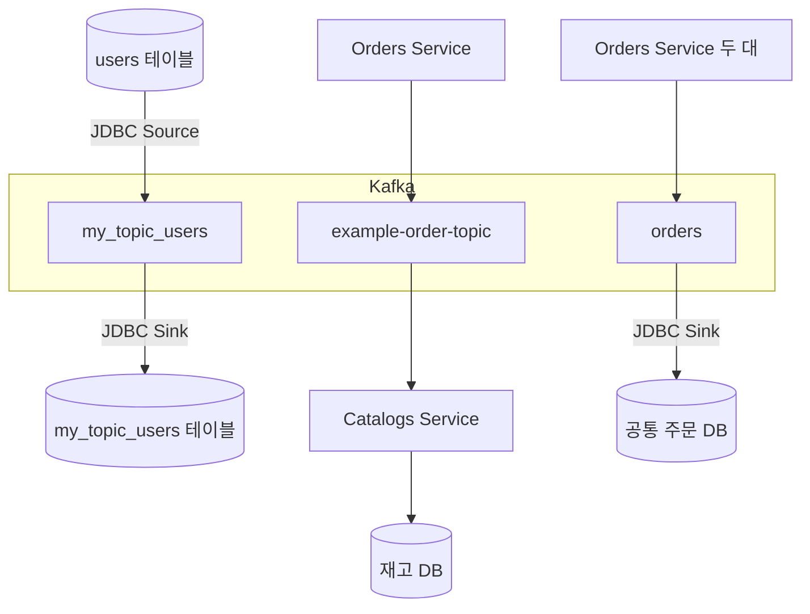
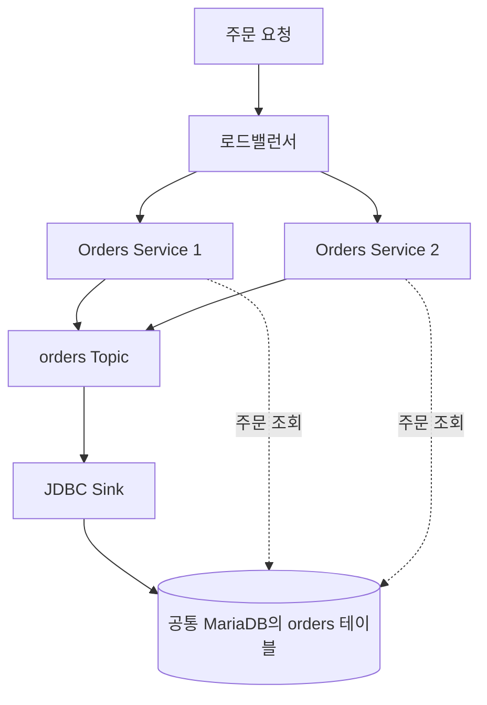

오늘은 "주문 서비스에서 주문이 생기면 상품 서비스의 재고와 주문 DB에 그 내용을 어떻게 전달할까?"라는 질문으로 Kafka를 이용한 데이터 동기화를 학습했다. Kafka가 이벤트를 보관하는 구조(Topic·Partition·Offset·Consumer Group)와 복제·전달 보장을 먼저 익혔다. 이어서 CLI로 메시지 왕복을 확인하는 방법과, Kafka Connect의 JDBC Source·Sink로 DB 테이블을 옮기는 설정 흐름을 정리했다.

후반에는 Spring Kafka로 주문 메시지를 보내 상품 재고를 줄이고, 여러 주문 서버의 주문을 JDBC Sink로 한 DB에 모으는 구성을 정리했다. 이 과정에서 생기는 동시 갱신·중복 이벤트·Dual Write·실패 메시지 문제와 이를 다루는 멱등 처리·Outbox·CDC·DLT, 운영에서 확인할 지표까지 이어서 살펴봤다.

> Kafka가 맡는 일은 이벤트를 보관하고 전달하는 것이고, 재고가 정확히 한 번 줄었는지 같은 업무 정합성은 애플리케이션이 설계해야 한다.

## 🎯 오늘의 학습 목표

- Topic·Partition·Offset·Consumer Group과 복제·ACK의 역할을 구분하고, 순서와 전달 보장이 어디까지 적용되는지 설명할 수 있다.
- Kafka Connect의 Worker·Connector·Task 구조를 이해하고, JDBC Source·Sink와 Schema·Payload 메시지로 DB 테이블을 옮기는 설정을 읽을 수 있다.
- Spring Kafka로 주문 메시지를 보내 재고를 줄이는 코드를 읽고, 동시 갱신과 중복 이벤트를 막는 방법을 구분해 설명할 수 있다.
- 비동기 저장 경로의 응답 의미, Dual Write와 Outbox, 실패 메시지 처리와 운영 지표를 연결해 설명할 수 있다.

## 📌 오늘의 핵심 요약

| 주제 | 핵심 내용 |
| --- | --- |
| Kafka가 필요한 이유 | 서비스마다 데이터 소유자가 달라, 변경 사실을 전달하고 보관할 공통 통로로 Kafka를 쓴다. |
| 보관과 읽기 구조 | 레코드는 Partition에 덧붙여 보관되고, Consumer Group은 Offset으로 각자 읽기 위치를 관리한다. |
| 내구성과 전달 보장 | 복제·acks는 Kafka 안의 데이터를 지키고, 정확히 한 번은 정해진 경계 안에서만 성립한다. |
| 실행 환경과 Connect | CLI로 Kafka를 먼저 확인한 뒤, JDBC Source·Sink와 Schema·Payload로 테이블을 옮긴다. |
| 주문과 재고 연동 | Spring Kafka로 주문 메시지를 보내 재고를 줄이고, 조건부 UPDATE와 eventId로 정합성을 지킨다. |
| 다중 서버와 실패 대비 | 여러 주문 서버의 주문을 Sink로 모으고, Outbox·DLT·운영 지표로 유실과 실패에 대비한다. |

## 🔄 오늘 학습 흐름

```text
서비스마다 데이터 소유자가 달라 변경 사실을 전달할 통로가 필요하다
    ↓ 그 통로가 데이터를 어떻게 저장하는지 알아야 한다
Kafka는 이벤트를 Partition에 덧붙여 보관하고 Offset으로 위치를 찾는다
    ↓ 여러 Consumer가 나누어 읽고, 장애에도 데이터를 지켜야 한다
Consumer Group으로 분담하고 복제·acks로 쓰기 안전성을 정한다
    ↓ 코드를 붙이기 전에 Kafka 자체가 동작하는지 확인한다
Kafka를 실행하고 CLI로 메시지 왕복과 읽기 위치를 확인한다
    ↓ 코드 없이 DB와 Kafka를 연결하는 실행 환경을 준비한다
Kafka Connect Worker와 JDBC 드라이버, MariaDB를 준비한다
    ↓ Connector 설정으로 실제 행을 옮긴다
JDBC Source·Sink와 Schema·Payload로 테이블을 옮긴다
    ↓ 행 복사가 아니라 업무 규칙이 필요한 흐름으로 넘어간다
Spring Kafka로 주문 메시지를 보내 상품 재고를 줄인다
    ↓ 동시 주문과 재전달이 재고를 틀어지게 할 수 있다
조건부 UPDATE와 eventId 처리 기록으로 재고 정합성을 지킨다
    ↓ 주문 서버를 여러 대 띄우면 주문 저장소가 갈라진다
주문 메시지를 Sink로 한 DB에 모으고 응답의 의미를 정한다
    ↓ DB 저장과 이벤트 발행 중 하나만 성공할 수 있다
Outbox·CDC와 이벤트 계약으로 유실과 중복에 대비한다
    ↓ 그래도 처리하지 못한 메시지는 남는다
재시도·DLT로 실패를 다루고 운영 지표로 상태를 확인한다
```

**본문 찾아보기**

1. [서비스 사이의 데이터 동기화와 Kafka가 필요한 이유](#1-서비스-사이의-데이터-동기화와-kafka가-필요한-이유)
2. [Kafka가 이벤트를 보관하는 구조와 Topic·Partition·Offset](#2-kafka가-이벤트를-보관하는-구조와-topicpartitionoffset)
3. [Consumer Group과 복제로 나누어 읽고 안전하게 쓰기](#3-consumer-group과-복제로-나누어-읽고-안전하게-쓰기)
4. [Kafka 실행 환경과 CLI로 메시지 왕복 확인하기](#4-kafka-실행-환경과-cli로-메시지-왕복-확인하기)
5. [Kafka Connect의 구조와 MariaDB 준비](#5-kafka-connect의-구조와-mariadb-준비)
6. [JDBC Source·Sink와 Schema·Payload로 테이블 옮기기](#6-jdbc-sourcesink와-schemapayload로-테이블-옮기기)
7. [Spring Kafka로 주문 메시지를 보내 재고 줄이기](#7-spring-kafka로-주문-메시지를-보내-재고-줄이기)
8. [재고 정합성을 지키는 동시성 제어와 멱등 처리](#8-재고-정합성을-지키는-동시성-제어와-멱등-처리)
9. [여러 주문 서버의 주문을 Kafka와 Sink로 한 DB에 모으기](#9-여러-주문-서버의-주문을-kafka와-sink로-한-db에-모으기)
10. [이벤트 유실을 막는 Outbox·CDC와 이벤트 설계](#10-이벤트-유실을-막는-outboxcdc와-이벤트-설계)
11. [실패 메시지 처리와 운영에서 확인할 지표](#11-실패-메시지-처리와-운영에서-확인할-지표)

## 📚 학습 내용

### 1. 서비스 사이의 데이터 동기화와 Kafka가 필요한 이유

마이크로서비스(업무별로 나뉜 작은 서비스가 각자 자기 데이터를 관리하며 협력하는 구조)에서는 주문 데이터는 주문 서비스가, 재고 데이터는 상품 서비스가 각자 관리한다. 그래서 주문 DB에 주문이 저장되어도 상품 DB의 재고는 저절로 줄지 않으며, 변화 내용을 다른 서비스에 전달할 별도 수단이 필요하다.

이 장에서는 오늘 다룬 세 가지 데이터 흐름을 먼저 보고, 직접 호출과 메시지 방식의 차이, 그리고 Kafka가 해 주는 일과 해 주지 않는 일을 구분한다.

#### 1.1 오늘 다룬 세 가지 데이터 흐름

오늘 내용은 세 가지 흐름으로 나누면 이해하기 쉽다. 세 흐름 모두 Kafka를 가운데 두지만, Kafka에 쓰는 쪽과 Kafka에서 읽어 반영하는 쪽이 다르다.



| 흐름 | Kafka에 쓰는 쪽 | Kafka에서 읽는 쪽 | 필요한 업무 규칙 |
| --- | --- | --- | --- |
| A. 테이블 옮기기 | JDBC Source Connector | JDBC Sink Connector | 없음. 행을 그대로 옮긴다. |
| B. 재고 줄이기 | Orders Service | Catalogs Service | 주문 수량만큼 재고를 뺀다. |
| C. 주문 모으기 | 여러 Orders Service | JDBC Sink Connector | 없음. 주문 행을 공통 DB에 저장한다. |

흐름 A는 DB에서 Kafka를 거쳐 DB로 가는 전 구간을, 흐름 C는 Kafka에서 공통 DB로 저장하는 구간을 애플리케이션 코드 없이 Connector 설정만으로 구성한다. 다만 흐름 C에서 Kafka에 주문을 쓰는 쪽은 여전히 Orders Service 코드다(9장). 흐름 B는 "주문 수량만큼 재고를 줄인다"는 **업무 규칙**이 있으므로 Spring으로 만든 Consumer가 직접 처리한다. 예를 들어 주문 전 재고가 100개이고 3개를 주문하면, 정상 반영 후 재고는 97개가 된다.

#### 1.2 데이터 동기화는 목적이고 동기 통신은 호출 방식이다

**데이터 동기화**는 관련된 여러 시스템의 데이터를 정해진 규칙에 맞춰 반영하는 일이다. 주문이 생기면 재고를 줄이고, 회원 정보가 바뀌면 검색용 저장소에도 반영하고, 결제가 끝나면 주문 상태를 바꾸는 것이 모두 동기화다.

이름이 비슷하지만 다음 용어들은 서로 다른 것을 가리킨다.

| 용어 | 뜻 | 오늘 예시 |
| --- | --- | --- |
| 데이터 동기화 | 관련 데이터를 규칙에 맞춰 맞추는 목적 | 주문 수량만큼 재고를 줄인다. |
| 동기 통신 | 요청한 작업의 응답을 기다리는 호출 방식 | 재고 API를 호출하고 응답을 기다린다. |
| DB 복제 | DB 엔진이 자체 기능으로 데이터를 다른 DB 노드에 그대로 복사하는 구성 | Connector가 Kafka를 거쳐 특정 테이블의 행을 옮기는 흐름 A와도 다르다. |
| 이벤트 동기화 | 업무 사건을 전달하고 받는 쪽이 자기 규칙대로 반영 | 주문 이벤트를 받아 재고를 차감한다. |

동기화가 항상 "같은 행을 그대로 복사한다"는 뜻은 아니다. 주문 DB와 상품 DB는 구조도 목적도 다르므로, 주문 수량을 보고 재고를 갱신하는 것도 동기화다. 또 동기화를 **비동기 통신**으로 수행할 수도 있으며, 오늘 강의가 바로 그 예다.

#### 1.3 REST로 직접 호출할지, Kafka에 메시지를 남길지

각 서비스는 자기 업무와 데이터를 관리한다. Orders Service는 주문 생성·조회·상태를, Catalogs Service는 상품 정보·판매 가능 여부·재고를, User Service는 회원 정보를 맡는다. 주문 사실을 재고에 반영하는 방법은 크게 두 가지다.

**REST 직접 호출 예시**

```http
PATCH /catalogs/CATALOG-001/stock
Content-Type: application/json

{"qty": 3}
```

| 비교 항목 | REST 직접 호출 | Kafka 메시지 |
| --- | --- | --- |
| 동작 | Orders가 Catalogs API를 호출하고 응답을 받는다. | Orders가 Kafka에 기록하고, Catalogs가 준비되었을 때 읽어 처리한다. |
| 장점 | 흐름이 직관적이고 성공 여부를 바로 알 수 있다. | 실행 시점을 분리하고, 소비자가 멈춰도 보관된 데이터를 나중에 처리할 수 있다. |
| 고려할 점 | 상대가 느리거나 멈추면 호출자도 영향을 받아 타임아웃·재시도·중복 요청을 설계해야 한다. | 응답과 반영 사이 시간 차, 중복·재처리·실패 메시지 관리, Kafka 운영 비용이 생긴다. |
| 어울리는 일 | 결과가 당장 필요한 조회와 검증 | 지연을 허용하고 여러 업무가 함께 쓰는 사건 전달 |

비동기 HTTP 클라이언트를 써도 상대 서비스의 응답에 의존한다는 점은 남는다. 호출한 스레드가 기다리는지와 서비스끼리 얼마나 묶여 있는지는 다른 문제이기 때문이다.

**방식을 고르는 기준**

- 결과를 지금 알아야 하는가?
- 일부 지연을 허용할 수 있는가?
- 여러 시스템이 같은 사건을 활용해야 하는가?
- 실패했을 때 다시 처리할 필요가 큰가?

두 방식은 함께 쓸 수 있다. 상품의 현재 가격 조회는 REST로 하고, 주문 접수 후 알림·통계 갱신은 Kafka로 전달하는 식이다. Kafka를 쓰면 호출 대기와 결합은 줄지만 **비동기 처리의 복잡성**이 새로 생기므로, 서비스 간 모든 통신을 Kafka로 바꿀 필요는 없다.

#### 1.4 최종적 일관성은 복구 장치가 있어야 성립한다

**최종적 일관성**(Eventual Consistency)은 서로 다른 저장소의 상태가 잠시 다를 수 있지만, 정상 처리와 복구가 이루어지면 나중에 맞춰지는 방식이다. 주문과 재고 사이에는 다음과 같은 시간 차가 생긴다.

```text
18:00:00.000 주문 접수
    ↓ 주문 정보를 Kafka에 기록
18:00:00.030 주문 이벤트 저장
    ↓ 상품 서비스가 이벤트를 읽어 처리
18:00:00.150 재고 반영
```

0.000초부터 0.150초 사이에는 주문은 있는데 재고는 아직 줄지 않은 순간이 존재한다. 비동기 동기화를 선택하면 이 틈을 정상 상태의 일부로 받아들이고 설계해야 한다.

> [!WARNING]
> 최종적 일관성은 "언젠가 알아서 맞는다"는 뜻이 아니다. 이벤트 보관, 재시도, 중복 방지, 실패 복구가 갖춰져야 하며, 영구 실패를 방치하면 데이터는 계속 어긋난다.

#### 1.5 이벤트·명령·메시지·레코드와 Producer·Consumer

Kafka 관련 글에서 비슷하게 쓰이는 말들이지만, 업무상 사건과 전달 형식을 구분해 두면 설계가 선명해진다.

| 용어 | 뜻 | 예시 |
| --- | --- | --- |
| 이벤트(Event) | 업무에서 이미 발생한 사실 | "주문 O-100이 생성되었다." |
| 명령(Command) | 특정 작업을 해 달라는 요청 | "상품 재고를 3개 줄여라." |
| 메시지(Message) | 사실이나 요청을 전달하려고 담은 데이터 | 주문 정보를 담은 JSON 문자열 |
| 레코드(Record) | Kafka가 저장하고 주고받는 단위로, Key·Value·Timestamp·Headers를 가질 수 있다. | Key `CATALOG-001` + 주문 JSON Value |

명령은 받는 쪽이 거절하거나 실패할 수 있는 요청이지만, 이벤트는 이미 일어난 사실이라 받는 쪽이 되돌릴 수 없다. 그래서 이벤트 이름은 실제 업무 상태와 맞아야 하며, 재고 확보가 끝나지 않았는데 "주문 확정" 이벤트를 먼저 보내면 이름과 실제 상태가 어긋난다.

**Producer**는 Kafka에 데이터를 보내는 쪽(생산자), **Consumer**는 Kafka에서 데이터를 읽는 쪽(소비자)이다. 이는 역할 이름이므로 그 이름의 Java 클래스를 꼭 만들 필요가 없고, 하나의 애플리케이션이 두 역할을 함께 맡을 수도 있다. 흐름 A의 JDBC Source도 Kafka에 쓰므로 Producer 역할을 한다.

**Broker**는 데이터를 받아 저장하고, 요청한 소비자에게 내주는 Kafka 서버다. 여러 애플리케이션 사이에서 공통 기능을 제공하는 소프트웨어를 미들웨어라고 하는데, Kafka를 단순히 메시지를 넘겨주는 미들웨어로만 보면 보관과 다시 읽기라는 핵심 특징을 놓치게 된다.

#### 1.6 Kafka가 맡는 일과 애플리케이션이 설계할 일

원본 시스템 3개가 대상 시스템 4개에 각각 데이터를 보내면 연결 관계가 최대 12개 생긴다. Kafka를 공통 통로로 두면 각 시스템은 Kafka에 보내거나 Kafka에서 읽기만 하면 되므로 연결이 단순해진다. 다만 Kafka가 업무 데이터 형식까지 통일해 주지는 않으므로, 이벤트 이름·필드·자료형·버전은 여전히 서비스끼리 합의해야 한다.

**Kafka가 제공하는 기반**

- 이벤트 저장과 전송
- Partition 단위의 순서
- Consumer Group을 통한 분산 소비
- 복제를 통한 장애 대응
- 보관된 이벤트의 재소비

**애플리케이션이 설계할 내용**

- 중복 주문 차단
- 같은 이벤트로 재고가 두 번 줄지 않게 하는 처리
- DB 트랜잭션
- 잘못된 수량·상품 검증
- 실패 이벤트 처리와 보상

> Kafka는 전달의 기반이고, 업무 정합성은 각 서비스의 설계 몫이다. 오늘 나오는 대부분의 주의점은 이 둘을 구분하는 데서 출발한다.

### 2. Kafka가 이벤트를 보관하는 구조와 Topic·Partition·Offset

1장에서 Kafka를 서비스 사이의 공통 통로로 쓰기로 했다면, 이제 그 통로가 데이터를 어떻게 저장하고 내주는지 알아야 한다. 이 구조를 알아야 "왜 읽어도 사라지지 않는지", "순서는 어디까지 보장되는지"를 설명할 수 있다.

이 장에서는 Kafka를 덧붙이는 기록장으로 이해한 뒤 Broker·Controller, Topic·Partition, Offset·Key 순서로 구조를 쌓는다.

#### 2.1 Kafka는 기록을 뒤에 덧붙이는 분산 로그다

**Kafka**는 이벤트를 여러 서버에 나누어 저장하고, 여러 소비자가 각자의 위치에서 읽을 수 있게 하는 분산 이벤트 스트리밍 플랫폼이다. 여기서 "로그"는 에러 출력 파일이 아니라, 발생한 기록을 뒤에 차례대로 덧붙이는 **데이터 구조**를 뜻한다.

Topic을 특정 주제의 기록장이라고 생각하면 쉽다. Producer는 기록장 맨 뒤에 새 기록을 덧붙이고, Consumer는 자기 책갈피 위치부터 읽는다. 다른 Consumer는 자기 책갈피를 따로 가지므로, 한 사람이 읽었다고 다른 사람이 못 읽는 일은 없다. 실제 Kafka에서는 기록장이 여러 Partition으로 나뉘고, 책갈피도 Partition마다 따로 관리한다.

"스트리밍"이라는 말은 데이터를 다루는 방식과 관련이 있다.

| 용어 | 뜻 |
| --- | --- |
| 데이터 파이프라인 | 데이터가 수집·변환·전달·저장되는 일련의 경로 |
| 데이터 스트림 | 시간에 따라 계속 발생하는 데이터의 흐름 |
| 배치 처리 | 데이터를 모아 일정 단위로 처리하는 방식 |
| 스트림 처리 | 계속 들어오는 데이터를 연속으로 처리하는 방식 |

스트림 처리가 항상 "한 건씩 즉시 처리"를 뜻하지는 않는다. 내부에서는 작은 묶음으로 보내거나 처리하기도 한다.

#### 2.2 읽어도 지워지지 않고 보관 정책에 따라 남는다

Kafka는 일반적으로 소비가 끝났는지와 상관없이 **보관 정책**(Retention)에 따라 레코드를 유지한다.

| 보관 정책 | 동작 |
| --- | --- |
| 시간 기준 | 일정 시간 동안 보관한다. |
| 크기 기준 | 일정 크기를 넘으면 오래된 데이터부터 정리한다. |
| Log Compaction | 같은 Key의 최신 값을 중심으로 남기고 정리한다. |

반대로 Consumer가 아직 읽지 않았더라도, 보관 범위를 넘은 오래된 데이터는 제거될 수 있다. "읽으면 삭제"도 "읽을 때까지 영원히 보관"도 아닌 셈이다.

보관 중인 데이터는 과거 위치로 돌아가 다시 읽을 수 있다. Consumer 버그를 고친 뒤 재처리하거나, 새 검색 인덱스·분석 시스템을 추가할 때 과거 이벤트부터 쌓을 수 있다.

> [!WARNING]
> 다시 읽으면 업무 동작도 다시 실행된다. 재고 차감이나 결제 요청처럼 반복하면 결과가 달라지는 작업은 중복 효과를 막는 장치가 있어야 한다(8장).

#### 2.3 Broker·Cluster·Controller는 맡는 일이 다르다

| 구성 요소 | 정체 | 주요 역할 |
| --- | --- | --- |
| Broker | Kafka 서버 프로세스 | 쓰기·읽기 요청 처리, Partition 데이터 저장, 다른 Broker와 복제 |
| Cluster | 여러 Broker가 함께 동작하는 구성 | 데이터 분산, 부하 분산, 일부 서버 장애 대응 |
| Controller | Cluster를 관리하는 역할 | 메타데이터와 Leader 선출 같은 관리 작업 |

한 Broker는 여러 Topic의 여러 Partition을 저장할 수 있다. Controller가 관리하는 **메타데이터**는 "데이터에 대한 데이터"로, 어떤 Topic이 있는지, Partition이 어느 Broker에 있는지, 각 Partition의 Leader가 누구인지, 어떤 Broker가 정상 참여 중인지 같은 정보다.

"Kafka는 Broker가 3대 이상이어야 실행된다"는 말은 틀리다. 로컬 학습은 Broker 1대로도 가능하고, 운영에서 자주 쓰는 3대 구성은 복제와 장애 허용을 위한 선택이다. 또 Controller가 메시지 내용을 받아 재고를 계산하지는 않는다. 데이터 처리 업무와 Cluster 관리는 다른 역할이다.

#### 2.4 ZooKeeper 방식과 KRaft 방식은 버전과 실행 모드로 구분한다

예전 Kafka는 **ZooKeeper**라는 외부 시스템으로 Cluster 관리 정보를 유지했고, Broker 중 한 대가 Controller 역할을 맡았다. ZooKeeper에 주문 메시지가 저장되는 것은 아니며, Consumer Group의 일반적인 Offset 관리도 Kafka 내부 Topic을 쓴다. 그러므로 ZooKeeper를 모든 Kafka 상태의 저장소로 외우면 안 된다.

**KRaft**는 Kafka가 자체 합의 구조로 메타데이터를 관리하는 방식이다. Controller 역할의 노드들이 메타데이터 로그를 복제하고, 그중 활성 Controller가 관리를 맡는다. 노드 역할은 `broker`, `controller`, 둘을 함께 맡는 `broker,controller` 결합 구성이 있으며, 로컬에서는 결합 구성이 쓰기 쉽다.

| 버전 | 메타데이터 관리 방식 |
| --- | --- |
| Kafka 3.9 계열 | ZooKeeper 방식과 KRaft 방식이 모두 있고, 설정 파일과 실행 방식에 따라 정해진다. |
| Kafka 4.0부터 | ZooKeeper 방식이 제거되어 KRaft만 사용한다. |

Kafka 3.9.1을 설치했다고 무조건 ZooKeeper를 쓰는 것은 아니므로, 버전보다 **실제 실행 모드**를 확인해야 한다. 강의의 "Broker 중 1대가 Controller" 설명은 ZooKeeper 기반 구조이므로 KRaft의 별도 Controller 구성에 그대로 대입하지 않는다.

"Leader"라는 말도 두 곳에서 나온다.

| 이름 | 관리 범위 |
| --- | --- |
| Partition Leader | 특정 Partition의 읽기·쓰기와 복제를 주도한다. |
| 활성 Controller | Cluster 메타데이터와 Leader 선출 등을 관리한다. |

#### 2.5 Topic과 Partition, 그리고 순서가 보장되는 범위

**Topic**은 데이터를 분류하는 이름이다. 오늘은 `orders`, `example-order-topic`, `my_topic_users` 같은 Topic을 쓴다. Producer는 어느 Topic에 보낼지, Consumer는 어느 Topic을 읽을지 지정한다.

Topic은 DB 테이블 그 자체가 아니다. JDBC Sink가 기본 설정에서 Topic 이름을 대상 테이블 이름으로 쓸 뿐이다.

**Partition**은 Topic을 나눈 실제 저장 단위다. `orders` Topic을 Partition 3개로 만들면 주문이 다음처럼 나뉘어 저장될 수 있다.

| Partition | 저장된 주문 |
| --- | --- |
| Partition 0 | 주문 A, 주문 D |
| Partition 1 | 주문 B, 주문 E |
| Partition 2 | 주문 C, 주문 F |

Partition은 여러 Broker에 배치되어 부하를 나누며, 저장·순서·소비 병렬성의 기본 단위다.

Kafka의 순서는 **같은 Partition 안**에서만 정의된다. Partition 0에서 Offset 10은 11보다 앞서지만, Partition 1의 Offset 5와 Partition 0의 Offset 10 사이에는 전역 순서가 없다. 그래서 여러 Partition을 병렬로 처리하면 먼저 보낸 주문이 먼저 끝난다고 보장할 수 없다.

같은 Partition이라도 받은 레코드를 별도 스레드에 넘겨 병렬 실행하거나 재시도 Topic으로 우회시키면 처리 완료 순서가 달라질 수 있다. Kafka의 저장 순서와 업무 처리 완료 순서는 다른 이야기다.

#### 2.6 Offset으로 위치를 찾고 Lag로 뒤처짐을 본다

**Offset**은 Partition 안에서 각 레코드를 식별하는 증가하는 번호다. 다른 Partition에 같은 Offset이 있을 수 있으므로, 레코드 위치를 특정하려면 보통 Topic + Partition + Offset을 함께 본다.

```text
orders / Partition 0 / Offset 0
orders / Partition 0 / Offset 1
orders / Partition 1 / Offset 0
```

Offset은 주문 ID도, Topic 전체의 일련번호도 아니다. 보관 기간이 지나 앞부분이 지워지면 시작 번호가 0이 아닐 수 있고, Compaction이나 트랜잭션 표시 레코드 때문에 번호 사이에 빈 구간이 생길 수도 있다.

Consumer는 보통 `poll()`을 호출해 레코드를 가져오며, 소비자가 원할 때 가져가는 이 방식을 **Pull 방식**이라고 한다. 7장의 Spring `@KafkaListener`도 콜백처럼 보이지만, 내부의 리스너 컨테이너(Consumer를 대신 실행해 주는 Spring 구성 요소)가 `poll()`을 반복 호출하는 구조이며, Kafka가 Java 메서드를 네트워크로 직접 호출하지는 않는다.

"위치"라는 말은 세 가지를 구분해야 한다.

| 위치 | 뜻 |
| --- | --- |
| 레코드 Offset | Partition에 저장된 각 기록의 위치 |
| 현재 읽기 위치 | Consumer가 `poll()`로 읽어 온 다음 위치. 읽었다고 업무 처리가 끝난 것은 아니다. |
| Committed Offset | Consumer Group이 재시작할 때 이어 읽을 위치로 저장한 값. 보통 다음에 읽을 Offset을 기록한다. |

예를 들어 Offset 0~9를 처리하고 10을 커밋했다면, 재시작 후 보통 Offset 10부터 이어 읽는다. 커밋한 값이 "마지막으로 처리한 번호"가 아니라 "다음에 읽을 번호"라는 점이 중요하다.

**Lag**는 Partition 로그 끝과 Group의 소비 위치 사이의 Offset 차이로, 아직 처리하지 않고 남은 양을 나타낸다. 걸린 시간이 아니라 "얼마나 쌓였는지"를 보는 값이다. Partition 끝의 다음 Offset이 100이고 Group의 Committed Offset이 80이면 Lag는 대략 20으로 표시될 수 있다. 압축·트랜잭션 등의 영향으로 실제 업무 건수와 정확히 같지 않을 수 있으며, Lag가 크면 처리 지연을 의심할 수 있지만 Lag가 0이라고 모든 업무가 성공한 것은 아니다.

#### 2.7 Key로 관련 이벤트를 같은 Partition에 모은다

Kafka 레코드는 Key와 Value를 가질 수 있다.

```text
Key:   CATALOG-001
Value: {"orderId":"O-100","productId":"CATALOG-001","qty":3}
```

기본적인 Key 기반 분배에서는 같은 직렬화 Key가 같은 Partition에 배치된다. 그래서 같은 상품의 재고 이벤트를 한 흐름으로 묶고 싶다면 `productId`를 Key로 고르는 식으로 설계할 수 있다.

**같은 Key가 같은 Partition에 가는 전제**

- Partition 수가 그대로다. Partition을 늘리면 Key의 배치가 달라질 수 있다.
- Producer들이 같은 파티셔닝 규칙을 쓴다.
- Partition 번호를 따로 강제로 지정하지 않는다.

Key 없이도 보낼 수 있지만, 이때 분배 방식은 Producer 버전과 Partitioner 설정에 따라 달라진다. "Key가 없으면 정확히 한 건씩 돌아가며 나눈다"고 단정하지 말고, 특정 업무의 순서가 필요하면 Key를 명시적으로 설계한다.

> [!WARNING]
> Key는 중복 방지 장치가 아니다. 같은 Key로 두 번 보내면 일반적으로 레코드 두 개가 생긴다. 같은 업무 이벤트가 다시 왔는지는 Key가 아니라 이벤트마다 붙인 고유 식별자(`eventId`)로 판단한다.

| 식별 기준 | 쓰임 |
| --- | --- |
| Key | Partition 배치, 관련 이벤트 묶기, Compaction 기준 |
| `eventId` | 동일한 업무 이벤트가 다시 전달되었는지 판단 |

#### 2.8 Kafka와 작업 큐·Redis Pub/Sub의 차이

Kafka의 보관·다시 읽기 특징은 다른 메시징 기술과 비교하면 더 선명해진다.

| 기술 | 대표적인 사용 방식 | 비교할 점 |
| --- | --- | --- |
| 일반 작업 큐 | Consumer가 작업을 처리하고 ACK하면 큐에서 제거한다. | Kafka는 레코드를 보관하고 Group별 Offset으로 읽기 위치를 관리한다. |
| RabbitMQ | 작업 라우팅과 큐 처리에 강하고, AMQP라는 통신 규약을 쓴다. | Streams처럼 보관·재읽기와 연결되는 기능도 있어 "항상 삭제만 한다"고 단정할 수 없다. |
| Redis Pub/Sub | 지금 구독 중인 상대에게 메시지를 전달한다. | 과거 메시지 보관·재소비를 전제로 하지 않으며, 별도 구조인 Redis Streams와 구분한다. |

Kafka는 자체 프로토콜과 생태계를 사용하므로, 비동기 메시징이라는 공통점과 실제 통신 규약은 구분해야 한다. 기술을 고를 때는 이벤트를 오래 보관하고 다시 읽어야 하는지, 여러 독립 업무가 같은 사건을 소비하는지, 라우팅·큐 처리가 핵심인지, 팀이 익숙한 운영 도구와 순서·처리량·지연 목표가 무엇인지 따진다. Kafka가 항상 더 빠르거나 모든 상황에 더 적절한 것은 아니다.

> 순서와 위치는 항상 Partition을 기준으로 생각한다. Topic은 분류이고, Partition은 저장과 순서의 단위이며, Offset은 그 Partition 안의 위치다.

### 3. Consumer Group과 복제로 나누어 읽고 안전하게 쓰기

2장에서 데이터가 Partition에 어떻게 놓이는지 봤다. 이제 읽는 쪽에서 여러 Consumer가 일을 나누는 방법과, 쓰는 쪽에서 서버 장애에도 데이터를 지키는 방법을 정리할 차례다.

이 장은 Consumer Group의 분담 규칙, 복제와 acks, 전달 보장의 세 단계를 다루고 마지막으로 "어디까지 완료되었는가"를 나타내는 세 가지 표시를 구분한다.

#### 3.1 같은 Group은 나누어 읽고 다른 Group은 각자 읽는다

**Consumer Group**은 여러 Consumer가 같은 업무를 나누어 처리하기 위한 묶음이며 `group.id`로 구분한다. Catalogs Service를 여러 대 띄우고 같은 `group.id = catalog-service`로 묶으면 재고 반영 작업을 나누어 처리할 수 있다.

일반적인 할당에서 하나의 Partition은 한 시점에 같은 Group의 Consumer 하나가 맡고, 한 Consumer는 여러 Partition을 맡을 수 있다. 서로 다른 Group은 같은 Topic을 독립적으로 읽고 각자의 읽기 위치를 관리한다.

다음은 Partition 3개짜리 `example-order-topic`을 두 Group이 읽을 때의 할당 예다.

| Partition | catalog-service Group | notification-service Group |
| --- | --- | --- |
| Partition 0 | Consumer A | Consumer C |
| Partition 1 | Consumer A | Consumer C |
| Partition 2 | Consumer B | Consumer C |

같은 Group은 **분담**하고, 다른 Group은 **독립적으로** 읽는다. 그래서 일반 Consumer 두 개로 같은 메시지를 각각 확인하고 싶다면 서로 다른 Group을 쓰면 된다.

#### 3.2 group.id를 잘못 정하면 중복 차감이나 누락이 생긴다

| 잘못된 설정 | 결과 |
| --- | --- |
| 상품 서비스 인스턴스마다 다른 `group.id`를 준다. | 각 인스턴스가 같은 주문을 따로 읽어, 공통 재고 DB가 같은 주문으로 여러 번 줄어들 수 있다. |
| 상품 서비스와 알림 서비스에 같은 `group.id`를 준다. | 둘 다 모든 주문을 받아야 하는데 나누어 받아, 재고 반영이나 알림이 누락된다. |

기준은 간단하다. 같은 논리적 업무의 복제 인스턴스는 **같은 Group**, 서로 다른 논리적 업무는 **다른 Group**으로 묶는다.

#### 3.3 Consumer 수와 concurrency, 그리고 Rebalance

Partition이 3개인데 같은 Group의 Consumer가 5개라면, 일반적인 할당에서는 2개가 할 일을 받지 못한다. Consumer를 늘리기 전에 다음을 확인한다.

- Partition 수가 충분한가?
- DB 처리 속도가 병목인가?
- 특정 Key에 이벤트가 몰리는가?
- 한 건 처리에 너무 오래 걸리는가?

Spring의 `concurrency=3`은 하나의 리스너 컨테이너에서 Consumer 여러 개를 실행하는 설정이다. 애플리케이션 2대가 각각 `concurrency=3`이면 최대 6개 Consumer가 Group에 참여하지만, 실제 병렬성은 Partition 할당에 제한되므로 숫자를 높인다고 성능이 비례해 오르지 않는다.

Consumer가 추가되거나 종료되면 Group은 담당 Partition을 다시 나누는데, 이를 **Rebalance**라고 한다. 처리 시간이 지나치게 길거나 `poll()`이 오래 멈춰도 정상 참여 중이 아니라고 판단될 수 있다. Rebalance 뒤에는 아직 커밋하지 않은 데이터가 다른 Consumer에게 다시 전달될 수 있으므로, Group이 있다고 **중복 처리가 사라지는 것은 아니다**.

지금까지의 구조는 "Topic은 분류, Partition은 분할, Offset은 위치, Group은 소비 업무의 묶음"이라는 문장으로 정리할 수 있다.

#### 3.4 Partition 복제와 Leader·Follower·ISR

Broker가 한 대이고 그 서버의 저장 장치가 고장 나면 데이터를 잃을 수 있다. 같은 Partition의 복사본을 여러 Broker에 두면 일부 장애에서도 다른 복사본으로 계속 서비스할 수 있다.

**Replication Factor**는 한 Partition의 복사본 개수이며 Leader도 개수에 포함된다. Replication Factor가 3이면 Leader 1개와 Follower 2개다. Broker가 1대라면 복제 계수 3으로 만들 수 없으므로, 로컬 1대 실습은 보통 복제 계수 1을 쓴다.

Producer는 일반적으로 해당 Partition의 Leader에 기록하고, Follower는 Leader의 데이터를 복제한다. Leader에 장애가 나면 적절한 복사본 중에서 새 Leader를 선출할 수 있다.

| 구분 | 목적 | 담는 데이터 |
| --- | --- | --- |
| Partition 분할 | 작업과 저장 부하를 나눈다. | Partition마다 서로 다른 레코드 |
| Partition 복제 | 장애에 대비한다. | 같은 Partition의 같은 레코드 복사본 |

**ISR**(In-Sync Replicas)은 Leader를 충분히 따라잡고 있는 복제본의 집합이며 Leader도 포함된다. 전체 복제본이 3개라도 일부 Follower가 뒤처지면 현재 ISR은 2개일 수 있다.

#### 3.5 acks와 min.insync.replicas로 쓰기 성공 기준을 정한다

Producer의 `acks`는 "어디까지 기록되었을 때 성공으로 볼까"를 정하는 설정이다.

| 설정 | 성공으로 보는 기준 | 위험 |
| --- | --- | --- |
| `acks=0` | Broker의 확인을 기다리지 않는다. | 쓰기 실패를 감지하기 어렵다. |
| `acks=1` | Leader가 기록했음을 확인한다. | Follower 복제 전에 Leader를 잃으면 데이터가 사라질 수 있다. |
| `acks=all` (`-1`) | 현재 ISR의 확인을 기준으로 판단한다. | `min.insync.replicas`와 함께 봐야 의미가 정해진다. |

`acks=all`은 "운영 중인 모든 Broker가 확인한다"는 뜻이 아니라, 해당 Partition의 ISR이 기준이다. `min.insync.replicas`는 Producer가 아니라 Broker·Topic 쪽에 두는 설정으로, `acks=all`일 때 쓰기를 허용하기 위한 최소 ISR 수다.

```text
Replication Factor=3, min.insync.replicas=2, acks=all
    ↓ Follower 하나가 뒤처져도 ISR이 2개 이상이면
쓰기를 허용한다
    ↓ Follower가 더 빠져 ISR이 1개로 줄면
내구성 기준을 만족하지 못해 쓰기가 실패한다
```

복제본이 부족한데도 무조건 성공시키는 정책이 아니라, **가용성과 내구성** 사이에서 선택하는 설정이다. Broker 한 대, 복제 계수 1인 실습에서는 `acks=all`을 써도 다른 서버에 복사본이 생기지 않는다.

> [!NOTE]
> Kafka 3.0부터 Producer의 기본값이 `acks=all`과 `enable.idempotence=true`로 바뀌었다. 멱등 전송 기본값은 버그 때문에 3.0.1·3.1.1·3.2.0부터 실제로 적용되었고, 충돌하는 설정을 직접 주면 꺼질 수 있으므로 실제 설정값을 확인한다.

#### 3.6 Producer 멱등 전송과 세 가지 전달 보장

**멱등**(같은 작업을 여러 번 해도 한 번 한 것과 결과가 같은 성질) 전송을 켜는 `enable.idempotence=true`는 Producer가 네트워크 문제로 재전송할 때 같은 레코드가 중복 기록되는 문제를 줄이는 기능이다. 관련 설정인 `acks`, `retries`, `max.in.flight.requests.per.connection`도 서로 호환되어야 한다. 또 이 보호는 같은 Producer 인스턴스가 실행 중인 동안의 재전송에만 적용되므로, 프로세스가 재시작한 뒤 다시 보내는 것은 막지 못한다.

이 기능은 **전송 단계의 중복**만 다룬다. 사용자가 주문 버튼을 두 번 누르거나, 서버가 같은 이벤트를 코드로 다시 발행하거나, Consumer가 같은 이벤트를 다시 받아 DB를 또 갱신하는 업무 단계의 중복은 막지 못한다.

Consumer 쪽에서는 "읽은 위치를 언제 저장하느냐"에 따라 전달 보장이 달라진다.

| 보장 | 동작 | 감수하는 위험 |
| --- | --- | --- |
| 최대 한 번(At-most-once) | 처리하기 전에 위치를 저장한다. | 장애가 나면 처리하지 못한 데이터를 건너뛰어 누락될 수 있다. |
| 최소 한 번(At-least-once) | 처리한 뒤에 위치를 저장한다. | 장애 후 같은 데이터를 다시 처리해 중복될 수 있다. |
| 정확히 한 번(Exactly-once) | 정해진 시스템 경계와 트랜잭션 조건 안에서 결과를 한 번 반영한다. | 경계 밖의 외부 시스템은 보장 범위에 들어가지 않는다. |

> [!WARNING]
> "Kafka를 설치했으니 모든 DB 변경이 정확히 한 번 반영된다"는 틀린 말이다. Kafka 트랜잭션 기반의 읽기-처리-쓰기 흐름과 외부 MariaDB의 재고 변경은 같은 범위가 아니므로, 외부 DB에는 별도의 멱등 처리가 필요하다.

#### 3.7 Producer ACK·Offset Commit·DB Commit은 서로 다른 완료 표시다

비동기 흐름에서는 "완료"라는 말이 세 곳에서 나온다.

| 완료 표시 | 누가 기록하는가 | 의미 |
| --- | --- | --- |
| Producer ACK | Kafka가 Producer에게 응답 | 보낸 레코드를 기록했다는 확인 |
| Consumer Offset Commit | Consumer Group | 재시작할 때 이어 읽을 위치 저장 |
| DB Commit | DB 트랜잭션 | 변경 사항 확정 |

어느 하나가 성공했다고 나머지 둘도 성공한 것은 아니다. Kafka 전송이 성공해도 상품 DB 반영은 아직일 수 있고, DB 반영이 성공해도 Offset Commit 전에 Consumer가 종료될 수 있다.

같은 이유로 **Kafka 내부 복제**와 **서비스 데이터 동기화**도 구분한다. Kafka 내부 복제는 Partition 데이터를 Broker 사이에서 복사하는 일이고, 서비스 데이터 동기화는 주문 사실을 재고나 다른 저장소에 반영하는 일이다. Broker 복제 설정만으로는 재고 중복 차감이나 주문 DB 저장 누락을 해결할 수 없다.

> 복제와 acks는 Kafka 안의 데이터를 지키고, Offset Commit은 읽기 위치를 지킨다. 업무 결과가 정확히 한 번 반영되었는지는 DB 쪽 설계로 따로 보장해야 한다.

### 4. Kafka 실행 환경과 CLI로 메시지 왕복 확인하기

지금까지 Kafka의 구조를 이해했으니 이제 실제로 실행하는 방법을 정리할 차례다. Spring이나 Connect를 붙이기 전에 Kafka에 포함된 콘솔 도구로 메시지가 오가는지 먼저 확인하면, 이후 오류를 Kafka 문제와 애플리케이션 문제로 나누기 쉽다.

이 장의 명령어는 따로 표시하지 않으면 macOS·Linux의 bash 기준이다. 이 장에서는 실행 방식을 정하고, 접속 주소를 이해한 뒤 CLI로 Topic을 만들고 메시지와 읽기 위치를 확인한다.

#### 4.1 실습은 한 단계씩 붙이며 확인한다

이 실습 구성에서는 Kafka, Connect, MariaDB, Spring 애플리케이션이 모두 연결된다. 한 번에 전체를 붙이면 어디서 막혔는지 알기 어려우므로, 다음 순서로 한 단계씩 증거를 남기며 넓혀 간다.

```text
Kafka만 확인: 콘솔 Producer로 보낸 메시지를 콘솔 Consumer로 읽는다
    ↓ 메시지 왕복이 되면 DB 쪽을 준비한다
DB 접속 확인: DB Client로 JDBC URL·계정·테이블을 확인한다
    ↓ DB가 준비되면 Source를 붙인다
Source만 확인: users에 넣은 행이 my_topic_users Topic에 나타나는지 본다
    ↓ Topic에 행이 보이면 Sink를 붙인다
Sink 확인: Topic의 레코드가 대상 테이블의 행으로 저장되는지 본다
    ↓ DB 왕복이 되면 애플리케이션을 붙인다
Spring Producer 확인: 주문 요청 후 재고용 Topic에 메시지가 있는지 본다
    ↓ 메시지가 보이면 받는 쪽을 확인한다
Spring Consumer 확인: 메시지를 받아 재고가 줄었는지 본다
    ↓ 한 서버에서 되면 서버를 늘린다
다중 Orders Service 확인: 두 인스턴스의 주문이 orders Topic을 거쳐 공통 DB에 쌓이는지 본다
```

중간 단계마다 확인 결과를 남겨 두면, 문제가 생겼을 때 원인을 그 단계 안으로 좁힐 수 있다.

#### 4.2 버전과 설치 방식부터 정한다

강의 자료에는 Kafka 2.7 계열의 Windows 화면, Kafka 3.9.1 설치 안내, 이전 Confluent 배포판이 함께 나온다. 그래서 먼저 "강의 환경을 그대로 재현할 것인가, Kafka 4.x KRaft 환경으로 개념을 실습할 것인가"를 정하고, 서로 다른 버전의 실행 스크립트·설정 파일·드라이버를 이름만 보고 섞지 않는다.

| 설치 방식 | 특징 |
| --- | --- |
| 바이너리 압축 파일 | 실행에 필요한 결과물이 포함된 배포판이다. |
| 소스 압축 파일 | 개발 소스 중심이라 빌드가 필요할 수 있다. |
| Docker | 미리 구성된 실행 이미지를 컨테이너로 띄운다. 포트·네트워크·볼륨 개념이 필요하다. |

`Classpath is empty. Please build the project first`라는 오류가 나오면 먼저 바이너리 배포판을 받았는지 확인한다. 구형 강의에서 배치 파일을 고친 것은 특정 배포판의 문제 해결 예이므로, 현재 환경의 스크립트에 같은 수정부터 적용하지 않는다. 강의 환경을 재현할 때는 Kafka·Java·Connect·JDBC Connector·DB 드라이버의 호환 조합을 먼저 맞춘다.

#### 4.3 Kafka 4.x를 KRaft 방식으로 시작하기

해당 버전의 바이너리 배포판을 압축 해제한 디렉터리에서 실행하며, Java 17 이상과 새 로컬 학습용 저장 디렉터리를 전제로 한다. Kafka 4.0부터 Broker·Connect·도구는 Java 17, 클라이언트 라이브러리는 Java 11 이상이 필요하다.

```bash
KAFKA_CLUSTER_ID="$(bin/kafka-storage.sh random-uuid)"

bin/kafka-storage.sh format --standalone \
  -t "$KAFKA_CLUSTER_ID" \
  -c config/server.properties

bin/kafka-server-start.sh config/server.properties
```

| 명령 | 하는 일 |
| --- | --- |
| `random-uuid` | Cluster ID를 만든다. |
| `format` | 새 저장 디렉터리에 초기 메타데이터를 준비한다. |
| `--standalone` | 이 예제의 단일 Controller 초기 구성을 만든다. |
| `kafka-server-start.sh` | 실제 Kafka 서버를 실행한다. |

**`format`은 처음 한 번만** 실행하는 초기화 명령이다. 서버를 켤 때마다 실행하는 명령이 아니며, 기존 데이터를 가진 Cluster의 복구나 업그레이드에 쓰지 않는다. Kafka 3.x의 KRaft 예제는 `config/kraft/server.properties`처럼 경로와 초기화 옵션이 다를 수 있으므로, 위 명령을 다른 버전 설정에 그대로 쓰지 않는다.

ZooKeeper 방식을 지원하는 이전 배포판에서는 ZooKeeper를 먼저 켜고 Broker를 켠다.

```bash
# 터미널 1
bin/zookeeper-server-start.sh config/zookeeper.properties

# 터미널 2
bin/kafka-server-start.sh config/server.properties
```

Kafka 4.x에는 ZooKeeper 실행 파일이 없으므로 이를 찾으며 설치를 진행하면 안 된다. KRaft 방식과 ZooKeeper 방식 중 하나의 절차만 따른다.

#### 4.4 포트와 접속 주소가 가리키는 곳을 구분한다

| 포트 | 용도 |
| --- | --- |
| 9092 | Kafka 클라이언트 접속 |
| 8083 | Kafka Connect 관리 REST API |
| 3306 | MariaDB |
| 2181 | 이전 ZooKeeper 구성의 대표 포트 |

Spring 애플리케이션, Gateway, Eureka 포트와는 각각 별개다. **`bootstrap.servers`**는 클라이언트가 처음 접속할 Broker 주소 목록이다(`localhost:9092`, 여러 대라면 `broker-a:9092,broker-b:9092`). 클라이언트는 처음 접속한 뒤 Cluster 메타데이터를 받아 필요한 Broker와 통신한다.

`bootstrap.servers`에 Connect의 8083을 넣으면 안 된다. 브라우저로 9092에 접속했을 때 웹 화면이 뜨지 않는 것도 자연스러운데, 9092는 HTTP가 아닌 Kafka 프로토콜 통신용 포트이기 때문이다.

Broker 설정의 `listeners`는 Broker가 실제로 접속을 받을 주소·포트이고, `advertised.listeners`는 클라이언트에게 "다음부터는 이 주소로 접속하라"고 알려 주는 주소다. 둘이 어긋나면 다음과 같은 일이 생긴다.

```text
클라이언트가 localhost:9092로 처음 접속한다
    ↓ Broker가 메타데이터와 함께 광고 주소를 알려 줌
Broker가 "kafka:9092로 접속하라"고 응답한다
    ↓ 클라이언트가 알려 준 주소로 다시 연결
호스트 PC가 kafka라는 이름을 찾지 못해 이후 통신이 실패한다
```

Docker에서는 `localhost`의 의미도 달라진다. 호스트 PC에서 `localhost`는 내 PC 자신이지만, 컨테이너 안에서 `localhost`는 그 컨테이너 자신이다. Connect가 컨테이너에 있고 MariaDB가 다른 컨테이너라면 Connect 설정의 `localhost:3306`은 MariaDB를 가리키지 않으므로, 같은 Docker 네트워크에서는 서비스 이름 등을 쓴다.

**Kafka에 연결되지 않을 때 확인 순서**

| 확인 대상 | 확인할 것 |
| --- | --- |
| Broker | 프로세스가 실행 중인가? |
| 접속 주소 | `bootstrap.servers` 주소와 포트가 맞는가? 8083과 9092를 바꿔 넣지 않았는가? |
| 네트워크 | 클라이언트 위치에서 그 주소로 접근할 수 있는가? |
| 광고 주소 | `advertised.listeners`가 클라이언트가 접근 가능한 주소를 알려 주는가? |
| Docker | 컨테이너 내부와 호스트의 `localhost`를 혼동하지 않았는가? |
| 보안 설정 | 사용하는 Kafka 프로토콜·보안 설정이 서로 맞는가? |

`Broker unavailable`, `Connection refused`, `Timeout` 같은 증상은 위 순서로 좁혀 간다.

#### 4.5 Topic을 만들고 상세 정보 확인하기

```bash
bin/kafka-topics.sh --bootstrap-server localhost:9092 \
  --create --topic quickstart-events \
  --partitions 1 --replication-factor 1

bin/kafka-topics.sh --bootstrap-server localhost:9092 --list

bin/kafka-topics.sh --bootstrap-server localhost:9092 \
  --describe --topic quickstart-events
```

`--create`는 생성, `--list`는 목록 확인, `--describe`는 상세 확인이다. 강의 자료의 항목 제목보다 실제 옵션을 기준으로 이해하고, "이미 존재한다"는 오류는 같은 생성 요청을 다시 보낸 경우일 수 있다. `--describe` 결과에서는 PartitionCount, ReplicationFactor, Partition별 Leader, Replicas, ISR을 확인한다.

오늘 실습에 쓸 Topic은 미리 만들어 두면 이후 설정을 확인하기 좋다. 다음은 세 Topic을 Partition 1개, 복제 계수 1로 만드는 설명용 예제다.

```bash
for topic in my_topic_users example-order-topic orders; do
  bin/kafka-topics.sh --bootstrap-server localhost:9092 \
    --create --topic "$topic" \
    --partitions 1 --replication-factor 1
done
```

자동 Topic 생성에만 의존하면 Topic 이름의 오타가 새 Topic으로 만들어져, 잘못된 설정을 늦게 발견할 수 있다.

#### 4.6 콘솔 Producer와 Consumer로 메시지 왕복 확인하기

터미널 두 개를 열고, 한쪽은 메시지를 보내고 다른 쪽은 읽는다.

```bash
# 터미널 1: 메시지 보내기
bin/kafka-console-producer.sh \
  --bootstrap-server localhost:9092 \
  --topic quickstart-events

# 터미널 2: 처음부터 읽기
bin/kafka-console-consumer.sh \
  --bootstrap-server localhost:9092 \
  --topic quickstart-events \
  --from-beginning
```

Producer 터미널에서 다음처럼 입력한다. 기본 콘솔 Producer는 한 줄을 메시지 하나로 취급하며 `Ctrl+C`로 종료한다.

```text
hello kafka
second message
```

Consumer 터미널을 켜 둔 상태에서 Producer 터미널에 새 줄을 입력하면 바로 읽히는 것을 확인할 수 있다.

Windows에서는 스크립트 경로와 확장자가 다르다.

```powershell
.\bin\windows\kafka-topics.bat --bootstrap-server localhost:9092 --list
```

bash의 줄 연결 기호는 역슬래시(`\`)지만 Windows CMD와 PowerShell은 줄 연결·인용 문법이 다르므로, 헷갈리면 명령을 한 줄로 입력한다.

#### 4.7 처음부터 읽기 옵션과 Group별 읽기 위치

`--from-beginning`은 사용 가능한 과거 데이터의 처음부터 읽도록 **시작 기준**을 지정하는 옵션이다. 하지만 이미 유효한 Committed Offset이 있는 Group에 이 옵션을 줘도 기존 위치가 강제로 초기화되지는 않는다.

| 상황 | 결과 |
| --- | --- |
| 새 Group + `--from-beginning` | 보관 중인 과거 데이터부터 읽는다. |
| 기존 Group + 유효한 Offset | 보통 기존 위치에서 이어 읽는다. |

정말 다시 읽으려면 새 학습용 Group을 쓰거나 정해진 절차로 Offset을 조정한다. 다음처럼 Group을 다르게 지정하면 두 Group이 같은 데이터를 각자 읽는다.

```bash
bin/kafka-console-consumer.sh --bootstrap-server localhost:9092 \
  --topic quickstart-events --group study-console-a --from-beginning

bin/kafka-console-consumer.sh --bootstrap-server localhost:9092 \
  --topic quickstart-events --group study-console-b --from-beginning
```

> [!WARNING]
> 운영 중인 재고 Consumer를 새 Group으로 무작정 실행하면 과거 주문을 처음부터 다시 읽어 재고를 또 차감할 수 있다. 데이터를 관찰하는 실험은 업무 변경을 하지 않는 콘솔 Consumer로 한다.

#### 4.8 Key·Partition·Offset 출력과 Consumer Group 상태 보기

Key를 포함해 보내려면 Key와 Value를 나누는 구분자를 지정한다.

```bash
bin/kafka-console-producer.sh \
  --bootstrap-server localhost:9092 \
  --topic quickstart-events \
  --property parse.key=true \
  --property key.separator=:
```

```text
CATALOG-001:{"productId":"CATALOG-001","qty":3}
```

첫 번째 콜론 앞이 Key, 뒤가 Value로 해석된다. 읽을 때 Key·Partition·Offset을 함께 출력하면 메시지가 어느 Partition의 어느 위치에 들어갔는지 볼 수 있다.

```bash
bin/kafka-console-consumer.sh \
  --bootstrap-server localhost:9092 \
  --topic quickstart-events \
  --from-beginning \
  --property print.key=true \
  --property print.partition=true \
  --property print.offset=true
```

> [!NOTE]
> Kafka 4.2부터 콘솔 Producer의 `--property`는 `--reader-property`로, 콘솔 Consumer의 `--property`는 `--formatter-property`로 이름이 바뀌었다. 이전 이름도 경고와 함께 동작하지만 다음 메이저 버전에서 제거될 예정이다.

Consumer Group의 진행 상황은 다음 명령으로 본다.

```bash
bin/kafka-consumer-groups.sh \
  --bootstrap-server localhost:9092 \
  --describe --group catalog-service
```

| 항목 | 뜻 |
| --- | --- |
| `CURRENT-OFFSET` | Group이 커밋한 위치 |
| `LOG-END-OFFSET` | Partition 로그의 끝 위치 |
| `LAG` | 두 위치의 차이. 아직 처리하지 않은 레코드 수다. |

Consumer를 한 번도 실행하지 않은 Group은 정보가 없을 수 있다.

> CLI로 메시지 왕복과 읽기 위치를 먼저 확인해 두면, 이후 문제가 Kafka 바깥의 Connect나 애플리케이션 쪽에 있다고 범위를 좁힐 수 있다.

### 5. Kafka Connect의 구조와 MariaDB 준비

흐름 A처럼 DB 테이블의 행을 Kafka로 가져오고 다시 다른 테이블에 넣는 일은, 애플리케이션에 Producer·Consumer 코드를 쓰지 않고 **Kafka Connect** 설정으로 구성할 수 있다. 다만 Connect는 Broker와 별개의 실행 환경이므로 따로 실행하고, DB에 접속할 플러그인과 드라이버도 따로 준비해야 한다.

이 장에서는 Connect의 구성 요소와 Worker 설정, 플러그인 설치와 관리 API를 이해하고, Connector가 읽고 쓸 MariaDB를 준비한다.

#### 5.1 Connect는 외부 시스템과 Kafka 사이의 이동을 설정으로 구성한다

**Kafka Connect**는 Kafka와 외부 시스템 사이의 데이터 이동을 구성하는 프레임워크다. DB 데이터를 Kafka로 가져오거나, Kafka 데이터를 다른 DB·파일·검색 엔진·객체 저장소로 내보낼 수 있다. Broker가 데이터를 보관하는 서버라면, Connect는 외부 시스템과 데이터를 주고받는 실행 환경이다.

**Connector**는 특정 외부 시스템에 연결하는 플러그인과 그 설정이며, JDBC Source Connector와 JDBC Sink Connector가 오늘의 예다. 그래서 "Connect를 실행했다"와 "JDBC Connector를 등록했다"는 서로 다른 단계다.

Kafka와 데이터를 주고받는 도구를 함께 비교하면 Connect의 자리가 보인다.

| 도구 | 하는 일 | 오늘 기준의 예 |
| --- | --- | --- |
| Kafka Client | 애플리케이션이 Producer·Consumer·Admin API를 직접 사용한다. | 주문을 받아 재고를 줄이는 업무 Consumer |
| Kafka Connect | 외부 저장소와 Kafka 사이 이동을 플러그인·설정으로 구성한다. | users 테이블을 Topic으로 수집 |
| Kafka Streams | Kafka 데이터를 애플리케이션에서 변환·집계·조인하는 Java 라이브러리다. | 시간대별 주문 수 집계를 검토할 수 있는 처리 |

Connect는 기존 플러그인이 지원하는 이동을 설정만으로 구성해 줄 뿐, 주문 수량에 따른 재고 차감, 재고 부족 시 주문 취소, 이벤트별 중복 차단, 서비스별 권한 판단, 복잡한 가격 계산 같은 업무를 설계해 주지 않는다. 이런 일이 필요하면 애플리케이션 Consumer나 별도 처리 계층을 둔다.

#### 5.2 Source·Sink의 방향과 Worker·Connector·Task

Source는 외부에서 Kafka로, Sink는 Kafka에서 외부로 데이터를 옮긴다. 기준점은 언제나 **Kafka**이므로, MariaDB는 어떤 흐름에서는 Source DB, 다른 흐름에서는 Sink DB가 될 수 있다.

| 구성 요소 | 역할 |
| --- | --- |
| Worker | Connector와 Task를 실제로 실행하는 Connect 프로세스 |
| Connector | 데이터 이동 작업 전체의 설정과 Task 구성을 관리 |
| Task | 실제로 데이터를 읽거나 쓰는 작업 단위 |

한 Worker가 여러 Connector의 Task를 실행할 수 있고, 한 Connector는 지원 범위 안에서 여러 Task로 나뉠 수 있다. `tasks.max`는 Task 수의 **상한**이라 값을 늘린다고 항상 그만큼 생기지 않는다. 예를 들어 테이블 하나를 읽는 JDBC Source에 `tasks.max=10`을 줘도 테이블을 열 조각으로 나누어 동시에 읽지 않으며, JDBC Sink의 병렬 소비는 Topic의 Partition 수에도 제한받는다.

#### 5.3 Standalone과 Distributed, Worker 설정과 Connector 설정

| 실행 방식 | 특징 | 설정·Source Offset 저장 위치 |
| --- | --- | --- |
| Standalone | 단일 프로세스 중심으로 로컬 테스트 등에 쓴다. | 로컬 파일이 일반적이다. |
| Distributed | 여러 Worker가 Task를 나누어 맡을 수 있다. | Kafka 내부 Topic |

오늘 실습은 Distributed 방식으로 Worker를 실행하고 REST API로 Connector를 등록한다. Standalone도 REST API를 제공하지만 보통 실행할 때 넘기는 설정 파일로 Connector를 정하고, Distributed에서는 REST로 등록한 설정이 내부 Topic에 보관된다. 이름이 Distributed여도 Worker 1개로 시작할 수 있으며 여러 대가 필수는 아니다.

| 설정 종류 | 정하는 내용 | 적용 시점 |
| --- | --- | --- |
| Worker 설정 | 접속할 Kafka, 플러그인 위치, Converter, 내부 Topic | Worker 실행 전 설정 파일에 둔다. |
| Connector 설정 | 대상 DB·테이블·Topic과 이동 방식 | Worker 실행 후 REST API로 등록한다. |

#### 5.4 Distributed Worker 설정 읽기

다음은 Broker 한 대를 쓰는 로컬 실습에서 배포판의 `connect-distributed.properties`에 반영할 핵심 설정이다.

**Kafka 접속과 Converter**

```properties title="connect-distributed.properties" {6}
bootstrap.servers=localhost:9092
group.id=connect-study-cluster

key.converter=org.apache.kafka.connect.storage.StringConverter
value.converter=org.apache.kafka.connect.json.JsonConverter
value.converter.schemas.enable=true
```

**내부 Topic·REST 주소·플러그인 위치**

```properties title="connect-distributed.properties"
config.storage.topic=study-connect-configs
offset.storage.topic=study-connect-offsets
status.storage.topic=study-connect-status

config.storage.replication.factor=1
offset.storage.replication.factor=1
status.storage.replication.factor=1

listeners=http://0.0.0.0:8083
plugin.path=/absolute/path/to/connect-plugins
```

| 설정 | 의미 |
| --- | --- |
| `bootstrap.servers` | Worker가 접속할 Kafka |
| `group.id` | 같은 Connect Cluster에 참여할 Worker 묶음 |
| `key.converter`, `value.converter` | Kafka의 Key·Value와 Connect 자료형 사이의 변환기 |
| `*.storage.topic` | Connector 설정·Source Offset·상태를 보관할 내부 Topic |
| `*.replication.factor=1` | Broker 한 대 실습에 맞춘 내부 Topic 복제 계수 |
| `listeners` | Connect 관리 REST API를 받을 주소. 4.4의 Broker `listeners`와 이름만 같은 별개 설정이다. |
| `plugin.path` | Connector와 그 의존성을 찾을 위치 |

첫 번째 블록 6번째 줄의 `value.converter.schemas.enable=true`는 Kafka에 오가는 JSON을 schema와 payload를 함께 담은 형태로 쓰겠다는 뜻이며, 6장에서 자세히 다룬다. 내부 Topic이 이미 다른 설정으로 만들어져 있다면, 설정 파일의 복제 계수만 고쳐도 기존 Topic이 자동으로 바뀌지는 않는다.

> [!WARNING]
> Spring Consumer의 `group.id`는 재고 반영 같은 소비 업무의 인스턴스를 묶고, Connect Worker의 `group.id`는 같은 Connect Cluster에 참여할 Worker를 묶는다. 이름이 같아도 적용 대상이 다르므로 값을 서로 분리한다. 같은 Connect Cluster에 참여시킬 Worker끼리는 `group.id`와 내부 Topic 설정을 똑같이 맞추고, 독립된 Connect Cluster끼리는 내부 Topic 이름이 겹치지 않게 정한다.

#### 5.5 JDBC Connector 플러그인과 드라이버는 Worker가 읽는 곳에 둔다

JDBC로 DB에 연결하려면 **JDBC Connector 플러그인**과 대상 DB에 맞는 **JDBC Driver**가 함께 필요하다. 일반적인 플러그인 격리 구성에서는 JDBC Connector의 라이브러리 디렉터리에 MariaDB 드라이버 JAR도 함께 둔다.

```text
connect-plugins/
  jdbc/
    lib/
      JDBC Connector JAR 파일들
      MariaDB JDBC Driver JAR 파일
```

배포판에 따라 강의처럼 공용 `share/java/kafka` 경로를 쓰기도 한다. 어느 경로든 중요한 것은 Worker가 플러그인 JAR를 읽어 들이는 경로(클래스 로더)에서 그 드라이버를 실제로 찾을 수 있는지다.

| 프로세스 | 드라이버를 찾는 곳 |
| --- | --- |
| Spring 애플리케이션 | 자기 프로젝트 의존성에 포함된 MariaDB 드라이버 |
| Kafka Connect Worker | Worker의 플러그인·클래스 로딩 경로 |

둘은 별도 프로세스이므로 한쪽에만 드라이버를 추가하면 다른 쪽은 계속 접속에 실패할 수 있다. 애플리케이션의 `.m2` 폴더에 파일이 있다고 Worker가 그 파일을 읽지는 않으며, 여러 Worker로 운영한다면 각 Worker에서 플러그인을 쓸 수 있어야 하고 설치·교체 후에는 Worker를 다시 시작해야 할 수 있다.

#### 5.6 Worker 실행과 REST 관리 API

Worker 실행 스크립트의 이름과 경로는 배포판에 따라 다르다.

| 배포판 | 대표 실행 형태 |
| --- | --- |
| Apache Kafka | `bin/connect-distributed.sh config/connect-distributed.properties` |
| 일부 Confluent 배포판 | `bin/connect-distributed etc/kafka/connect-distributed.properties` |
| Windows(Apache Kafka) | `.\bin\windows\connect-distributed.bat .\config\connect-distributed.properties` |
| Windows(강의의 Confluent 배포판) | `.\bin\windows\connect-distributed.bat .\etc\kafka\connect-distributed.properties` |

Worker가 뜨면 8083 포트의 REST API로 Connector를 관리한다.

| 요청 | 하는 일 |
| --- | --- |
| `GET /connector-plugins` | 설치된 플러그인 목록 |
| `GET /connectors` | 등록된 Connector 이름 목록 |
| `GET /connectors/커넥터이름/config` | 개별 설정 조회 |
| `GET /connectors/커넥터이름/status` | 개별 실행 상태 조회 |
| `POST /connectors` | Connector 신규 등록 |
| `PUT /connectors/커넥터이름/config` | Connector 설정 생성·갱신 |

POST와 PUT은 **요청 본문의 모양**이 다르다. POST는 이름과 설정을 포장해서 보내고, PUT은 설정 객체만 보낸다.

**`POST /connectors` 요청 본문**

```json
{"name": "my-source-connect", "config": {"tasks.max": "1"}}
```

**`PUT /connectors/커넥터이름/config` 요청 본문**

```json
{"tasks.max": "1"}
```

두 본문 모두 설정 내용은 줄여서 표시했다. PUT에는 바깥의 `name`·`config` 포장을 붙이지 않는다.

Connector의 상태가 RUNNING이어도 개별 Task는 FAILED일 수 있다. status 응답에서는 `connector.state`, 각 Task의 `state`, 실패한 Task의 `trace`를 함께 보며, REST 등록 요청이 성공했다는 사실을 DB 저장까지 성공한 증거로 보지 않는다.

#### 5.7 JDBC 접속 정보와 MariaDB 준비

| 용어 | 뜻 |
| --- | --- |
| JDBC | Java에서 DB에 접속하고 SQL을 실행하기 위한 표준 인터페이스 |
| JDBC Driver | 특정 DB와 실제로 통신하는 구현체. MariaDB에는 MariaDB용 드라이버가 필요하다. |
| JPA | Java 객체와 관계형 DB 데이터를 연결하는 ORM(객체-관계 매핑) 표준. 애플리케이션의 객체 중심 DB 접근에 쓴다. |

JPA는 애플리케이션이 DB를 다룰 때 쓰고, JDBC Connector는 Kafka Connect가 DB를 읽고 쓸 때 쓴다. MariaDB 드라이버 클래스는 `org.mariadb.jdbc.Driver`이고 JDBC URL은 다음처럼 읽는다.

| URL 부분 | 의미 |
| --- | --- |
| `jdbc:` | Java JDBC 접속임을 나타낸다. |
| `mariadb:` | 드라이버 프로토콜 |
| `localhost` | 접속할 DB 호스트 |
| `3306` | DB 포트 |
| `mydb` | 데이터베이스 이름 |

강의에는 `jdbc:mysql` URL과 MariaDB 드라이버를 함께 쓴 예가 있는데, 그 조합이 되는지는 드라이버 버전과 설정에 따라 다르다. MariaDB 드라이버를 쓴다면 `jdbc:mariadb://localhost:3306/mydb`처럼 URL도 맞추는 편이 명확하다.

MariaDB는 macOS에서 `brew install mariadb`, Windows에서 MSI 설치 파일이나 ZIP 배포판, 또는 Docker 컨테이너로 설치할 수 있다. 강의의 MariaDB 10.5 경로, 비밀번호 변경 문법, Windows 서비스 등록 명령은 해당 버전의 예이므로, 설치 방식이 다르면 그대로 입력했을 때 경로·인증 오류가 날 수 있다.

#### 5.8 학습용 DB·계정과 users 테이블 만들기

학습 편의상 같은 MariaDB의 `mydb` 안에 Source가 읽을 원본 `users` 테이블과 Sink가 쓸 대상 `my_topic_users` 테이블을 나란히 둔다. 운영에서는 원본과 대상이 서로 다른 DB일 수 있다. 다음은 관리자 권한의 SQL 세션에서 실행하는 예다.

```sql
CREATE DATABASE IF NOT EXISTS mydb
  CHARACTER SET utf8mb4
  COLLATE utf8mb4_unicode_ci;

CREATE USER IF NOT EXISTS 'connect_lab'@'localhost'
  IDENTIFIED BY 'connect_lab_pw';

GRANT SELECT, INSERT, UPDATE, DELETE, CREATE, ALTER
  ON mydb.*
  TO 'connect_lab'@'localhost';
```

`connect_lab_pw`는 새 학습 환경의 예시 비밀번호이며, Connector JSON의 계정·비밀번호도 실제로 만든 값과 맞춘다. MariaDB 계정은 접속을 허용할 호스트 조건(`'connect_lab'@'localhost'`의 `localhost` 부분)을 함께 가지므로, Docker 등 다른 호스트에서 접속하면 주소가 맞아도 계정 조건 때문에 거절될 수 있다.

```sql
USE mydb;

CREATE TABLE users (
  id INT NOT NULL AUTO_INCREMENT PRIMARY KEY,
  user_id VARCHAR(256),
  name VARCHAR(256)
);

INSERT INTO users (user_id, name)
VALUES ('user01', 'TEST USER');

SELECT * FROM users ORDER BY id;
```

**테이블**은 데이터를 행과 열로 저장하는 구조이고, 한 **행**은 사용자 한 명 같은 데이터 항목, 열은 `id`·`user_id`·`name` 같은 속성이다. 기본 키(PK)는 행을 고유하게 식별하는 컬럼이며, 고유 제약(Unique)은 같은 값이 중복 저장되지 못하게 막는 규칙이다.

`id`는 `AUTO_INCREMENT`라 생략하면 DB가 증가하는 번호를 자동으로 채우고, Source Connector는 이 컬럼을 새 행을 찾는 기준으로 쓴다. `user_id`는 업무에서 쓰는 사용자 식별자이므로, DB 내부 번호인 `id`와 역할이 다르다.

> [!NOTE]
> H2 Console은 DB에 접속하는 웹 기반 SQL 클라이언트 화면이고, H2 Database는 데이터를 저장하는 DB 엔진이다. 드라이버가 있으면 H2 Console 화면으로 MariaDB에 접속할 수도 있으며, 이때 실제 저장소는 입력한 JDBC URL이 가리키는 DB다.

#### 5.9 Connect와 DB 준비 단계에서 자주 막히는 지점

| 증상 | 확인할 것 |
| --- | --- |
| Connect REST API에 연결되지 않는다. | Worker가 실제 실행 중인지, 시작 로그에 오류가 있는지, 8083 포트를 다른 프로그램이 쓰는지, `listeners` 설정이 맞는지 |
| Connector 등록이 이름 때문에 실패한다. | 같은 `name`의 Connector가 이미 있는지, 새로 만들려는지 기존 설정을 고치려는지 |
| Connector 등록이 형식 때문에 실패한다. | POST의 `name`·`config` 포장과 PUT의 설정 본문을 구분했는지 |
| Connector 클래스를 찾을 수 없다. | `GET /connector-plugins`에 보이는지, `plugin.path`가 실제 위치인지, 압축 폴더가 한 단계 더 들어가 있지 않은지, 설치 후 재시작했는지 |
| `No suitable driver` 또는 Driver 클래스 오류 | 드라이버 JAR가 Connector가 읽는 경로에 있는지, URL 프로토콜과 드라이버가 맞는지, Worker가 새 드라이버를 읽었는지 |
| `Access denied` | 사용자명·비밀번호, 계정의 호스트 조건, 원본 조회 권한과 대상 쓰기·DDL 권한 |
| 서로 다른 DB를 보고 있다. | `mydb`와 `my_db`처럼 이름이 섞이지 않았는지, SQL Client가 현재 선택한 DB가 무엇인지 |

등록 실패는 HTTP 상태 코드와 응답 본문을 함께 읽는다. 애플리케이션에서 DB 접속이 성공해도 Connect의 드라이버 설치가 끝났다는 증거는 아니며, 권한 문제는 재시도 횟수를 늘려도 해결되지 않는다. Windows의 `.properties` 파일에서는 역슬래시가 이스케이프 문자로 해석될 수 있어, `plugin.path`를 `C:/Work/connect-plugins`처럼 슬래시로 쓰면 혼동을 줄일 수 있다.

> Connect를 실행한 것, Connector를 등록한 것, Task가 실제로 데이터를 옮긴 것은 각각 따로 확인해야 하는 단계다.

### 6. JDBC Source·Sink와 Schema·Payload로 테이블 옮기기

5장에서 준비한 Worker에 Connector를 등록해 흐름 A를 완성한다. `users` 테이블의 새 행을 JDBC Source가 `my_topic_users` Topic으로 보내고, JDBC Sink가 그 Topic을 읽어 같은 이름의 테이블에 저장한다.

이 장에서는 두 Connector의 설정을 읽고, 중간 메시지가 왜 schema와 payload를 함께 담는지, 그리고 각 수집 모드가 놓치는 변경은 무엇인지 정리한다.

#### 6.1 Source Connector 등록 JSON 읽기

애플리케이션에서 사용자 전송용 Producer 코드를 쓰는 대신, JDBC Source Connector가 DB를 주기적으로 조회해 새 행을 Topic에 기록한다. 등록 전에 다음이 준비되어 있어야 한다.

- Kafka와 Connect Worker가 실행 중이다.
- `mydb.users` 테이블이 있고, DB 계정이 이를 조회할 수 있다.
- JDBC Connector와 MariaDB 드라이버가 Worker에서 로딩된다.
- `my_topic_users` Topic이 준비되어 있다.
- Worker의 Value Converter가 schema/payload 형식과 맞는다.

```json title="users-source.json" {8-11}
{
  "name": "my-source-connect",
  "config": {
    "connector.class": "io.confluent.connect.jdbc.JdbcSourceConnector",
    "connection.url": "jdbc:mariadb://localhost:3306/mydb",
    "connection.user": "connect_lab",
    "connection.password": "connect_lab_pw",
    "mode": "incrementing",
    "incrementing.column.name": "id",
    "table.whitelist": "users",
    "topic.prefix": "my_topic_",
    "poll.interval.ms": "1000",
    "tasks.max": "1"
  }
}
```

8~9번째 줄은 `id` 컬럼이 커지는 행을 새 행으로 본다는 수집 기준이고, 10~11번째 줄은 `users` 테이블만 읽어 `my_topic_` 접두사를 붙인 Topic에 쓰라는 뜻이다. 파일로 저장한 뒤 다음처럼 등록한다.

```bash
curl -X POST http://localhost:8083/connectors \
  -H "Content-Type: application/json" \
  --data-binary @users-source.json
```

| 설정 | 의미 |
| --- | --- |
| `name` | Connect에서 이 작업을 식별하는 이름. Topic 이름과 별개다. |
| `connector.class` | JDBC Source 플러그인의 Java 클래스 |
| `connection.*` | DB 접속 정보 |
| `mode=incrementing` | 이전에 읽은 값보다 큰 증가 컬럼을 가진 행을 찾는다. |
| `table.whitelist=users` | 수집할 테이블을 `users`로 제한한다. |
| `topic.prefix=my_topic_` | 테이블명 앞에 붙여 `my_topic_users` Topic 이름을 만든다. |
| `poll.interval.ms=1000` | 약 1초 간격으로 DB 조회를 시도한다(기본값은 5000ms). 끝까지 반영되는 시간이 정확히 1초라는 보장은 아니다. |
| `tasks.max=1` | 최대 Task 수를 1로 제한한다. |

비슷해 보이는 세 이름은 적용 위치가 다르다. `my-source-connect`는 관리 API에서 쓰는 Connector 이름, `my_topic_users`는 데이터를 기록하는 Kafka Topic 이름, `users`는 원본 DB 테이블 이름이다.

#### 6.2 등록 후 상태와 Topic 메시지 확인하기

```bash
curl http://localhost:8083/connectors
curl http://localhost:8083/connectors/my-source-connect/status
curl http://localhost:8083/connectors/my-source-connect/config
```

`jq`가 있으면 `| jq`를 붙여 보기 좋게 출력할 수 있는데, 기본 내장 도구가 아닐 수 있고 없어도 요청 자체는 가능하다. Windows에서 `curl` 별칭 문제를 피하려면 `curl.exe`를 명시할 수 있다. Connector 상태가 RUNNING인지와 Task도 정상 실행 중인지 함께 확인한 뒤, 원본 테이블에 행을 추가하고 Topic을 읽어 본다.

```sql
INSERT INTO users (user_id, name)
VALUES ('user02', 'TEST ADMIN');
```

```bash
bin/kafka-console-consumer.sh \
  --bootstrap-server localhost:9092 \
  --topic my_topic_users \
  --from-beginning
```

Worker가 schema/payload JSON을 쓰도록 설정되어 있다면 schema와 payload를 가진 메시지를 볼 수 있다. 원본 DB에 데이터가 하나도 없다면 시작 직후 Topic이 비어 있는 것이 정상이다. 반대로 이미 있던 행도 처음 실행할 때 수집 대상이 될 수 있으므로, "등록한 뒤 추가된 행만 읽는다"고 단정하지 않는다.

#### 6.3 incrementing 모드는 새로 늘어난 행만 찾는다

incrementing 모드의 동작은 다음 개념 SQL로 이해할 수 있다. 실제 SQL은 DB Dialect(DB별 SQL 문법 차이를 반영하는 방식)와 Connector 구현에 따라 다르다.

```sql
SELECT *
FROM users
WHERE id > 마지막으로_기억한_id
ORDER BY id;
```

지난 수집 위치가 `id=5`이고 그사이 `id=6, 7`이 추가되었다면, 다음 조회에서 6과 7을 찾아 보낸다. 여기서 기억하는 `id`는 **Source Connector의 수집 위치**이며, Kafka Partition의 Offset과는 다른 번호다.

이 방식은 이미 수집한 행의 변경을 잡지 못한다. `UPDATE users SET name = 'CHANGED NAME' WHERE id = 2;`처럼 기존 행을 고치면 `id`가 커지지 않으므로 수정 사실을 놓치고, 이미 읽은 행을 삭제해도 증가 번호 조회로는 알 수 없다.

증가 번호 순서와 트랜잭션 커밋 순서가 다를 때도 놓치는 행이 생길 수 있다.

```text
트랜잭션 A가 id=10을 할당받고 오래 실행된다
    ↓ 그사이 다른 트랜잭션이 먼저 끝남
트랜잭션 B가 id=11을 먼저 커밋한다
    ↓ Source가 조회
Source가 11까지 읽고 마지막 위치를 11로 기억한다
    ↓ 뒤늦게 A가 커밋
id=10 행이 생기지만 "11보다 큰 id"만 찾으므로 놓친다
```

| 수집 모드 | 찾는 변경 | 고려할 점 |
| --- | --- | --- |
| `bulk` | 조회할 때마다 대상 행 전체 | 단순하지만 반복 적재와 부하를 고려해야 한다. |
| `incrementing` | 증가 컬럼이 커진 새 행 | 기존 행의 UPDATE·DELETE를 잡지 못한다. |
| `timestamp` | 변경 시각 컬럼이 바뀐 새 행과 수정된 행 | 같은 시각 값, 시간 정밀도, 늦은 커밋을 고려해야 한다. |
| `timestamp+incrementing` | 변경 시각과 증가 식별자를 함께 사용 | 시각이 같은 행을 구분하기 쉽지만 물리 삭제는 여전히 모른다. |

`timestamp+incrementing`도 DB 로그를 모두 읽는 CDC와 같지 않다. 조회 사이에 여러 번 바뀐 중간 상태를 모두 보존하지 못할 수 있으므로, 삭제까지 포착하려면 소프트 삭제 컬럼과 변경 시각을 함께 관리하거나 로그 기반 CDC(10장)처럼 요구에 맞는 방식을 고른다.

#### 6.4 Source Offset과 새 데이터가 오지 않을 때

Connector는 어디까지 읽었는지 저장하며, Distributed 모드에서는 이 **Source Offset**이 내부 Topic에 저장된다. 그래서 일반적인 재시작은 저장된 수집 위치에서 이어 간다.

- Connector를 삭제하고 다시 등록했다고 항상 처음부터 읽는 것은 아니다.
- 같은 이름과 수집 식별 정보라면 기존 Offset이 재사용될 수 있다.
- 원본 `id`를 초기화해 과거보다 작은 번호를 넣으면 읽지 못할 수 있다.

Source는 RUNNING인데 새 데이터가 Topic에 나타나지 않는다면 다음을 확인한다. **정상 실행**과 **변경 감지 조건 충족**은 다른 문제다.

| 확인 대상 | 확인할 것 |
| --- | --- |
| INSERT | 실제로 Commit했는가? |
| DB | Source가 읽는 DB와 Client가 쓰는 DB가 같은가? |
| 수집 대상 | `table.whitelist`가 `users`인가? 확인 중인 Topic 이름이 정확한가? |
| 수집 기준 | 새 `id`가 마지막 수집 `id`보다 큰가? 기준 컬럼이 NULL이 아닌가? |
| 변경 종류 | 기존 행을 UPDATE만 하고 새 전송을 기대한 것은 아닌가? |

#### 6.5 Schema와 Payload로 메시지 구조를 함께 보낸다

`{"id":3,"user_id":"user03","name":"TEST MANAGER"}` 같은 일반 JSON을 보면 사람은 컬럼을 짐작할 수 있다. 하지만 JDBC Sink는 Connect 자료형과 구조를 알아야 DB 컬럼과 값을 안정적으로 매핑할 수 있으므로, 오늘 실습은 **schema**와 **payload**를 함께 담은 Connect JSON 표현을 쓴다.

Schema는 어떤 필드가 있고 자료형이 무엇인지 설명하는 작성 양식이고, Payload는 그 양식에 실제로 적은 값이다. 여기의 schema는 Kafka Connect의 자료형 정의이며 일반적인 JSON Schema 표준 문서와 같은 형식이 아니다. 이름이 비슷한 `JsonConverter`(오늘 쓰는 schema/payload 방식)와 Schema Registry용 `JsonSchemaConverter`도 서로 다른 구성 요소다.

```json {4,12}
{
  "schema": {
    "type": "struct",
    "fields": [
      {"type": "int32", "optional": false, "field": "id"},
      {"type": "string", "optional": true, "field": "user_id"},
      {"type": "string", "optional": true, "field": "name"}
    ],
    "optional": false,
    "name": "users"
  },
  "payload": {
    "id": 9001, "user_id": "manual-user", "name": "MANUAL TEST"
  }
}
```

4번째 줄의 `fields`는 필드 정의 **목록**이고, 그 안의 각 항목이 `field` 속성으로 필드 이름을 가진다. 12번째 줄부터의 `payload`가 실제로 저장될 값이다.

| 항목 | 의미 |
| --- | --- |
| `type: struct` | 여러 필드로 이루어진 구조 |
| `fields` | 필드 정의 목록 |
| `field` | 개별 필드의 이름 |
| `optional: false` | 해당 값이 null이면 안 된다는 구조 제약 |
| `name` | 이 스키마 구조의 이름 |
| `payload` | 실제 데이터 |

`{"fields": "id"}`처럼 목록 이름과 필드 이름을 섞어 쓰는 오타가 잦다. 또 JSON에서 `"qty": 3`은 숫자이고 `"qty": "3"`은 문자열이므로, 스키마가 `int32`라면 숫자로 넣어야 한다.

| Connect 자료형 | 뜻 |
| --- | --- |
| `int32` | 32비트 정수. Java `int`에 대응한다. |
| `int64` | 64비트 정수. Java `long`에 대응한다. |
| `string` | 문자열 |
| `boolean` | 참·거짓 |

Java 코드, 메시지의 Schema, DB 컬럼의 타입이 서로 맞아야 저장 단계에서 실패하지 않는다.

#### 6.6 직렬화를 담당하는 계층을 나누어 본다

**직렬화**(Serialization)는 객체나 데이터를 전송·저장할 수 있는 표현으로 바꾸는 것이고, **역직렬화**(Deserialization)는 받은 표현을 프로그램이 쓸 수 있는 데이터로 되돌리는 것이다. Kafka Broker는 Key와 Value를 바이트로 저장할 뿐, JSON 필드가 `qty`인지 `name`인지 해석하지 않는다.

| 계층 | 변환하는 대상 |
| --- | --- |
| `ObjectMapper` | Java 객체와 JSON 문자열 |
| Kafka Serializer·Deserializer | 문자열과 바이트 |
| Connect Converter | 바이트와 Connect 데이터 구조 |
| JDBC Connector | Connect 데이터 구조와 DB 컬럼 |

자료형 오류가 나면 어느 계층의 변환에서 났는지부터 나누어 본다. 흐름 A에서 데이터는 다음 계층을 거친다.

```text
users 테이블의 행
    ↓ JDBC Source가 Connect Schema와 Struct로 바꿈
Connect 데이터 구조
    ↓ JsonConverter가 schema/payload JSON 바이트로 직렬화
Kafka의 my_topic_users Topic
    ↓ Sink 쪽 JsonConverter가 Schema와 Struct로 복원
Connect 데이터 구조
    ↓ JDBC Sink가 컬럼에 맞춰 SQL 실행
대상 테이블의 행
```

Struct는 Schema를 가진 여러 필드의 구조이고, Worker의 `value.converter.schemas.enable=true`가 위 표현을 주고받는 핵심 조건이다. `schemas.enable=false`로 두면 일반 JSON을 스키마 없는 Map처럼 읽게 되어, 비어 있지 않은 Struct 스키마를 요구하는 JDBC Sink에서는 "Struct와 Schema가 필요한데 Map과 null Schema를 받았다"는 취지의 오류가 날 수 있다. 이때는 Producer가 실제로 보낸 메시지 형식과 Sink의 Converter 설정을 함께 확인한다.

> [!WARNING]
> 설정을 한 줄 바꿔도 Topic에 이미 쌓인 레코드는 변하지 않는다. 잘못된 형식으로 쌓인 기존 레코드가 계속 실패 지점이 될 수 있으므로, 수정 후에는 기존 레코드를 어떻게 처리할지도 정해야 한다.

> [!NOTE]
> 오늘 예제는 메시지 안에 스키마를 직접 담으므로 Schema Registry가 필요 없다. Schema Registry는 스키마를 별도 서비스로 관리하며 호환성 정책과 스키마 ID 기반 전송을 지원하고 Avro·Protobuf·JSON Schema Converter와 함께 쓰이는데, 이때 Kafka에 기록되는 바이트 형식은 지금의 schema/payload JSON과 다를 수 있다.

#### 6.7 Sink Connector 등록과 대상 테이블 이름

Sink는 `my_topic_users` Topic을 읽어 MariaDB에 저장한다. 다음 JSON은 필기의 설정을 주요 항목이 앞에 오도록 순서만 바꾼 것이다.

```json title="users-sink.json" {5,7-8}
{
  "name": "my-sink-connect",
  "config": {
    "connector.class": "io.confluent.connect.jdbc.JdbcSinkConnector",
    "topics": "my_topic_users",
    "insert.mode": "insert",
    "auto.create": "true",
    "auto.evolve": "true",
    "delete.enabled": "false",
    "tasks.max": "1",
    "dialect.name": "MySqlDatabaseDialect",
    "connection.url": "jdbc:mariadb://localhost:3306/mydb",
    "connection.user": "connect_lab",
    "connection.password": "connect_lab_pw"
  }
}
```

5번째 줄의 `topics`가 읽을 Topic이고, 7~8번째 줄은 대상 테이블이 없으면 만들고 누락된 컬럼을 추가하려고 시도하라는 설정이다. 등록은 Source와 같은 `curl -X POST` 명령에 `@users-sink.json`을 넣어 보낸다.

| 설정 | 의미 |
| --- | --- |
| `topics` | 읽을 Topic 목록. 여러 개면 지원 형식에 맞춰 쉼표로 구분한다. |
| `insert.mode=insert` | 받은 레코드를 INSERT한다. |
| `auto.create=true` | 대상 테이블이 없으면 레코드 스키마를 보고 만들려고 한다. |
| `auto.evolve=true` | 지원되는 범위에서 누락 컬럼 추가 등을 시도한다. |
| `delete.enabled=false` | 값이 null인 삭제 표식을 DB DELETE로 처리하는 기능을 켜지 않는다. DB의 DELETE 권한과는 무관하다. |
| `dialect.name` | 이 MariaDB 실습에서 SQL 생성 방식을 명시한다. 대상 DB가 바뀌면 함께 확인한다. |

대상 테이블 이름은 기본 `table.name.format`에 따라 **Topic 이름**을 쓴다. 그래서 `my_topic_users` Topic은 `my_topic_users` 테이블로 저장되며, 메시지의 `schema.name`이 `users`여도 대상 테이블이 `users`가 되지는 않는다. 이름을 바꾸려면 `table.name.format`을 설정한다.

#### 6.8 Source에서 Sink까지 왕복 확인과 순환 방지

```text
users에 신규 행을 넣는다
    ↓ Source가 주기적으로 조회
Source가 새 행을 읽는다
    ↓ Converter가 schema/payload 메시지로 기록
my_topic_users Topic에 레코드가 생긴다
    ↓ Sink가 Topic을 읽음
Sink가 레코드를 Connect 구조로 복원한다
    ↓ 대상 테이블에 INSERT
my_topic_users 테이블에 행이 저장된다
```

```sql
SELECT * FROM users ORDER BY id;
SELECT * FROM my_topic_users ORDER BY id;
```

같은 DB에 두 테이블을 나란히 만든 이유는 원본과 대상을 비교하기 쉽기 때문이다. 예를 들어 `users`에 `user03`을 넣었다면 세 지점을 확인해 실패 구간을 좁힌다.

| 확인 결과 | 의심할 구간 |
| --- | --- |
| 원본 `users`에 행이 없다. | DB INSERT 문제 |
| 원본에는 있지만 Topic에 같은 `id`·`user_id`·`name`이 없다. | Source·Worker·Kafka 연결 문제 |
| Topic에는 있지만 대상 테이블에 행이 없다. | Sink·Converter·대상 DB 문제 |

반영에는 지연이 있으므로 짧은 간격으로 제한 시간 안에서 확인한다. 무한 대기나 무조건 긴 대기만 넣으면 실패를 늦게 발견한다.

이번 Source는 `table.whitelist=users`로 제한했기 때문에 Sink가 만든 `my_topic_users` 테이블을 다시 읽지 않는다. 모든 테이블을 무분별하게 수집하면서 같은 DB에 Sink 결과를 저장하면, 출력 테이블을 다시 수집하는 **순환 구조**가 생길 수 있으므로 수집 대상과 저장 대상을 명확히 나눈다.

Topic에 직접 쓴 메시지도 형식이 맞으면 Sink가 저장한다. 6.5의 JSON을 `users-message.json`으로 저장했다면 다음처럼 보낼 수 있다.

```bash
jq -c . users-message.json | \
  bin/kafka-console-producer.sh \
  --bootstrap-server localhost:9092 \
  --topic my_topic_users
```

콘솔 Producer는 한 줄을 레코드 하나로 읽으므로, 들여쓴 JSON을 그대로 붙이면 JSON 조각 여러 개가 전송된다. `jq -c`는 JSON을 한 줄로 압축하며, Sink가 정상 해석하면 대상 테이블에 `id=9001` 행이 들어간다. 이 경로는 원본 `users`를 거치지 않으므로 원본 테이블에는 같은 행이 생기지 않는다.

#### 6.9 auto.create·auto.evolve의 한계와 insert·upsert

`auto.create`는 메시지 스키마만으로 테이블을 만들기 때문에, 업무에 필요한 인덱스, 적절한 `VARCHAR` 길이, 원하는 PK와 Unique 제약, 모든 기본값과 DB별 데이터 타입을 완벽히 추론하지 못한다. 메시지에 `id` 필드가 있다고 자동으로 PK가 되는 것도 아니며, 기본 `pk.mode=none`은 PK를 추출해 쓰지 않는 설정이다.

`auto.evolve=true`도 모든 DB 변경을 알아서 안전하게 해 준다는 뜻이 아니다. 컬럼 삭제, 이름 변경, 임의의 자료형 변경, 복잡한 제약 변경까지 해결하지 않으므로, 운영에서는 테이블을 미리 만들고 별도 마이그레이션 절차를 쓰는 구성이 흔하다.

Sink는 장애 뒤 일부 레코드를 다시 처리할 수 있다. 이때 대상 테이블에 중복 제약이 없으면 같은 행이 여러 번 저장되고, PK가 있으면 같은 PK의 INSERT가 충돌해 실패할 수 있다. 그러므로 INSERT 방식과 **정확히 한 번 저장**은 같은 말이 아니며, 목적에 맞는 PK 설계와 쓰기 전략이 필요하다.

**Upsert**는 새 키라면 INSERT하고 이미 있는 키라면 UPDATE하는 방식이다. 다음은 Sink 설정에서 바뀌는 항목만 보여 준 것이며, 실제 요청에서는 전체 config 객체 안에 넣는다.

```json
{
  "insert.mode": "upsert",
  "pk.mode": "record_value",
  "pk.fields": "id"
}
```

| `pk.mode` 값 | DB 키 기준 |
| --- | --- |
| `record_value` | 레코드 Value에 들어 있는 필드 |
| `record_key` | Kafka 레코드의 Key |

Upsert는 같은 이벤트를 다시 적재해도 같은 최종 행을 만들게 하는 데 유용하다. 다만 같은 주문 ID에 다른 내용이 들어왔을 때 무조건 덮어쓸지는 별도 업무 정책이 필요하다.

삭제를 전달하려면 일반적으로 Sink에 `delete.enabled=true`와 `pk.mode=record_key` 같은 조건을 맞추고, Key와 null Value로 된 삭제 표식(Tombstone)을 보낸다. 그러나 Source가 incrementing 모드라면 원본의 물리 DELETE 자체를 감지하지 못하므로, **Sink의 삭제 옵션을 켜는 것**과 **Source가 삭제 이벤트를 만들 수 있는 것**은 따로 준비해야 한다.

#### 6.10 Topic에는 있는데 Sink가 저장하지 못할 때

| 확인 대상 | 확인할 것 |
| --- | --- |
| 읽는 Topic | Sink의 `topics`가 맞는가? |
| Task 상태 | Sink Task가 FAILED가 아닌가? |
| Converter | `value.converter`가 실제 메시지 형식과 맞는가? |
| 메시지 형식 | schema/payload가 정확하고, JSON 타입과 Connect 타입이 맞는가? |
| 대상 테이블 | 테이블·컬럼이 맞고, 필수 컬럼에 기본값이나 전달 값이 있는가? |
| 제약 조건 | PK·Unique 충돌이 있는가? |
| DB 연결 | 연결과 권한이 정상인가? |

로그는 가장 아래의 SQL 예외나 변환 예외까지 읽는다. schema/payload 관련 실패는 대개 다음 실수에서 나온다.

- `schemas.enable=true`인데 스키마 없는 단순 JSON만 보냈다.
- 전체 포장이 필요한데 payload만 보냈다.
- `field`를 `fields`로 잘못 적었다.
- 콘솔에서 여러 줄 JSON을 여러 메시지로 보냈다.
- 하나의 Topic에 서로 다른 형식을 섞어 넣었다.

실패한 레코드 한 건의 원문과 Converter 설정을 나란히 놓고 비교한다. 수정 후 새 레코드가 맞더라도 기존의 잘못된 레코드에서 계속 멈출 수 있으므로 재처리·복구 정책까지 정해야 한다.

> Connector가 RUNNING인 것과 대상 테이블에 올바른 행이 생긴 것은 다른 사실이다. 원본 행, Topic 레코드, 대상 행을 차례로 확인해야 어느 구간이 문제인지 알 수 있다.

### 7. Spring Kafka로 주문 메시지를 보내 재고 줄이기

6장의 흐름 A는 행을 그대로 옮겼으므로 업무 규칙이 필요 없었다. 흐름 B는 "주문 수량만큼 재고를 뺀다"는 규칙을 실행해야 하므로, 애플리케이션 코드가 직접 Producer와 Consumer가 된다.

이 장에서는 spring-kafka의 구성 요소와 설정을 읽고, 주문 메시지를 보내는 코드와 받아서 재고를 줄이는 코드를 따라간다. 아래 Java 코드는 필기에 정리한 학습용 발췌로, Spring Boot 3.x·Spring for Apache Kafka 3.x·Jackson 2 계열 기준이며 패키지·import는 생략했다.

#### 7.1 주문 데이터와 재고 데이터의 소유자가 다르다

목표는 상품 `CATALOG-001`의 재고가 100개일 때 사용자가 3개를 주문하면 최종 재고를 97개로 만드는 것이다. 주문 데이터의 소유자는 Orders Service, 재고 데이터의 소유자는 Catalogs Service이므로, Orders Service가 상품 DB를 직접 고치지 않고 메시지로 정보를 전달해 Catalogs Service가 자기 DB를 바꾼다.

```text
클라이언트가 주문 API를 호출한다
    ↓ 요청 본문을 변환
Orders Service가 OrderDto를 만들고 사용자 ID·주문 ID·주문 금액을 준비한다
    ↓ 기본 실습에서는 JPA로 저장
주문을 저장하고 주문 정보를 example-order-topic으로 보낸다
    ↓ Catalogs Service가 메시지를 읽음
productId로 상품을 조회한다
    ↓ 기존 재고에서 주문 수량을 뺌
변경된 재고를 저장한다
```

위 순서는 흐름을 설명한 것이며, HTTP 응답 시점과 재고 반영 완료 시점은 일치하지 않을 수 있다. 요청 데이터는 다음과 같다.

```json
{
  "productId": "CATALOG-001",
  "qty": 3,
  "unitPrice": 1200
}
```

수량 3 × 단가 1200이므로 총액은 3600이다. 수량은 양수여야 하고 상품이 존재하며 주문 가능한 상태인지도 검증해야 한다. 실제 서비스의 결제 금액은 클라이언트가 보낸 단가만 믿지 않고, 서버가 관리하는 가격·할인 규칙으로 확인한다.

#### 7.2 spring-kafka의 구성 요소와 의존성

spring-kafka는 Kafka의 Java Client를 Spring에서 편하게 쓰도록 돕는다.

| 구성 요소 | 역할 |
| --- | --- |
| `ProducerFactory` | Producer를 만들 설정을 제공한다. 구현체는 `DefaultKafkaProducerFactory`다. |
| `KafkaTemplate` | Kafka에 메시지를 보내는 편의 객체다. |
| `ConsumerFactory` | Consumer를 만들 설정을 제공한다. 구현체는 `DefaultKafkaConsumerFactory`다. |
| `ConcurrentKafkaListenerContainerFactory` | `@KafkaListener`가 쓸 실행 컨테이너를 구성한다. |
| `@KafkaListener` | 구독할 Topic과 메시지를 처리할 메서드를 지정한다. |

리스너 컨테이너는 Consumer 실행, `poll()` 호출, 리스너 메서드 호출, Offset 처리, 오류 처리와 재시도 정책 적용, 동시 실행을 맡는다. 그래서 `@KafkaListener` 메서드를 반복문으로 직접 호출할 필요가 없다. Factory Bean을 만들었다고 그 순간 주문이 전송되는 것도 아니다.

```groovy
implementation 'org.springframework.kafka:spring-kafka'
```

```xml
<dependency>
  <groupId>org.springframework.kafka</groupId>
  <artifactId>spring-kafka</artifactId>
</dependency>
```

첫 번째는 Gradle, 두 번째는 Maven 표현이다. 버전은 Spring Boot 의존성 관리에 맡기고, 인터넷 예제의 임의 버전을 각각 추가하면 `kafka-clients`와 Spring 구성 사이에 충돌이 생길 수 있다.

Spring Cloud Bus와 spring-kafka는 다른 기능이다. Config Server는 설정을 제공하고, Bus는 RabbitMQ나 Kafka를 전송 기반으로 삼아 설정 갱신 같은 **관리 이벤트**를 여러 인스턴스에 전파한다. 오늘의 주문 Consumer는 주문에 따라 재고 같은 **업무 데이터**를 바꾸는 것이므로 목적이 다르다.

#### 7.3 application.yml로 Producer·Consumer 설정 읽기

강의는 `BOOTSTRAP_SERVERS_CONFIG`, `KEY_SERIALIZER_CLASS_CONFIG`, `GROUP_ID_CONFIG` 같은 상수로 설정 클래스를 직접 만들어 동작 원리를 보여 준다. Spring Boot에서는 같은 내용을 `application.yml`과 자동 구성으로 표현할 수 있다. 다음은 핵심 설정을 이해하기 위한 필기의 `application.yml` 예를 Producer 쪽과 Consumer 쪽으로 나누어 표시한 것이다.

**Producer 설정**

```yaml title="application.yml" {7,9}
spring:
  kafka:
    bootstrap-servers: localhost:9092
    producer:
      key-serializer: org.apache.kafka.common.serialization.StringSerializer
      value-serializer: org.apache.kafka.common.serialization.StringSerializer
      acks: all
      properties:
        enable.idempotence: true
```

**Consumer와 리스너 설정**

```yaml title="application.yml" {7-8,10}
spring:
  kafka:
    consumer:
      group-id: catalog-service
      key-deserializer: org.apache.kafka.common.serialization.StringDeserializer
      value-deserializer: org.apache.kafka.common.serialization.StringDeserializer
      enable-auto-commit: false
      auto-offset-reset: earliest
    listener:
      ack-mode: record
```

Producer는 문자열 Key·Value를 바이트로 바꾸고, Consumer는 바이트를 문자열로 되돌린다. Producer 블록의 7·9번째 줄은 3장에서 본 `acks=all`과 멱등 전송을 켠다. Consumer 블록의 7~8번째 줄과 10번째 줄은 Offset을 언제 저장할지와 어디서 시작할지를 정한다.

| 설정 | 의미 |
| --- | --- |
| `group-id` | 같은 논리 업무를 나누는 Consumer 묶음. 수신할 Topic 이름이 아니다. |
| `enable-auto-commit: false` | Consumer의 주기적 자동 커밋을 끈다. |
| `auto-offset-reset: earliest` | 유효한 Group Offset이 없을 때 처음부터 읽는다는 시작 기준 |
| `ack-mode: record` | 레코드 리스너가 정상 반환한 뒤 컨테이너가 그 레코드에 맞춰 Offset을 커밋한다. |

자동 커밋을 껐다고 아무도 Offset을 저장하지 않는 것은 아니며, 이 구성에서는 Spring 컨테이너가 AckMode에 따라 관리한다. 처리에 실패했을 때 Offset이 어떻게 되는지는 오류 처리기의 재시도·복구 정책에 따라 달라지므로, 예외가 났다고 항상 무한 재시도하는 것도 아니다(11장).

설정 클래스로 Factory Bean을 직접 만들면 Boot 자동 구성의 일부가 적용되지 않을 수 있다. "yml을 고쳤는데 왜 안 바뀌지?"라는 상황에서는 실제로 쓰이는 Factory Bean이 무엇인지 확인하고, 한 프로젝트 안에서는 한 가지 경로로 설정을 관리한다.

#### 7.4 Java 객체가 Kafka 바이트가 되기까지

**JSON**은 데이터를 텍스트로 표현하는 형식이고, **DTO**는 데이터를 전달하기 위한 객체다. Java 객체와 JSON 문자열은 다르므로 둘 사이를 바꾸는 단계가 필요하며, 이 단계는 Kafka Serializer와 별개다.

```text
OrderMessage 객체
    ↓ ObjectMapper가 JSON 문자열로 변환
JSON 문자열
    ↓ StringSerializer가 바이트로 변환
Kafka Value 바이트
    ↓ Consumer의 StringDeserializer가 문자열로 복원
JSON 문자열
    ↓ ObjectMapper가 Java 객체로 변환
OrderMessage 객체
```

`StringDeserializer`를 쓴다고 JSON이 자동으로 DTO가 되지는 않는다. 강의 Consumer는 JSON을 `Map<Object, Object>`로 읽는데, 이 방식은 필드명 오타나 타입 오류가 컴파일 단계에서 드러나지 않는다. `qty`가 없으면 null이 되고, `"qty":"3"`처럼 문자열이면 `Integer`로 바로 캐스팅할 수 없으며, `productId`가 없으면 상품 조회가 실패한다.

그래서 메시지 전용 DTO를 정의하는 편이 이해와 유지보수에 유리하다. 다음은 강의 구조를 타입이 보이도록 재구성한 필기의 예다.

```java title="OrderMessage.java"
public record OrderMessage(
    String orderId,
    String productId,
    int qty,
    long unitPrice
) {
}
```

Java의 `record`는 데이터를 담는 용도의 간결한 문법이며, 메시지 DTO가 JPA Entity일 필요는 없다. 다만 DTO를 정의했다고 값 검증이 자동으로 되지는 않으므로, 빈 ID나 0·음수 수량은 따로 검증해야 한다.

#### 7.5 KafkaTemplate으로 주문 메시지 보내기

`KafkaTemplate<String, String>`은 Key도 String, Value도 String으로 쓴다는 뜻이다. `send`에 인자를 몇 개 넘기느냐에 따라 Key 지정 여부가 달라진다.

| 호출 | 인자의 의미 |
| --- | --- |
| `kafkaTemplate.send("example-order-topic", json)` | Topic, Value. 명시적인 Key가 없다. |
| `kafkaTemplate.send("example-order-topic", productId, json)` | Topic, Key, Value 순서다. |

IDE가 보여 주는 `kafkaTopic:` 같은 인자 이름 힌트는 Java 문법이 아니다. 소스에 `send(kafkaTopic: "orders", ...)`처럼 쓰면 안 된다.

**필드와 생성자 주입**

```java title="CatalogEventProducer.java"
@Service
public class CatalogEventProducer {

    private final KafkaTemplate<String, String> kafkaTemplate;
    private final ObjectMapper objectMapper;

    public CatalogEventProducer(
            KafkaTemplate<String, String> kafkaTemplate,
            ObjectMapper objectMapper) {
        this.kafkaTemplate = kafkaTemplate;
        this.objectMapper = objectMapper;
    }
```

**메시지 전송 메서드**

```java title="CatalogEventProducer.java" {4,8}
    public CompletableFuture<SendResult<String, String>> send(
            OrderMessage message) throws JsonProcessingException {

        String json = objectMapper.writeValueAsString(message);

        return kafkaTemplate.send(
                "example-order-topic",
                message.productId(),
                json
        );
    }
}
```

`KafkaTemplate`과 `ObjectMapper`를 주입받아 재사용한다. 4번째 줄에서 메시지 DTO를 JSON 문자열로 바꾸고, 8번째 줄에서 `productId`를 Kafka Key로 넘겨 같은 상품의 메시지가 같은 Partition에 모이게 한 뒤, 전송 결과 Future를 호출자에게 돌려준다. 이 코드는 단순 전송 예이며, DB 저장과 이벤트 발행을 함께 확정하는 문제는 10장에서 다룬다.

#### 7.6 send의 반환값으로 전송 결과 확인하기

Spring for Apache Kafka 3.x의 `send()`는 `CompletableFuture<SendResult<K, V>>`를 반환한다. "이 Future로 나중에 전송 결과를 확인할 수 있다"는 뜻이므로, `send()`가 반환되었다고 Broker 저장이 성공했다고 확정하면 안 된다. 실패는 호출 시점의 설정·직렬화 문제로 바로 나타날 수도, Future에 나중에 전달될 수도 있다.

다음은 필기의 결과 확인 예제다.

```java {5,10-11}
CompletableFuture<SendResult<String, String>> future =
    kafkaTemplate.send("example-order-topic", productId, json);

future.whenComplete((result, error) -> {
    if (error != null) {
        // 전송 실패 기록 및 서비스의 복구 경로로 연결
        return;
    }

    int partition = result.getRecordMetadata().partition();
    long offset = result.getRecordMetadata().offset();

    // 이 시점에 Broker 전송 결과의 Partition/Offset 확인 가능
});
```

5번째 줄에서 전송 실패를 감지하고, 10~11번째 줄에서는 성공했을 때 Broker가 기록한 Partition과 Offset을 꺼낸다. 이 코드는 결과를 관찰하는 방법일 뿐, 실패 로그를 남긴다고 사용자 응답이나 주문 상태가 자동으로 복구되지는 않는다. API가 어떤 성공을 약속할지에 따라 Future를 비동기 응답에 연결하거나 제한 시간 안에 결과를 기다리는 등 응답 경로를 설계해야 한다.

#### 7.7 @KafkaListener로 주문 메시지를 받아 재고 줄이기

강의 Consumer의 핵심 동작을 풀어 쓰면 다음과 같고, 핵심 식은 "새 재고 = 기존 재고 - 주문 수량"이다.

```text
JSON 문자열을 받는다
    ↓ ObjectMapper로 변환
Map에서 productId와 qty를 꺼낸다
    ↓ CatalogRepository로 조회
상품의 현재 stock을 읽는다
    ↓ 주문 수량만큼 뺌
repository.save()로 저장한다
```

다음은 같은 동작을 메시지 DTO와 별도 서비스로 정리한 필기의 예다.

**필드와 생성자 주입**

```java title="CatalogOrderListener.java"
@Service
public class CatalogOrderListener {

    private final ObjectMapper objectMapper;
    private final CatalogInventoryService inventoryService;

    public CatalogOrderListener(
            ObjectMapper objectMapper,
            CatalogInventoryService inventoryService) {
        this.objectMapper = objectMapper;
        this.inventoryService = inventoryService;
    }
```

**리스너 메서드**

```java title="CatalogOrderListener.java" {2-3,7-8}
    @KafkaListener(
        topics = "example-order-topic",
        groupId = "catalog-service"
    )
    public void receive(String json) throws JsonProcessingException {

        OrderMessage message =
                objectMapper.readValue(json, OrderMessage.class);

        inventoryService.decreaseStock(
                message.productId(),
                message.qty()
        );
    }
}
```

2~3번째 줄의 `topics`는 구독할 Topic, `groupId`는 이 리스너가 참여할 Consumer Group이다. 메시지가 들어오면 컨테이너가 이 메서드를 호출하므로, 메서드 이름이 Topic 이름과 같을 필요는 없다. 7~8번째 줄에서 JSON 문자열을 `OrderMessage`로 바꾸고, 재고 검증과 DB 변경은 `CatalogInventoryService`에 맡긴다.

이 예제는 비동기 연동을 보여 주기 위한 출발점이다. 기본 DTO에 아직 `eventId` 기반 중복 방지가 없어 같은 메시지가 다시 오면 재고를 또 줄일 수 있고, 동시 주문과 재고 부족도 처리하지 않으므로 8장의 원칙으로 보완해야 한다.

#### 7.8 예외를 삼키면 실패가 성공처럼 처리된다

잘못된 예는 JSON 변환에 실패했을 때 `printStackTrace()`만 실행하고, 빈 Map으로 재고 처리를 계속 진행하는 코드다. 그러면 원래 오류와 별개로 `NullPointerException` 같은 2차 오류가 이어지거나, 실패한 메시지가 정상 처리된 것으로 취급될 수 있다.

> [!WARNING]
> 리스너에서 예외를 출력만 하고 정상 반환하면 컨테이너는 처리에 성공했다고 보고 다음으로 넘어간다. 오류가 난 메시지는 정상 처리 경로를 멈추고 예외를 컨테이너의 오류 처리기로 넘겨야 재시도·복구 정책을 적용할 수 있다.

상품을 찾지 못한 경우도 같은 시각으로 본다. `repository.findByProductId(productId)`의 결과가 null이나 빈 `Optional`이면 다음을 판단해야 한다.

| 가능성 | 성격 |
| --- | --- |
| 상품 데이터가 아직 준비되지 않았다. | 일시적이라 나중에 다시 시도하면 성공할 수 있다. |
| 존재하지 않는 잘못된 상품이다. | 영구적이라 반복해도 성공하지 않는다. |
| 메시지 계약이 잘못되었다. | 보내는 쪽 수정이 필요하다. |

모든 경우를 무조건 반복 재시도하면 처리되지 않는 메시지가 계속 쌓인다. 재시도할 오류와 그렇지 않은 오류를 나누는 방법은 11장에서 정리한다.

#### 7.9 메시지가 오지 않을 때 먼저 볼 것

메시지가 오지 않으면 코드 로직보다 먼저 **Producer의 Topic과 Consumer의 Topic**을 비교한다. 두 이름이 한 글자라도 다르면 같은 데이터가 오가지 않으며, 강의 중 `example-category-topic`처럼 다른 이름이 보이더라도 재고 Consumer와 연결할 실제 Topic은 `example-order-topic` 한 이름으로 맞춘다.

보내는 메시지에는 생성된 주문 ID가 채워져 있어야 한다. 요청 DTO에는 주문 ID가 없을 수 있으므로, 서비스가 ID를 만드는 구조라면 만든 ID를 메시지에 넣어 발행한다. 주문 ID가 없는 이벤트는 추적, 중복 판단, 나중의 주문 상태 연결이 모두 어려우며, DB 내부의 숫자 `id`와 업무용 `orderId`도 구분해야 한다.

**Topic은 있는데 메시지가 보이지 않을 때**

| 확인 대상 | 확인할 것 |
| --- | --- |
| 보낸 쪽 | Producer가 그 Topic에 실제로 보냈는가? 전송 Future가 실패하지 않았는가? |
| 읽기 위치 | Consumer가 이미 끝까지 읽은 Group인가? `auto.offset.reset`의 의미를 잘못 이해하지 않았는가? |
| 보관 기간 | 보관 기간이 지나 데이터가 제거되지 않았는가? |
| 같은 Group | 같은 Group의 다른 Consumer가 그 Partition을 읽고 있지 않은가? |

기존 Group의 Offset을 강제로 바꾸기 전에, 업무 동작이 없는 새 콘솔 Group으로 Topic을 관찰하면 원인을 이해하기 쉽다.

> `send()`를 호출한 것, Kafka가 ACK한 것, Consumer가 재고를 바꾼 것은 서로 다른 시점의 일이다. 리스너는 실패를 숨기지 말고 컨테이너의 오류 처리 경로로 넘겨야 한다.

### 8. 재고 정합성을 지키는 동시성 제어와 멱등 처리

7장의 Consumer는 메시지를 받아 재고를 줄이는 출발점이었다. 실제로는 같은 메시지가 다시 오고, 여러 주문이 동시에 같은 재고를 바꾸고, 남은 재고보다 많은 주문도 들어온다.

이 장에서는 재고에서 생기는 문제를 네 가지로 나누고, 각각에 맞는 해결책을 DB 쪽에서 정리한다.

#### 8.1 재고에서 생기는 네 가지 문제는 해결책이 다르다

| 문제 | 상황 | 해결 방향 |
| --- | --- | --- |
| A. 중복 이벤트 | 같은 주문 이벤트가 두 번 와서 재고가 두 번 줄어든다. | `eventId` 처리 기록으로 이미 반영한 이벤트를 걸러 낸다. |
| B. 동시 갱신 | 서로 다른 주문이 같은 재고를 읽고 덮어써 차감 일부가 사라진다. | 원자적 조건부 UPDATE나 락으로 경쟁을 막는다. |
| C. 재고 부족 | 남은 재고보다 많은 주문이 들어온다. | 재시도할 오류가 아닌 업무 결과로 처리한다. |
| D. 상태 불일치 | 주문은 접수됐는데 재고 반영이 영구적으로 실패한다. | 주문 상태 변경과 보상 흐름으로 정리한다. |

"재고 감소 SQL을 한 번에 실행하면 중복 이벤트도 해결된다"는 생각은 틀리다. 동시 갱신과 같은 이벤트의 재전달은 **다른 문제**이므로 각각의 장치가 필요하다.

#### 8.2 읽고 계산한 뒤 저장하면 갱신이 사라진다

재고를 읽어 Java에서 계산한 뒤 저장하는 방식은 동시에 실행되면 결과가 틀어진다.

```text
현재 재고는 100이다
    ↓ 두 주문이 거의 동시에 처리됨
주문 A와 주문 B가 모두 재고 100을 읽는다
    ↓ A가 3개를 빼서 저장
재고가 97로 저장된다
    ↓ B는 자기가 읽은 100에서 4개를 빼서 저장
재고가 96으로 덮어써진다
```

기대한 결과는 93이지만 실제 결과는 96이다. A의 차감 결과가 덮어써져 사라졌으며, 이를 **Lost Update**(갱신 손실)라고 부른다. 같은 DB를 쓴다고 이 문제가 자동으로 해결되지는 않는다.

#### 8.3 원자적 조건부 UPDATE로 확인과 차감을 한 문장에서 한다

단순 재고 차감은 다음처럼 조건 확인과 차감을 하나의 SQL로 표현할 수 있다. `:qty`, `:productId`는 바인딩할 값을 나타내는 설명용 표기다.

```sql
UPDATE catalog
SET stock = stock - :qty
WHERE product_id = :productId
  AND stock >= :qty
  AND :qty > 0;
```

DB가 읽은 시점의 값이 아니라 **현재 값**을 기준으로 차감하므로 Lost Update가 생기지 않는다. 또 재고가 부족하면 차감하지 않고, 음수 수량으로 재고가 늘어나는 것도 막는다.

| 영향받은 행 수 | 의미 |
| --- | --- |
| 1 | 조건에 맞는 상품의 재고를 차감했다. |
| 0 | 상품 없음, 재고 부족, 잘못된 수량 중 무엇인지 확인해야 한다. |

`product_id`는 상품 테이블에서 고유하게 식별되도록 설계해야 한다. 그렇지 않으면 의도하지 않은 여러 행이 함께 바뀔 수 있다.

#### 8.4 락·버전 검증과 Partition 설계의 한계

원자적 UPDATE 외에도 동시 갱신을 막는 선택지가 있으며, 어떤 방식이 맞는지는 업무 규칙과 경합 수준에 따라 다르다.

| 방식 | 동작 |
| --- | --- |
| 비관적 락 | 대상 행을 잠근 상태에서 읽고 수정한다. |
| 낙관적 락 | 버전 값 등을 비교해 다른 변경과 충돌했는지 확인하고, 충돌하면 실패 처리나 재시도한다. |
| 원자적 UPDATE | DB가 조건 확인과 차감을 하나의 갱신 문장으로 실행한다. |

`@Transactional`을 붙였다는 이유만으로 모든 읽기-수정-쓰기 경쟁이 사라지지는 않는다. 트랜잭션은 변경을 묶어 확정하는 단위이지, 두 트랜잭션이 같은 값을 읽는 것 자체를 막아 주지는 않기 때문이다.

`productId`를 Key로 쓰고 한 Group에서 Partition별로 순차 처리하면 같은 상품 이벤트끼리의 경합은 줄일 수 있다. 하지만 관리자의 재고 수정, 주문 취소 시 재고 복원, 다른 서비스나 API의 직접 갱신, 재시도 경로에서 바뀐 처리 순서, 같은 이벤트의 재전달 같은 경로는 따로 고려해야 한다. Partition 설계는 도움이 되지만 **DB 정합성을 대신하지 못한다**.

#### 8.5 멱등성과 eventId, 그리고 헷갈리는 식별자들

같은 요청을 여러 번 실행해도 최종 효과가 한 번 실행한 것과 같다면 **멱등적**(Idempotent)이라고 한다. "재고 3 차감"은 반복할 때마다 재고가 더 줄어들므로 그 자체로는 멱등적이지 않다. 그래서 "이 이벤트를 이 업무가 이미 반영했는가?"를 확인하는 장치를 둔다.

이벤트마다 고유한 `eventId`를 넣고, 업무별 처리 기록을 남긴다. 다음은 필기의 처리 기록 개념(`handler_id`, `event_id`, `processed_at`)을 테이블로 옮겨 본 설명용 예제다.

```sql {5}
CREATE TABLE processed_event (
  handler_id VARCHAR(100) NOT NULL,
  event_id VARCHAR(100) NOT NULL,
  processed_at DATETIME(6) NOT NULL,
  PRIMARY KEY (handler_id, event_id)
);
```

5번째 줄처럼 `(handler_id, event_id)` 조합을 고유하게 만든다. `handler_id`(예: `catalog-stock`)를 함께 두는 이유는 같은 이벤트를 재고 업무와 통계 업무가 각각 처리할 수 있어, 업무마다 중복 판단 범위를 나눠야 하기 때문이다.

중복을 판단할 때 쓰는 식별자는 서로 역할이 다르다.

| 식별자 | 뜻 |
| --- | --- |
| `orderId` | 업무상 주문 한 건의 식별자 |
| `eventId` | 그 주문에 관한 특정 이벤트 한 건의 식별자 |
| Kafka Key | Partition 배치 등 전달 구조에 쓰는 값 |
| Offset | Partition 로그에 저장된 레코드의 위치 |

주문 `O-100` 하나에 생성 이벤트 `E-1`, 결제 완료 이벤트 `E-2`, 취소 이벤트 `E-3`이 생길 수 있다. 그래서 모든 이벤트의 중복을 `orderId` 하나로만 판단하면 정상적인 후속 이벤트까지 막는다.

API 중복 요청과 이벤트 중복도 경계가 다르다. 사용자가 같은 주문 요청을 두 번 보내는 것은 클라이언트가 한 주문 시도에 같은 **Idempotency Key**를 재사용하고 서버가 그 키와 생성된 주문의 관계를 관리해 막는다. 한 이벤트가 재전달되는 것은 Consumer의 `eventId` 처리 기록으로 막으며, Producer 멱등 전송만으로는 둘 다 해결되지 않는다.

#### 8.6 처리 기록과 재고 차감을 한 DB 트랜잭션으로 묶는다

```text
DB 트랜잭션을 시작한다
    ↓ 이번 이벤트를 처리했다는 기록부터 남김
handler_id와 event_id로 처리 기록을 INSERT한다
    ↓ 고유 제약에 걸리면 이미 처리한 이벤트로 판단
신규 이벤트라면 재고를 조건부 UPDATE한다
    ↓ 둘 다 성공
DB Commit한다
    ↓ 리스너가 정상 반환
컨테이너가 Offset을 커밋한다
```

핵심은 처리 기록과 재고 변경을 **같은 트랜잭션**으로 묶는 것이다. 재고 변경이 실패하면 새 처리 기록도 함께 롤백되어야 하고, 이미 완료된 이벤트라면 이번 트랜잭션을 적절히 끝내고 차감 없이 성공으로 처리할 수 있다.

> [!WARNING]
> 고유 제약 충돌이 난 뒤의 트랜잭션 상태는 프레임워크마다 다르다. 실제 구현에서는 롤백된 트랜잭션 밖에서 "중복이므로 성공"을 반환하는 식으로 트랜잭션 경계와 예외 처리를 정확히 구성해야 한다.

#### 8.7 메모리 기록이나 Offset Commit만으로는 부족하다

처리한 `eventId`를 메모리의 Set에 모아 두면 재시작할 때 기록이 사라지고, 여러 인스턴스가 기록을 공유하지 못하며, "확인한 뒤 기록하는" 사이에 경쟁이 생길 수 있다. Redis를 쓰더라도 Redis의 처리 기록과 재고 DB 변경 사이의 원자성은 별도 문제다. 재고가 DB에 있다면 같은 DB 트랜잭션 안의 처리 기록이 명확한 해결책이 되는 경우가 많다.

Offset Commit만 믿어도 부족하다. 다음 상황에서 재전달 자체는 항상 막을 수 없다.

```text
재고 DB Commit이 성공한다
    ↓ Offset Commit 직전에 프로세스가 종료됨
재시작한 Consumer가 마지막 Committed Offset부터 다시 읽는다
    ↓ 같은 이벤트를 다시 받음
처리 기록에 eventId가 있으므로 차감 없이 성공 처리한다
```

그래서 Consumer는 최소 한 번 전달 흐름을 받아들이면서, DB 쪽 멱등 처리로 **업무 효과는 한 번만** 반영되게 만든다.

#### 8.8 재고 부족은 재시도할 오류가 아니라 업무 결과다

DB 연결이 끊긴 것은 잠시 후 재시도하면 성공할 수 있다. 하지만 재고가 2개인데 5개를 주문한 것은 같은 요청을 바로 반복해도 결과가 바뀌지 않으므로, 재고 부족은 서버 오류가 아니라 **업무 결과**로 다룬다.

- 주문을 재고 확보 실패 상태로 바꾼다.
- 재고 예약 실패 이벤트를 발행한다.
- 결제가 이미 진행됐다면 취소·보상 흐름을 실행한다.

실패 메시지를 따로 모아 두는 DLT(11장)에 보냈다는 사실만으로 주문 상태가 자동 정리되지는 않는다.

> [!NOTE]
> 실전 주문은 "주문 접수 → 재고 예약 요청 → 예약 성공 → 결제 → 주문 확정"처럼 예약과 확정을 나누고, 실패하면 예약 해제·결제 취소·주문 실패 상태 반영 같은 보상 흐름을 둘 수 있다. 여러 서비스의 업무 단계와 보상을 조정하는 이 접근을 **Saga 패턴**이라 하며, 강의의 단순 차감 예제는 이 전체 업무의 일부만 보여 준다.

#### 8.9 재고 반영을 검증하는 실험 기준

| 실험 | 조건 | 기대 결과와 확인할 것 |
| --- | --- | --- |
| 기본 반영 | 새 학습용 상품의 초기 재고 100, `CATALOG-001` 3개 주문 | `productId`가 맞고 `qty`가 숫자 3이며, 최종 재고가 97이다. |
| 동시성 | 초기 재고 100, 서로 다른 주문 20개, 각 수량 2 | 최종 재고 60. 이벤트 수·고유 주문 수·처리 성공 수와 예외·DLT·재시도 여부도 본다. |
| 중복 이벤트 | 같은 `eventId`의 이벤트를 두 번 전달 | 재고가 한 번만 줄어든다. 8.6을 구현했을 때의 목표다. |
| 재고 부족 | 초기 재고 2, 주문 수량 3 | 재고가 -1이 되지 않고, 무한 재시도나 잘못된 확정 상태로 남지 않는다. |
| 장애 후 재처리 | Consumer나 대상 DB를 잠시 멈춘 사이 이벤트 발생 | 복구 후 재처리되고, 중복 효과 없이 Lag가 해소되며 최종 상태가 기대와 같다. |

동시성 실험의 기대값은 100 - (20 × 2) = 60이며, HTTP 응답 건수만 세면 재고 정합성을 검증한 것이 아니다. 강의의 기본 Consumer는 같은 이벤트가 다시 오면 중복 차감할 수 있고, API를 두 번 호출하면 매번 새 `orderId`와 `eventId`가 생기므로 "같은 이벤트 재전달" 실험과는 다른 실험이 된다.

실험은 기존 미처리 이벤트가 없는 독립된 조건에서 한다. 초기 재고만 100으로 바꿔 놓고 과거 주문을 다시 재생하면 테스트 조건이 달라지며, 실패 테스트의 목적은 오류 로그가 나오는지가 아니라 **복구 후 올바른 상태로 돌아오는지**를 확인하는 것이다.

**재고가 예상보다 많이 줄었을 때 의심할 원인**

- Catalogs 인스턴스마다 다른 Group을 썼다.
- 같은 이벤트가 재전달되었거나, 과거 이벤트를 재처리했다.
- 주문 생성과 확정처럼 서로 다른 이벤트를 모두 차감에 썼다.
- API 중복 주문이 생겼다.

재고를 바꿀 때 `eventId`, `orderId`, `productId`, `qty`, `handler_id`를 함께 기록해 두면 원인을 추적하기 쉽다.

> 조건부 UPDATE는 동시 갱신을, `eventId` 처리 기록은 같은 이벤트의 재반영을 막는다. 두 장치는 서로를 대신하지 못하며 재고 차감에는 둘 다 필요하다.

### 9. 여러 주문 서버의 주문을 Kafka와 Sink로 한 DB에 모으기

이제 흐름 C를 다룬다. Orders Service를 두 대 띄우면 요청을 나누고 일부 인스턴스 장애에 대응할 수 있지만, 각자 자기 메모리 DB를 쓰면 주문 목록이 서버마다 달라진다.

이 장에서는 그 원인과 두 가지 해결책을 비교하고, 강의가 선택한 Kafka·JDBC Sink 경로를 메시지·테이블·Sink 설정 순서로 구성한다. 마지막으로 저장이 비동기로 바뀌면서 달라지는 응답의 의미를 정리한다.

#### 9.1 인스턴스마다 메모리 DB를 쓰면 주문이 갈라진다

예를 들어 Orders Service #1을 포트 60001, #2를 포트 60002로 실행한다. User Service가 FeignClient 등으로 주문 서비스를 조회하면 로드밸런싱 설정에 따라 서로 다른 인스턴스가 선택될 수 있다.

두 인스턴스가 각자 프로세스 안의 H2 메모리 DB를 쓰면, 주문 A가 #1에 저장되어도 #2는 그 DB를 보지 못한다. 조회 요청이 #2로 가면 주문 A가 없는 것처럼 보인다.

문제의 원인은 **각 인스턴스가 독립된 저장소를 쓴다는 점**이지, H2라는 제품이 동기화할 수 없는 DB라는 뜻이 아니다. 같은 `jdbc:h2:mem:testdb`라는 이름도 서로 다른 JVM에서는 별개의 메모리 DB를 가리킨다.

Eureka는 서비스 인스턴스가 어디서 실행되는지 알려 주고, 로드밸런서는 요청을 보낼 인스턴스를 고르며, FeignClient는 HTTP 호출을 선언형으로 구성하게 돕는다. 이 도구들은 서비스 탐색과 호출 도구일 뿐, 각 인스턴스의 로컬 주문 DB를 자동으로 복제하거나 하나로 합쳐 주지 않는다.

#### 9.2 공통 DB 직접 저장과 Kafka·Sink 경로 비교

첫 번째 해결책은 #1과 #2가 같은 주문 DB에 접속해 JPA로 바로 저장하는 것이다. "서비스별 DB"는 보통 논리적 서비스의 **데이터 소유권**을 뜻하므로, 한 논리 서비스의 복제 인스턴스마다 별도 DB를 가져야 한다는 뜻이 아니다. 그래서 다중 인스턴스 문제를 풀려고 Kafka를 반드시 도입해야 하는 것은 아니다.

강의는 두 번째 방법으로 Kafka와 JDBC Sink를 공통 저장 경로로 썼다.



| 방식 | 저장 경로 | 특징 |
| --- | --- | --- |
| 공통 DB 직접 저장 | 각 인스턴스가 JPA로 같은 DB에 바로 저장한다. | 응답할 때 저장이 끝나 있고 구성이 단순하다. |
| Kafka·Sink 경로 | 각 인스턴스가 `orders` Topic에 보내고 JDBC Sink가 공통 DB에 저장한다. | 저장 경로가 Kafka로 모이지만 응답 뒤에 저장이 일어난다. |

Kafka가 두 메모리 DB를 자동으로 병합하는 구조가 아니라, 저장 경로 자체를 공통 Topic과 공통 DB로 바꾼 것이다. 이 경로에서는 각 서버의 JPA 직접 저장 호출을 빼고, 주문 조회는 공통 DB를 보도록 구성한다.

> [!WARNING]
> 같은 주문을 애플리케이션의 JPA와 JDBC Sink가 둘 다 INSERT하면 중복 저장이나 PK 충돌이 생긴다. 어떤 경로가 주문 저장을 책임지는지 하나로 정해야 한다.

#### 9.3 MariaDB 설정과 주문 ID·금액 준비

조회를 위해 H2 대신 공통 MariaDB에 접속하도록 바꾼다.

```xml
<dependency>
  <groupId>org.mariadb.jdbc</groupId>
  <artifactId>mariadb-java-client</artifactId>
  <scope>runtime</scope>
</dependency>
```

```yaml title="application.yml"
spring:
  datasource:
    url: jdbc:mariadb://localhost:3306/mydb
    username: connect_lab
    password: connect_lab_pw
    driver-class-name: org.mariadb.jdbc.Driver
```

주문 조회를 JPA로 유지한다면 Entity 매핑과 `orders` 테이블 구조도 맞춰야 한다. Sink가 관리하는 테이블과 JPA의 자동 DDL(`spring.jpa.hibernate.ddl-auto`)이 충돌하지 않도록 테이블 생성 책임을 정하고, 운영 테이블에는 테이블을 지우고 다시 만드는 `create`·`create-drop`을 쓰지 않는다.

| 구분 | 처리 순서 |
| --- | --- |
| 기존 | 요청 → `OrderDto` → `orderService.createOrder()` → JPA 저장 → 응답 |
| 강의의 Kafka 저장 | 요청 → `OrderDto` → 주문 ID·금액 준비 → `orders` Topic 전송 → 응답, 이후 Sink가 비동기로 DB 저장 |

JPA 저장 결과로 응답을 만들던 부분이 메시지에 보낸 주문 데이터로 응답을 만드는 방식으로 바뀐다. 이 변경으로 **저장 시점과 HTTP 응답의 의미**도 달라지며, 이는 9.8에서 다룬다.

```java
String orderId = UUID.randomUUID().toString();
long totalPrice = Math.multiplyExact((long) qty, unitPrice);
```

주문 ID는 UUID로 만든다. 금액은 `int`끼리 곱한 뒤 `long`으로 바꾸면 이미 오버플로가 났을 수 있으므로 처음부터 `long` 연산으로 계산하고, `Math.multiplyExact`로 `long` 범위 초과도 예외로 감지한다. 원화처럼 최소 단위를 정수로 저장할 수도 있지만, 소수 단위가 필요한 계산은 `BigDecimal`과 DB `DECIMAL` 같은 정확한 표현을 고른다.

#### 9.4 Sink용 주문 메시지는 Schema와 Payload를 함께 담는다

재고 반영 Consumer는 단순한 업무 JSON을 읽지만, JDBC Sink는 스키마가 포함된 구조를 기대한다. 그래서 강의는 주문 저장용 메시지를 Schema + Payload 형태로 따로 구성하며, `KafkaOrderDto`·`Schema`·`Field`·`Payload`·`OrderProducer`를 만든다.

| 객체 | 포함하는 것 |
| --- | --- |
| `KafkaOrderDto` | Schema 하나와 Payload 하나 |
| `Schema` | `type`, `fields`, `optional`, `name` 속성과 여러 Field 정의 |
| `Field` | `type`, `optional`, `field` 속성 |
| `Payload` | 주문 한 건의 실제 값 |

이 관계는 메시지 객체의 포함 구조이며, JPA의 `@OneToMany` 관계를 설정한다는 뜻이 아니다. 다음은 금액을 `int64`로 확장하고 필수 값을 `optional: false`로 강화한 필기의 예로, 강의의 `int32`·`optional: true` 표현과 구분해 읽는다.

```json
{
  "schema": {
    "type": "struct",
    "fields": [
      {"type": "string", "optional": false, "field": "order_id"},
      {"type": "string", "optional": false, "field": "user_id"},
      {"type": "string", "optional": false, "field": "product_id"},
      {"type": "int32", "optional": false, "field": "qty"},
      {"type": "int64", "optional": false, "field": "total_price"},
      {"type": "int64", "optional": false, "field": "unit_price"}
    ],
    "optional": false,
    "name": "orders"
  },
  "payload": {
    "order_id": "c72c47e9-5e80-4f74-832a-19b650ddf401",
    "user_id": "USER-001", "product_id": "CATALOG-001",
    "qty": 3, "total_price": 3600, "unit_price": 1200
  }
}
```

Schema의 필드명과 Payload의 키가 일치해야 하고, DB 컬럼명과도 일관되게 맞춘다. `optional: false`는 구조 검증일 뿐이라 수량이 양수인지, 가격이 맞는지, 주문 ID 형식이 올바른지, 사용자·상품이 실제로 있는지는 검증하지 못한다. 구조 검증과 **업무 검증**은 다르다.

강의에서도 재고용 메시지는 `productId` 같은 camelCase를, 주문 적재용 메시지는 DB 컬럼에 맞춘 `product_id` 같은 snake_case를 쓴다. 같은 Kafka를 쓰더라도 두 Topic의 필드명·스키마 포장·소비 주체가 같을 필요는 없다.

#### 9.5 orders 테이블과 OrderProducer의 처리 단계

다음은 강의의 숫자 `id` PK 테이블과 달리 `order_id`를 PK로 쓰도록 확장한 테이블 예다.

```sql {2,8}
CREATE TABLE orders (
  order_id VARCHAR(36) NOT NULL PRIMARY KEY,
  user_id VARCHAR(256) NOT NULL,
  product_id VARCHAR(256) NOT NULL,
  qty INT NOT NULL,
  total_price BIGINT NOT NULL,
  unit_price BIGINT NOT NULL,
  created_at DATETIME(6) NOT NULL DEFAULT CURRENT_TIMESTAMP(6)
);
```

2번째 줄에서 업무 식별자인 `order_id`를 PK로 정해, 같은 주문이 다시 적재되어도 행이 하나로 유지될 수 있게 한다. 8번째 줄의 `created_at`은 메시지에 없어도 DB 기본값으로 **적재 시각**을 채우는데, 이 시각은 주문 발생 시각과 다를 수 있다. 실제 주문 시각이 필요하면 메시지에 별도 필드를 넣고 Schema와 테이블도 함께 맞춘다.

```text
필드 정의 목록을 만든다
    ↓ 목록을 담아 구조를 정의
type이 struct인 Schema를 만든다
    ↓ 주문 값을 채움
OrderDto의 값을 Payload에 복사한다
    ↓ 하나의 메시지 객체로 묶음
Schema와 Payload를 KafkaOrderDto에 담는다
    ↓ ObjectMapper로 직렬화
전체 객체를 JSON 문자열로 만든다
    ↓ KafkaTemplate으로 전송
orders Topic에 보낸다
```

Value는 Payload만이 아니라 **Schema와 Payload 전체**다. 보내는 모양은 `kafkaTemplate.send("orders", orderId, 전체_JSON)`이며, 주문 단위로 묶기 위해 `orderId`를 Key로 쓸 수 있다.

#### 9.6 upsert Sink 등록과 upsert의 한계

| 구분 | 강의의 기본 Sink | 확장 예 |
| --- | --- | --- |
| 테이블 | `auto.create`·`auto.evolve`로 만든다. | 미리 만든 테이블을 쓴다. |
| 키 | 기본 INSERT 중심 | `order_id`를 안정적인 키로 쓴다. |
| 재적재 대응 | 중복 행이나 충돌이 생길 수 있다. | upsert로 같은 주문의 재적재를 하나의 행으로 맞춘다. |

다음 JSON은 필기의 확장 설정을 주요 항목이 앞에 오도록 순서만 바꾼 것이다.

```json title="orders-sink.json" {7-9}
{
  "name": "my-order-sink-connect",
  "config": {
    "connector.class": "io.confluent.connect.jdbc.JdbcSinkConnector",
    "topics": "orders",
    "table.name.format": "orders",
    "insert.mode": "upsert",
    "pk.mode": "record_value",
    "pk.fields": "order_id",
    "auto.create": "false",
    "auto.evolve": "false",
    "delete.enabled": "false",
    "tasks.max": "1",
    "dialect.name": "MySqlDatabaseDialect",
    "connection.url": "jdbc:mariadb://localhost:3306/mydb",
    "connection.user": "connect_lab",
    "connection.password": "connect_lab_pw"
  }
}
```

7~9번째 줄은 Value의 `order_id`를 키로 삼아 upsert하라는 설정이다. 메시지 Key로 `orderId`를 보내더라도 이 설정은 `record_value` 모드이므로, PK는 Key가 아니라 `payload.order_id`에서 꺼낸다. 등록은 `curl -X POST`에 `@orders-sink.json`을 넣어 보내며, 앞의 `orders` 테이블이 이미 있고 Worker의 Converter가 schema/payload를 해석하며 레코드가 설명한 스키마와 일치해야 한다.

기존 숫자 `id` PK 테이블을 그대로 쓰려면 `order_id`에 고유 제약을 두는 등 구조를 따로 맞춘다. 서로 다른 테이블 예를 검토 없이 섞지 않는다.

Upsert로 같은 `order_id`가 다시 와도 DB 행을 갱신하므로 중복 행은 줄일 수 있다. 하지만 같은 `order_id`에 다른 수량이 들어오거나, 오래된 상태가 나중에 도착해 최신 상태를 덮어쓰거나, 같은 주문의 재고 차감 이벤트가 중복 처리되는 문제는 별도다. **Upsert는 쓰기 전략**이며 업무상 동일 요청 검증과 이벤트 순서 정책까지 대신하지 않는다.

#### 9.7 성공의 증거를 단계별로 확인한다

1. Orders Service #1과 #2를 실행한다.
2. 주문 세 건을 만들고, 처리한 인스턴스를 로그로 확인한다.
3. `orders` Topic에 각 주문이 들어왔는지 확인한다.
4. Sink Task가 RUNNING인지 확인한다.
5. 공통 `orders` 테이블을 조회한다.

```bash
bin/kafka-console-consumer.sh \
  --bootstrap-server localhost:9092 \
  --topic orders \
  --from-beginning
```

```sql
SELECT order_id, user_id, product_id, qty, total_price
FROM orders
ORDER BY created_at, order_id;
```

로드밸런싱이 "1·2번 주문은 #1, 3번 주문은 #2"처럼 정해진 순서로 나뉜다는 보장은 없다. 특정 인스턴스 경로를 검증하려면 테스트 환경에서 각 인스턴스를 직접 호출하거나 처리 로그로 실제 배정을 확인한다.

| 관찰한 사실 | 증명하는 것 |
| --- | --- |
| HTTP 응답이 왔다. | 애플리케이션의 요청 처리가 끝났다. |
| Producer Future가 성공했다. | Kafka 전송이 성공했다. |
| `orders` Topic에 메시지가 있다. | Kafka에 데이터가 존재한다. |
| Sink가 RUNNING이다. | 작업이 실행 중이다. |
| `orders` 테이블에 올바른 행이 있다. | 해당 주문이 대상 DB에 반영되었다. |

마지막 행까지 확인해야 종단 간 실습이 성공한 것이다. 또 두 서버가 동시에 보내고 Topic의 Partition이 여러 개라면 전역 순서는 없으므로, 한 Topic에 모였다는 사실만으로 주문의 업무 순서가 정해지지 않는다. 안정적인 주문 식별자, 의도한 Key, 업무 시각과 상태, 중복 요청 정책이 함께 필요하다.

#### 9.8 HTTP 응답이 약속하는 성공의 범위를 정한다

비동기 시스템에서는 단계마다 성공의 의미가 다르다.

| 상태 | 의미 |
| --- | --- |
| 접수 완료 | 나중에 처리할 요청이 유실되지 않도록 기록되었다. |
| 주문 DB 저장 완료 | 주문 조회 저장소에 실제 행이 반영되었다. |
| 재고 확보 완료 | 필요한 수량을 확보했다. |
| 주문 확정 | 결제·재고 등 업무 규칙의 조건이 충족되었다. |

이 상태들을 모두 "주문 성공"이라는 한 문장으로 표현하면 사용자가 실제 처리 상태를 오해한다. HTTP 상태 코드도 같은 기준으로 고른다. `201 Created`는 API가 정의한 리소스가 생성되었을 때, `202 Accepted`는 요청을 받았지만 최종 처리가 끝나지 않은 흐름에 어울린다.

"비동기면 무조건 202, 동기면 무조건 201"이라는 규칙은 없으며, 어떤 리소스를 만들었고 무엇을 보장하는지가 기준이다. 다만 Sink의 DB 저장이 끝나기 전에 응답하면서 "주문 DB 저장까지 완료"라고 설명하면 의미가 맞지 않는다.

`send()`를 호출한 직후 성공을 응답하면, 메시지가 전송 경로에 들어갔어도 나중에 전송이 실패할 수 있다. 단지 함수를 호출했는지, Broker의 ACK를 확인했는지, DB Outbox(10장)에 요청을 확실히 기록했는지를 구분해야 하며, 접수를 보장하려면 **유실되지 않는 접수 근거**가 필요하다.

**비동기 상태 응답 예시**

```json
{
  "orderId": "O-100",
  "status": "PENDING"
}
```

| 상태 값 | 의미 |
| --- | --- |
| `PENDING` | 접수되어 처리 대기 중 |
| `PROCESSING` | 처리 중 |
| `CONFIRMED` | 업무상 확정 |
| `FAILED` | 처리 실패 |

클라이언트는 상태 조회 API 등으로 결과를 확인하며, 상태를 어디에 저장하고 누가 갱신하는지도 설계해야 한다. 상태 이름은 서비스가 정의하는 계약이므로 Kafka를 쓴다고 자동으로 생기지 않는다.

#### 9.9 저장 전에 조회하면 주문이 보이지 않는다

주문 API가 메시지를 보내고 바로 응답한 뒤 사용자가 곧바로 주문 목록을 조회하면, Sink가 아직 저장하지 않아 목록에 주문이 없을 수 있다. 이것이 비동기 반영 지연으로 생기는 **Read-after-write**(쓴 직후 읽기) 문제다.

- 주문 화면에 "접수 중" 상태를 보여 준다.
- 주문 ID로 상태를 조회하게 한다.
- 결과 저장소의 반영 지연을 사용자 경험 설계에 반영한다.
- 즉시 조회가 반드시 필요하면 동기 저장 경로도 검토한다.

메시지를 반복 발행해 억지로 나타나게 하는 것은 해결책이 아니다.

| 증상 | 확인할 것 |
| --- | --- |
| 주문 목록이 서버마다 다르다. | 두 서버의 datasource URL이 같은지, H2 메모리 DB가 인스턴스별로 따로 있는지, 직접 저장 경로와 Sink 경로가 섞였는지, Sink 반영 전에 조회했는지, 다른 DB·스키마·테이블을 보는지 |
| 같은 주문 행이 여러 개 생긴다. | API 중복 요청, 같은 이벤트 재발행, Sink 장애 후 재처리, PK·Unique 제약 없음, JPA와 Sink의 이중 저장 |

중복 행은 API Idempotency Key, `orderId`, `eventId`, Topic·Partition·Offset을 차례로 보며 어느 경계에서 생겼는지부터 구분한다. 로드밸런서의 분배만 바꿔서는 저장소가 나뉜 문제가 해결되지 않는다.

> Kafka와 Sink는 저장 경로를 하나로 모을 뿐, 응답하는 순간 저장을 끝내 주지 않는다. 그래서 응답이 약속하는 성공의 범위와 조회 지연을 함께 설계해야 한다.

### 10. 이벤트 유실을 막는 Outbox·CDC와 이벤트 설계

9장에서 `send()` 직후 응답하면 전송이 나중에 실패할 수 있다는 점을 봤다. 주문을 DB에 저장하면서 이벤트도 보내야 하는 순간, 두 작업 중 하나만 성공하는 문제가 생긴다.

이 장에서는 그 틈을 막는 Transactional Outbox와 CDC, Kafka 트랜잭션이 묶어 주는 범위, 그리고 오래 쓰일 이벤트 메시지를 설계하는 기준을 다룬다.

#### 10.1 Dual Write는 두 저장 대상 중 하나만 성공할 수 있다

**Dual Write**는 같은 업무를 처리하면서 서로 다른 저장 대상에 따로 쓰는 상황이다. 주문 DB에 저장하고 Kafka에 주문 이벤트를 보내는 것이 대표적이며, 두 작업은 각각 성공·실패할 수 있다.

| 순서 | 중간에 생긴 장애 | 결과 |
| --- | --- | --- |
| DB 먼저 | 주문 DB Commit 성공 뒤 Kafka 전송 전에 서버 종료 | 주문은 있는데 상품 서비스가 이벤트를 받지 못해 재고 반영이 없다. |
| Kafka 먼저 | Kafka 전송 성공 뒤 주문 DB 저장 실패 | 재고는 줄었는데 주문 DB에는 주문이 없다. |

순서를 바꾸는 것만으로는 원자성이 생기지 않는다. 강의의 확장 흐름처럼 재고 반영용 `example-order-topic`과 DB 적재용 `orders`에 일반 `send()`를 두 번 하는 것도 같다. 한쪽 전송만 성공할 수 있고, 둘 다 Kafka에 들어가도 재고 DB와 주문 DB의 반영 시점은 다르다.

#### 10.2 @Transactional과 AFTER_COMMIT이 막지 못하는 틈

일반적인 DB 트랜잭션은 그 DB의 변경을 묶을 뿐, Kafka 전송까지 같은 원자적 커밋에 자동으로 넣지 않는다. Spring이 DB와 Kafka 트랜잭션의 커밋 순서를 연계하는 구성도 있지만, 먼저 확정된 쪽 뒤에 다른 쪽이 실패할 수 있는 경계는 여전히 남는다. "같은 메서드 안에 있다"와 "같은 원자적 트랜잭션이다"는 **다른 말**이다.

DB Commit 뒤에 이벤트 발행 코드를 실행하는 AFTER_COMMIT 방식은 롤백된 주문을 미리 알리는 문제를 줄인다. 하지만 다음 틈은 남는다.

```text
주문 DB Commit이 성공한다
    ↓ 커밋 후 발행 코드를 실행하려는 순간
프로세스가 종료된다
    ↓ 발행할 이벤트가 메모리에만 있었음
재시작해도 보낼 이벤트가 남아 있지 않아 재고 쪽은 주문을 모른다
```

AFTER_COMMIT이나 `@Async`는 실행 시점과 실행 방식을 바꾸는 기능이다. 그 자체가 이벤트의 **영속 보관과 재발행**을 보장하지는 않는다.

#### 10.3 Transactional Outbox로 발행 의도를 함께 저장한다

**Transactional Outbox**는 주문 데이터와 "나중에 발행해야 할 이벤트"를 같은 DB 트랜잭션에 기록하는 패턴이다.

```text
주문 행을 INSERT한다
    ↓ 같은 DB 트랜잭션 안에서
Outbox 행도 INSERT한다
    ↓ 두 쓰기를 함께 Commit
주문과 발행 의도가 함께 확정된다
    ↓ 별도 Relay가 미발행 Outbox를 읽음
Relay가 Kafka에 이벤트를 보낸다
    ↓ 전송 결과를 반영
Outbox의 발행 상태를 갱신한다
```

**Relay**는 기록된 이벤트를 읽어 메시지 시스템에 전달하는 구성 요소다. 이렇게 하면 DB에 주문만 있고 발행 의도 자체가 사라지는 문제를 줄일 수 있다.

| Outbox 컬럼 예 | 의미 |
| --- | --- |
| `event_id` | 재시도해도 유지할 이벤트 식별자 |
| `aggregate_id` | 관련 주문 등의 업무 식별자 |
| `event_type` | 발생한 사건 종류 |
| `payload` | 전송할 데이터 |
| `created_at` | 생성 시각 |
| `publish_status` | 발행 대기·성공 등의 상태 |

이 구조는 예시이며, 전용 Relay를 쓰는지 CDC를 쓰는지에 따라 컬럼은 달라질 수 있다.

#### 10.4 Outbox의 중복 발행과 Kafka 트랜잭션의 범위

Relay가 Kafka 전송에 성공한 뒤 발행 완료 상태를 DB에 쓰기 전에 종료되면, 재시작한 Relay가 같은 이벤트를 다시 보낸다. 그래서 Outbox는 **발행 의도의 유실**을 막고, Consumer 멱등 처리는 **중복 전달의 업무 효과**를 막는 보완 관계다.

> [!WARNING]
> 다시 발행할 때 `eventId`를 새로 만들면 Consumer가 같은 이벤트인지 구분하지 못한다. 처음 만든 식별자를 Outbox에 저장해 두고 그대로 유지해야 한다.

Kafka 트랜잭션은 Kafka 안에서 여러 레코드의 발행을 하나로 묶을 수 있고, Consumer가 읽은 위치와 결과 Topic 발행을 함께 다루는 읽기-처리-쓰기 흐름에도 쓰인다. 트랜잭션이 완료된 결과만 보려는 Consumer는 `isolation.level=read_committed`로 설정해야 한다(기본값은 `read_uncommitted`). 하지만 주문 DB Commit과 상품 DB Commit을 하나의 Kafka 트랜잭션으로 묶어 주지는 않는다.

| 장치 | 묶어 주는 범위 |
| --- | --- |
| Kafka 트랜잭션 | Kafka 안의 여러 레코드 발행과 Consumer 읽기 위치 |
| DB 트랜잭션 | 한 DB 안의 변경 |
| Transactional Outbox | 업무 데이터와 발행 의도를 같은 DB에 함께 기록 |
| Consumer 멱등 처리 | 중복으로 전달된 이벤트의 업무 효과 |

두 Topic 발행을 Kafka 트랜잭션으로 묶어도, 재고 Consumer의 DB 반영과 JDBC Sink의 주문 DB 적재는 별도 처리다. "두 메시지가 함께 발행됨"과 "두 DB가 함께 확정됨"은 다른 보장이다.

#### 10.5 Polling 수집과 로그 기반 CDC

**CDC**(Change Data Capture)는 DB에서 발생한 변경을 포착해 외부로 전달하는 접근이다. 6장의 JDBC Source는 현재 테이블을 SQL로 조회해 바뀐 행을 찾는 방식이고, 로그 기반 CDC는 DB의 변경 로그를 읽어 INSERT·UPDATE·DELETE를 포착한다. MariaDB·MySQL 계열에서는 binlog(변경 기록 로그)와 연결해 이해할 수 있으며, Debezium이 대표 도구 중 하나다.

| 방식 | 장점 | 고려할 점 |
| --- | --- | --- |
| Polling(주기 조회) | 구성이 비교적 직관적이다. | 조회 부하와 지연이 있고, 모드에 따라 수정·삭제·중간 변경을 놓친다. |
| 로그 기반 CDC | 변경 이력을 로그에서 포착해 전체 변경 추적에 유리하다. | DB 로그 설정·권한·로그 보관·초기 스냅샷을 구성해야 한다. |

둘 다 지연이 완전히 0이거나 실패 가능성이 없는 것은 아니다. 또 CDC 메시지에는 변경 전 값(`before`), 변경 후 값(`after`), 변경 종류(`op`), 원본 정보(`source`) 같은 포장이 있을 수 있어, JDBC Sink가 기대하는 행 구조와 다르면 변환이나 별도 Consumer가 필요하다. 삭제 이벤트와 Tombstone 처리도 Source·변환·Sink 설정을 함께 맞춰야 하므로, "Debezium을 추가했으니 기존 JDBC Sink 설정이 그대로 완성된다"고 일반화하지 않는다.

Outbox와 CDC는 함께 쓸 수 있다. 주문과 Outbox를 같은 트랜잭션으로 저장하고, CDC가 Outbox 변경을 감지해 필요한 변환을 거쳐 Kafka 이벤트로 보낸다. 그러면 원자적 기록은 유지하면서 별도의 주기 조회 Relay를 대체할 수 있으며, 입문 단계에서는 이 구조와 목적을 이해하면 충분하다.

#### 10.6 오래 쓰일 이벤트 메시지에 담을 것

다음은 재고 연동용 업무 이벤트의 예로, 9장의 JDBC Sink용 schema/payload 메시지와는 별도 형식이다.

```json
{
  "eventId": "E-100",
  "eventType": "OrderPlaced",
  "schemaVersion": 1,
  "orderId": "O-100",
  "productId": "CATALOG-001",
  "qty": 3,
  "occurredAt": "2026-10-15T09:00:00Z"
}
```

| 필드 | 역할 |
| --- | --- |
| `eventId` | 재전달 추적과 중복 판단 |
| `eventType` | 어떤 사건인지 식별 |
| `schemaVersion` | 메시지 계약의 버전 |
| `orderId`, `productId` | 관련 주문과 대상 상품 연결 |
| `qty` | 주문 수량 |
| `occurredAt` | 사건이 발생한 시각 |

`occurredAt`과 DB 적재 시각은 다를 수 있고, 여러 서버의 시계 값만으로 완벽한 전역 순서를 만들 수는 없다.

이벤트 이름의 의미도 합의해야 한다. `OrderPlaced`가 "접수"인지 "재고까지 확보된 확정 주문"인지 팀마다 다르게 이해하면, 접수 이벤트를 받은 배송 서비스가 바로 출고하는 식의 잘못된 결정이 나온다.

DB Entity를 그대로 이벤트로 보내는 것은 작은 실습에서는 가능하지만, DB 컬럼 변경이 외부 메시지 변경으로 이어지고, 불필요한 내부 필드가 전송되고, 지연 로딩 객체가 직렬화 문제를 일으키고, 다른 서비스가 내부 저장 구조에 의존하게 된다. 이벤트는 **외부 소비자와의 계약**이므로 메시지 전용 DTO로 필요한 값과 의미를 명확히 하는 편이 좋다.

강의는 주문 한 건에 `productId`와 `qty`를 하나씩 담지만, 실제 장바구니 주문은 여러 품목을 포함할 수 있다. 이때는 주문 이벤트에 품목 목록을 담을지, 품목별 재고 이벤트를 따로 만들지, 일부 품목만 재고가 부족하면 어떻게 할지 정해야 한다. "주문 한 건"과 "재고 차감 한 건"이 항상 같은 단위는 아니다.

#### 10.7 스키마 변경은 이전 레코드와 함께 산다

Producer와 Consumer가 동시에 배포된다고 가정하지 않는다. Topic에는 이전 버전의 레코드가 남아 있으므로, 새 코드가 새 메시지만 읽는다고 생각하면 안 된다.

| 변경 | 확인할 것 |
| --- | --- |
| 새 필드 추가 | 이전 레코드에는 값이 없으므로 기본값과 선택 여부를 정한다. |
| 기존 필드 삭제 | 이전 Consumer가 그 필드에 의존하는지 확인한다. |
| 타입 변경 | 기존 레코드와 호환되는지 확인한다. |
| 의미 변경 | 이름이 같아도 계약을 깨뜨릴 수 있다. |

> Outbox는 발행할 의도를 잃지 않게 하고, Consumer의 멱등 처리는 중복으로 전달된 이벤트의 효과를 막는다. 둘은 서로를 대신하는 것이 아니라 함께 쓰는 짝이다.

### 11. 실패 메시지 처리와 운영에서 확인할 지표

유실과 중복을 막아도, 형식이 잘못되었거나 DB가 잠시 멈춰 처리하지 못하는 메시지는 생긴다. 또 비동기 시스템은 API 응답이 빨라도 뒤쪽 처리가 밀릴 수 있어, 정상 동작 여부를 다른 지표로 확인해야 한다.

이 장에서는 실패를 종류별로 나누어 재시도·DLT로 다루는 방법과, 처리 지연·병목·복구 범위를 판단하는 운영 지표를 정리한다.

#### 11.1 실패를 일시적 오류·형식 오류·업무 실패로 나눈다

| 실패 종류 | 예 | 다루는 방법 |
| --- | --- | --- |
| 일시적 오류 | DB 연결 중단, 순간적인 네트워크 장애, 일시적 락 충돌 | 재시도로 해결될 수 있다. |
| 영구적 형식 오류 | 잘못된 JSON, 필드 누락, 맞지 않는 자료형 | 같은 데이터를 반복해도 해결되지 않으므로 분리한다. |
| 업무상 실패 | 존재하지 않는 상품, 재고 부족, 이미 취소된 주문 | 주문 상태 변경과 보상 정책으로 이어진다. |

7장의 "상품을 찾지 못한 경우"와 8장의 "재고 부족"이 바로 이 분류를 적용할 자리다. 실패를 나누지 않고 한 가지 방식으로 다루면, 재시도할 필요 없는 메시지가 뒤의 정상 메시지를 막는다.

#### 11.2 재시도는 횟수·간격·방식을 정한다

무한 재시도만 쓰면 뒤의 메시지 처리가 계속 지연되고, DB나 외부 서비스에 부하를 반복해서 주며, 문제를 발견하기 어려워진다. 그래서 어떤 예외를 재시도할지, 몇 번까지 시도할지, 얼마나 기다릴지, 계속 실패하면 어디로 보낼지를 정한다. 재시도 사이에 두는 대기 간격을 **Backoff**라고 한다.

| 재시도 방식 | 동작 | 장점 | 한계 |
| --- | --- | --- | --- |
| Blocking Retry | 해당 Consumer 경로에서 실패 레코드를 다시 처리한다. | 원래 처리 순서를 유지하기 쉽다. | 문제 레코드가 담당 Partition의 뒤 데이터 처리까지 늦춘다. |
| Retry Topic | 실패 데이터를 재시도 Topic으로 보내 지연 후 다시 처리한다. | 원래 Topic은 계속 진행한다. | 실패한 이전 이벤트보다 나중 이벤트가 먼저 처리될 수 있다. |

재시도 구조를 바꾸면 **순서 보장의 범위**도 달라진다. 재고 예약과 취소처럼 순서가 중요한 업무는 이를 고려해야 하며, 정확한 동작은 ErrorHandler와 컨테이너 설정에 따라 달라진다.

> [!WARNING]
> Spring for Apache Kafka의 기본 오류 처리기(`DefaultErrorHandler`)는 따로 설정하지 않으면 지연 없이 9번 재시도(총 10번 시도)한 뒤 실패 레코드를 ERROR 로그로 남기고 다음 레코드로 넘어간다. Kafka 역직렬화 단계의 `DeserializationException` 같은 일부 예외는 재시도 없이 바로 이 처리로 가지만, 7.7처럼 리스너 안에서 `ObjectMapper`가 던지는 JSON 변환 예외는 기본적으로 재시도 대상이다. 실패 레코드를 따로 보관하려면 DLT로 보내는 복구 방식을 직접 설정해야 한다.

#### 11.3 DLT는 실패를 보관하는 곳이지 해결한 곳이 아니다

**DLT**(Dead Letter Topic)는 정해진 방식으로 처리하지 못한 데이터를 분리해 두는 경로다. 일반적으로는 DLQ(Dead Letter Queue)라고도 하며, Kafka에서는 DLT라는 말을 자주 쓴다. DLT 레코드에는 원본 Topic, Partition과 Offset, 이벤트 ID와 주문 ID, 실패 이유, 재시도 횟수나 실패 시각을 함께 남겨 두어야 원인 분석과 재처리에 쓸 수 있다.

DLT는 문제를 지우는 장소가 아니다. 알림, 원인 분석, 수정, 재처리 또는 업무상 실패 확정이 뒤따라야 한다.

실패 메시지를 DLT로 보낸 뒤 원본 Topic의 Lag가 0이 되었다면, 읽기 위치가 앞으로 진행했다는 뜻일 뿐이다. 실패한 주문은 업무적으로 반영되지 않았을 수 있으므로 원본 Lag, DLT 적재량, 주문 상태, 재고 반영 결과, 실패 알림을 함께 보며 **기술적인 소비 완료와 업무 완료를 구분**한다.

형식 오류를 고치거나 일시 장애를 해결한 뒤 실패 메시지를 다시 처리할 때는 기존 `eventId`를 유지해야, 이미 일부 반영된 이벤트를 다시 구분할 수 있다. 수정한 내용이 실제로 새로운 업무 사건이라면 새 이벤트로 취급할지 별도 정책을 정한다.

#### 11.4 처리 시간·병렬 처리·상태 덮어쓰기의 함정

Consumer는 주기적으로 `poll()`을 진행해야 한다. 한 번에 받은 데이터를 너무 오래 처리하면 `max.poll.interval.ms` 같은 제한과 충돌해 Group에서 제외되거나 Rebalance가 일어나고, 다른 Consumer가 미완료 데이터를 이어받을 수 있다.

**처리 시간이 길 때 볼 설정과 구조**

- 한 번의 처리 시간
- `max.poll.records`와 `max.poll.interval.ms`
- DB 배치 크기
- 컨테이너 동시성

제한 시간만 무작정 늘리기 전에 병목 원인을 확인한다.

리스너가 메시지를 받자마자 별도 스레드에 넘기고 바로 정상 반환하면, 실제 DB 처리가 끝나기 전에 Offset이 커밋될 수 있다. 같은 Partition의 레코드도 작업 완료 순서가 바뀔 수 있으므로, "비동기니까 또 비동기 스레드에 넘기면 더 좋다"는 식으로 구조를 겹치지 않는다. 중요한 것은 **업무 완료와 Offset 완료를 어떻게 연결하는지**다.

상태 덮어쓰기도 주의한다. 주문 상태 v3가 먼저 반영된 뒤 늦게 도착한 v2가 DB를 덮어쓸 수 있고, 단순 upsert로는 이를 막지 못한다.

- 주문별 Key로 같은 주문 이벤트를 순차 처리한다.
- 이벤트 버전이나 상태 전이를 검증한다.
- DB에서 더 최신 버전일 때만 반영하는 조건을 둔다.
- 재시도·재처리 경로의 순서 정책을 정한다.

이벤트 시각 하나만으로 모든 순서 문제를 해결하려 하지 않는다.

#### 11.5 처리량과 지연, 비동기가 없애지 못하는 일

**처리량**은 일정 시간 동안 얼마나 많은 데이터를 처리했는지이고, **지연**은 한 데이터가 발생한 뒤 결과에 반영되기까지 걸린 시간이다. API 응답이 빨라도 Consumer Lag가 계속 늘면 사용자가 보는 실제 반영은 늦어진다.

비동기는 일을 없애는 것이 아니다. 주문 API가 Kafka 전송 후 빨리 응답해도 DB 저장과 재고 반영은 뒤에서 계속 수행되며, 처리할 수 있는 속도보다 더 많이 들어오면 대기량이 늘어난다. 가상의 예로 생산 속도가 초당 100건, 소비 속도가 초당 80건이면 같은 조건이 유지되는 동안 대기량은 초당 약 20건씩 늘어나므로, 잠깐의 증가와 지속적인 병목을 구분해야 한다.

종단 간 반영 시간은 주문 발생 시점부터 주문 DB 저장·재고 반영까지의 시간으로, API 응답 시간과 따로 측정한다. 메시지 발생 시각과 처리 완료 시각을 비교할 수 있지만 서버 간 시계 차이를 고려해야 하며, 같은 `eventId`로 각 처리 단계를 연결하면 도움이 된다.

성능 테스트도 두 가지를 본다. API 성능은 주문 요청이 얼마나 빨리 접수되는지이고, 처리 파이프라인 성능은 발행된 주문이 얼마나 빨리 최종 DB와 재고에 반영되는지다. API TPS(초당 처리 요청 수)만 높고 뒤의 처리 지연이 계속 커지면 시스템이 그 부하를 안정적으로 처리하는 상태가 아니므로, 부하가 끝난 뒤 Lag와 PENDING 상태가 해소되는지까지 확인한다.

#### 11.6 Kafka·Consumer·Connect·업무별로 볼 지표

| 대상 | 확인할 지표 |
| --- | --- |
| Kafka | Broker 상태, 저장 공간, 복제 지연과 ISR 상태, 쓰기·읽기 실패, 요청 지연 |
| Consumer | Group별 Lag, 처리 속도와 처리 시간, 재시도 수, Rebalance 발생, DLT 적재량 |
| Connect | Worker 상태, Connector·Task 상태, Source 수집 지연, Sink 쓰기 실패, DB 연결 오류 |
| 업무 | 주문 접수 대비 DB 적재 건수, 재고 반영 성공·실패, 오래 PENDING인 주문, 중복 차단 건수 |

Lag가 늘면 처리 병목이나 장애를 의심할 수 있다. 하지만 Lag 0은 Group이 읽기 위치를 따라잡았다는 관찰일 뿐이라, 실패 메시지를 DLT로 보냈거나 Consumer가 예외를 삼키고 정상 반환했거나 잘못된 로직으로 재고를 갱신한 경우에도 0일 수 있다. 그래서 데이터 결과와 업무 상태를 함께 확인한다.

**관찰 로그에 남길 연결 정보**

| 정보 | 쓰임 |
| --- | --- |
| `eventId` | 같은 이벤트의 전송·재시도·처리를 연결한다. |
| `orderId` | 사용자의 주문과 연결한다. |
| Topic·Partition·Offset | Kafka에 기록된 위치를 확인한다. |
| 처리 결과 | 성공, 중복 차단, 업무 실패, 기술 실패를 구분한다. |

이벤트 원문 전체를 무조건 남기기보다, 추적에 필요한 값과 데이터의 민감도를 고려해 로그를 구성한다.

#### 11.7 처리량을 높이는 방법과 DB 병목·Hot Key

| 대상 | 처리량을 높이는 방법 |
| --- | --- |
| Producer | 적절한 배치와 압축으로 전송 효율을 높인다. |
| Topic | Partition 수로 저장·소비 병렬성을 확보한다. |
| Consumer | 필요한 만큼 인스턴스와 concurrency를 늘린다. |
| Sink와 DB | 배치 쓰기, 인덱스, 연결 수, SQL 효율을 점검한다. |

각 설정은 지연·메모리·순서·장애 복구와 맞물리므로, 숫자를 크게 하는 것이 항상 좋은 설정은 아니다.

Consumer를 늘려도 DB가 더 처리하지 못하면 연결 경합과 락 대기만 늘어난다. 이때는 쿼리 시간, 인덱스 유무, 배치 크기, 트랜잭션 길이, 같은 행에 대한 경합, DB Connection Pool 대기를 확인한다. Kafka의 처리량이 높다고 대상 DB가 같은 속도로 저장할 수 있다는 뜻은 아니다.

특정 상품의 주문이 대부분을 차지하는데 `productId`를 Key로 쓰면, 그 상품 이벤트가 한 Partition에 몰린다. 이를 **Hot Key·Hot Partition** 문제라고 하며, Partition을 늘려도 같은 Key의 흐름이 여러 Consumer로 나뉘지는 않으므로 순서 유지와 분산 처리 사이에서 업무에 맞게 절충해야 한다.

#### 11.8 보관 기간과 Compaction이 정하는 복구 범위

Consumer가 오래 멈추면 읽지 못한 데이터가 쌓이고, 보관 정책보다 오래 뒤처지면 필요한 과거 기록이 이미 지워졌을 수 있다. Kafka는 보관 정책을 넘어 무한히 복구를 보장하는 저장소가 아니다.

**보관 기간을 정할 때 따질 것**

- 어느 정도의 중단을 복구해야 하는가?
- 재처리에 필요한 기간은 얼마인가?
- 저장 공간이 충분한가?
- 원본 데이터에서 다시 만들어 낼 방법이 있는가?

Log Compaction은 같은 Key의 최신 상태를 남기는 로그 정리 정책으로, 회원 `U-1`의 최신 프로필 상태를 유지하는 용도와 연결할 수 있다. 그러나 정리는 비동기로 진행되고, Consumer가 이전 값을 이미 처리했을 수 있으며, 중간 이벤트가 업무적으로 필요할 수도 있다. 그러므로 재고 차감 이벤트를 두 번 보낸 뒤 Compaction이 한 번으로 만들어 줄 것이라고 기대하면 안 된다.

> 재시도·DLT·보관 기간은 실패를 다룰 경로와 시간을 정할 뿐이다. 실패를 종류별로 나누어 처리하고 주문 상태와 재고 결과까지 확인해야 복구가 끝난다.

## 🧠 오늘 이해한 핵심

1. **Kafka의 순서와 위치는 Partition 단위로만 의미가 있다.** Key로 같은 상품 이벤트를 한 Partition에 모으면 그 안의 기록 순서는 지켜지지만, 여러 Partition 전체의 순서나 업무 처리가 끝나는 순서까지 보장되지는 않는다.
2. **전달이 완료된 것과 업무가 완료된 것은 다른 사실이다.** Producer ACK, Offset Commit, DB Commit, HTTP 응답, Connector의 RUNNING 상태는 각자 다른 단계의 성공이므로, 종단 간 결과는 대상 DB의 행과 업무 상태로 확인한다.
3. **재전달은 막는 대상이 아니라 전제로 두는 대상이다.** Rebalance, 재시작, Sink 재처리, Outbox 재발행으로 같은 이벤트는 다시 올 수 있으므로, `eventId` 처리 기록과 재고 변경을 한 DB 트랜잭션으로 묶어 업무 효과를 한 번으로 만든다.
4. **정합성 문제는 원인이 생긴 경계부터 구분한다.** 재고가 틀어진 같은 증상이라도 동시 갱신, 재전달, 발행 유실 중 어디서 생겼는지 나눠야 조건부 UPDATE·처리 기록·Outbox 중 맞는 장치를 고를 수 있다.
