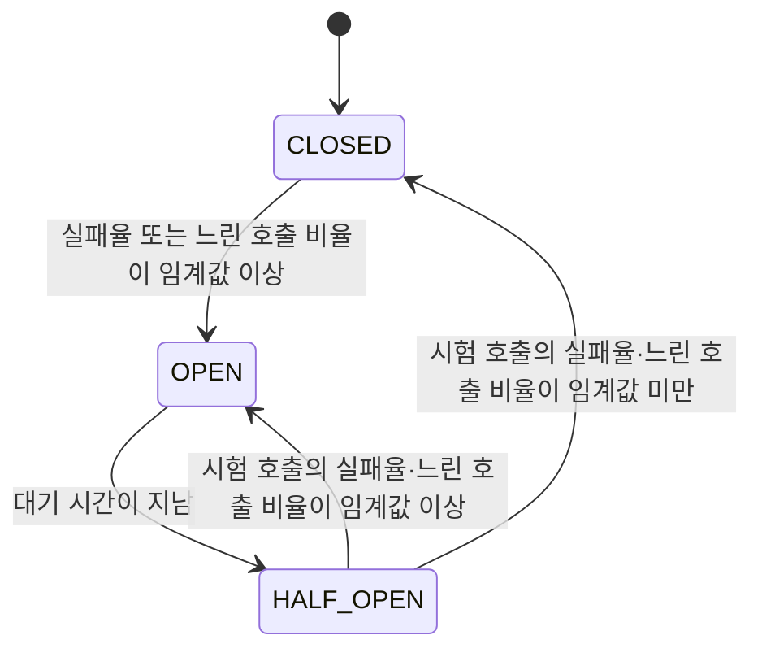

오늘은 마이크로서비스 사이의 호출에서 한 서비스의 장애가 다른 서비스로 번지는 연쇄 장애를 막는 방법과, 여러 서비스를 거친 요청을 하나로 이어 보는 분산 추적을 학습했다. 주문 서비스 장애 때문에 회원 조회까지 500 오류가 되는 상황에서 출발해 CircuitBreaker 패턴의 상태 전이를 이해했다. 이어서 Resilience4j와 Spring Cloud CircuitBreaker로 주문 조회를 감싸, 실패했을 때 대체 응답(fallback)을 돌려주는 코드와 설정 값을 정리했다.

후반에는 Trace ID와 Span ID로 요청 경로를 기록하는 분산 추적의 개념과 Zipkin의 구조를 익히고, 강의의 Spring Cloud Sleuth·Zipkin 실습 화면으로 정상 요청과 장애 요청이 어떻게 기록되는지 따라갔다. 강의 자료는 Spring Boot 2.x 시절의 Sleuth를 쓰므로, Spring Boot 3 이후 Micrometer Tracing으로 바뀐 설정과 기본값도 함께 정리했다.

> CircuitBreaker는 실패한 호출이 우리 서비스까지 무너뜨리지 않게 끊고, 분산 추적은 그 실패가 어느 서비스에서 시작됐는지 보여 준다.

## 🎯 오늘의 학습 목표

- 원격 호출 실패가 연쇄 장애로 번지는 이유를 설명하고, CircuitBreaker의 CLOSED·OPEN·HALF_OPEN 상태 전이를 실패율·슬라이딩 윈도우와 연결해 설명할 수 있다.
- Spring Cloud CircuitBreaker와 Resilience4j로 원격 호출과 fallback을 연결하고, 설정 값에 따라 회로가 열리는 시점을 계산할 수 있다.
- Trace·Span·Parent Span과 Trace 정보의 전파 방식을 설명하고, 로그와 Zipkin 화면에서 여러 서비스를 거친 요청과 실패 지점을 찾을 수 있다.
- Spring Cloud Sleuth와 Micrometer Tracing의 차이를 구분하고, Spring Boot 3 이후의 추적 설정을 읽을 수 있다.

## 📌 오늘의 핵심 요약

| 주제 | 핵심 내용 |
| --- | --- |
| 연쇄 장애 | 뒤쪽 서비스의 실패와 지연이 호출 사슬을 따라 앞쪽 서비스의 응답과 자원까지 무너뜨린다. |
| CircuitBreaker 패턴 | 최근 호출의 실패율로 회로를 열어 호출을 끊고, 대기 후 시험 호출로 회복을 확인한다. |
| Resilience4j 적용과 설정 | `CircuitBreakerFactory.run`으로 호출과 fallback을 묶고, Customizer로 실패율·윈도우·제한 시간을 조정한다. |
| 분산 추적과 Zipkin | 같은 요청은 같은 Trace ID로, 각 작업 구간은 Span ID로 기록해 Zipkin에서 하나의 트리로 본다. |
| Sleuth·Zipkin 실습 | 로그의 Trace ID와 Zipkin 화면으로 정상 요청의 구간 시간과 장애 요청의 오류 Span을 찾는다. |
| Micrometer Tracing | Spring Boot 3 이후에는 Sleuth 대신 Micrometer Tracing을 쓰며 전파 형식과 기본값이 달라졌다. |

## 🔄 오늘 학습 흐름

```text
주문 서비스가 멈추자 회원 조회까지 500 오류가 된다
    ↓ 실패가 번지는 길을 끊는 장치가 필요하다
CircuitBreaker가 실패율로 회로를 열고 시험 호출로 회복을 확인한다
    ↓ 패턴을 코드에 적용할 라이브러리를 고른다
Resilience4j와 Spring Cloud CircuitBreaker로 주문 조회와 fallback을 묶는다
    ↓ 기본값으로는 실습에서 회로가 잘 열리지 않는다
Customizer로 실패율·윈도우·제한 시간을 조정한다
    ↓ 응답은 200 OK여도 어디서 실패했는지 알 수 없다
Trace ID와 Span ID로 요청 경로를 잇고 Zipkin에 모은다
    ↓ 실제 로그와 화면으로 확인한다
Sleuth·Zipkin으로 정상 요청과 장애 요청을 추적한다
    ↓ 강의 설정은 Spring Boot 2.x 기준이다
Spring Boot 3 이후의 Micrometer Tracing 설정과 기본값을 정리한다
```

**본문 찾아보기**

1. [연쇄 장애가 퍼지는 과정과 막아야 하는 이유](#1-연쇄-장애가-퍼지는-과정과-막아야-하는-이유)
2. [CircuitBreaker 패턴의 상태와 동작 원리](#2-circuitbreaker-패턴의-상태와-동작-원리)
3. [Resilience4j와 Spring Cloud CircuitBreaker로 주문 조회 감싸기](#3-resilience4j와-spring-cloud-circuitbreaker로-주문-조회-감싸기)
4. [Customizer로 회로가 열리는 조건 조정하기](#4-customizer로-회로가-열리는-조건-조정하기)
5. [분산 추적의 개념과 Zipkin의 구조](#5-분산-추적의-개념과-zipkin의-구조)
6. [Sleuth와 Zipkin으로 정상 요청과 장애 요청 추적하기](#6-sleuth와-zipkin으로-정상-요청과-장애-요청-추적하기)
7. [Spring Boot 3 이후의 분산 추적과 Micrometer Tracing](#7-spring-boot-3-이후의-분산-추적과-micrometer-tracing)

## 📚 학습 내용

### 1. 연쇄 장애가 퍼지는 과정과 막아야 하는 이유

앞서 회원 서비스는 OpenFeign으로 주문 서비스를 호출해, 회원 정보와 주문 목록을 함께 응답하도록 만들었다. 이 구조에서는 회원 정보가 멀쩡해도 주문 서비스가 멈추면 회원 조회 전체가 실패한다.

이 장에서는 강의의 장애 화면과 참고 그림으로 실패가 호출 사슬을 따라 번지는 과정을 보고, 무엇을 막아야 하는지 목표를 정한다.

#### 1.1 회원 조회 한 번이 여러 서비스를 거친다

강의 그림에서 회원 조회 한 번은 다음 순서로 여러 서비스를 거친다. 강의는 주문 서비스가 다시 상품 서비스를 호출하는 구조로 그렸다.

```text
클라이언트가 회원 조회를 요청한다
    ↓ Gateway를 거쳐 User Service에 도착
User Service의 getUser()가 회원 정보를 조회한다
    ↓ Feign Client로 주문 목록을 요청
Order Service의 getOrders()가 주문 목록을 만든다
    ↓ 필요한 상품 정보를 요청
Catalog Service의 getCatalogs()가 상품 정보를 돌려준다
```

호출이 사슬처럼 이어지므로 앞쪽 서비스의 응답은 뒤쪽 서비스가 모두 정상일 때만 완성된다. 뒤쪽 서비스 하나가 멈추면 그 앞의 모든 서비스가 영향을 받는 구조다.

#### 1.2 주문 서비스가 멈추면 회원 조회까지 500 오류가 된다

강의에서 주문 서비스를 멈춘 뒤 회원 조회를 요청하면 다음 결과가 나온다.

| 확인한 것 | 내용 |
| --- | --- |
| 요청 | `GET 127.0.0.1:8000/user-service/users/{userId}` |
| 응답 상태 | 500 Internal Server Error |
| 응답의 `trace` | `feign.RetryableException: order-service executing GET http://order-service/order-service/...` |
| 회원 서비스 로그 | `java.net.UnknownHostException: order-service` |

`UnknownHostException: order-service`는 서비스 이름 `order-service`를 실제 접속 주소로 바꾸지 못해 연결 자체가 실패했다는 뜻이다. Feign은 이런 연결 실패를 `RetryableException`으로 감싸 던지고, 회원 서비스가 이 예외를 처리하지 않으니 회원 조회 전체가 500 오류가 되었다. 회원 정보는 정상인데 **주문 조회 실패가 회원 조회 전체의 실패**로 번진 것이다.

#### 1.3 실패한 원격 호출은 호출한 쪽의 자원까지 묶는다

원격 호출은 바로 실패하기도 하지만, 응답 없이 타임아웃까지 매달려 있기도 하다. 기다리는 동안 요청을 처리하던 스레드와 연결은 다른 일을 하지 못하므로, 같은 요청이 많이 몰리면 호출한 쪽의 자원이 바닥난다.

```text
Catalog Service가 느려지거나 멈춘다
    ↓ Order Service의 요청 스레드가 응답을 기다림
Order Service의 스레드와 연결이 대기 중인 요청으로 가득 찬다
    ↓ 새 요청을 처리할 자원이 부족해짐
Order Service도 늦게 응답하거나 오류를 돌려준다
    ↓ User Service도 같은 방식으로 기다림
User Service까지 느려지고 회원 조회가 실패한다
```

이렇게 한 서비스의 장애가 호출 사슬을 따라 앞쪽 서비스로 퍼지는 것을 **연쇄 장애**(Cascading Failure)라고 한다. 이미 실패하고 있는 서비스를 계속 호출하면 그 서비스가 회복할 여유도 빼앗는다.

#### 1.4 참고 그림으로 본 세 가지 장애 상황

강의의 참고 그림들은 같은 호출 구조에서 세 가지 상황을 보여 준다. 각 상황은 오늘 배우는 해결책과 하나씩 이어진다.

| 참고 그림의 상황 | 드러나는 문제 | 이어지는 해결책 |
| --- | --- | --- |
| 상품 서비스가 멈춘 상태에서 주문 조회를 1번째부터 10번째까지 반복하고 매번 500 오류를 받는다. | 실패가 계속되는 서비스를 반복 호출해 부하와 대기만 늘린다. | 실패율이 높으면 호출 자체를 막는 CircuitBreaker(2장) |
| 1·2번째 호출은 500 오류였지만 3번째 호출은 200 OK로 성공한다. | 일시적 장애는 시간이 지나면 회복될 수 있다. | 대기 후 시험 호출로 회복을 확인하는 HALF_OPEN 상태(2장) |
| 각 서비스의 로그가 LOG AGGREGATION으로 모인다. | 어느 서비스에서 처음 실패했는지 찾으려면 흩어진 로그를 모아 이어야 한다. | Trace ID로 요청을 잇는 분산 추적(5장) |

#### 1.5 목표는 빨리 실패하고 대체 응답을 주는 것이다

강의는 같은 장애 상황에서 회원 서비스가 fallback 메서드로 주문 조회를 대신하게 만들어, 회원 조회가 다음처럼 200 OK로 끝나는 결과를 보여 준다. 회원 정보 필드는 줄여서 표시했다.

```json
{
  "email": "...",
  "name": "...",
  "userId": "125b716c-2769-4381-9333-1cadba603b37",
  "orders": []
}
```

여기에는 두 가지 목표가 담겨 있다. 하나는 실패할 것이 뻔한 호출을 오래 기다리지 않고 **빨리 실패**하는 것이고, 다른 하나는 실패한 기능 대신 **대체 응답**(fallback)을 주어 나머지 기능은 살리는 것이다. 다만 대체 응답으로 무엇을 줄지는 업무에 따라 정해야 하며, 이는 3장에서 다시 다룬다.

> 원격 호출은 언제든 실패하므로, 실패를 없애는 것보다 실패가 호출 사슬을 따라 번지지 않게 끊는 것이 목표다.

### 2. CircuitBreaker 패턴의 상태와 동작 원리

1장에서 본 "실패가 계속되는 서비스를 반복 호출하는 문제"와 "회복 여부를 확인하는 문제"를 함께 푸는 패턴이 CircuitBreaker다. 강의는 Martin Fowler의 CircuitBreaker 글을 기준으로 개념을 소개했다.

이 장에서는 상태 전이와 실패율 계산 방식을, 오늘 사용하는 Resilience4j의 동작 기준으로 정리한다.

#### 2.1 회로 차단기는 실패가 반복되면 호출을 끊는다

집의 차단기는 전기가 너무 많이 흐르거나 새면 회로를 끊어 집 전체에 불이 나는 것을 막고, 원인을 해결한 뒤 다시 올린다. **CircuitBreaker**도 같은 생각으로, 원격 호출을 감싼 채 실패를 지켜보다가 실패가 기준을 넘으면 그 호출을 더 이상 보내지 않는다.

강의는 CircuitBreaker를 두 문장으로 정리했다. 장애가 발생하는 서비스에 반복적인 호출이 가지 못하게 차단하고, 특정 서비스가 정상 동작하지 않으면 다른 기능으로 대체 수행해 장애를 회피한다.

| 차단기 상태 | 호출 흐름 |
| --- | --- |
| Closed(닫힘) | 호출이 그대로 서비스까지 전달된다. |
| Open(열림) | 호출이 서비스까지 가지 않고 차단기에서 바로 실패로 돌아온다. |

문처럼 "열려야 통과한다"고 생각하면 이름이 반대로 느껴질 수 있다. 하지만 전기 회로는 **닫혀 있어야 전류가 흐르므로**, Closed가 정상 상태이고 Open이 차단 상태다.

#### 2.2 CLOSED·OPEN·HALF_OPEN 상태 전이



| 상태 | 호출 처리 | 다음 상태로 가는 조건 |
| --- | --- | --- |
| CLOSED | 모든 호출을 통과시키고 결과를 기록한다. | 실패율이나 느린 호출 비율이 임계값 이상이면 OPEN |
| OPEN | 호출을 보내지 않고 바로 거절한다. | `waitDurationInOpenState`(기본 60초)가 지나면 HALF_OPEN |
| HALF_OPEN | 정해진 수(기본 10번)의 시험 호출만 허용한다. | 시험 호출 결과가 임계값 미만이면 CLOSED, 이상이면 다시 OPEN |

강의 슬라이드의 시퀀스 다이어그램도 CLOSED에서 OPEN으로 가는 흐름을 보여 준다. 처음 몇 번은 연결 문제로 타임아웃이 나고, 실패가 쌓이면 차단기가 작동(trip)하며, 그 뒤의 호출은 공급자(supplier)까지 가지 않고 "circuit open"으로 바로 돌아온다.

Resilience4j에서 OPEN → HALF_OPEN 전환은 기본적으로 대기 시간이 지난 뒤 **새 호출이 들어올 때** 일어난다. `automaticTransitionFromOpenToHalfOpenEnabled`를 `true`로 켜면 별도 감시 스레드가 시간이 되면 자동으로 전환한다.

#### 2.3 실패율은 슬라이딩 윈도우로 계산한다

CLOSED 상태의 CircuitBreaker는 호출 결과를 **슬라이딩 윈도우**(최근 일정 범위만 보는 기록 창)에 모아 실패율을 계산한다. 오래된 결과는 창 밖으로 밀려나므로, 과거의 실패가 아니라 최근 상태를 기준으로 판단할 수 있다.

| 윈도우 종류 | 기록 범위 | 동작 |
| --- | --- | --- |
| `COUNT_BASED`(기본) | 최근 N번의 호출 | N칸짜리 원형 배열에 결과를 넣고, 밀려나는 결과를 합계에서 뺀다. |
| `TIME_BASED` | 최근 N초 동안의 호출 | 1초 단위 칸에 실패·느린 호출·전체 수를 모으고, 오래된 칸을 합계에서 뺀다. |

윈도우가 쌓이기 전에 섣불리 판단하지 않도록 `minimumNumberOfCalls`(기본 100)가 있다. 기록된 호출이 이 수보다 적으면 실패율을 계산하지 않으므로, 최소 호출 수가 10일 때 9번이 모두 실패해도 회로는 열리지 않는다.

예를 들어 기본 설정(윈도우 100, 최소 호출 수 100, 실패율 임계값 50%)에서는 최근 100번 중 50번 이상 실패해야 OPEN이 된다. `COUNT_BASED`에서는 최소 호출 수가 윈도우 크기보다 커도 실제로는 **윈도우 크기까지만** 적용되는데, 이 점은 4장의 강의 설정을 계산할 때 중요하다.

#### 2.4 실패로 셀 예외와 느린 호출을 정한다

기본적으로 모든 예외가 실패로 기록된다. `recordExceptions`로 실패로 셀 예외를 지정하면 목록에 없는 예외는 성공으로 세고, `ignoreExceptions`로 지정한 예외는 성공도 실패도 아닌 것으로 무시하며, 두 설정이 겹치면 무시 설정이 우선한다. 예를 들어 상대 서비스가 멀쩡한데 잘못된 요청 때문에 생긴 오류까지 실패로 세면, 장애가 아닌데도 회로가 열릴 수 있다.

응답이 오기는 하지만 느린 호출도 자원을 붙잡으므로 비율로 차단할 수 있다.

| 설정 | 기본값 | 의미 |
| --- | --- | --- |
| `slowCallDurationThreshold` | 60000ms | 이 시간보다 오래 걸린 호출을 느린 호출로 분류한다. |
| `slowCallRateThreshold` | 100% | 느린 호출 비율이 이 값 이상이면 OPEN |

기본값으로는 60초가 넘는 호출이 윈도우 전체를 차지해야 열리므로, 느린 호출을 실제로 막으려면 두 값을 업무에 맞게 낮춰야 한다.

#### 2.5 OPEN 상태의 호출은 바로 거절되고 대체 응답으로 간다

OPEN 상태에서 호출하면 Resilience4j는 실제 호출을 하지 않고 `CallNotPermittedException`을 던진다. HALF_OPEN에서도 허용된 시험 호출이 모두 진행 중이면 추가 호출을 같은 예외로 거절한다.

호출한 쪽은 타임아웃까지 기다리지 않고 즉시 실패를 알게 되고, 실패하던 서비스는 호출이 끊긴 동안 회복할 여유를 얻는다. 이때 호출한 쪽이 할 일은 작업 자체를 실패로 끝낼지, 대체 응답으로 이어 갈지 정하는 것이며, 이것이 fallback이다.

Resilience4j에는 운영을 위한 특수 상태도 있다.

| 특수 상태 | 동작 |
| --- | --- |
| `DISABLED` | 항상 호출을 허용하고 지표·이벤트를 기록하지 않는다. |
| `FORCED_OPEN` | 항상 호출을 거절한다. |
| `METRICS_ONLY` | CLOSED처럼 지표·이벤트를 기록하지만 회로는 절대 열리지 않는다. |

> [!NOTE]
> Martin Fowler는 차단기의 상태 변화를 모두 로그로 남기고, 상태를 자세히 관찰할 수 있게 드러내야 한다고 조언한다. 회로가 열렸다는 사실 자체가 더 깊은 장애의 신호일 수 있기 때문이다.

> CircuitBreaker는 최근 호출의 실패율로 회로를 열고, 대기 후 시험 호출로 회복을 확인한다. 열려 있는 동안에는 실패할 호출을 아예 보내지 않아 호출한 쪽과 받는 쪽을 함께 보호한다.

### 3. Resilience4j와 Spring Cloud CircuitBreaker로 주문 조회 감싸기

패턴을 코드에 적용하려면 라이브러리가 필요하다. 강의는 예전에 쓰던 Hystrix가 물러난 배경을 짚은 뒤, Resilience4j를 Spring Cloud CircuitBreaker 추상화로 사용해 회원 서비스의 주문 조회를 감쌌다.

이 장에서는 Resilience4j의 구성, Spring Cloud CircuitBreaker의 `run` 메서드, 그 안에서 실제로 일어나는 일과 fallback 응답을 설계하는 기준을 정리한다.

#### 3.1 Hystrix가 물러나고 Resilience4j가 대안이 되었다

예전 Spring Cloud에서는 Netflix가 만든 **Hystrix**로 CircuitBreaker를 구성했다. 강의 슬라이드에는 Hystrix 의존성, 애플리케이션 클래스의 애너테이션, Feign 설정에서 Hystrix를 켜는 예전 구성 코드가 대체 기술 표에 일부 가려진 채로 보인다.

2018년 12월 Spring Cloud는 Hystrix를 포함한 여러 Netflix 모듈을 유지보수 모드로 전환한다고 발표하고, 다음 대체 기술을 제시했다(Eureka는 대상이 아니었다).

| 기존 기술 | 대체 기술 |
| --- | --- |
| Hystrix | Resilience4j |
| Hystrix Dashboard / Turbine | Micrometer + 모니터링 시스템 |
| Ribbon | Spring Cloud LoadBalancer |
| Zuul 1 | Spring Cloud Gateway |
| Archaius 1 | Spring Boot 외부 설정 + Spring Cloud Config |

지금까지 써 온 LoadBalancer, Gateway, Config가 모두 이 표의 대체 기술이다. 오늘은 그중 Hystrix를 대신하는 Resilience4j를 다루고, Hystrix Dashboard를 대신하는 Micrometer 기반 모니터링은 다음 학습 범위로 이어진다.

#### 3.2 Resilience4j의 특징과 모듈

**Resilience4j**는 Netflix Hystrix에서 영감을 받아 함수형 프로그래밍 방식으로 설계한 가볍고 쓰기 쉬운 장애 허용(fault tolerance) 라이브러리다. 강의 자료는 Resilience4j가 외부 의존성이 없는 Vavr(Java 함수형 프로그래밍 라이브러리) 하나만 쓰는 반면, Hystrix는 Archaius에 의존하고 Archaius가 다시 Guava·Apache Commons Configuration 같은 여러 라이브러리에 의존한다고 비교한다.

Resilience4j는 필요한 기능만 골라 쓰는 모듈로 나뉘며, 원래 함수를 기능별 데코레이터(원래 함수를 감싸 기능을 덧붙이는 래퍼)로 감싸는 방식으로 조합한다.

| 모듈 | 하는 일 | 막는 상황 |
| --- | --- | --- |
| `resilience4j-circuitbreaker` | 실패율에 따라 호출을 차단한다. | 실패하는 서비스를 계속 호출하는 상황 |
| `resilience4j-ratelimiter` | 일정 시간당 호출 수를 제한한다. | 호출이 한순간에 몰리는 상황 |
| `resilience4j-bulkhead` | 동시에 실행되는 호출 수를 제한한다. | 의존 서비스 하나가 스레드를 독차지하는 상황 |
| `resilience4j-retry` | 실패한 호출을 자동으로 다시 시도한다(동기·비동기). | 잠깐 실패했다가 곧 회복되는 상황 |
| `resilience4j-timelimiter` | 실행 시간을 제한한다. | 응답 없이 오래 기다리는 상황 |
| `resilience4j-cache` | 호출 결과를 캐시한다. | 같은 호출을 반복하는 상황 |

Bulkhead(격벽)는 배 안을 여러 칸으로 나눠 한 칸에 물이 차도 배 전체가 가라앉지 않게 하는 구조에서 온 이름이다. Retry는 일시적 실패에 유용하지만, 1장의 참고 그림처럼 이미 실패 중인 서비스를 반복 호출하면 부하만 늘리므로 CircuitBreaker와 함께 쓰고 같은 요청을 여러 번 보내도 안전한지(멱등성)도 따져야 한다.

> [!NOTE]
> 강의 자료의 소개 화면은 Resilience4j 1.x 시절 기준이다. 현재 Resilience4j 2는 Java 17이 필요하고, Vavr 지원은 별도 모듈(`resilience4j-vavr`)로 나뉘어 있다.

#### 3.3 Spring Cloud CircuitBreaker는 구현체를 바꿀 수 있는 추상화다

**Spring Cloud CircuitBreaker**는 여러 CircuitBreaker 구현체 위에 같은 API를 제공하는 추상화다. 코드는 `CircuitBreakerFactory`와 `CircuitBreaker` 인터페이스만 쓰고, 실제 구현체는 Resilience4J, Sentinel, Spring Retry 중에서 고를 수 있다.

| 스타터 | 대상 |
| --- | --- |
| `spring-cloud-starter-circuitbreaker-resilience4j` | 일반(요청마다 스레드 하나가 처리하는 서블릿 방식) 애플리케이션 |
| `spring-cloud-starter-circuitbreaker-reactor-resilience4j` | 리액티브(적은 스레드로 비동기 처리하는 방식) 애플리케이션 |

강의는 일반 애플리케이션용 스타터를 회원 서비스에 추가했다. 스타터가 클래스패스(애플리케이션이 실행할 때 불러오는 라이브러리 목록)에 있으면 `CircuitBreakerFactory`를 구현한 Bean이 자동으로 만들어지므로 바로 주입받아 쓸 수 있다.

```xml title="pom.xml"
<dependency>
  <groupId>org.springframework.cloud</groupId>
  <artifactId>spring-cloud-starter-circuitbreaker-resilience4j</artifactId>
</dependency>
```

자동 구성을 끄고 싶다면 `spring.cloud.circuitbreaker.resilience4j.enabled`를 `false`로 설정한다.

#### 3.4 run(Supplier, Function)으로 주문 조회와 fallback 연결하기

강의는 앞서 ErrorDecoder와 함께 쓰던 직접 호출을 주석으로 막고, 같은 호출을 CircuitBreaker로 감쌌다. 아래 코드는 강의 코드를 화면 폭에 맞게 줄바꿈만 조정한 것이다.

```java title="UserServiceImpl.java" {9,11-12}
@Autowired
CircuitBreakerFactory circuitBreakerFactory;

/* ErrorDecoder */
// List<ResponseOrder> ordersList = orderServiceClient.getOrders(userId);

/* CircuitBreaker */
CircuitBreaker circuitBreaker =
        circuitBreakerFactory.create("circuitbreaker");
List<ResponseOrder> ordersList = circuitBreaker.run(
        () -> orderServiceClient.getOrders(userId),
        throwable -> new ArrayList<>());

userDto.setOrders(ordersList);
```

9번째 줄의 `create("circuitbreaker")`는 이름(id)이 `circuitbreaker`인 CircuitBreaker를 만들거나 가져온다. 같은 이름을 쓰는 호출은 같은 실패 기록과 상태를 공유하므로, 보호할 대상마다 이름을 구분하는 것이 좋다.

`run`의 첫 번째 인자(11번째 줄)는 보호할 호출을 담은 `Supplier`(값을 만들어 돌려주는 함수)이고, 두 번째 인자(12번째 줄)는 실패했을 때 실행할 fallback `Function`(입력을 받아 값을 돌려주는 함수)이다. fallback 함수는 실패 원인인 `Throwable`을 받으며, 강의 코드는 원인과 상관없이 빈 `ArrayList`를 돌려준다. fallback은 생략할 수도 있다.

#### 3.5 주문 서비스가 멈춰도 회원 조회가 200 OK가 되는 흐름

```text
회원 조회 요청이 User Service에 도착한다
    ↓ 회원 정보는 정상 조회
circuitBreaker.run()이 주문 조회 Supplier를 실행한다
    ↓ 주문 서비스가 멈춰 호출이 예외로 끝남
CircuitBreaker가 실패를 기록하고 fallback 함수를 호출한다
    ↓ fallback이 빈 목록을 돌려줌
userDto에 빈 주문 목록이 담긴다
    ↓ 예외 없이 응답 생성
클라이언트는 200 OK와 "orders": []를 받는다
```

fallback은 회로가 OPEN일 때만 실행되는 것이 아니다. CLOSED 상태에서 호출이 예외로 끝나도, 제한 시간을 넘겨도, OPEN이라 호출이 거절되어도 `run`은 그 원인을 fallback 함수에 넘겨 실행한다. 차이는 OPEN일 때는 주문 서비스에 **요청 자체를 보내지 않는다**는 점이다.

#### 3.6 run 안에서는 별도 스레드와 TimeLimiter가 함께 동작한다

Spring Cloud CircuitBreaker의 Resilience4J 구현을 보면 `run`은 단순히 CircuitBreaker만 거치지 않는다. 기본 팩토리는 캐시된 스레드 풀(`Executors.newCachedThreadPool()`)을 `ExecutorService`로 가지고 있고, 보호할 호출을 그 스레드에서 실행하면서 다음 순서로 감싼다.

```text
CircuitBreaker가 호출을 허용할지 판단한다
    ↓ 허용되면
Bulkhead가 동시 실행 수를 확인한다(resilience4j-bulkhead가 있을 때)
    ↓ 자리가 있으면
TimeLimiter가 제한 시간을 걸고 결과를 기다린다
    ↓ 실제 실행은 다른 스레드에서
ExecutorService의 스레드가 주문 조회 Supplier를 실행한다
```

문서는 TimeLimiter가 기본으로 켜져 있어 모든 실행이 제한 시간 안에서 이루어진다고 설명하며, Resilience4j의 기본 제한 시간은 1초다. 1초를 넘긴 호출은 실패로 기록되고 fallback으로 가므로, 4장에서 강의가 이 값을 4초로 늘린 이유와 이어진다.

> [!WARNING]
> 보호할 호출이 요청 스레드가 아닌 다른 스레드에서 실행되므로, MDC(로그에 넣는 요청별 값) 같은 스레드 단위 정보가 자동으로 따라가지 않을 수 있다(강의의 Sleuth는 Trace 정보만큼은 Supplier를 감싸 넘겨 주었다). 공식 문서는 이런 경우 컨텍스트를 전달하는 `ExecutorService`를 `configureExecutorService`로 지정하는 방법을 안내한다.

`resilience4j-bulkhead`가 클래스패스에 있으면 모든 호출을 Bulkhead로도 감싸며 기본 구현은 고정 크기 스레드 풀(`FixedThreadPoolBulkhead`)이다. 시간 제한이 필요 없다면 `spring.cloud.circuitbreaker.resilience4j.disable-time-limiter`를 `true`로 설정해 끌 수 있다.

#### 3.7 Fallback 응답을 설계하는 기준

강의의 fallback은 빈 목록을 돌려준다. 화면은 깨지지 않지만, 응답만 보고는 **주문이 0건인 회원**과 **주문 조회에 실패한 회원**을 구분할 수 없다. "주문 없음"과 "조회 실패"는 다른 상태이므로, fallback도 두 상태를 구분할 방법을 함께 정해야 한다.

| fallback 방식 | 장점 | 주의할 점 |
| --- | --- | --- |
| 빈 목록 반환(강의 방식) | 회원 정보 화면이 그대로 유지된다. | 0건과 조회 실패를 구분할 수 없다. |
| 빈 목록 + 상태 표시 필드 | 화면을 유지하면서 "주문을 불러오지 못했다"고 알릴 수 있다. | 응답 계약에 필드가 추가된다. |
| 최근에 저장한 데이터 | 사용자는 이전 주문 목록이라도 볼 수 있다. | 오래된 데이터임을 알려야 한다. |
| 오류 응답 | 실패가 분명히 드러난다. | 회원 조회 전체가 실패한다. |

또한 fallback 안에서 원인을 기록해 두지 않으면 장애가 응답 뒤로 숨는다. 다음은 원인을 로그로 남기고, 회로가 열려 호출을 생략한 경우를 구분하는 설명용 예제다.

```java {4,7}
List<ResponseOrder> ordersList = circuitBreaker.run(
        () -> orderServiceClient.getOrders(userId),
        throwable -> {
            if (throwable instanceof CallNotPermittedException) {
                log.warn("주문 서비스 회로가 열려 호출을 생략했다.");
            } else {
                log.warn("주문 조회 실패: {}", throwable.toString());
            }
            return new ArrayList<>();
        });
```

4번째 줄은 OPEN 상태 때문에 호출 자체가 거절된 경우이고, 7번째 줄은 그 밖의 실패, 즉 호출 중 예외나 제한 시간 초과 같은 경우다. 두 경우를 나눠 기록하면 "주문 서비스가 지금 실패 중인지"와 "회로가 이미 열려 보호 중인지"를 로그에서 구분할 수 있다.

#### 3.8 OpenFeign에 CircuitBreaker를 직접 연결하는 방법

강의처럼 호출하는 코드에서 `run`으로 감싸는 방법 외에도, CircuitBreaker를 적용하는 위치에 따라 다음 방법들이 있다.

| 방법 | 적용 위치 | 특징 |
| --- | --- | --- |
| `CircuitBreakerFactory.run`(강의) | 호출하는 서비스 코드 | 감쌀 범위와 fallback을 코드에서 직접 정한다. |
| OpenFeign 통합 | `@FeignClient` 인터페이스의 모든 메서드 | 설정으로 켜고 fallback 클래스나 `fallbackFactory`를 지정한다. |
| Resilience4j 애너테이션 | 메서드에 붙인 `@CircuitBreaker` | `resilience4j-spring-boot3`와 AOP(메서드 앞뒤에 공통 기능을 끼워 넣는 방식)를 쓰며 Spring Cloud 추상화를 거치지 않는다. |

OpenFeign 통합은 Spring Cloud CircuitBreaker가 클래스패스에 있고 `spring.cloud.openfeign.circuitbreaker.enabled=true`이면 Feign 클라이언트의 모든 메서드를 CircuitBreaker로 감싼다. 이때 이름은 `클래스명#메서드명(파라미터 타입)` 형식이라, 예를 들어 `OrderServiceClient#getOrders(String)`처럼 만들어진다.

fallback은 Feign 인터페이스를 구현한 클래스를 Bean으로 등록하고 `@FeignClient`의 `fallback`에 지정하며, 실패 원인이 필요하면 `fallbackFactory`를 쓴다. Resilience4j 애너테이션 방식에서는 fallback 메서드가 같은 클래스에 있어야 하고, 원래 메서드와 같은 파라미터에 예외 파라미터 하나를 더 받아야 한다.

> `run`의 Supplier는 보호할 호출, Function은 실패했을 때의 대체 응답이다. 대체 응답은 화면을 살리는 대신 실패를 숨길 수 있으므로, 응답 계약과 로그로 실패를 드러낼 방법을 함께 설계한다.

### 4. Customizer로 회로가 열리는 조건 조정하기

기본 설정(실패율 50%, 최소 호출 수 100, OPEN 대기 60초)으로는 실습 중에 회로가 열리고 닫히는 모습을 보기 어렵다. 강의는 Customizer Bean으로 모든 CircuitBreaker의 기본 설정을 바꿨다.

이 장에서는 강의 설정을 하나씩 읽고, 그 설정에서 회로가 언제 열리는지 계산한 뒤, 속성 파일로 설정하는 방법과 값을 고를 때 생각할 점을 정리한다.

#### 4.1 Customizer Bean으로 기본 설정 바꾸기

`Customizer<Resilience4JCircuitBreakerFactory>` Bean을 등록하면 팩토리가 CircuitBreaker를 만들기 전에 설정을 바꿀 수 있다. 아래 코드는 강의 코드를 화면 폭에 맞춰 들여쓰기와 줄바꿈만 조정한 것이다.

**CircuitBreaker 설정 만들기**

```java title="Resilience4JConfiguration.java" {10-13}
@Configuration
public class Resilience4JConfiguration {

  @Bean
  public Customizer<Resilience4JCircuitBreakerFactory>
      globalCustomConfiguration() {

    // the circuitBreakerConfig and timeLimiterConfig objects
    CircuitBreakerConfig circuitBreakerConfig = CircuitBreakerConfig.custom()
        .failureRateThreshold(4)
        .waitDurationInOpenState(Duration.ofMillis(1000))
        .slidingWindowType(CircuitBreakerConfig.SlidingWindowType.COUNT_BASED)
        .slidingWindowSize(2)
        .build();
```

**TimeLimiter 설정과 팩토리 기본값 등록**

```java title="Resilience4JConfiguration.java" {2,5}
    TimeLimiterConfig timeLimiterConfig = TimeLimiterConfig.custom()
        .timeoutDuration(Duration.ofSeconds(4))
        .build();

    return factory -> factory.configureDefault(
        id -> new Resilience4JConfigBuilder(id)
            .timeLimiterConfig(timeLimiterConfig)
            .circuitBreakerConfig(circuitBreakerConfig)
            .build());
  }
}
```

첫 번째 블록의 10~13번째 줄이 CircuitBreaker의 차단 조건이고, 두 번째 블록의 2번째 줄이 제한 시간이다. 두 번째 블록 5번째 줄의 `configureDefault`는 id마다 같은 설정을 만들어 주므로, `create`로 만드는 모든 CircuitBreaker의 기본값이 바뀐다.

#### 4.2 강의 설정 값을 하나씩 읽기

| 설정 | 강의 값 | 기본값 | 의미 |
| --- | --- | --- | --- |
| `failureRateThreshold` | 4 | 50 | 실패율(%)이 이 값 이상이면 OPEN으로 바뀐다. |
| `waitDurationInOpenState` | 1000ms | 60초 | OPEN을 유지하는 시간. 지나면 HALF_OPEN으로 갈 수 있다. |
| `slidingWindowType` | `COUNT_BASED` | `COUNT_BASED` | 최근 N번 호출(`COUNT_BASED`) 또는 최근 N초(`TIME_BASED`)로 실패율을 계산한다. |
| `slidingWindowSize` | 2 | 100 | 윈도우 크기. 호출 수 또는 초 단위다. |
| `timeoutDuration` | 4초 | 1초 | TimeLimiter가 결과를 기다리는 최대 시간 |

강의 자료는 `slidingWindowType`과 `slidingWindowSize`를 "CircuitBreaker가 종료(Close)되기 위한 조건"이라고 설명했지만, 정확히는 **CLOSED 상태에서 실패율을 계산할 호출 범위**, 즉 OPEN으로 갈지 판단하는 기준이다. HALF_OPEN에서 CLOSED로 돌아갈지는 `permittedNumberOfCallsInHalfOpenState`(기본 10번)만큼의 시험 호출 결과로 정해진다.

#### 4.3 강의 설정에서 회로가 열리는 시점 계산하기

강의 설정에서는 `minimumNumberOfCalls`를 바꾸지 않아 100이지만, `COUNT_BASED`에서는 Resilience4j가 최소 호출 수를 **윈도우 크기까지만** 적용하므로 실제 기준은 2번이다.

```text
CLOSED 상태에서 주문 조회 두 번의 결과가 기록된다
    ↓ 두 번 중 한 번이라도 실패하면 실패율 50%
실패율 50%가 임계값 4% 이상이므로 OPEN으로 바뀐다
    ↓ 1초 동안 주문 서비스 호출을 보내지 않음
그사이의 회원 조회는 바로 fallback의 빈 목록을 받는다
    ↓ 1초가 지난 뒤 새 호출이 들어오면
HALF_OPEN에서 시험 호출을 최대 10번 허용한다
    ↓ 시험 호출의 실패율로 판단
4% 미만이면 CLOSED로, 이상이면 다시 OPEN으로 간다
```

임계값이 4%라서 **최근 두 번 안에 실패가 한 번만 있어도** 회로가 열린다. 단, 첫 호출 하나만 실패한 시점에는 기록이 한 번뿐이라 아직 판단하지 않고, 두 번째 결과가 기록될 때 OPEN이 된다. HALF_OPEN에서도 시험 호출 10번 중 한 번만 실패하면 10%가 되어 다시 OPEN이 된다.

만약 `TIME_BASED`였다면 최소 호출 수 100이 그대로 적용되어, 최근 2초 동안 호출이 100번 이상 기록되어야 실패율을 계산한다. 같은 숫자라도 윈도우 종류에 따라 의미가 크게 달라진다.

> [!WARNING]
> 강의 값은 실습에서 상태 변화를 빠르게 보기 위한 값이다. 운영에서 윈도우 2, 임계값 4%를 쓰면 일시적인 실패 한 번에도 회로가 열렸다 닫히기를 반복할 수 있으므로, 실제 호출량과 허용할 실패 수준에 맞춰 정해야 한다.

#### 4.4 TimeLimiter 4초와 주문 서비스의 3초 지연

6장에서 볼 강의의 장애 실습 코드는 주문 조회 중 `Thread.sleep(3000)`으로 3초를 멈춘다. Zipkin 화면에서는 예외 없이 끝난 요청(6.5)과 장애 요청(6.8) 모두 주문 서비스 구간이 약 3.1초로 기록되었다.

TimeLimiter를 기본값 1초로 두었다면 이 호출은 매번 제한 시간을 넘겨 실패로 기록되고 fallback으로 갔을 것이다. 강의는 제한 시간을 4초로 늘렸기 때문에 3초 걸리는 응답이 제한 시간 안에 들어온다. 그래서 장애 실습에서 fallback이 실행된 원인도 타임아웃이 아니라, 주문 서비스가 500 오류로 응답하고 Feign이 그 응답을 예외로 바꿔 던진 것이다.

TimeLimiter는 호출한 쪽이 **결과를 기다리는 시간**을 제한하는 장치이고, Feign의 연결·읽기 타임아웃은 HTTP 클라이언트 수준의 제한이다. 둘 중 짧은 쪽이 먼저 작동하므로, 두 값을 함께 보고 정해야 의도한 실패 판단이 나온다.

#### 4.5 속성 파일로 설정하고 인스턴스·그룹별로 나누기

Java Customizer 대신 `application.yml`로도 설정할 수 있으며, 공식 문서는 **속성 설정이 Customizer보다 우선**한다고 설명한다. 다음은 강의의 CircuitBreaker 이름에 맞춰 문서의 형식을 옮긴 설명용 예제다.

```yaml
resilience4j:
  circuitbreaker:
    configs:
      default:
        slidingWindowSize: 50
    instances:
      my_circuit_breaker:
        failureRateThreshold: 50
        waitDurationInOpenState: 10s
  timelimiter:
    instances:
      my_circuit_breaker:
        timeoutDuration: 4s
```

| 설정 위치 | 적용 대상 | 우선순위 |
| --- | --- | --- |
| `instances.이름` | `create("이름")`으로 만든 특정 CircuitBreaker | 가장 높다. |
| `configs.그룹명` | `create(id, 그룹명)`으로 같은 그룹에 묶은 CircuitBreaker | 중간 |
| `configs.default` | 그 밖의 모든 CircuitBreaker | 가장 낮다. |

단, 강의처럼 Customizer에서 `configureDefault`를 등록하면 그 함수가 전역 기본값을 대신하므로 `configs.default`는 적용되지 않는다. 속성이 Customizer보다 우선하는 것은 `instances.이름`이나 `configs.그룹명`처럼 이름이 맞는 설정이 있을 때다.

TimeLimiter도 같은 구조로 설정하며, 특정 인스턴스나 그룹만 시간 제한을 끄려면 `spring.cloud.circuitbreaker.resilience4j.disable-time-limiter-map`을 쓴다.

#### 4.6 설정 값을 고를 때 함께 볼 것

- **최소 호출 수:** 너무 작으면 일시적인 실패 몇 번에 회로가 열리고, 너무 크면 장애가 나도 한참 뒤에야 열린다.
- **윈도우 종류:** 호출이 드문 서비스에 `COUNT_BASED`를 쓰면 오래전 결과까지 기준에 남고, `TIME_BASED`를 쓰면 최소 호출 수를 채우지 못해 판단이 늦어질 수 있다.
- **OPEN 대기 시간:** 짧으면 회복되지 않은 서비스에 시험 호출을 자주 보내고, 길면 회복된 뒤에도 한동안 fallback만 돌려준다.
- **실패로 셀 예외:** 잘못된 요청처럼 상대 서비스의 장애가 아닌 오류는 `ignoreExceptions`로 빼야 회로가 엉뚱하게 열리지 않는다.
- **상태 관찰:** 상태 전환을 로그나 지표로 남겨야 회로가 왜 열렸는지 나중에 설명할 수 있다.

> 숫자 하나가 회로가 열리는 시점을 바꾼다. 윈도우 크기, 최소 호출 수, 임계값, 제한 시간은 서로 맞물리므로 한 번에 계산해 보고 정해야 한다.

### 5. 분산 추적의 개념과 Zipkin의 구조

CircuitBreaker 덕분에 회원 조회는 주문 서비스가 멈춰도 200 OK를 돌려준다. 하지만 응답만 봐서는 그 뒤에서 어떤 서비스가 실패했는지, 어느 구간이 느렸는지 알 수 없다.

이 장에서는 여러 서비스를 거친 요청을 하나로 잇는 분산 추적의 개념(Trace·Span·전파·샘플링)과, 추적 데이터를 모아 보여 주는 Zipkin의 구조를 정리한다.

#### 5.1 서비스마다 흩어진 로그로는 요청 하나를 이어 보기 어렵다

마이크로서비스에서는 서비스마다 로그가 따로 쌓인다. 1장의 참고 그림처럼 각 서비스의 로그를 한곳에 모으는 **로그 집계**(Log Aggregation)를 해도, 수많은 로그 줄 가운데 "같은 요청에서 나온 줄"을 골라낼 기준이 없으면 요청 하나의 경로를 복원하기 어렵다.

**분산 추적**(Distributed Tracing)은 요청이 처음 들어올 때 식별자를 붙이고, 그 요청이 거치는 모든 서비스가 같은 식별자를 이어받아 기록하게 하는 방법이다. 그러면 식별자 하나로 여러 서비스의 기록을 모아 요청의 전체 경로와 구간별 시간을 볼 수 있다.

#### 5.2 Trace와 Span, 그리고 부모 Span

| 용어 | 뜻 | 강의 자료의 설명 |
| --- | --- | --- |
| Span | 하나의 요청을 처리하는 동안의 작업 단위. 시작 시각, 걸린 시간, 태그를 가진다. | 하나의 요청에 사용되는 작업의 단위, 64비트 고유 ID |
| Trace | 같은 요청에서 나온 Span들을 트리 구조로 묶은 것 | 트리 구조로 이뤄진 Span 집합, 하나의 요청에 같은 Trace ID 발급 |
| Parent Span ID | 이 Span을 시작하게 만든 바로 위 Span의 ID | 강의 자료에는 설명이 없고, Zipkin 화면에 Parent ID로 표시된다. |

요청이 처음 들어온 서비스의 Span이 트리의 뿌리(Root Span)가 되며 부모가 없다. 그 서비스가 다른 서비스를 호출하면 새 Span이 생기고, 새 Span은 같은 Trace ID와 함께 부모 Span의 ID를 기록한다.

강의 그림은 이 관계를 두 요청으로 보여 준다.

| 요청 | 구간 | Trace ID | Span ID |
| --- | --- | --- | --- |
| 요청 1 | Microservice A → B | AA | AA |
| 요청 1 | Microservice B → C | AA | BB |
| 요청 1 | Microservice C → E | AA | CC |
| 요청 2 | Microservice B로 들어온 요청 | DDD | DDD |
| 요청 2 | Microservice B → D | DDD | EEE |

같은 요청에서 나온 구간은 서비스가 달라도 **Trace ID가 같고**, 구간마다 Span ID가 새로 붙는다. 그림에서는 각 요청의 첫 Span ID가 Trace ID와 같게 그려졌는데, 6장의 Sleuth 로그에서도 요청이 처음 들어온 서비스의 두 값이 같게 찍힌다.

#### 5.3 Trace 정보는 요청 헤더에 실려 다음 서비스로 전달된다

다음 서비스가 같은 Trace ID를 이어받으려면, 호출할 때 Trace 정보를 함께 보내야 한다. 이를 **컨텍스트 전파**(Context Propagation)라고 하며 HTTP 호출에서는 요청 헤더에 싣는다.

```text
User Service가 요청을 받아 Trace ID와 첫 Span을 만든다
    ↓ Feign 호출에 Trace 정보를 헤더로 붙임
Order Service가 헤더를 읽어 같은 Trace ID로 새 Span을 만든다
    ↓ 각 서비스는 작업이 끝나면
완료된 Span을 Zipkin에 비동기로 보고한다
    ↓ Zipkin이 Trace ID로 Span을 모음
하나의 Trace를 시간 막대 트리로 보여 준다
```

| 전파 형식 | 대표 헤더 | 주로 쓰는 곳 |
| --- | --- | --- |
| B3 | `X-B3-TraceId`, `X-B3-SpanId`, `X-B3-ParentSpanId`, `X-B3-Sampled` | Zipkin과 Spring Cloud Sleuth의 기본 형식 |
| W3C Trace Context | `traceparent` | Spring Boot 3 이후 Micrometer Tracing의 기본 형식 |

W3C 형식의 `traceparent`는 버전, Trace ID, 부모 Span ID, 플래그를 하이픈으로 이은 값이다. 다음은 W3C 표준 문서의 예시 값이다.

```http
traceparent: 00-4bf92f3577b34da6a3ce929d0e0e4736-00f067aa0ba902b7-01
```

헤더로는 ID와 샘플링 여부 같은 최소한의 정보만 전달하고 작업 이름 같은 자세한 정보는 보내지 않는다. Span의 세부 정보는 요청과 별도로(out-of-band), 그리고 비동기로 Zipkin에 보고되므로 추적이 사용자 요청에 주는 부담이 작다.

#### 5.4 Zipkin은 Span을 모아 저장하고 보여 준다

**Zipkin**은 Twitter가 공개한 오픈소스 분산 추적 시스템으로, 분산 환경의 타이밍 데이터를 모아 병목 지점을 찾게 해 준다. Google의 분산 추적 논문 Dapper에서 출발했다(강의 자료의 "Drapper"는 Dapper의 오타다).

| 구성 요소 | 하는 일 |
| --- | --- |
| Reporter | 애플리케이션 안에서 완료된 Span을 Zipkin으로 보낸다. |
| Transport | Span을 실어 나르는 통로. HTTP가 기본이고 Kafka 등도 쓸 수 있다. |
| Collector | 들어온 Span을 검증하고 저장소에 넣는다. |
| Storage | Span을 보관한다. 기본은 메모리이고 Cassandra·Elasticsearch·MySQL을 지원한다. |
| API(Query Service) | 저장된 Trace를 검색해 돌려준다. |
| Web UI | Trace를 시간 막대 트리와 서비스 의존 관계 그림으로 보여 준다. |

강의 그림에서 Zipkin 계측이 있는 클라이언트와 서버는 Reporter로 Span을 보내지만, 계측이 없는 서버는 Span을 보내지 않는다. 추적하려는 모든 서비스에 계측 라이브러리를 붙여야 경로가 빠짐없이 이어지는 이유다.

#### 5.5 샘플링은 Zipkin에 보낼 Trace의 비율이다

모든 요청의 Span을 저장하면 네트워크와 저장 공간 부담이 커지므로, 일부 요청만 골라 보내는 **샘플링**(Sampling)을 한다. 강의는 학습용으로 `spring.sleuth.sampler.probability: 1.0`을 설정해 모든 요청을 Zipkin에 보냈다.

| 구분 | 기본 샘플링 |
| --- | --- |
| Spring Cloud Sleuth 3.x | 초당 10개의 Trace로 제한하는 방식 |
| Spring Boot 3 이후(Micrometer Tracing) | 요청의 10%(`management.tracing.sampling.probability=0.1`) |

샘플링은 Zipkin 같은 추적 백엔드로 보낼지만 정한다. Sleuth 문서에 따르면 샘플링에서 빠진 요청도 로그에는 Trace ID가 그대로 찍히므로, 로그 검색은 계속 할 수 있다.

> 같은 요청은 서비스가 달라도 같은 Trace ID로 묶이고, 각 작업 구간은 부모 Span ID로 트리를 이룬다. 이 연결은 헤더 전파가 이어질 때만 유지된다.

### 6. Sleuth와 Zipkin으로 정상 요청과 장애 요청 추적하기

강의는 Zipkin 서버를 띄우고 회원·주문 서비스에 Spring Cloud Sleuth를 붙여, 정상 요청과 장애 요청이 로그와 Zipkin에 어떻게 기록되는지 확인했다. 아래 로그와 화면 값은 강의 실습 화면에 나온 결과이며, 로그에서는 시각·프로세스 번호·스레드 이름 같은 부분을 생략했다.

이 장의 Sleuth 설정은 Spring Boot 2.x 기준이므로, 지금 프로젝트에 적용할 설정은 7장에서 따로 정리한다.

#### 6.1 Zipkin 서버 실행하기

Zipkin은 Docker 이미지나 실행 가능한 jar로 바로 띄울 수 있다.

```bash
# Docker로 실행
docker run -d -p 9411:9411 openzipkin/zipkin

# jar로 실행
curl -sSL https://zipkin.io/quickstart.sh | bash -s
java -jar zipkin.jar
```

강의는 jar 방식으로 2.23.2 버전을 내려받아 실행했고, `http://127.0.0.1:9411/`에서 Find a trace 화면을 열었다. 강의 당시 안내는 Java 8 이상이었지만, 현재 Zipkin 빠른 시작 문서는 jar 실행에 Java 17 이상을 요구한다.

> [!WARNING]
> 따로 설정하지 않으면 Zipkin은 Span을 메모리에 저장한다. 테스트용 저장소라 서버를 다시 켜면 기록이 사라지고 오래된 Span부터 지워지며, Zipkin UI에는 기본 인증 기능이 없으므로 외부에 그대로 열어 두면 안 된다.

#### 6.2 강의의 Sleuth·Zipkin 의존성과 설정

**Spring Cloud Sleuth**는 Spring Boot 애플리케이션에 분산 추적 자동 구성을 제공해, 요청마다 Trace ID와 Span ID를 붙이고 이를 SLF4J MDC(로그 출력에 요청별 값을 넣는 저장소)에 넣어 로그에 남긴다. 서블릿 필터, RestTemplate, 스케줄 작업, 메시지 채널, Feign 클라이언트처럼 요청이 들어오고 나가는 지점을 자동으로 계측한다.

```xml title="pom.xml"
<dependency>
  <groupId>org.springframework.cloud</groupId>
  <artifactId>spring-cloud-starter-sleuth</artifactId>
</dependency>
<dependency>
  <groupId>org.springframework.cloud</groupId>
  <artifactId>spring-cloud-starter-zipkin</artifactId>
  <version>2.2.3.RELEASE</version>
</dependency>
```

```yaml title="application.yml" {5,9}
spring:
  application:
    name: user-service
  zipkin:
    base-url: http://localhost:9411
    enabled: true
  sleuth:
    sampler:
      probability: 1.0
```

`zipkin`과 `sleuth` 아래가 추가한 설정이다. 5번째 줄의 `base-url`은 Span을 보낼 Zipkin 서버 주소이고, 9번째 줄의 `probability: 1.0`은 모든 요청을 Zipkin에 보내라는 뜻이다. `enabled`는 Zipkin 전송 여부이며, `spring.application.name`은 로그와 Zipkin 화면에서 서비스 이름으로 쓰인다.

`spring-cloud-starter-zipkin`에만 버전을 직접 적은 것은, 강의 화면의 Sleuth 3.0부터 이 스타터가 없어져 의존성 관리에 버전이 없기 때문으로 보인다. Sleuth 3.x 문서는 대신 `spring-cloud-sleuth-zipkin`을 추가하라고 안내하며, `base-url`의 기본값도 `http://localhost:9411`이라 강의 값은 기본값을 그대로 적은 것이다.

#### 6.3 로그에 붙은 서비스 이름·Trace ID·Span ID 읽기

강의는 CircuitBreaker 호출 앞뒤에 로그를 남겨, 같은 요청의 로그가 어떻게 이어지는지 보이게 했다. 이때 CircuitBreaker 이름도 3장의 `circuitbreaker`에서 `my_circuit_breaker`로 바뀌었다. 아래 코드는 앞뒤 줄을 생략하고 줄바꿈만 조정한 것이다.

```java title="UserServiceImpl.java" {1,7}
log.info("Before call orders microservice");
CircuitBreaker circuitBreaker =
        circuitBreakerFactory.create("my_circuit_breaker");
List<ResponseOrder> ordersList = circuitBreaker.run(
        () -> orderServiceClient.getOrders(userId),
        throwable -> new ArrayList<>());
log.info("after called orders microservice");
```

1번째 줄과 7번째 줄이 주문 서비스 호출 앞뒤의 로그다. 먼저 주문 서비스에 주문을 하나 만들면(`productId` `CATALOG-003`, 수량 5, 단가 1500 → 201 Created, 총액 7500), 주문 서비스 로그에 다음이 찍힌다.

```text
INFO [order-service,a04b6cf3c9338a13,a04b6cf3c9338a13] Before add orders data
Hibernate: call next value for hibernate_sequence
Hibernate: insert into orders (order_id, product_id, qty, total_price, ...)
INFO [order-service,a04b6cf3c9338a13,a04b6cf3c9338a13] After added orders data
```

| 대괄호 안의 위치 | 값 | 의미 |
| --- | --- | --- |
| 첫 번째 | `order-service` | `spring.application.name` |
| 두 번째 | `a04b6cf3c9338a13` | Trace ID |
| 세 번째 | `a04b6cf3c9338a13` | Span ID |

두 ID는 16자리 16진수, 즉 64비트 값이다. 이 요청은 Gateway(`127.0.0.1:8000`)를 거쳐 들어왔지만, 다음 절의 Zipkin 화면에서 Services가 1이고 Gateway가 보이지 않으므로 강의의 Gateway는 추적 정보를 만들거나 전달하지 않은 것으로 볼 수 있다. 그래서 주문 서비스가 새 Trace를 시작해 자신의 Span이 Root Span이 되었고, Trace ID와 Span ID가 같다.

같은 요청에서 나온 SQL 로그와 앞뒤 로그가 모두 같은 ID를 가진다는 점이 핵심이다. 5.4에서 본 것처럼 계측이 없는 서비스는 추적 경로에서 빠진다는 것도 이 화면으로 확인할 수 있다.

#### 6.4 Zipkin에서 Trace ID로 요청 찾기

Zipkin 오른쪽 위의 검색 창에 로그의 Trace ID `a04b6cf3c9338a13`을 넣으면 해당 Trace가 열린다.

| 화면 항목 | 값 |
| --- | --- |
| Trace 이름 | `ORDER-SERVICE: post /order-service/{userid}/orders` |
| Duration | 153.720ms |
| Services / Depth / Total Spans | 1 / 1 / 1 |
| Span ID / Parent ID | `a04b6cf3c9338a13` / None |

Span을 누르면 태그(Tags)가 보인다. 태그는 Span에 붙은 부가 정보로, 이 요청에는 `http.method`(POST), `http.path`(실제 요청 경로), `mvc.controller.class`(OrdersController), `mvc.controller.method`(createOrder)가 기록되었다.

> [!TIP]
> 로그에서 이상한 줄을 발견하면 대괄호 안의 Trace ID를 복사해 Zipkin의 trace ID 검색 창에 넣는다. 로그 한 줄에서 출발해 그 요청이 거친 전체 경로와 구간별 시간으로 바로 넘어갈 수 있다.

#### 6.5 회원 조회 한 번이 네 개의 Span으로 기록된다

강의는 이번에는 주문이 있는 회원을 조회했고, 응답은 200 OK와 주문 목록이었다. 두 서비스의 INFO 로그를 시간 순서로 놓으면 다음과 같다(로그 수준 표시도 생략).

```text
[user-service,e132359d05efde94,e132359d05efde94] Before call orders microservice
[order-service,e132359d05efde94,4e9274e54e747ed0] Before retrieve orders data
[order-service,e132359d05efde94,4e9274e54e747ed0] After retrieved orders data
[user-service,e132359d05efde94,e132359d05efde94] after called orders microservice
```

두 서비스의 로그가 **같은 Trace ID** `e132359d05efde94`를 가지므로 하나의 요청에서 나온 기록임을 알 수 있다. Span ID는 서비스마다 달라, 회원 서비스는 Root Span `e132359d05efde94`, 주문 서비스는 `4e9274e54e747ed0`이다.

Zipkin에서 이 Trace를 열면 `USER-SERVICE: get /users/{userid}`, 전체 3.462s, Services 2, Depth 4, Total Spans 4로 나온다.

| 깊이 | 서비스 | Span 이름 | 걸린 시간 |
| --- | --- | --- | --- |
| 1 | USER-SERVICE | `get /users/{userid}` | 3.462s |
| 2 | USER-SERVICE | `userserviceimpl$$lambda$1778/...` | 3.276s |
| 3 | USER-SERVICE | `get` | 3.147s |
| 4 | ORDER-SERVICE | `get /order-service/{userid}/orders` | 3.139s |

1번은 회원 서비스가 받은 HTTP 요청, 4번은 주문 서비스가 받은 HTTP 요청이다. 2번 lambda Span은 Sleuth가 CircuitBreaker에 넘긴 `Supplier`를 추적용으로 감싸면서 생긴 구간이고, 3번 `get`은 회원 서비스가 Feign으로 보낸 호출 구간으로 볼 수 있다. 주문 서비스 Span의 Span ID는 `4e9274e54e747ed0`, Parent ID는 `585681926fe50087`이므로 회원 서비스 쪽 구간에 매달린 자식 Span임을 알 수 있다. 다만 Sleuth는 기본적으로 Feign 클라이언트 구간과 그 요청을 받은 서버 구간이 같은 Span ID를 함께 쓰는 방식(B3 공유 Span)이라, 이 Parent ID는 바로 위 `get`이 아니라 2번 lambda 구간을 가리키는 것으로 볼 수 있다.

막대의 길이를 비교하면 전체 3.462초 가운데 약 3.14초가 주문 서비스 처리 구간이라는 것을 바로 알 수 있다. 예외 없이 끝난 요청인데도 장애 실습(3.112초)과 거의 같은 시간이 걸렸으므로 이때도 6.7의 3초 지연이 들어가 있었던 것으로 보이며, 그래도 fallback 없이 주문 목록이 돌아온 것은 TimeLimiter를 4초로 늘려 두었기 때문이다(4.4). 이처럼 Zipkin은 "어느 서비스의 어느 구간이 느린가"를 숫자로 보여 준다.

#### 6.6 서비스 이름 검색과 Dependencies 화면

Find a trace 화면에서 `serviceName`을 `user-service`로 지정해 검색하면 이 서비스가 포함된 Trace 목록이 나온다.

| Root | Spans | Duration |
| --- | --- | --- |
| `user-service: get /users/{userid}` | 4 | 3.462s |
| `user-service: post /users` | 1 | 278.307ms |

Dependencies 화면은 일정 기간 동안 기록된 Trace로 서비스 사이의 호출 관계를 그린다. 강의 화면에서는 `user-service`가 `order-service`를 사용하며, 호출(Call) 4번, 오류(Error) 0번으로 표시되었다.

#### 6.7 주문 서비스에 일부러 장애를 넣는다

강의는 주문 목록 조회 메서드에 지연과 예외를 넣어 장애를 만들었다. 다음은 강의 코드에서 장애를 넣은 부분만 옮긴 것으로, 앞의 주문 목록 조회·변환 코드는 생략했다.

```java {5,7}
log.info("Before retrieve orders data");
// ... 주문 목록을 조회해 result에 담는 코드 생략 ...

try {
    Thread.sleep(3000);

    throw new Exception("장애 발생!");
} catch (InterruptedException e) {
    e.printStackTrace();
}
log.info("After retrieved orders data");

return ResponseEntity.status(HttpStatus.OK).body(result);
```

5번째 줄에서 3초를 기다린 뒤 7번째 줄에서 일반 `Exception`을 던진다. `catch`는 `InterruptedException`만 잡으므로 이 예외는 메서드 밖으로 나가며(메서드에 `throws Exception`이 선언되어 있다), "After retrieved orders data" 로그는 찍히지 않고 주문 서비스는 오류 응답을 돌려준다.

#### 6.8 장애 요청의 로그와 Zipkin 화면 읽기

장애를 넣은 뒤 회원을 조회하면 두 서비스의 로그는 다음과 같다. 이번에는 스레드 이름을 함께 표시했다.

```text
INFO  [order-service,6c84bb1c6c2a1ed6,599ab271752b6a5f] [o-auto-1-exec-2] ...
ERROR [order-service,,] [o-auto-1-exec-2] ...[dispatcherServlet] ...
java.lang.Exception: 장애 발생!
INFO  [user-service,6c84bb1c6c2a1ed6,6c84bb1c6c2a1ed6] [o-auto-1-exec-2] ...
```

Trace ID `6c84bb1c6c2a1ed6`이 두 서비스의 로그를 잇고, 주문 서비스의 처리 시작(23:31:06.903)부터 오류(23:31:10.022)까지 약 3초가 걸렸다. 오류 줄은 `[order-service,,]`처럼 ID가 비어 있다. 로거 이름(`...[dispatcherServlet]`)으로 보아 Sleuth의 추적 필터가 끝난 뒤 Tomcat이 남긴 로그라 MDC에 추적 값이 없었던 것으로 볼 수 있다. 그래서 오류 로그만 보고는 어느 요청인지 알기 어렵고, 주문 서비스에서 같은 스레드(`o-auto-1-exec-2`)·시각의 앞뒤 로그나 Zipkin을 함께 봐야 한다.

Zipkin에서는 전체 3.387s, Services 2, Depth 4, Total Spans 5로 기록되었고, 실패한 구간이 빨간색으로 표시되었다.

| 서비스 | Span 이름 | 걸린 시간 | 표시 |
| --- | --- | --- | --- |
| USER-SERVICE | `get /users/{userid}` | 3.387s | 정상 |
| USER-SERVICE | `userserviceimpl$$lambda$1780/...` | 3.244s | 오류(빨간색) |
| USER-SERVICE | `get` | 3.142s | 오류(빨간색) |
| ORDER-SERVICE | `get /order-service/{userid}/orders` | 3.112s | 오류(빨간색) |
| USER-SERVICE | `userserviceimpl$$lambda$1781/...` | 75µs | 정상 |

주문 서비스 Span의 태그에는 `error: Request processing failed; nested exception is java.lang.Exception: 장애 발생!`이 남아, 실패 원인을 화면에서 바로 확인할 수 있다. 정상 요청보다 하나 늘어난 마지막 75µs짜리 lambda Span은 Sleuth가 fallback 함수도 추적용으로 감싸기 때문에 생긴 구간, 즉 빈 목록을 돌려준 fallback 실행으로 볼 수 있다. Dependencies 화면에서도 `user-service`에서 `order-service`로 가는 호출이 Call 1, Error 1로 표시되었다.

#### 6.9 응답은 정상이어도 Trace에는 실패가 남는다

장애 실습에서 Root Span은 오류로 표시되지 않았고 fallback 구간이 뒤따랐으므로, 회원 조회 응답 자체는 fallback 결과로 정상 종료되었다고 볼 수 있다. 사용자 입장에서는 주문 목록이 비어 있을 뿐, 주문 서비스가 실패했다는 사실이 보이지 않는다. 강의 화면에는 장애 요청의 응답이 나오지 않으므로, 아래 표의 사용자 응답은 fallback 코드로 추론한 것이다.

| 관점 | 보이는 것 |
| --- | --- |
| 사용자 응답 | 정상 응답과 빈 주문 목록 |
| 회원 서비스 로그 | fallback에서 원인을 기록하지 않으면 실패 흔적이 거의 없다. |
| Zipkin Trace | 어느 서비스의 어느 구간이 몇 초 걸려 어떤 예외로 실패했는지 |

CircuitBreaker는 장애를 **사용자 응답에서 숨기는** 역할도 하므로, 분산 추적과 fallback 로그가 없으면 장애가 났다는 사실조차 늦게 알게 된다. 두 기술은 각각 보호와 관찰을 맡는 짝이다.

> 로그의 Trace ID는 여러 서비스의 기록을 잇는 열쇠이고, Zipkin은 그 Trace를 구간별 시간과 오류 표시가 있는 트리로 보여 준다. fallback으로 정상 응답이 나가도 Trace에는 실패한 구간이 그대로 남는다.

### 7. Spring Boot 3 이후의 분산 추적과 Micrometer Tracing

6장의 설정은 강의 당시의 Spring Boot 2.x와 Spring Cloud Sleuth 기준이다. Sleuth는 Spring Boot 3에서 동작하지 않으므로, 지금 프로젝트에 같은 기능을 넣으려면 Micrometer Tracing을 써야 한다.

이 장에서는 바뀐 구조, Spring Boot 3.x와 4.x의 설정, Sleuth와 달라진 기본값, 그리고 Trace가 끊기지 않게 하는 조건을 정리한다.

#### 7.1 Sleuth의 핵심은 Micrometer Tracing으로 옮겨졌다

Sleuth 공식 문서는 다음을 분명히 밝힌다.

- Spring Cloud Sleuth의 마지막 마이너 버전은 3.1이다.
- Sleuth는 Spring Boot 3.x부터 동작하지 않으며, 지원하는 마지막 Spring Boot 메이저 버전은 2.x다.
- 핵심 기능은 **Micrometer Tracing**으로 옮겨졌고, 각 라이브러리의 계측은 Micrometer와 해당 프로젝트로 나뉘어 옮겨졌다.

| 역할 | Sleuth 시절(강의) | Spring Boot 3 이후 |
| --- | --- | --- |
| 추적 API | `org.springframework.cloud.sleuth` 패키지 | `io.micrometer.tracing` 패키지(Micrometer Tracing) |
| 실제 추적 구현 | Sleuth가 Brave(Zipkin 쪽의 Java 추적 라이브러리)를 감싸 사용 | Micrometer Tracing의 브리지로 Brave 또는 OpenTelemetry(업계 표준 관측 도구 모음)를 선택 |
| 자동 구성 | Spring Cloud Sleuth | Spring Boot Actuator(상태·지표 같은 운영 기능을 제공하는 모듈) |

Micrometer Tracing은 여러 추적 라이브러리 위의 공통 API(퍼사드)이고, 브리지(bridge)는 그 API를 실제 추적 라이브러리에 연결하는 어댑터다.

#### 7.2 Spring Boot 3.x에서 Zipkin으로 보내는 설정

Spring Boot 3.x에서 Brave를 거쳐 Zipkin으로 보내려면 Actuator와 함께 두 라이브러리를 추가한다. 다음은 강의 프로젝트처럼 Maven을 쓸 때의 Spring Boot 3.x 기준 설명용 예제다.

```xml
<dependency>
  <groupId>org.springframework.boot</groupId>
  <artifactId>spring-boot-starter-actuator</artifactId>
</dependency>
<dependency>
  <groupId>io.micrometer</groupId>
  <artifactId>micrometer-tracing-bridge-brave</artifactId>
</dependency>
<dependency>
  <groupId>io.zipkin.reporter2</groupId>
  <artifactId>zipkin-reporter-brave</artifactId>
</dependency>
```

`micrometer-tracing-bridge-brave`는 Micrometer Tracing API를 실제 추적 라이브러리인 Brave에 연결하고, `zipkin-reporter-brave`는 완료된 Span을 Zipkin으로 보낸다.

```yaml {7,10}
spring:
  application:
    name: user-service
management:
  tracing:
    sampling:
      probability: 1.0
  zipkin:
    tracing:
      endpoint: http://localhost:9411/api/v2/spans
```

7번째 줄의 `probability: 1.0`은 강의의 `spring.sleuth.sampler.probability`에 해당하고, 10번째 줄의 `endpoint`는 강의의 `spring.zipkin.base-url`에 해당한다. 다만 주소에는 Zipkin이 Span을 받는 API 경로(`/api/v2/spans`)까지 적는다.

#### 7.3 Spring Boot 4에서 바뀐 이름

2026년 10월 기준 Spring Boot 공식 문서의 안정 버전은 4.1이며, Spring Boot 4에서는 의존성과 속성 이름이 다시 정리되었다.

| 항목 | Spring Boot 3.x | Spring Boot 4.x |
| --- | --- | --- |
| Brave + Zipkin 의존성 | `micrometer-tracing-bridge-brave` + `zipkin-reporter-brave` | `spring-boot-starter-zipkin` |
| Zipkin 주소 속성 | `management.zipkin.tracing.endpoint` | `management.tracing.export.zipkin.endpoint` |
| 샘플링 속성 | `management.tracing.sampling.probability` | `management.tracing.sampling.probability` |

Spring Boot 4 문서는 OpenTelemetry를 거쳐 Zipkin으로 보내는 방식을 더 이상 권장하지 않으며(deprecated), 4.2에서 자동 구성을 제거할 예정이라고 안내한다. 그래서 Zipkin을 쓴다면 Brave 조합이, OpenTelemetry를 쓴다면 OTLP(OpenTelemetry 표준 전송 방식)가 기본 선택지가 된다.

#### 7.4 Sleuth와 달라진 기본값

| 항목 | Sleuth(강의) | Micrometer Tracing(Spring Boot 3 이후) |
| --- | --- | --- |
| 전파 형식 | B3 | W3C Trace Context |
| Trace ID 길이 | 16자리(64비트), 강의 로그 기준 | 32자리(128비트) |
| 기본 샘플링 | 초당 10개 Trace | 요청의 10% |
| 로그의 ID 표시 | `[앱이름,traceId,spanId]`를 Sleuth가 자동 설정 | 현재 문서 기준 `[traceId-spanId]` 형식이 기본 |

로그 형식을 강의처럼 앱 이름과 함께 보고 싶다면 `logging.pattern.correlation`으로 바꾼다. 다음은 공식 문서의 properties 예를 yml로 옮긴 것으로, 앱 이름이 두 번 찍히지 않도록 `logging.include-application-name`을 끈다.

```yaml
logging:
  pattern:
    correlation: "[${spring.application.name:},%X{traceId:-},%X{spanId:-}] "
  include-application-name: false
```

패턴 끝의 공백은 뒤에 오는 로거 이름과 띄어 쓰기 위한 것이다.

> [!WARNING]
> Sleuth를 쓰는 서비스(B3)와 Spring Boot 3 서비스(W3C)가 섞여 있으면, 서로 다른 헤더를 읽고 써서 Trace가 중간에 끊길 수 있다. Micrometer의 이전 가이드는 전환 기간에 Sleuth 쪽에서 `spring.sleuth.propagation.type=w3c,b3`처럼 두 형식을 함께 보내도록 권장한다.

#### 7.5 Trace가 끊기지 않게 하는 조건

추적 라이브러리를 넣는 것만으로 모든 호출이 이어지지는 않는다. Trace 정보가 다음 서비스로 전달되려면 호출 방식마다 조건이 있다.

| 호출 방식 | Trace가 이어지는 조건 |
| --- | --- |
| RestTemplate·RestClient·WebClient | 자동 구성된 `RestTemplateBuilder`, `RestClient.Builder`, `WebClient.Builder`로 만든다. 직접 `new`로 만들면 자동 전파가 되지 않는다. |
| OpenFeign | `feign-micrometer`가 클래스패스에 있어야 Feign 클라이언트가 Micrometer 관찰 대상이 된다(`spring.cloud.openfeign.micrometer.enabled`는 기본 `true`). |
| CircuitBreaker 내부 호출 | `ObservationRegistry`가 있으면 Spring Cloud CircuitBreaker가 Supplier와 fallback을 관찰(`circuit-breaker`, `circuit-breaker fallback`)로 감싸 Trace를 이어 주므로, Zipkin에 이 구간이 보이는지 확인한다. |

강의에서 Sleuth가 만들던 lambda 구간이 Spring Boot 3 이후에는 이 관찰 구간으로 바뀐다(현재 Spring Cloud CircuitBreaker 소스 기준이므로, 사용하는 버전에서 확인한다). 직접 넣은 MDC 값처럼 그 밖의 스레드 단위 정보는 여전히 컨텍스트를 전달하는 `ExecutorService`로 넘겨야 한다.

OpenFeign을 쓰는 오늘의 회원 서비스라면 다음 의존성을 추가하는 것이 출발점이다. 다음은 설명용 예제이며, 버전은 Spring Cloud의 의존성 관리에 맡긴다.

```xml
<dependency>
  <groupId>io.github.openfeign</groupId>
  <artifactId>feign-micrometer</artifactId>
</dependency>
```

설정 후에는 6장처럼 두 서비스의 로그에 같은 Trace ID가 찍히는지, Zipkin에서 한 Trace 아래 두 서비스의 Span이 함께 보이는지로 연결을 확인한다. 한 서비스의 Span만 보인다면 위 조건과 함께 두 서비스의 전파 형식(B3·W3C)이 맞는지, 상대 서비스에도 추적·Zipkin 설정이 들어갔는지 확인한다.

#### 7.6 로그·지표·추적은 서로 다른 질문에 답한다

| 데이터 | 답하는 질문 | 오늘 기준의 예 |
| --- | --- | --- |
| 로그 | 그 순간 무슨 일이 있었는가? | "장애 발생!" 예외와 스택 트레이스 |
| 지표(메트릭) | 얼마나 자주, 얼마나 많이 일어나는가? | 회로가 열린 횟수, 실패율, 응답 시간 분포 |
| 추적(트레이스) | 요청 하나가 어디를 거쳐 어디서 느려지거나 실패했는가? | Zipkin의 Span 트리와 오류 구간 |

세 가지는 서로를 대신하지 않고, Trace ID로 로그와 추적을 잇고 지표로 전체 추세를 본다. Hystrix Dashboard의 대안으로 제시된 "Micrometer + 모니터링 시스템"이 바로 지표 쪽이며, 다음 단계인 마이크로서비스 모니터링으로 이어진다.

> Spring Boot 3 이후의 분산 추적은 Micrometer Tracing과 Brave 또는 OpenTelemetry 조합으로 구성한다. 기본 전파 형식·ID 길이·샘플링이 Sleuth와 다르므로, 설정을 옮길 때 기본값까지 함께 확인해야 한다.

## 🧠 오늘 이해한 핵심

1. **CircuitBreaker는 실패를 없애는 장치가 아니라 실패가 번지는 길을 끊는 장치다.** 최근 호출의 실패율로 회로를 열어 실패할 호출을 보내지 않고, fallback으로 나머지 기능을 살리며, HALF_OPEN의 시험 호출로 회복을 확인한다.
2. **설정 값은 회로가 열리는 시점을 직접 바꾼다.** 강의 설정에서는 `COUNT_BASED` 윈도우 2가 최소 호출 수를 2로 제한하므로, 계산상 최근 두 번 중 한 번만 실패해도 회로가 열린다. 또 TimeLimiter를 4초로 늘렸기 때문에 3초 지연만으로는 타임아웃 실패가 되지 않는다.
3. **fallback의 정상 응답 뒤에 숨은 실패는 분산 추적으로 드러난다.** 회원 조회가 빈 주문 목록으로 끝나도 Zipkin에는 같은 Trace ID 아래 오류 Span과 fallback Span이 남으므로, 사용자 응답과 실제 장애 지점을 따로 확인할 수 있다.
4. **Trace는 헤더 전파가 이어질 때만 하나로 모인다.** 전파 형식(B3·W3C), 자동 구성된 클라이언트 빌더, `feign-micrometer` 같은 조건이 맞아야 서비스 사이의 Span이 같은 Trace ID와 부모 Span ID로 연결된다.
