오늘은 컨테이너 이미지에서 출발해 Docker 명령어, 이미지 레이어, Dockerfile로 직접 이미지를 만드는 과정을 연결해 학습했다. 이미지를 실행하는 데서 한 걸음 더 나아가, 컨테이너 안의 파일을 바꾸면 어디에 저장되는지, 그 변경을 다시 배포하려면 무엇을 만들어야 하는지 살펴봤다.

이미지와 컨테이너를 구분한 뒤 파일 변경과 저장 공간을 이해하고, Dockerfile로 실행 환경을 재현하는 순서로 정리한다. 마지막에는 이미지 전달과 로그·자원·디스크 점검을 연결해, 명령어를 대상과 목적에 맞게 선택하는 기준까지 다룬다.

> 컨테이너에서 바꾼 파일은 그 컨테이너의 변경분이다. 같은 환경을 다시 만들고 배포하려면 필요한 파일과 실행 설정을 이미지에 담는 과정이 필요하다.

## 🎯 오늘의 학습 목표

- 이미지 이름·태그·컨테이너의 관계를 설명하고, 생성·실행·접속·파일 복사 명령을 구분할 수 있다.
- 읽기 전용 이미지 레이어와 컨테이너의 쓰기 계층을 구분하고, 파일 수정과 디스크 사용량을 연결해 설명할 수 있다.
- Dockerfile의 빌드 시점과 실행 시점, 빌드 컨텍스트와 캐시를 이해하고 웹 서버 이미지 예제를 읽을 수 있다.
- 이미지의 온라인·오프라인 전달 방법을 구분하고, 로그·이벤트·자원·정리 명령의 대상과 범위를 판단할 수 있다.

## 📌 오늘의 핵심 요약

| 주제 | 핵심 내용 |
| --- | --- |
| 이미지와 컨테이너 조작 | 이미지를 준비하고 컨테이너를 생성·실행하며, 파일 복사와 추가 프로세스 실행은 별도 명령으로 수행한다. |
| 레이어와 저장 공간 | 컨테이너는 이미지 레이어를 공유하고 각자의 쓰기 계층에 변경분을 기록하므로 표시 크기를 단순 합산하면 안 된다. |
| Dockerfile과 빌드 | 설치·복사·실행 설정을 문서화하고, 빌드 시 작업과 컨테이너 시작 시 작업을 구분한다. |
| 이미지 생성과 전달 | 빌드한 이미지는 태그를 붙여 레지스트리로 보내거나, 아카이브로 저장해 다른 환경에 불러올 수 있다. |
| 운영 확인과 정리 | 애플리케이션 로그·컨테이너 이벤트·데몬 로그를 나누고, 미사용 객체의 종류에 맞는 정리 범위를 선택한다. |

## 🔄 오늘 학습 흐름

```text
이미지에서 컨테이너를 만들고 파일과 프로세스를 다룬다
    ↓ 바꾼 파일이 원본 이미지에도 반영되는지 알아야 한다
공유 이미지 레이어와 개별 쓰기 계층의 관계를 이해한다
    ↓ 변경을 일회성 작업으로 끝내지 않고 다시 만들고 싶다
Dockerfile에 설치·파일 복사·실행 설정을 기록한다
    ↓ 실행 가능한 결과물을 다른 환경에도 전달한다
이미지를 빌드하고 태그·push 또는 save·load로 옮긴다
    ↓ 실행 이후의 상태와 쌓인 데이터를 관리한다
로그·자원·디스크를 점검하고 필요한 범위의 객체를 정리한다
```

**본문 찾아보기**

1. [이미지에서 컨테이너를 만들고 파일·프로세스 다루기](#1-이미지에서-컨테이너를-만들고-파일프로세스-다루기)
2. [이미지 레이어와 컨테이너의 변경분 이해하기](#2-이미지-레이어와-컨테이너의-변경분-이해하기)
3. [Dockerfile로 이미지의 구성과 실행 방법 기록하기](#3-dockerfile로-이미지의-구성과-실행-방법-기록하기)
4. [웹 서버 이미지를 빌드하고 다른 환경에 전달하기](#4-웹-서버-이미지를-빌드하고-다른-환경에-전달하기)
5. [로그·자원·디스크를 확인하고 정리 범위 판단하기](#5-로그자원디스크를-확인하고-정리-범위-판단하기)

## 📚 학습 내용

### 1. 이미지에서 컨테이너를 만들고 파일·프로세스 다루기

어제는 Docker가 실행되는 환경과 첫 컨테이너의 동작을 살펴봤다. 오늘은 [Docker 개념 자료의 이미지 부분](https://lgcns-docker-container-edu.oopy.io/docker05)부터 시작해, 이미지와 컨테이너를 실제 명령의 대상으로 구분한다.

이 문서의 셸 명령은 Docker Engine이 있는 Ubuntu 호스트 기준이다. 강의가 root 셸에서 입력한 명령은 일반 사용자 기준으로 `sudo`를 붙여 표시하며, 추가 예제는 설명용이라고 구분한다. 강의의 출력은 강의에서 제시된 결과로 읽는다.

#### 1.1 이미지 이름은 저장 위치와 이름표를 함께 나타낸다

**이미지**는 프로그램 실행에 필요한 파일과 설정을 담은 읽기 전용 패키지다. **컨테이너**는 그 이미지로 만든 개별 실행 환경이며, 이미지 자체가 실행 중인 프로그램은 아니다.

강의의 이미지 이름 `powermvp/marvel-collection:latest`는 다음처럼 나눌 수 있다.

| 부분 | 의미 | 강의 예시 |
| --- | --- | --- |
| 레지스트리 | 이미지를 내려받는 서버 | 생략 시 기본 Docker Hub |
| 네임스페이스 | 사용자·조직을 구분하는 이름 | `powermvp` |
| 저장소 | 이미지가 모이는 이름 | `marvel-collection` |
| 태그 | 버전·종류를 구분하는 이름표 | `latest` |

태그를 생략하면 기본적으로 `latest`를 사용한다. 하지만 `latest`가 항상 가장 최근에 만들어진 이미지를 자동 선택한다는 뜻은 아니다. 또한 같은 태그가 나중에 다른 이미지 내용을 가리킬 수 있다. [Docker 이미지 참조 형식](https://docs.docker.com/reference/cli/docker/image/tag/)

**Docker 데몬**은 컨테이너 생성·실행 같은 작업을 실제로 처리하는 백그라운드 관리 프로그램이다. `docker images`는 내 Docker 데몬에 있는 이미지를, `docker search nginx`는 Docker Hub의 저장소 검색 결과를 보여 준다. 검색과 다운로드는 다르며, 이미지를 내려받는 명령은 `docker pull`이다.

#### 1.2 새로 실행하는 것과 기존 컨테이너를 시작하는 것은 다르다

[Docker 명령어 자료](https://lgcns-docker-container-edu.oopy.io/docker06)의 기본 명령은 다음 관계로 묶을 수 있다.

| 명령 | 대상과 역할 | 새 컨테이너 생성 여부 |
| --- | --- | --- |
| `docker pull 이미지` | 이미지 내려받기 | 생성하지 않음 |
| `docker create 이미지` | 컨테이너만 생성 | 생성하고 아직 시작하지 않음 |
| `docker run 이미지` | 컨테이너 생성 후 주 프로세스 실행 | 새로 생성 |
| `docker start 이름` | 기존 컨테이너 시작 | 생성하지 않음 |
| `docker stop 이름` | 실행 중인 컨테이너 중지 | 기존 객체는 남음 |
| `docker rm 이름` | 컨테이너 삭제 | 이미지 삭제와 다름 |

`run`·`create`는 이미지가 로컬에 없으면 기본 정책에서 다운로드할 수 있다. 따라서 `create`를 단순히 `pull`이라고 읽으면 안 된다. 이미지를 준비한 뒤 실제 컨테이너 객체까지 만든다.

다음은 강의의 Nginx 실행 명령을 일반 사용자 기준으로 표시한 것이다. 이름이 같은 기존 컨테이너가 없고 호스트의 80번 포트를 사용할 수 있는 상태를 전제로 한다.

```bash
sudo docker run -d --name webserver -p 80:80 nginx
sudo docker ps
```

`-d`는 터미널과 분리 실행하고, `--name`은 컨테이너 이름을 정한다. `-p 80:80`의 왼쪽은 Docker 호스트, 오른쪽은 컨테이너 포트다. Ubuntu VM에 Docker가 있다면 이 호스트는 Ubuntu VM을 뜻한다.

`--rm`을 붙이면 컨테이너가 종료된 뒤 자동 제거된다. 이미지까지 삭제하는 옵션은 아니다. `docker ps -a`에서 확인할 종료 기록을 남기려는 경우와 일회성 실행을 구분한다. [Docker run 옵션](https://docs.docker.com/reference/cli/docker/container/run/)

#### 1.3 실행을 유지하는 주체는 d 옵션이 아니라 주 프로세스다

**프로세스**는 실행 중인 프로그램이다. 컨테이너의 **주 프로세스**가 끝나면 컨테이너 실행도 끝난다. 셸은 명령을 입력받아 실행하는 프로그램이며, 강의는 Ubuntu 이미지의 셸을 세 가지 형태로 실행한다. 아래 명령은 각각 별개의 컨테이너 이름을 사용하는 비교 예제다.

```bash
sudo docker run -d --name app1 ubuntu:focal
sudo docker run -it --name app2 ubuntu:focal /bin/bash
sudo docker run -dit --name app3 ubuntu:focal /bin/bash
```

| 형태 | 의미 | 실행 상태를 읽는 기준 |
| --- | --- | --- |
| `-d` | 터미널과 분리 | 셸이 종료되면 컨테이너도 종료 가능 |
| `-it` | 입력을 열고 가상 터미널 연결 | 셸에서 대화형 작업 가능 |
| `-dit` | 입력·터미널을 준비한 채 분리 | 주 셸이 유지되는 동안 실행 유지 |

`-d`는 프로그램을 영구 실행시키는 옵션이 아니다. 강의의 `Exited (0)`은 주 프로세스가 종료 코드 0으로 끝난 경우이며, 종료됐다는 사실만으로 오류라고 판단하지 않는다.

주 셸에서 `exit`하면 컨테이너가 멈춘다. 기본 대화형 설정에서 `Ctrl+p` 다음 `Ctrl+q`를 보내면 주 셸을 끝내지 않고 연결만 분리할 수 있다.

반면 `docker exec -it app3 /bin/bash`는 실행 중인 컨테이너에 **새 셸 프로세스**를 추가한다. 그 셸만 종료하면 원래 주 프로세스가 살아 있는 컨테이너는 유지된다.

#### 1.4 파일 복사는 컨테이너 변경이고 이미지 재생성이 아니다

강의는 Nginx 컨테이너의 `index.html`을 호스트에서 바꿔 복사하는 예제를 보여 준다. 다음은 `webserver`가 있고 현재 호스트 폴더에 수정할 `index.html`이 준비됐다는 전제의 명령이다.

```bash
sudo docker cp webserver:/usr/share/nginx/html/index.html ./index.before.html
sudo docker cp ./index.html webserver:/usr/share/nginx/html/index.html
sudo docker exec webserver cat /usr/share/nginx/html/index.html
```

콜론 앞의 `webserver`가 컨테이너 이름이고, 뒤는 컨테이너 안의 경로다. 콜론이 없는 `./index.html`은 Docker CLI를 실행하는 호스트 쪽 파일이다.

`docker cp`는 두 방향으로 복사할 수 있으며 이동이나 지속적인 동기화가 아니다. 강의에서는 복사 뒤 웹 화면의 내용이 바뀌는 모습을 제시한다. 이 변화는 해당 컨테이너에 반영되지만 원본 Nginx 이미지가 새 이미지로 바뀌지는 않는다. [Docker cp 설명](https://docs.docker.com/reference/cli/docker/container/cp/)

컨테이너 이름만 바꾸려면 `docker rename 기존이름 새이름`을 사용한다. 이름 변경은 이미지 내용·컨테이너 ID·포트 연결을 새로 만드는 작업이 아니다.

#### 1.5 DB 컨테이너에서는 서버와 접속 클라이언트를 나눈다

강의는 `MYSQL_ROOT_PASSWORD` 환경 변수로 초기 비밀번호를 전달해 `ms`라는 MySQL 컨테이너를 실행한다. **환경 변수**는 프로그램이 실행될 때 읽을 수 있는 이름과 값이다.

다음은 비밀번호 값을 명령문에 고정하지 않는 설명용 변형이다. Bash에서 값을 입력받아 해당 Docker 명령에만 환경 변수로 전달하며, 사용자의 실제 비밀번호나 실행 결과를 기록한 코드는 아니다.

```bash
read -r -s -p 'MySQL 초기 비밀번호: ' mysql_root_password
printf '\n'
sudo env MYSQL_ROOT_PASSWORD="$mysql_root_password" docker run -d --name ms \
  -e MYSQL_ROOT_PASSWORD mysql:8.4
unset mysql_root_password
```

비밀값을 환경 변수로 전달해도 Docker 관리 권한을 가진 주체에게서 숨겨지는 것은 아니다. 여기서는 강의의 환경 변수 역할을 설명하는 예시로 구분한다.

DB가 초기화를 마치고 접속을 받을 준비가 된 뒤, 다음 명령은 실행 중인 컨테이너 안에 MySQL 클라이언트를 추가 실행한다. 이미지 버전은 강의의 태그 생략 방식과 달리 설명용으로 명시했다.

```bash
sudo docker exec -it ms mysql -u root -p
```

`-p` 뒤에 비밀번호를 바로 붙이지 않으면 클라이언트가 별도로 입력을 받는다. 강의의 `show databases;`는 MySQL 프롬프트에서 실행하는 SQL이지 Ubuntu 셸 명령이 아니다.

```sql
SHOW DATABASES;
```

자료에는 `information_schema`·`mysql`·`performance_schema`·`sys` 목록이 나온다. 이런 결과는 DB 서버에 접속해 조회한 것이며, 컨테이너 안에서 `/var/lib/mysql`을 조회하는 파일 시스템 작업과는 다른 계층의 확인이다.

> 이미지·컨테이너·프로세스·파일은 서로 다른 명령 대상이다. 특히 컨테이너에서 파일을 바꾸거나 새 셸을 실행하는 작업은 원본 이미지를 다시 만드는 작업이 아니다.

### 2. 이미지 레이어와 컨테이너의 변경분 이해하기

컨테이너에서 바꾼 파일이 이미지에 반영되지 않는 이유를 설명하는 것이 레이어 구조다. [Docker 레이어 자료](https://lgcns-docker-container-edu.oopy.io/docker07)는 여러 이미지와 컨테이너가 공통 부분을 재사용하는 원리를 소개한다.

이 장에서는 레이어를 “파일 변경분을 쌓아 하나의 파일 시스템처럼 보는 구조”로 이해하고, 실제 저장 경로와 크기 출력까지 연결한다.

#### 2.1 레이어는 완성된 파일 전체를 매번 복사하는 방식과 다르다

**레이어**는 파일의 추가·수정·삭제 같은 변경분을 표현하는 단위다. 여러 레이어를 순서대로 조합하면 컨테이너가 볼 파일 시스템을 구성할 수 있다.

| 구성 | 역할 | 여러 컨테이너 사이의 관계 |
| --- | --- | --- |
| 이미지 레이어 | 읽기 전용 파일 변경분 | 공통 레이어를 재사용 가능 |
| 컨테이너 쓰기 계층 | 실행 후 해당 컨테이너의 변경분 | 컨테이너별로 따로 존재 |
| 합쳐진 파일 시스템 | 프로세스가 실제로 보는 파일 경로 | 읽기 전용 부분과 변경분이 함께 보임 |

같은 이미지에서 컨테이너 두 개를 만든다고 이미지 파일 전체를 각각 독립 복사하는 것은 아니다. 이미지의 공통 부분을 공유하고 개별 변경분을 따로 기록할 수 있어 저장 공간을 절약한다.

업데이트된 이미지를 받을 때도 필요한 레이어가 이미 있으면 재사용할 수 있다. 다만 어떤 수정이든 아주 작은 전송량만 생긴다고 보장되는 것은 아니며, 실제 변경 레이어의 크기와 캐시 상태에 달려 있다.

#### 2.2 원본 파일을 수정할 때는 자기 쓰기 계층에 변경을 남긴다

OverlayFS 계열의 대표적인 동작에서는 읽기 전용 레이어의 파일을 처음 수정할 때 위쪽 쓰기 계층으로 복사한 뒤 그 복사본을 바꾼다. 이를 **Copy-on-Write**, 파일을 위로 복사하는 동작을 **copy-up**이라고 한다.

위쪽에 같은 경로의 파일이 있으면 컨테이너는 위쪽 파일을 우선해서 본다. 다른 컨테이너는 자신의 변경분이 없다면 계속 원래 이미지 파일을 읽는다. [Docker의 쓰기 시 복사 설명](https://docs.docker.com/engine/storage/drivers/)

다음 애니메이션은 `index.html`의 설명용 값 `Hello`를 A 컨테이너에서 `Study`로 수정하는 경우다. A의 쓰기 계층과 화면의 값이 바뀌는 동안 원본 이미지와 B의 값이 유지되는 점을 본다. 재생 시간은 실제 처리 시간이나 성능 수치를 뜻하지 않는다.



이미지에 있던 파일을 삭제하는 경우에도 읽기 전용 원본을 직접 지우는 방식은 아니다. 상위 계층에서 그 경로를 가리는 정보로 표현할 수 있으므로, 나중 레이어에서 삭제했다고 이전 레이어에 들어 있던 파일의 용량이 곧바로 사라지는 것은 아니다.

#### 2.3 lowerdir·upperdir·merged·workdir는 다른 역할이다

자료는 실제 컨테이너의 OverlayFS 마운트 정보를 읽어 레이어를 확인한다. 폴더 이름만 외우기보다 역할을 구분하는 것이 먼저다.

| 항목 | 의미 | 파일을 읽을 때의 관계 |
| --- | --- | --- |
| `lowerdir` | 읽기 전용 이미지 쪽 디렉터리들 | 변경되지 않은 파일의 출처 |
| `upperdir` | 해당 컨테이너의 쓰기 계층 | 같은 경로의 하위 파일보다 우선 |
| `merged` | 아래와 위를 합쳐 보여 주는 뷰 | 컨테이너 프로세스가 보는 파일 시스템 |
| `workdir` | OverlayFS가 내부 동작에 사용하는 작업 공간 | 사용자 파일을 저장하려고 선택하는 곳은 아님 |

`upperdir`만 조회했을 때 `run`, `var`처럼 일부 폴더만 보일 수 있다. 전체 이미지가 사라졌다는 뜻이 아니라, 그 디렉터리가 컨테이너의 변경분만 담고 있기 때문이다.

#### 2.4 레이어 해시와 실제 디스크 경로를 구분한다

다음은 로컬 이미지의 파일 시스템 레이어 식별 정보를 읽는 설명용 명령이다. 자료의 `nginx:1.14` 대신 로컬에 존재하는 `nginx`를 대상으로 표시했다.

```bash
sudo docker image inspect nginx
sudo docker image inspect --format '{{range .RootFS.Layers}}{{println .}}{{end}}' nginx
sudo docker history nginx
```

`RootFS.Layers`는 이미지의 파일 시스템 변경분 식별자 목록이다. 이것이 컨테이너의 쓰기 계층 목록이나 디스크 폴더 이름을 그대로 출력하는 것은 아니다. `history`는 빌드 이력과 명령 정보를 보며, 모든 이력 행이 파일 시스템 레이어 하나라는 뜻도 아니다.

Docker의 저장 백엔드에 따라 실제 경로도 다르다. 자료의 환경은 `overlayfs`와 `io.containerd.snapshotter.v1`을 표시하며 `/var/lib/containerd/.../snapshots/` 경로를 사용한다. 이를 무조건 `/var/lib/docker/overlay2/`로 바꾸어 읽으면 안 된다. [containerd 이미지 저장소 설명](https://docs.docker.com/engine/storage/containerd/)

아래는 `webserver`가 실행 중이고 Docker 데몬이 현재 Linux 호스트에 있는 경우의 설명용 확인 명령이다.

```bash
sudo docker info
til_container_pid=$(sudo docker inspect -f '{{.State.Pid}}' webserver)
sudo grep ' - overlay ' /proc/"$til_container_pid"/mountinfo
```

컨테이너가 중지되어 PID가 유효하지 않거나, CLI가 다른 컴퓨터의 데몬에 연결돼 있다면 현재 호스트의 `/proc` 경로로 같은 정보를 읽을 수 없다. 내부 저장 폴더는 진단을 위해 읽는 대상이며 파일을 직접 편집하는 관리 인터페이스로 사용하지 않는다.

#### 2.5 컨테이너 표시 크기를 단순 합산하면 공유 부분을 중복 계산한다

강의의 `docker ps --size` 출력에는 `53.2kB (virtual 121MB)` 같은 값이 나온다. 앞은 해당 컨테이너의 쓰기 계층, 괄호 안은 읽기 전용 이미지와 쓰기 계층을 합친 논리적 크기다.

```bash
sudo docker ps -a -s --format 'table {{.Names}}\t{{.Status}}\t{{.Size}}'
sudo docker system df
sudo docker system df -v
```

| 구분 | 해석 | 단순 합산 시 주의점 |
| --- | --- | --- |
| 쓰기 계층 크기 | 컨테이너 고유 변경분 | 로그·볼륨까지 포함한 전체 비용은 아님 |
| Virtual size | 이미지와 쓰기 계층의 논리적 합 | 같은 이미지의 공유 부분이 중복됨 |
| 이미지 `DISK USAGE`·`CONTENT SIZE` | 저장 백엔드와 출력 방식에 따른 크기 | 압축 콘텐츠와 펼친 데이터 등을 구분 |
| `system df -v` | 이미지·컨테이너·볼륨·빌드 캐시의 상세 사용 | 공유·고유 크기와 참조 관계를 함께 확인 |

따라서 컨테이너 두 개가 각각 `virtual 121MB`라고 해서 물리 디스크를 정확히 두 배 썼다고 계산하지 않는다. 실제 회수 가능한 공간은 공통 레이어·로그·볼륨·캐시까지 함께 봐야 한다.

#### 2.6 중지·삭제·이미지 저장은 서로 다른 데이터를 다룬다

일반적인 중지는 컨테이너의 쓰기 계층을 그대로 둔다. 컨테이너를 삭제하면 그 쓰기 계층은 제거되지만 원본 이미지는 별도로 남을 수 있다.

볼륨이나 바인드 마운트로 연결한 데이터는 쓰기 계층과 다른 저장 영역이다. 이미지 저장 명령도 컨테이너의 실행 중 변경과 DB 데이터를 자동으로 모두 백업하는 명령이 아니다.

> 레이어를 이해하면 파일 변경과 디스크 사용량이 함께 설명된다. 공통 이미지는 재사용하고 실행 중 변경은 개별 계층에 남기므로, 데이터 보존과 정리는 저장 대상별로 판단해야 한다.

### 3. Dockerfile로 이미지의 구성과 실행 방법 기록하기

컨테이너 안에서 명령을 손으로 실행하면 그 환경을 어떻게 만들었는지 놓치기 쉽다. 설치할 패키지·복사할 파일·기본 실행 명령을 기록하면 같은 작업을 다시 빌드할 수 있다.

[Dockerfile 자료](https://lgcns-docker-container-edu.oopy.io/docker08)는 이 기록 방법과 웹 서버 예제를 소개한다. Dockerfile은 일반 셸 스크립트를 그대로 이름만 바꾼 파일이 아니라, Docker 빌더가 해석하는 전용 명령 문서다.

#### 3.1 Dockerfile·이미지·컨테이너는 만드는 시점이 다르다

**빌드**는 Dockerfile과 입력 파일을 이용해 이미지를 만드는 과정이다. **실행**은 그 이미지로 컨테이너를 만들고 주 프로세스를 시작하는 과정이다.

| 대상 | 담고 있는 것 | 다음 단계 |
| --- | --- | --- |
| Dockerfile | 구성과 실행 방법의 지시문 | `docker build`로 해석 |
| 이미지 | 준비한 파일과 기본 실행 설정 | `docker run`의 입력 |
| 컨테이너 | 이미지에서 만든 개별 환경과 상태 | 프로그램 실행·중지·삭제 |

기본 파일명은 확장자 없는 `Dockerfile`이다. 다른 파일명도 빌드 명령의 `-f`로 지정할 수 있다. [Dockerfile 개요](https://docs.docker.com/build/concepts/dockerfile/)

#### 3.2 설치는 RUN에서, 서비스 시작은 CMD에서 수행한다

| 명령 | 역할 | 적용 시점과 결과 |
| --- | --- | --- |
| `FROM` | 시작할 베이스 이미지 지정 | 빌드의 출발점 |
| `RUN` | 명령을 실행해 파일 시스템 준비 | 빌드할 때 실행 |
| `COPY` | 입력 파일을 이미지 안에 복사 | 빌드할 때 실행 |
| `CMD` | 컨테이너의 기본 실행 명령 지정 | 이미지에 기록하고 시작할 때 사용 |
| `EXPOSE` | 사용할 포트 정보 기록 | 호스트 포트 공개는 하지 않음 |

Apache 설치는 `RUN apt-get ...`으로 빌드할 때 수행한다. Apache 서버를 계속 실행하는 명령은 `CMD`에 두어 컨테이너가 시작할 때 사용한다.

`RUN`으로 웹 서버를 실행해 두면 그 서버가 최종 이미지 안에서 계속 살아 있는 것이 아니다. 빌드는 실행 중인 프로세스를 포장하는 작업이 아니라 파일과 실행 설정을 준비하는 작업이다.

또한 `RUN`마다 사용자가 선택할 별개의 최종 이미지가 하나씩 만들어진다고 읽지 않는다. 파일 시스템 변경이 레이어로 반영되어 최종 이미지 구성에 참여한다.

#### 3.3 모든 Dockerfile 줄이 파일 시스템 레이어를 만드는 것은 아니다

`RUN`·`COPY`·`ADD`처럼 파일 시스템을 바꾸는 작업과 `LABEL`·`ENV`·`CMD`·`EXPOSE`처럼 이미지의 설정 정보를 기록하는 작업을 나눠 본다. 이력 행 수를 그대로 실제 파일 레이어 수로 세면 맞지 않을 수 있다.

| 명령 | 기록하는 정보 | 간단한 사용 예 |
| --- | --- | --- |
| `LABEL` | 이미지 설명 등의 메타데이터 | `LABEL description="Docker study"` |
| `ENV` | 이후 작업과 실행 환경의 기본 변수 | `ENV APP_HOME=/app` |
| `WORKDIR` | 뒤따르는 명령의 작업 디렉터리 | `WORKDIR /app` |

현대적인 `ENV` 표기는 `ENV 이름=값`이다. 강의의 `ENV 이름 값` 표기와 목적은 같지만, 새 예제에서는 등호 형태로 읽는 것이 명확하다.

`ENV`는 이미지를 다시 만들 때마다 자동으로 바뀌는 비밀 저장소가 아니다. 기본값은 이미지 설정에 남고 실행 시 `docker run -e`로 덮어쓸 수 있다. [Dockerfile 명령 참조](https://docs.docker.com/reference/dockerfile/)

#### 3.4 WORKDIR는 뒤의 작업에 이어지지만 RUN cd는 해당 셸에서 끝난다

다음은 차이를 설명하기 위한 예제다. 두 번째 `RUN`은 새로운 셸에서 시작하므로 앞 셸의 현재 디렉터리를 이어받지 않는다.

```dockerfile
FROM ubuntu:24.04
RUN mkdir -p /app
RUN cd /app
RUN pwd
```

작업 위치를 이후 명령에 계속 적용하려면 다음처럼 설정한다. `WORKDIR`는 필요한 디렉터리가 없으면 만든다.

```dockerfile
FROM ubuntu:24.04
WORKDIR /app
RUN pwd
```

`WORKDIR`는 뒤의 `RUN`과 기본 실행 명령 등의 작업 위치에 영향을 준다. 상대 경로의 `COPY` 목적지도 이 위치를 기준으로 해석하므로 절대 경로와 함께 구분한다.

#### 3.5 COPY의 출발점은 빌드 컨텍스트다

**빌드 컨텍스트**는 빌더가 입력으로 사용할 수 있는 파일들의 범위다. 다음 명령의 마지막 `.`이 현재 디렉터리를 컨텍스트로 선택한다.

```bash
sudo docker build -t til-apache:v1 .
```

`COPY index.html /var/www/html/index.html`의 `index.html`은 컨텍스트 안에서 찾는다. 호스트의 임의 경로에 있는 파일을 언제나 복사할 수 있는 명령이 아니다. Dockerfile 파일의 위치와 컨텍스트 루트가 항상 같은 것도 아니다. [빌드 컨텍스트 설명](https://docs.docker.com/build/concepts/context/)

| 명령 | 하는 일 | 기본 선택 기준 |
| --- | --- | --- |
| `COPY` | 지정한 파일·디렉터리를 목적지로 복사 | 일반적인 파일 복사 |
| `ADD` | 복사 외에 원격 소스·일부 아카이브 처리 등 지원 | 추가 기능이 실제로 필요할 때 |

`COPY`가 항상 현재 폴더 전체를 복사하는 것은 아니다. `COPY . /app`처럼 출발점을 `.`으로 지정했을 때와 `COPY index.html /app/`처럼 파일을 지정했을 때를 구분한다.

컨텍스트의 불필요한 파일은 `.dockerignore`로 제외할 수 있다. 예를 들어 `.git`·임시 아카이브를 제외하면 빌드 입력 범위와 전송량을 줄일 수 있다.

#### 3.6 셸 형식은 셸이 해석하고 exec 형식은 실행 파일에 직접 전달한다

셸 형식은 `&&`·환경 변수 확장·리다이렉션 같은 셸 문법을 사용할 수 있다. 다음은 설명용 문법 예제다.

```dockerfile
RUN echo "Hello" > /message.txt
```

exec 형식은 JSON 배열이며 각 원소를 실행 파일과 인자로 전달한다. 큰따옴표를 사용하고, 셸 기능은 자동으로 적용되지 않는다.

```dockerfile
CMD ["/usr/sbin/apache2ctl", "-D", "FOREGROUND"]
```

예를 들어 `CMD ["echo", "$APP_HOME"]`만으로 셸처럼 변수를 확장한다고 생각하면 안 된다. 셸 해석이 필요한 경우에는 셸을 명시적으로 실행하는 구성이 필요하다.

Dockerfile에 `CMD`를 여러 번 쓸 수는 있지만 마지막 것이 기본값으로 유효하다. 여러 개의 CMD가 순서대로 모두 실행되는 목록이 아니다. 이미지의 `ENTRYPOINT` 구성에 따라 결합 방식이 달라질 수 있으므로 기본 명령을 분석할 때 함께 확인한다.

#### 3.7 EXPOSE는 포트 설명이고 p 옵션은 호스트 연결이다

`EXPOSE 80`은 이미지가 80번 포트를 사용한다는 정보를 기록한다. 이것만으로 프로그램이 80번을 수신하도록 설정되거나 호스트 포트가 열리지는 않는다.

| 설정 | 정하는 것 | 정하지 않는 것 |
| --- | --- | --- |
| 서버의 설정 파일 | 프로그램이 실제로 요청을 받을 포트 | Docker 호스트 포트 공개 |
| Dockerfile의 `EXPOSE` | 이미지의 포트 정보 | 실제 수신 포트 변경 |
| 실행 옵션 `-p 8080:80` | 호스트 8080에서 컨테이너 80으로 전달 | 컨테이너 내부 서버 설정 |

Tomcat 예제의 `EXPOSE 80`과 실행 명령 `-p 80:8080`은 이 차이를 보여 준다. 기본 HTTP Connector가 컨테이너의 8080을 사용한다면 공개 대상은 오른쪽의 8080이어야 한다.

#### 3.8 캐시는 재사용 조건을 확인하는 것이며 no-cache는 삭제 명령이 아니다

빌더는 명령과 입력이 재사용 조건에 맞으면 앞서 계산한 결과를 캐시에서 사용할 수 있다. 순차적인 단일 스테이지 예제에서는 바뀐 지점과 그 결과에 의존하는 뒤쪽 작업을 다시 평가한다.

자주 바뀌는 `index.html`의 `COPY`를 패키지 설치 뒤에 두면, HTML만 바꿀 때 설치 단계의 캐시를 재사용할 여지가 생긴다. 반대로 파일 전체를 먼저 복사하면 작은 변경이 뒤의 설치 작업까지 영향을 줄 수 있다. [빌드 캐시의 무효화 기준](https://docs.docker.com/build/cache/invalidation/)

```bash
sudo docker build --no-cache -t til-apache:v2 .
```

`--no-cache`는 기존 빌드 캐시를 사용하지 않도록 하는 빌드 옵션이다. 캐시 파일을 모두 삭제하거나 새 캐시가 절대 생성되지 않도록 하는 명령은 아니다. 베이스 이미지 갱신을 요청하는 `--pull`, 캐시 공간을 정리하는 `docker builder prune`도 별도로 구분한다.

> Dockerfile은 무엇을 준비할지와 무엇을 실행할지를 함께 기록하되 실행 시점은 구분한다. 컨텍스트·작업 위치·캐시·포트 정보까지 읽어야 같은 파일을 다시 빌드할 때의 동작을 설명할 수 있다.

### 4. 웹 서버 이미지를 빌드하고 다른 환경에 전달하기

Dockerfile 명령을 알았다면 하나의 예제로 설치·복사·기본 실행 설정을 연결해 볼 수 있다. 강의의 Apache와 Tomcat은 정적 페이지를 제공하는 서버와 Java 웹 애플리케이션을 실행하는 서버의 구성 차이도 보여 준다.

이 장의 파일은 강의의 구조를 바탕으로 다시 구성한 **설명용 예제**다. 사용자가 직접 작성·빌드한 결과를 대신 기록하는 것은 아니다.

#### 4.1 Apache 예제는 설치·페이지 복사·포그라운드 실행을 묶는다

강의의 한 예제는 `RUN echo`로 페이지 내용을 만들고, 다른 예제는 `COPY`로 호스트의 `index.html`을 넣는다. 둘 다 최종 웹 경로에 파일을 준비하지만, 페이지를 별도 소스로 관리하려면 `COPY` 방식이 자연스럽다.

아래는 베이스를 Ubuntu 24.04로 정리하고 설치 시 임시 패키지 목록을 같은 `RUN` 안에서 지우는 설명용 Dockerfile이다. 원문의 Ubuntu 18.04 예제를 그대로 옮긴 코드는 아니다.

```dockerfile title="Dockerfile" {8,10}
FROM ubuntu:24.04
LABEL description="TIL Apache example"
RUN apt-get update \
    && apt-get install -y --no-install-recommends apache2 \
    && rm -rf /var/lib/apt/lists/*

WORKDIR /var/www/html
COPY index.html ./index.html
EXPOSE 80
CMD ["/usr/sbin/apache2ctl", "-D", "FOREGROUND"]
```

3~5줄은 빌드할 때 Apache를 설치하고 불필요한 패키지 목록을 정리한다. 강조한 8줄은 입력 HTML을 이미지에 복사하고, 10줄은 컨테이너 시작 시 Apache를 포그라운드로 실행하도록 기록한다.

`FOREGROUND`는 서버 프로세스가 주 작업으로 계속 실행되도록 하는 인자다. 서버를 백그라운드로만 보내고 시작 명령이 끝나 버리면 컨테이너 실행도 끝날 수 있다.

#### 4.2 빌드 입력 파일을 같은 작업 범위 안에 준비한다

다음은 예제를 위한 폴더 구조다. `index.html`은 빌드 컨텍스트 안에 있고 `COPY`가 찾을 수 있어야 한다.

```text
web/
  Dockerfile
  index.html
  .dockerignore
```

HTML은 설명에 필요한 부분만 담은 예제다. 실제 실행 결과가 아니라 웹 응답에서 확인하려는 입력 내용이다.

```html title="index.html"
<!doctype html>
<html lang="ko">
  <head>
    <meta charset="utf-8">
    <title>Docker Study</title>
  </head>
  <body>
    <h1>Docker Container Connected Success</h1>
    <p>이미지에 복사한 페이지입니다.</p>
  </body>
</html>
```

다음은 같은 폴더에 둘 수 있는 설명용 제외 목록이다.

```text title=".dockerignore"
.git
*.tar
*.tar.gz
```

`.dockerignore`가 있다고 모든 비밀값이 자동으로 제외되는 것은 아니다. 어떤 파일을 이미지에 넣는지는 컨텍스트와 `COPY` 대상을 통해 확인한다.

#### 4.3 빌드 결과와 컨테이너의 HTTP 응답을 따로 확인한다

앞의 `web` 폴더에 필요한 파일을 저장한 뒤 실행할 설명용 명령이다. `til-apache`는 이 예제를 위해 정한 이미지 이름이다.

```bash
cd web
sudo docker build -t til-apache:v1 .
sudo docker images til-apache
sudo docker run -d --name apache-til -p 8080:80 til-apache:v1
curl http://localhost:8080/
```

`-t`는 결과 이미지의 이름과 태그를 지정하고 마지막 `.`은 컨텍스트를 지정한다. 자료의 `docker build -t`라는 짧은 형태에는 실제 이름과 컨텍스트를 채워야 한다.

확인할 것은 이미지 생성, 주 프로세스 실행, 포트 연결, HTML 응답이다. 빌드가 성공해도 실행 시 포트 충돌이나 서버 설정 문제는 별도로 생길 수 있다.

HTML을 수정한 뒤에는 다시 빌드해야 이미지의 내용이 바뀐다. 새 이미지를 만들었다고 이미 실행 중인 컨테이너가 자동으로 교체되지는 않으며, 변경한 이미지로 새 컨테이너를 만들어야 한다.

#### 4.4 Tomcat 예제는 Java·서버 파일·실행 경로의 관계를 읽는다

강의의 Tomcat Dockerfile은 Ubuntu에 JDK와 `wget`을 설치하고, Tomcat 압축 파일을 받아 풀어 `CATALINA_HOME`에 배치한 뒤 `catalina.sh run`을 실행하는 구조다.

| 요소 | 역할 | 자료를 읽을 때 확인할 점 |
| --- | --- | --- |
| JDK | Java 프로그램 실행·개발 환경 | 주석의 OpenJDK 18과 설치 명령의 17이 다름 |
| `JAVA_HOME` | Java 설치 위치 | `amd64` 경로를 다른 아키텍처에 고정하지 않음 |
| `TOMCAT_VERSION` | 내려받을 서버 버전 | 강의의 고정값과 현재 선택 버전을 구분 |
| `CATALINA_HOME` | Tomcat 파일의 설치 위치 | 내려받아 복사한 위치와 실행 경로를 일치 |
| `catalina.sh run` | Tomcat을 포그라운드 실행 | 컨테이너 주 프로세스와 연결 |

Ubuntu 18.04에서 해당 JDK 패키지를 구할 수 있는 저장소 조건도 확인해야 한다. 주석·환경 변수·패키지 이름이 적혀 있다는 이유만으로 현재 환경에서 빌드 가능한 구성이 완성되는 것은 아니다.

Tomcat의 기본 HTTP 포트는 일반 배포 구성에서 8080이다. 강의처럼 이를 호스트 80으로 연결하려면 `-p 80:8080`이며, Dockerfile의 `EXPOSE 80`만으로 Connector가 80으로 바뀌지는 않는다. [Tomcat HTTP Connector 설명](https://tomcat.apache.org/tomcat-9.0-doc/config/http.html)

#### 4.5 tag는 이미지 복사가 아니라 새 이름표 연결이다

**레지스트리**는 이미지를 저장하고 다른 환경에 전달하는 서버다. 온라인 전달에서는 로그인·태그·업로드를 구분한다.

다음은 Docker Hub의 `mydockerid`가 실제로 사용할 계정의 네임스페이스라고 가정한 설명용 명령이다. 계정명은 실제 값으로 바꾸고 해당 저장소에 업로드할 권한이 있어야 한다.

```bash
sudo docker login
sudo docker tag til-apache:v1 mydockerid/til-apache:v1
sudo docker push mydockerid/til-apache:v1
```

`tag`는 같은 이미지에 다른 참조를 붙이는 작업이다. 이미지의 내용을 다시 빌드하거나 전체 파일을 별도 복제하지 않는다. `push`의 이름은 앞에서 붙인 네임스페이스·저장소·태그와 정확히 일치해야 한다.

다른 환경은 같은 참조로 이미지를 내려받아 컨테이너를 만들 수 있다. 이미지 전달만으로 실행 중인 프로세스·호스트의 파일·DB 볼륨·호스트 포트 설정이 모두 복제되는 것은 아니다.

#### 4.6 save·load는 이미지를 파일로 전달하는 방식이다

외부 레지스트리에 접근하기 어려운 환경에서는 이미지를 아카이브 파일로 전달할 수 있다. 아래는 앞에서 빌드한 이미지를 대상으로 한 설명용 명령이다.

```bash
sudo docker save -o til-apache-v1.tar til-apache:v1
sudo docker load -i til-apache-v1.tar
sudo docker images til-apache
```

`save`는 이미지 레이어와 해당 이미지 참조 등을 tar 아카이브에 담는다. `load`는 이를 읽어 이미지와 태그를 복원한다. 강의는 이미지를 저장한 뒤 로컬에서 제거하고 다시 불러와 목록에 나타나는 결과를 제시한다. [이미지 save](https://docs.docker.com/reference/cli/docker/image/save/), [이미지 load](https://docs.docker.com/reference/cli/docker/image/load/)

tar는 파일을 묶는 형식으로, `save -o 파일.tar` 자체가 gzip 압축까지 수행하는 것은 아니다. 용량을 줄이려면 다음처럼 별도의 압축을 연결할 수 있다.

```bash
sudo docker save til-apache:v1 | gzip > til-apache-v1.tar.gz
sudo docker load -i til-apache-v1.tar.gz
```

이미지 전달에는 `save`·`load`를 사용하고, 컨테이너 파일 시스템을 대상으로 하는 `export`·`import`와 혼동하지 않는다. 실행 중 컨테이너에서 `docker cp`로 바꾼 내용이 원본 이미지의 `save`에 자동 포함되는 것도 아니다.

#### 4.7 변경을 재현하는 기록과 현재 상태를 보존하는 작업을 구분한다

Dockerfile은 환경을 어떻게 만들었는지 다시 실행할 수 있는 형태로 기록한다. 컨테이너 변경분으로 새 이미지를 만드는 `docker commit`도 있지만, 어떤 수작업을 했는지의 설명을 자동으로 Dockerfile로 만들어 주지는 않는다.

또한 `commit`은 마운트된 볼륨 데이터를 포함하지 않는다. 따라서 컨테이너 상태를 이미지로 남기는 작업을 DB 데이터 전체의 백업과 동일하게 생각하면 안 된다. [Docker commit의 범위](https://docs.docker.com/reference/cli/docker/container/commit/)

> Dockerfile은 만드는 방법, 이미지는 만들어진 실행 파일 묶음, 레지스트리·아카이브는 전달 수단이다. 전달 후에도 실행 설정과 영속 데이터는 별도로 준비해야 같은 서비스를 구성할 수 있다.

### 5. 로그·자원·디스크를 확인하고 정리 범위 판단하기

컨테이너를 만든 뒤에는 동작 여부와 자원 사용을 확인하고 쌓인 데이터를 관리해야 한다. 이때 같은 Docker 명령이어도 애플리케이션·컨테이너 객체·Docker 데몬 중 무엇을 관찰하는지 다르다.

마지막으로 [명령어 자료](https://lgcns-docker-container-edu.oopy.io/docker06)의 운영 확인 도구와 정리 명령을 목적별로 묶는다. 아래 상황은 실제 겪은 장애를 만들어 기록한 것이 아니라 확인 방법을 설명하는 기준이다.

#### 5.1 버전·전체 구성·컨테이너 상태를 다른 깊이로 확인한다

| 명령 | 확인 범위 | 읽어야 할 차이 |
| --- | --- | --- |
| `docker -v` | Docker CLI 버전 | 데몬 연결까지 검증하지 않음 |
| `docker version` | Client와 Server 버전 | 서버 응답 여부도 구분 |
| `docker info` | 데몬 전체 구성 | 저장 백엔드·런타임·로그 드라이버 등 |
| `docker ps` | 실행 중 컨테이너 | 중지 상태까지 보려면 `-a` |
| `docker inspect 이름` | 특정 객체의 상세 정보 | 이미지와 컨테이너 중 대상을 확인 |

자료의 `docker -v`를 “현재 데몬의 상태까지 확인하는 명령”으로 읽지 않는다. 명령줄 프로그램이 설치되어 있어도 서버에 연결하지 못할 수 있다.

#### 5.2 컨테이너 IP와 공개 포트는 다른 주소다

컨테이너가 기본 브리지에서 받은 IP와 외부에서 접근할 Docker 호스트 주소는 다르다. 컨테이너 IP가 보인다는 사실만으로 내 컴퓨터의 브라우저에서 그 IP에 직접 접속할 수 있다는 뜻은 아니다.

다음은 컨테이너가 연결된 네트워크 이름과 IP를 함께 보는 설명용 명령이다. 여러 네트워크에 붙어도 주소가 구분되도록 한 줄씩 출력한다.

```bash
sudo docker inspect --format '{{range $name, $net := .NetworkSettings.Networks}}{{printf "%s: %s\n" $name $net.IPAddress}}{{end}}' webserver
```

자료의 `alias cip=...`는 긴 조회 명령에 별명을 붙이는 방식이다. 별명은 원래 명령을 편하게 호출할 뿐, 컨테이너 IP를 고정하거나 새 네트워크를 만드는 기능은 아니다.

#### 5.3 애플리케이션 로그·수명주기 이벤트·데몬 로그를 구분한다

| 확인하려는 것 | 명령 예시 | 의미 |
| --- | --- | --- |
| 프로그램이 출력한 내용 | `docker logs webserver` | 컨테이너 표준 출력·오류 기반 로그 |
| 생성·시작·중지 등의 사건 | `docker system events` | Docker 객체의 수명주기 이벤트 |
| Docker 서비스 자체의 기록 | `journalctl -u docker` | systemd가 관리하는 데몬의 로그 |

**표준 출력·표준 오류**는 프로그램이 일반 메시지와 오류 메시지를 내보내는 기본 통로다. 터미널에 실행한 프로그램의 출력이 보이는 것도 이 통로와 연결된다. HTTP 응답 문제를 보려는지, 컨테이너가 언제 종료됐는지, 데몬 자체가 왜 동작하지 않는지에 따라 관찰 대상을 고른다.

다음은 컨테이너 로그를 읽는 설명용 명령들이다.

```bash
sudo docker logs webserver
sudo docker logs --tail 10 webserver
sudo docker logs -f -t webserver
```

`--tail 10`은 마지막 10줄을, `-f`는 이후 출력의 지속 조회를, `-t`는 타임스탬프 표시를 뜻한다. 로그를 따라 보는 명령에서 `Ctrl+c`를 누르는 것은 일반적으로 조회를 끝내는 것이며 컨테이너 자체를 중지하는 명령이 아니다. [Docker logs 옵션](https://docs.docker.com/reference/cli/docker/container/logs/)

자료의 `<컨테이너 ID>-json.log`는 `json-file` 드라이버를 사용하는 환경의 예시다. 모든 설치의 로그가 반드시 그 경로에 있는 것은 아니다. 다음처럼 실제 설정과 경로를 먼저 확인한다.

```bash
sudo docker inspect --format '{{.HostConfig.LogConfig.Type}} {{.LogPath}}' webserver
```

로그 파일은 컨테이너 쓰기 계층 밖에서 관리될 수 있다. 따라서 컨테이너의 `SIZE`가 작아도 로그가 디스크를 많이 쓸 수 있다. [Docker 로그 드라이버 설정](https://docs.docker.com/engine/logging/configure/)

#### 5.4 자원 사용량과 디스크 사용량은 서로 다른 지표다

| 명령 | 대상 | 확인하는 정보 |
| --- | --- | --- |
| `docker stats` | 실행 중 컨테이너 | CPU·메모리·네트워크·블록 I/O·PID 수 등 |
| `docker system df -v` | Docker 객체 | 이미지·컨테이너·볼륨·빌드 캐시 공간 |
| `df -h` | 파일 시스템 | 전체 용량·사용량·남은 공간 |
| `du -h --max-depth=1 경로` | 디렉터리 | 해당 경로 아래의 파일 사용량 |

`docker stats`의 메모리 사용량과 `docker builder prune`이 정리하는 빌드 캐시 공간은 다른 대상이다. 후자는 단순히 RAM 캐시를 비우는 명령이 아니다.

자료의 `du ... /var/lib/docker | sort -hr`는 하위 디렉터리를 크기순으로 읽는 진단 예제다. 실제 백엔드가 `/var/lib/containerd`에도 데이터를 두는 경우 Docker 루트 하나의 크기만으로 전체 비용을 설명하지 않는다.

`system df -v`의 `SHARED SIZE`·`UNIQUE SIZE`와 컨테이너·볼륨 참조를 함께 보면 어떤 공간이 공유되고 무엇이 남아 있는지 읽을 수 있다. `RECLAIMABLE`은 Docker의 참조 기준에서 회수 가능하다는 의미이며, 사용자가 업무상 다시 필요로 하지 않는다는 보장은 아니다. [Docker 디스크 사용량 조회](https://docs.docker.com/reference/cli/docker/system/df/)

#### 5.5 prune는 종류와 옵션에 따라 삭제 대상이 달라진다

**Prune**은 특정 종류의 미사용 객체를 정리하는 명령이다. “미사용”의 기준이 객체마다 다르므로 하나의 만능 삭제 명령처럼 외우지 않는다.

| 명령 | 기본 정리 대상 | 옵션에 따른 차이 |
| --- | --- | --- |
| `docker container prune` | 중지된 컨테이너 | 실행 중 컨테이너를 강제 종료하지 않음 |
| `docker image prune` | 태그가 없고 컨테이너도 참조하지 않는 dangling 이미지 | `-a`면 컨테이너가 참조하지 않는 이미지까지 |
| `docker network prune` | 컨테이너가 사용하지 않는 네트워크 | 기본 제공 네트워크 등은 별도 규칙 적용 |
| `docker volume prune` | 컨테이너가 참조하지 않는 익명 로컬 볼륨 | `-a`면 미참조 이름 있는 볼륨도 포함 |
| `docker builder prune` | 빌드 캐시 | `-f`는 확인 질문 생략 |
| `docker system prune` | 중지 컨테이너·미사용 네트워크·dangling 이미지·미사용 빌드 캐시 | 볼륨은 기본 대상이 아님 |
| `docker system prune -a` | 위 범위와 컨테이너가 참조하지 않는 이미지 | 볼륨까지 자동 포함하는 뜻은 아님 |

자료의 “container prune는 실행 중인 것도 삭제한다”는 설명과 `docker images prune` 표기는 바로잡아야 한다. 올바른 이미지 정리 명령은 단수형 `docker image prune`다. [중지 컨테이너 정리](https://docs.docker.com/reference/cli/docker/container/prune/), [이미지 등 객체 정리 기준](https://docs.docker.com/engine/manage-resources/pruning/)

`docker volume prune`의 “미사용”은 어떤 컨테이너도 참조하지 않는 상태다. 중지된 컨테이너도 볼륨을 참조할 수 있으며, 기본 정리 범위와 `-a`의 차이는 사용 버전의 안내를 확인한다. [볼륨 prune](https://docs.docker.com/reference/cli/docker/volume/prune/)

또한 자료의 “system prune는 로그를 삭제하지 않는다”는 표현을 로그 보존 약속으로 읽지 않는다. 로그를 별도 분류해 정리하는 명령은 아니지만, 컨테이너를 삭제하면 그 컨테이너가 로컬에서 관리하던 로그도 보존되지 않을 수 있다. [System prune 범위](https://docs.docker.com/reference/cli/docker/system/prune/)

> [!WARNING]
> 정리 명령은 중지된 컨테이너의 변경분이나 참조가 끊긴 DB 볼륨처럼 다시 필요할 수 있는 데이터도 대상으로 삼을 수 있다. 먼저 객체와 참조 관계를 확인하고, 강제 삭제·확인 생략 옵션을 조회 명령처럼 취급하지 않는다.

#### 5.6 alias는 짧아져도 원래 명령의 범위가 그대로다

다음은 전체 컨테이너 목록을 보는 설명용 별명이다. 현재 Bash 세션에서 정의할 수 있고, 새 세션에도 쓰려면 자신의 `~/.bashrc`에 같은 정의를 기록해 읽어야 한다.

```bash
alias dps='sudo docker ps -a'
dps
```

`source ~/.bashrc`는 그 파일 내용을 현재 셸에서 읽는 명령이다. 별명을 등록하는 명령 그 자체와 구분한다.

자료의 `crm`·`crmi`는 각각 여러 컨테이너·이미지를 강제 삭제하는 명령을 줄인 것이다. 이름이 짧다고 정리 범위가 좁아지지 않으며, 셸의 `$()`는 안쪽 조회 결과를 바깥 명령의 인자로 전달한다.

#### 5.7 무엇을 확인하려는지부터 정하면 명령을 고를 수 있다

| 질문 | 먼저 볼 명령 | 다음에 구분할 것 |
| --- | --- | --- |
| 이미지가 내 환경에 있는가? | `docker images` | 검색 결과와 로컬 이미지의 차이 |
| 컨테이너가 왜 안 보이는가? | `docker ps -a` | 생성 여부와 실행·중지 상태 |
| 어떤 파일이 응답되는가? | `docker exec ... cat ...` | 이미지 파일과 컨테이너 변경분 |
| 앱이 어떤 오류를 냈는가? | `docker logs` | 표준 출력 로그와 별도 앱 파일 로그 |
| Docker 자체가 동작하는가? | `docker version`, `docker info` | CLI·데몬·저장 백엔드 상태 |
| 공간이 어디에 쌓였는가? | `docker system df -v` | 공유 이미지·쓰기 계층·로그·볼륨·캐시 |

실제 실행 결과가 없는 상태에서 원인을 하나로 단정하지 않는다. 조회 대상과 실행 환경을 맞추고, 그 결과로 다음 확인 범위를 좁히는 것이 명령어 사용의 기준이다.

> 로그와 공간을 볼 때도 먼저 대상을 구분한다. 컨테이너 상태·애플리케이션 출력·데몬 기록·이미지·볼륨·캐시는 서로 다른 정보이며, 정리 명령의 미사용 기준도 각각 다르다.

## 🧠 오늘 이해한 핵심

1. **컨테이너의 파일 변경과 이미지 변경은 별개의 작업이다.** 공통 이미지 레이어는 읽기 전용으로 재사용하고, 실행 중 수정은 개별 쓰기 계층에 남긴다. 따라서 파일을 복사해 화면이 바뀌어도 같은 이미지로 새로 만든 컨테이너에 자동 반영되지는 않는다.
2. **Dockerfile은 준비와 실행을 서로 다른 시점으로 기록한다.** `RUN`·`COPY`는 이미지를 준비하는 빌드 작업이고, `CMD`는 시작할 기본 프로세스의 설정이다. 컨텍스트·작업 경로·서버 포트까지 맞춰야 명령들이 하나의 환경으로 연결된다.
3. **이미지 전달은 실행 중인 서비스 전체의 복제가 아니다.** 태그·push·save·load는 이미지 참조와 내용을 다루며, 실행 옵션·컨테이너 변경분·볼륨의 DB 데이터는 별도로 구분해야 한다.
4. **관찰과 정리는 객체의 종류와 참조 관계를 기준으로 한다.** 컨테이너 크기에는 공유 레이어가 있고 로그·볼륨·캐시는 별도 비용이 생긴다. 조회와 prune의 범위를 맞춰야 원인을 찾고 필요한 데이터를 남길 수 있다.
