오늘은 웹 서버 이미지를 직접 구성하는 데서 출발해 컨테이너의 포트와 네트워크, 이미지 보존·전달, 이미지 경량화, 운영 명령을 연결해 학습했다. 같은 웹 화면이 나온다고 같은 이미지 구성인 것은 아니며, 이미지가 작아졌다고 애플리케이션의 실행 조건까지 같다는 뜻도 아니라는 점을 중심으로 정리한다.

특히 경량화는 “Alpine으로 바꾸기”나 “명령어 줄이기”로 끝나지 않는다. 어떤 파일이 어느 레이어에 남는지, 빌드할 때만 필요한 도구와 실행할 때 필요한 파일이 무엇인지 구분하고, 기능·호환성·크기를 함께 확인하는 과정으로 이해한다.

> 좋은 컨테이너 이미지는 필요한 기능을 같은 조건에서 수행하면서, 실행에 필요하지 않은 파일과 도구를 배포 대상에서 덜어낸 결과물이다.

## 🎯 오늘의 학습 목표

- 웹 서버의 파일·주 프로세스·수신 포트와 Docker 이미지·실행 옵션의 관계를 설명할 수 있다.
- 호스트 주소와 컨테이너 주소를 나누어 포트 공개 방식과 브리지 네트워크의 동작을 구분할 수 있다.
- `commit`, `save`·`load`, `export`·`import`의 보존 대상과 한계를 구분할 수 있다.
- 이미지 레이어·베이스 이미지·의존성·멀티 스테이지를 기준으로 경량화를 설계하고, 기능과 크기를 함께 검증할 수 있다.

## 📌 오늘의 핵심 요약

| 주제 | 핵심 내용 |
| --- | --- |
| 웹 서버 이미지 제작 | 파일을 넣을 경로, 서버 실행 명령, 실제 수신 포트를 맞춰야 이미지가 서비스로 동작한다. |
| 포트와 네트워크 | 호스트 포트 공개와 컨테이너 IP 직접 접근은 별개이며, 사용자 정의 브리지는 이름 기반 통신을 지원한다. |
| 이미지 보존과 전달 | 이미지 구성 보존, 컨테이너 파일 시스템 추출, 변경분 이미지화는 서로 다른 작업이다. |
| 경량화의 원리 | 이전 레이어에 들어간 파일은 나중에 지워도 남으므로, 입력·패키지·임시 파일·베이스부터 줄인다. |
| 멀티 스테이지 심화 | 빌드 도구와 실행 환경을 분리하고 필요한 산출물과 운영 의존성만 최종 이미지로 복사한다. |
| 운영 확인과 정리 | 실행 자원·이미지 크기·빌드 캐시·볼륨을 구분하고 확인한 대상에 맞춰 조회·정리한다. |

## 🔄 오늘 학습 흐름

```text
웹 서버의 파일과 시작 명령을 이미지로 만든다
    ↓ 만들어진 서버로 요청이 들어가는 경로를 알아야 한다
호스트 포트 공개와 컨테이너 네트워크를 구분한다
    ↓ 동작하는 환경을 보존하거나 다른 곳으로 전달한다
이미지와 컨테이너 파일 시스템의 보존 범위를 비교한다
    ↓ 전달할 이미지에 불필요한 내용이 포함됐는지 확인한다
레이어·베이스·입력 파일·의존성에서 크기의 원인을 찾는다
    ↓ 빌드 과정 전체를 실행 환경에 넣을 필요는 없다
멀티 스테이지로 필요한 산출물만 최종 이미지에 담는다
    ↓ 작아진 이미지도 기능과 운영 상태를 확인해야 한다
응답·실행 조건·저장 공간을 확인하고 대상을 정해 관리한다
```

**본문 찾아보기**

1. [웹 서버의 파일과 실행 명령을 이미지로 만들기](#1-웹-서버의-파일과-실행-명령을-이미지로-만들기)
2. [호스트 포트와 컨테이너 네트워크로 요청 연결하기](#2-호스트-포트와-컨테이너-네트워크로-요청-연결하기)
3. [컨테이너 변경과 이미지 구성을 보존하고 전달하기](#3-컨테이너-변경과-이미지-구성을-보존하고-전달하기)
4. [이미지가 커지는 원인을 이해하고 불필요한 내용 줄이기](#4-이미지가-커지는-원인을-이해하고-불필요한-내용-줄이기)
5. [멀티 스테이지로 빌드와 실행 환경을 분리하기](#5-멀티-스테이지로-빌드와-실행-환경을-분리하기)
6. [실행 상태와 저장 공간을 구분해 점검하기](#6-실행-상태와-저장-공간을-구분해-점검하기)

## 📚 학습 내용

### 1. 웹 서버의 파일과 실행 명령을 이미지로 만들기

[웹 서버 제작 자료](https://lgcns-docker-container-edu.oopy.io/docker09)는 Ubuntu에 Apache를 설치하는 방법과 Nginx 이미지를 바탕으로 페이지를 교체하는 방법을 비교한다. 핵심은 프로그램·파일·시작 명령을 이미지에 준비한 뒤, 실행 시 요청이 도달하도록 연결하는 것이다.

명령 예시는 Docker Engine을 사용하는 Ubuntu 호스트 기준이며 일반 사용자에게 필요한 `sudo`를 붙였다. 강의 코드의 발췌와 보완한 설명용 예제를 구분하며, 사용자가 직접 실행한 결과가 제공되지 않은 부분은 성공한 실습으로 기록하지 않는다.

#### 1.1 이미지 안에 파일이 있다는 것과 웹 서버가 실행된다는 것은 다르다

**이미지**는 실행에 필요한 파일과 기본 설정을 담은 패키지다. **컨테이너**는 이미지로 만든 개별 실행 환경이며, 실행 중인 프로그램을 프로세스라고 한다.

웹 서비스를 만들려면 다음 세 가지가 함께 맞아야 한다.

| 구성 | 확인할 내용 | 빠졌을 때 생길 수 있는 일 |
| --- | --- | --- |
| 서버 프로그램 | Apache·Nginx·Node.js 등이 설치되어 있는가? | 실행할 프로그램을 찾지 못함 |
| 제공할 파일·앱 | 서버가 읽는 경로에 원하는 파일이 있는가? | 기본 페이지·없는 경로·앱 오류가 나타남 |
| 시작 명령과 포트 | 서버가 계속 실행되고 올바른 포트를 수신하는가? | 컨테이너 종료 또는 접속 실패 |

`RUN`은 빌드할 때 파일 시스템을 준비하고, `CMD`·`ENTRYPOINT`는 컨테이너를 시작할 때의 기본 실행 방법을 기록한다. 서버를 빌드 중 잠깐 실행했다고 그 프로세스가 이미지 안에서 계속 살아 있는 것은 아니다.

#### 1.2 Apache와 Nginx는 페이지 경로와 시작 명령이 다르다

다음은 강의 Apache Dockerfile에서 실행 구성을 발췌한 것이다. 원문의 패키지 설치 방식은 그대로 읽고, 설치 목록 정리는 4장에서 개선한다.

```dockerfile
FROM ubuntu:22.04
RUN apt-get update && apt-get -y install apache2
COPY index.html /var/www/html/index.html
EXPOSE 80
CMD ["/usr/sbin/apache2ctl", "-D", "FOREGROUND"]
```

다음은 강의 Nginx Dockerfile의 핵심 부분이다. 이미 준비된 Nginx 실행 환경 위에 페이지를 추가한다.

```dockerfile
FROM nginx:1.14
COPY index.html /usr/share/nginx/html/index.html
EXPOSE 80
CMD ["nginx", "-g", "daemon off;"]
```

두 예제는 모두 컨테이너의 80번 포트로 요청을 받지만, 페이지를 읽는 기본 경로와 서버 명령은 다르다. `FOREGROUND`와 `daemon off;`는 서버가 주 작업으로 계속 실행되도록 하는 설정이다.

자료에서 Nginx 이미지가 더 작게 표시되는 것은 이 두 구성의 비교 결과다. “Nginx라는 프로그램은 어떤 구성에서도 Apache보다 이미지가 작다”는 일반 법칙으로 확장하지 않는다. 베이스 OS와 포함 패키지까지 다르기 때문이다.

#### 1.3 빌드 입력과 실행 후 HTTP 응답을 나누어 확인한다

설명용 작업 폴더는 다음처럼 나눌 수 있다. 각 `index.html`은 해당 Dockerfile의 빌드 컨텍스트 안에 둔다.

```text
web-lab/
  apache/
    Dockerfile
    index.html
  nginx/
    Dockerfile
    index.html
```

각 폴더의 `index.html`에 넣을 수 있는 설명용 페이지는 다음과 같다. 강의는 배경색과 문구를 다르게 꾸몄지만, 우선 어느 서버에서든 같은 페이지를 응답하는지 확인할 수 있게 단순화했다.

```html title="index.html"
<!doctype html>
<html lang="ko">
<head>
  <meta charset="utf-8">
  <title>Docker 웹 서버</title>
</head>
<body><h1>컨테이너에서 제공한 페이지</h1></body>
</html>
```

다음은 `web-lab` 폴더에서 앞의 두 이미지를 빌드하고 서로 다른 호스트 포트로 실행하는 설명용 명령이다. 같은 이름의 컨테이너와 포트가 사용 중이지 않은 상태를 전제로 한다.

```bash
sudo docker build -t til-apache:v1 ./apache
sudo docker build -t til-nginx:v1 ./nginx
sudo docker run -d --name apache-lab -p 127.0.0.1:8081:80 til-apache:v1
sudo docker run -d --name nginx-lab -p 127.0.0.1:8082:80 til-nginx:v1
curl http://127.0.0.1:8081/
curl http://127.0.0.1:8082/
```

이미지 생성, 컨테이너 실행, HTTP 응답은 서로 다른 확인 단계다. 빌드 성공만으로 페이지의 내용이나 포트 연결까지 검증됐다고 판단하지 않는다.

#### 1.4 Node.js 예제는 컨테이너의 이름과 주소를 응답한다

[실습 과제 자료](https://lgcns-docker-container-edu.oopy.io/docker10)의 Node.js 서버는 호스트 이름과 IPv4 주소를 HTTP 응답으로 보여 준다. 여기서 호스트 이름은 컨테이너 환경의 이름이지 반드시 물리 컴퓨터의 이름은 아니다.

원문은 네트워크 인터페이스 반복문 안에서 `res.end()`를 호출한다. 외부 IPv4 주소가 여러 개면 응답을 여러 번 끝내려 할 수 있으므로, 아래 설명용 보완 예제는 주소를 모은 뒤 한 번만 응답한다. CommonJS 코드임을 확실히 하기 위해 파일명은 `info.cjs`로 정했다.

```javascript title="info.cjs"
const http = require("node:http");
const os = require("node:os");
http.createServer((req, res) => {
  const ips = Object.values(os.networkInterfaces()).flat()
    .filter((entry) => entry && entry.family === "IPv4" && !entry.internal)
    .map((entry) => entry.address);
  res.writeHead(200, { "Content-Type": "text/plain; charset=utf-8" });
  res.end(`Hostname: ${os.hostname()}\nIP: ${ips.join(", ")}\n`);
}).listen(8080, "0.0.0.0");
```

`0.0.0.0`은 컨테이너의 모든 IPv4 인터페이스에서 요청을 받겠다는 뜻이다. 컨테이너 내부의 `127.0.0.1`에만 서버를 묶으면 호스트의 포트 공개만으로 그 서버에 연결되지 않을 수 있다.

다음은 같은 폴더의 `info.cjs`를 넣는 설명용 Dockerfile이다. 내장 모듈만 사용하므로 별도의 `npm install`은 필요하지 않다.

```dockerfile title="Dockerfile"
FROM node:24-bookworm-slim
WORKDIR /app
COPY --chown=node:node info.cjs ./info.cjs
USER node
EXPOSE 8080
ENTRYPOINT ["node", "/app/info.cjs"]
```

이 폴더에서 `sudo docker build -t til-info:v1 .`으로 이미지를 만들면 이후 네트워크 예제의 입력으로 사용할 수 있다. 원문의 Node.js 14·16은 지원이 종료된 과거 버전이므로, 설명용 예제는 버전 계열과 OS 변형을 명시했다. 태그도 갱신될 수 있어 실제 배포의 재현성은 이미지 내용을 식별하는 해시값인 다이제스트까지 고려한다. [Node.js 릴리스 현황](https://nodejs.org/en/about/previous-releases)

#### 1.5 레지스트리로 보낼 때는 이미지 이름표를 정확히 맞춘다

**레지스트리**는 이미지를 보관하고 내려받는 서버다. 강의의 Docker Hub 업로드 과정은 로그인, 대상 이름표 붙이기, 업로드로 나뉜다.

다음은 `yourdockerid`를 실제 사용할 계정 이름으로 바꾸는 설명용 명령이다. 강의의 `powermvp/nginxweb:/v1.0`처럼 콜론 뒤에 슬래시를 넣는 표기는 잘못된 태그 형식이다.

```bash
sudo docker login --username yourdockerid
sudo docker tag til-nginx:v1 yourdockerid/til-nginx:v1
sudo docker push yourdockerid/til-nginx:v1
```

`tag`는 같은 이미지에 다른 참조를 붙이고 `push`는 그 참조의 이미지를 업로드한다. 실행 중인 프로세스, 공개한 호스트 포트, 마운트된 데이터까지 함께 배포하는 작업은 아니다.

> 서버 이미지에서는 프로그램·파일 경로·기본 실행 명령을 맞추고, 실행 단계에서는 실제 응답을 확인한다. 프로그램 이름이나 빌드 성공 하나만으로 동작과 크기를 단정하지 않는다.

### 2. 호스트 포트와 컨테이너 네트워크로 요청 연결하기

서버가 실행되어도 요청이 어느 주소와 포트로 들어가야 하는지 모르면 접속을 설명할 수 없다. [포트 실습](https://lgcns-docker-container-edu.oopy.io/docker10)과 [네트워크 자료](https://lgcns-docker-container-edu.oopy.io/docker14)를 함께 읽어 주소·연결·포트 공개를 나눈다.

이 장의 기본 모델은 Linux의 일반적인 Docker 브리지 네트워크다. Docker Desktop·rootless·host 네트워크에서는 구현 경로나 직접 접근 가능 범위가 달라질 수 있다.

#### 2.1 localhost는 요청을 보낸 환경 자신을 뜻한다

**IP 주소**는 네트워크에서 대상을 구분하고, **포트**는 그 대상의 어떤 서비스로 접속할지 구분한다. `localhost`·`127.0.0.1`은 요청을 실행하는 네트워크 공간 자신을 가리킨다.

| 요청을 실행한 곳 | localhost의 대상 | 다른 주소와의 차이 |
| --- | --- | --- |
| Docker가 있는 Ubuntu VM | 그 VM 자신 | 노트북의 localhost와 다름 |
| 컨테이너 A | 컨테이너 A 자신 | 컨테이너 B나 Docker 호스트가 아님 |
| 내 노트북 | 내 노트북 자신 | 원격 Ubuntu VM의 포트가 아님 |

따라서 VM 안에서 `curl localhost:80`이 성공해도 노트북의 같은 명령이 같은 서버를 확인하는 것은 아니다. “어디에서 실행한 curl인가?”를 먼저 정해야 한다.

#### 2.2 브리지와 veth는 분리된 네트워크 공간을 연결한다

일반적인 컨테이너는 **네트워크 네임스페이스**로 인터페이스·주소·라우팅 등의 공간을 분리한다. 브리지는 같은 네트워크의 인터페이스를 연결하는 가상 스위치 역할을 하며, `veth`는 양 끝으로 패킷을 주고받는 가상 인터페이스 쌍이다.

| 요소 | 역할 | 자료를 읽을 때의 기준 |
| --- | --- | --- |
| 컨테이너의 `eth0` | 해당 공간의 네트워크 인터페이스 | 실제 이름은 구성에 따라 달라질 수 있음 |
| 호스트 쪽 `veth` | 컨테이너 쪽 인터페이스와 연결된 한쪽 끝 | 브리지에 연결되어 통신 경로를 구성 |
| 기본 브리지 `docker0` | 기본 bridge 네트워크의 가상 스위치 | 모든 Docker 네트워크의 이름은 아님 |
| 호스트 라우팅·NAT | 다른 네트워크와의 전달 및 주소 변환 | 물리 NIC를 단순히 브리지에 꽂는 설명과 구분 |

기본 브리지에 `172.17.0.0/16`이 자주 사용되지만 고정 법칙은 아니다. 사용자 정의 브리지는 보통 별도의 브리지 인터페이스를 만들며, 모든 컨테이너가 반드시 `docker0`를 거친다는 설명은 맞지 않는다. [Docker 브리지 네트워크](https://docs.docker.com/engine/network/drivers/bridge/)

#### 2.3 네 가지 포트 옵션은 호스트의 연결 방법을 다르게 정한다

포트 공개의 기본 형태는 `-p 호스트주소:호스트포트:컨테이너포트`다. Nginx가 컨테이너의 80번 포트에서 실제로 수신하고 있다는 전제로 비교한다.

| 옵션 | 호스트에서 받을 위치 | 컨테이너 대상 | 확인 방법 |
| --- | --- | --- | --- |
| `-p 80:80` | 기본 설정에서 모든 호스트 주소의 80 | 80번 포트 | 호스트의 `127.0.0.1:80` 등 |
| `-p 127.0.0.1:80:80` | 호스트 루프백 주소의 80 | 80번 포트 | Docker 호스트 자신의 `127.0.0.1:80` |
| `-p 80` | Docker가 선택한 호스트 포트 | 80번 포트 | `docker port`로 선택값 확인 |
| `-P` | 공개 대상별로 선택한 호스트 포트 | 이미지 등에서 expose된 포트들 | `docker port`로 각각 확인 |

**`-P`도 포트 매핑을 만든다.** 자료의 “포트포워딩이 되는 건 아님”이라는 설명은 바로잡아야 한다. 다만 호스트의 80번을 지정하지 않았으므로 `localhost:80`이 아니라 실제 배정된 호스트 포트로 요청해야 한다. 임의 포트가 항상 `32768`이나 `32769`인 것도 아니다. [Docker run의 포트 옵션](https://docs.docker.com/reference/cli/docker/container/run/)

`-p 80:80`으로 동시에 두 컨테이너가 같은 호스트 수신 위치를 차지하려 하면 충돌할 수 있다. 비교 실습은 하나씩 실행하거나, 1장처럼 호스트 포트를 나눠야 한다.

#### 2.4 컨테이너 IP 직접 접근의 성공을 호스트 포트 공개의 증거로 읽지 않는다

Linux Docker 호스트에서 같은 브리지의 컨테이너 IP로 직접 접근하는 경로와 호스트의 공개 포트로 접근하는 경로는 별개다.

| 요청 예시 | 확인하는 경로 | 결과 해석의 조건 |
| --- | --- | --- |
| Linux 호스트의 `curl 컨테이너IP:80` | 호스트에서 컨테이너로 직접 접근 | 브리지 경로·서버 수신·방화벽 확인 |
| 호스트의 `curl 127.0.0.1:호스트포트` | 호스트 포트에서 컨테이너로 전달 | 매핑의 수신 주소와 실제 포트 확인 |
| 외부 컴퓨터의 `curl 호스트IP:호스트포트` | 외부에서 Docker 호스트를 거치는 접근 | 공개 주소·라우팅·호스트 방화벽·클라우드 보안 규칙 확인 |

따라서 `curl 172.17.0.2`의 성공을 “호스트의 임의 포트가 열렸기 때문”이라고 설명하면 안 된다. Docker Desktop에서는 컨테이너의 브리지가 Linux VM 안에 있어 노트북에서 같은 직접 접근을 기대할 수도 없다. [포트 공개와 직접 라우팅](https://docs.docker.com/engine/network/port-publishing/)

`EXPOSE 8080`은 이미지의 포트 정보를 기록할 뿐 Nginx의 `listen 80`을 바꾸지 않는다. 과제의 Nginx Dockerfile은 이 둘을 구분해서 읽어야 한다. `-P`는 기록된 포트를 공개하더라도 그 포트에 없는 서버를 만들어 주지 않는다.

#### 2.5 사용자 정의 브리지는 컨테이너 이름으로 대상을 찾게 한다

사용자 정의 브리지에서는 같은 네트워크의 컨테이너 이름·별칭을 IP로 찾는 DNS를 사용할 수 있다. IP를 설정 파일에 고정하는 대신 이름으로 연결하면 주소가 바뀌었을 때의 관리 부담을 줄일 수 있다.

다음은 앞에서 만든 `til-info:v1`을 내부 네트워크의 `app`으로 실행하는 설명용 명령이다. 앱의 8080을 호스트에 공개하지 않아도 같은 네트워크의 다른 컨테이너는 접근할 수 있다.

```bash
sudo docker network create til-net
sudo docker run -d --name app --network til-net til-info:v1
sudo docker network inspect til-net
```

강의처럼 주소를 직접 정할 수도 있다. 다음은 호스트·VPN·다른 Docker 네트워크와 대역이 겹치지 않는 경우에만 사용하는 별도의 설명용 구성이다.

```bash
sudo docker network create --driver bridge \
  --subnet 192.168.100.0/24 --gateway 192.168.100.254 mynet
sudo docker run -d --name fixed-app --network mynet \
  --ip 192.168.100.100 til-info:v1
```

`/24`는 이 예시에서 앞의 세 옥텟을 네트워크 부분으로 사용한다는 뜻이다. 지정 주소는 대역 안에 있어야 하고 게이트웨이·다른 컨테이너와 중복되면 안 된다. 고정 IP를 설정하는 것과 호스트 포트를 공개하는 것은 서로 다른 작업이다.

#### 2.6 리버스 프록시는 요청을 받아 다른 서버로 전달한다

**리버스 프록시**는 클라이언트의 요청을 먼저 받아 백엔드 서버로 전달하는 서버다. 13번 자료의 Nginx → Tomcat 연결도 이 구조다. 아래는 같은 원리를 앞의 Node.js 앱에 연결한 설명용 설정이다.

```nginx title="default.conf"
server {
    listen 80;
    location / {
        proxy_pass http://app:8080;
        proxy_set_header Host $host;
        proxy_set_header X-Real-IP $remote_addr;
    }
}
```

이 설정과 다음 Dockerfile을 같은 폴더에 두고 빌드할 수 있다. `app`은 앞에서 실행한 컨테이너 이름이며, 요청은 앱의 컨테이너 포트 8080으로 전달된다.

```dockerfile title="Dockerfile"
FROM nginx:stable-alpine
COPY default.conf /etc/nginx/conf.d/default.conf
EXPOSE 80
CMD ["nginx", "-g", "daemon off;"]
```

해당 폴더에서 실행할 설명용 명령이다. `app`이 먼저 같은 네트워크에서 실행되어 있어야 Nginx가 시작할 때 이름을 해석할 수 있다.

```bash
sudo docker build -t til-proxy:v1 .
sudo docker run -d --name edge --network til-net \
  -p 127.0.0.1:8080:80 til-proxy:v1
curl http://127.0.0.1:8080/
```

강의의 고정 IP 방식은 현재 Tomcat의 IP를 알아야 설정할 수 있지만, 이것이 Docker 이미지의 필수 빌드 순서라는 뜻은 아니다. 이름을 사용하는 이 구성에서는 백엔드 실행·이름 해석과 이미지 빌드를 나눠 생각한다. 컨테이너 재생성으로 IP가 바뀌면 Nginx의 이름 재해석·재시작 여부도 확인해야 한다.

#### 2.7 네트워크 조회는 현재 호스트와 방화벽 백엔드를 기준으로 한다

다음은 Docker 데몬이 현재 Linux 호스트에서 실행되고 있을 때의 조회 예제다.

```bash
sudo docker network ls
sudo docker port edge
ip addr show docker0
bridge link
sudo iptables -t nat -L -n -v
```

`brctl show`는 강의에서 브리지 연결을 확인하는 도구지만 별도 패키지가 필요할 수 있다. `bridge link` 등 현재 사용 가능한 도구와 Docker의 네트워크 조회 결과를 함께 읽는다.

Docker는 Linux에서 포트 공개·격리·NAT에 방화벽 규칙을 사용하며 `iptables`와 `nftables` 백엔드가 있다. `iptables` 출력 하나가 비었다고 네트워크 전체가 없다고 단정하거나, 조회를 위해 규칙을 삭제해서는 안 된다. [Docker의 패킷 필터링과 방화벽](https://docs.docker.com/engine/network/packet-filtering-firewalls/)

> 통신은 요청을 보낸 위치, 목적지 주소, 실제 수신 포트, 연결된 네트워크를 함께 읽어야 한다. 포트 공개·컨테이너 직접 접근·이름 기반 내부 통신은 각각 다른 경로다.

### 3. 컨테이너 변경과 이미지 구성을 보존하고 전달하기

동작하는 서버를 다른 환경에 옮기려면 무엇을 보존할지 먼저 정해야 한다. [컨테이너를 통한 이미지 생성 자료](https://lgcns-docker-container-edu.oopy.io/docker11)는 `commit`과 두 종류의 아카이브를 비교하는 데 중요한 사례를 제공한다.

여기서 아카이브는 파일을 묶은 결과다. 자료의 “압축”이라는 표현과 달리 tar 생성 자체가 반드시 gzip 등의 용량 압축을 수행하는 것은 아니다.

#### 3.1 이미지를 만드는 명령과 받아 오는 명령을 구분한다

| 명령 | 입력 | 만들어지거나 준비되는 대상 |
| --- | --- | --- |
| `docker build` | Dockerfile과 빌드 입력 | 지시한 구성의 이미지 |
| `docker commit` | 기존 컨테이너 | 변경분·설정을 반영한 이미지 |
| `docker pull` | 레지스트리의 이미지 참조 | 이미 존재하는 이미지의 로컬 사본 |
| `docker load` | 이미지 아카이브 | 보존된 이미지·태그 |
| `docker import` | 파일 시스템 아카이브 | 해당 파일 시스템을 가진 새 이미지 |
| `docker run` | 이미지와 실행 옵션 | 새 컨테이너 |

따라서 `run`을 이미지 생성 명령으로 분류하거나, `pull`이 Dockerfile을 다시 빌드한다고 설명하지 않는다. 비슷한 최종 목록이 보여도 만들어지는 경로와 보존되는 정보가 다르다.

#### 3.2 commit은 변경한 컨테이너로 새 이미지를 만드는 작업이다

다음은 `nginx-lab`의 파일을 바꾼 뒤 새 이미지로 남기는 설명용 예제다. 현재 폴더에 새 `index.html`이 있고 해당 컨테이너가 존재한다는 전제다.

```bash
sudo docker cp ./index.html nginx-lab:/usr/share/nginx/html/index.html
sudo docker commit nginx-lab til-nginx:snapshot
sudo docker image inspect til-nginx:snapshot
```

`commit`은 컨테이너의 파일 변경과 이미지 설정을 새 이미지로 남길 수 있지만, 수작업 명령을 재현 가능한 Dockerfile로 자동 작성하지는 않는다. 실행 중 메모리 상태나 마운트된 볼륨 데이터도 포함하는 전체 시스템 백업이 아니다. 기본 동작은 일관성을 위해 커밋 중 컨테이너 프로세스를 일시정지한다. [Docker commit의 범위](https://docs.docker.com/reference/cli/docker/container/commit/)

자료에서 이미지 태그를 강제로 제거한 뒤에도 컨테이너가 실행되는 장면은 “필요한 원본 레이어까지 즉시 사라졌다”는 뜻이 아니다. 태그 제거, 이미지 목록, 실행 중 컨테이너가 참조하는 파일의 보존을 구분해야 한다. 이를 확인하려고 정상 이미지부터 강제로 지울 필요는 없다.

#### 3.3 save와 load는 이미지 구성을 보존해 전달한다

다음은 앞의 새 이미지를 파일로 저장하고 다른 Docker 환경에서 읽는 설명용 명령이다.

```bash
sudo docker save -o til-nginx-snapshot.tar til-nginx:snapshot
sudo docker load -i til-nginx-snapshot.tar
```

`save`·`load`는 이미지 레이어와 설정·태그 등을 보존하는 전달 방식이다. 컨테이너에서만 바꾼 파일은 먼저 이미지에 반영하지 않으면 원본 이미지의 `save`에 자동 포함되지 않는다. 호스트 포트·네트워크 연결·외부 데이터도 별도로 준비해야 한다. [이미지 저장](https://docs.docker.com/reference/cli/docker/image/save/), [이미지 불러오기](https://docs.docker.com/reference/cli/docker/image/load/)

아카이브의 전송 크기를 줄이고 싶다면 `docker save 이미지 | gzip > 이미지.tar.gz`처럼 별도의 압축을 사용할 수 있다. 압축된 전달 파일이 작아지는 것과 펼쳐진 이미지의 파일 구성을 줄이는 경량화는 구분한다.

#### 3.4 export와 import는 파일 시스템을 옮기며 실행 설정을 잃을 수 있다

다음은 컨테이너 파일 시스템을 내보내 새 이미지로 가져오는 설명용 예제다.

```bash
sudo docker export -o nginx-filesystem.tar nginx-lab
sudo docker import nginx-filesystem.tar til-nginx:imported
sudo docker image inspect til-nginx:imported \
  --format 'CMD={{json .Config.Cmd}} ENTRYPOINT={{json .Config.Entrypoint}}'
```

이 방식은 원래 이미지 레이어 이력과 `CMD`·`ENTRYPOINT` 등 설정을 그대로 보존하는 이미지 복제 방식이 아니다. Nginx 파일이 있어도 시작 명령이 없으면 새 컨테이너의 기본 실행을 결정할 수 없다. [Docker import](https://docs.docker.com/reference/cli/docker/image/import/)

자료처럼 실행 명령을 직접 지정하면 프로그램을 시작할 수 있지만, 이것만으로 원래 이미지의 모든 설정이 복원되는 것은 아니다.

```bash
sudo docker run -d --name imported-web -p 127.0.0.1:8083:80 \
  til-nginx:imported nginx -g 'daemon off;'
```

`export`는 마운트된 볼륨 내용도 내보내지 않는다. 볼륨이 이미지의 기존 디렉터리를 가리고 있으면 그 아래의 파일 시스템 내용을 내보낼 수 있으므로, 보이는 DB 파일이 모두 담겼다고 추정하지 않는다. [Docker export의 볼륨 제외](https://docs.docker.com/reference/cli/docker/container/export/)

#### 3.5 파일 시스템 평탄화를 일반적인 경량화 대책으로 사용하지 않는다

| 목적 | 적합한 접근 | 함께 확인할 범위 |
| --- | --- | --- |
| 같은 이미지 구성을 파일로 전달 | `save`·`load` | 태그·아키텍처·실행 옵션·외부 데이터 |
| 컨테이너의 현재 변경분 이미지화 | `commit` | 수작업 기록·볼륨 제외·설정에 남는 값 |
| 파일 시스템만 추출해 재구성 | `export`·`import` | 실행 설정·이력·볼륨 정보의 손실 |
| 불필요한 구성 자체를 제거 | Dockerfile 개선·멀티 스테이지 | 기능·의존성·최종 파일의 적정성 |

`export`·`import`로 합쳐진 파일 시스템을 만들면 과거 레이어에만 남은 내용과 이력 구조가 달라질 수 있다. 그러나 설정·이력·레이어 공유를 희생하는 방식이므로, 재현 가능한 경량화에서는 무엇을 넣을지 Dockerfile에서 제어하는 것을 우선한다.

> 이미지 전달, 변경분 보존, 파일 시스템 추출은 보존 범위가 다르다. 실행 가능한 구성과 영속 데이터까지 복원하려면 파일 존재만이 아니라 설정·실행 옵션·외부 저장소를 함께 확인해야 한다.

### 4. 이미지가 커지는 원인을 이해하고 불필요한 내용 줄이기

이미지를 전달할 수 있게 되면 다운로드·저장·배포에 불필요한 비용을 줄이고 싶어진다. [이미지 경량화 자료](https://lgcns-docker-container-edu.oopy.io/docker13)의 첫 번째 핵심은 최종 이미지에 포함되는 파일을 이해하는 것이다.

여기서는 레이어, 임시 파일, 베이스 이미지, 입력 범위, 의존성을 차례로 확인한다. 멀티 스테이지는 이 원리를 빌드 환경과 실행 환경의 분리로 확장한 방법이며 다음 장에서 깊게 다룬다.

#### 4.1 경량화의 목표는 파일 구성과 배포 비용을 줄이는 것이다

이미지가 크면 처음 내려받는 데이터와 저장할 공간이 커질 수 있다. 배포 대상이 많거나 이미지 갱신이 잦으면 전송·보관 비용도 누적된다. 불필요한 도구가 적으면 관리할 패키지와 공격에 노출되는 기능도 줄일 여지가 생긴다.

그러나 이미지 크기, 시작 시간, 요청 처리 속도, 실행 중 메모리는 각각 다른 지표다. 이미지가 작아졌다고 CPU 사용량이나 RAM이 같은 비율로 줄어드는 것은 아니다. **필요한 기능을 유지하면서 배포 대상의 불필요한 구성을 제거하는 것**이 경량화의 기준이다.

강의에 제시된 결과는 다음과 같다. 아래 숫자는 이 문서에서 새로 측정한 값이나 모든 환경의 보장값이 아니다.

| 강의 비교 | 변경 전 | 변경 후 | 함께 달라진 조건 |
| --- | --- | --- | --- |
| Nginx 예제 | 109MB | 16MB | `nginx:1.14`에서 Alpine 변형으로 변경 |
| Tomcat 예제 | 948MB | 104MB | Ubuntu·JDK 17 구성에서 Alpine·Java 8 런타임 구성 등으로 변경 |

특히 Tomcat 결과를 “멀티 스테이지 하나만 적용해서 줄어든 수치”라고 해석하면 안 된다. OS·Java·설치 도구·파일 복사 방식이 함께 바뀌었다. 같은 Java 조건과 같은 앱 기능으로 맞춘 비교가 추가로 필요하다.

#### 4.2 이전 레이어에 들어간 파일은 나중에 지워도 그 레이어에 남는다

**레이어**는 이전 파일 시스템과의 변경분이다. 컨테이너는 여러 레이어를 합쳐 보므로 최종 경로에서 파일이 안 보이는 것과 이미지 안의 이전 레이어에서 바이트가 제거되는 것은 다르다.

다음은 문제를 설명하는 예제다. 첫 번째 `RUN`에 패키지 목록이 들어가고, 두 번째 `RUN`은 최종 화면에서 목록을 삭제한 상태를 기록한다.

```dockerfile
FROM ubuntu:22.04
RUN apt-get update && apt-get install -y curl
RUN rm -rf /var/lib/apt/lists/*
```

삭제한 목록은 컨테이너에서 안 보여도 첫 번째 레이어의 데이터로 남을 수 있다. 나중 레이어의 삭제를 이전 레이어의 편집으로 생각하면 경량화를 잘못 판단하게 된다. [이미지 레이어와 삭제의 관계](https://docs.docker.com/engine/storage/drivers/)

이를 개선한 설명용 예제는 임시 목록의 생성·사용·삭제를 같은 `RUN`에서 끝낸다.

```dockerfile
FROM ubuntu:22.04
RUN apt-get update \
    && apt-get install -y --no-install-recommends curl \
    && rm -rf /var/lib/apt/lists/*
```

여기서 줄을 여러 개로 적어도 `\`로 이어진 하나의 `RUN`이다. `curl`은 실행에 필요한 패키지로 남고, 패키지 목록은 이 작업의 최종 변경분에 남기지 않는다. `--no-install-recommends`는 추천 패키지까지 자동 설치하는 범위를 줄이며 필수 의존성을 무시하는 옵션은 아니다.

#### 4.3 RUN 개수보다 그 작업이 남기는 파일을 먼저 본다

강의 Slacktee 예제의 핵심을 발췌하면 다음과 같다. 원문의 명령 의미를 읽기 위해 표기만 정리했다.

```dockerfile
RUN apk add --no-cache bash curl git \
    && git clone https://github.com/course-hero/slacktee /slacktee \
    && apk del --no-cache git
RUN chmod 755 /slacktee/slacktee.sh
```

`git`을 설치해 소스를 받은 뒤 같은 `RUN`에서 제거하므로, 임시 도구를 최종 변경분에 계속 남기는 구성을 피한다. `bash`와 `curl`은 앱의 실행 요구에 따라 남긴다. `chmod`를 별도 `RUN`으로 썼다고 큰 이미지가 되는 것은 아니며, 파일 내용과 메타데이터 변경의 실제 크기를 봐야 한다.

다만 `git clone`으로 받은 `.git` 이력도 앱 실행에 필요한지 확인해야 한다. 재현성까지 원하면 내려받는 소스의 리비전도 고정해야 하며, 태그가 아닌 원격 저장소의 최신 상태에만 의존하면 나중 빌드가 달라질 수 있다.

`apk --no-cache`는 Alpine 패키지 캐시 처리 옵션이다. Docker 빌드의 `--no-cache`와 이름이 비슷해도 같은 캐시를 제어하는 것이 아니다. 모든 명령을 한 줄에 합쳐 가독성과 재사용성을 잃는 것이 목표도 아니다.

#### 4.4 베이스 이미지 선택은 크기와 호환성을 함께 바꾼다

**베이스 이미지**는 `FROM`으로 선택하는 출발 환경이다. 앱을 실행할 언어 런타임·라이브러리·OS 구성까지 그 선택에 영향을 받는다.

| 선택지 | 주된 특징 | 선택 전에 확인할 점 |
| --- | --- | --- |
| 일반 Node 이미지 | 공통 OS 패키지와 도구가 비교적 풍부함 | 그 도구가 실제로 필요한가? |
| `slim` | 같은 계열의 구성을 덜어낸 변형 | 누락된 도구·공유 라이브러리가 필요한가? |
| Alpine | 작은 배포판과 `musl` C 라이브러리 사용 | `glibc` 전제 바이너리·네이티브 모듈이 동작하는가? |
| Distroless | 앱 실행에 필요한 구성을 중심으로 제공 | 셸·패키지 관리자가 없는 환경에서 실행·진단할 수 있는가? |
| `scratch` | 비어 있는 출발점 | 바이너리와 인증서 등 필요한 모든 실행 파일을 직접 준비했는가? |

`slim`과 Alpine은 단순한 압축률 옵션이 아니다. Debian 계열의 `glibc`와 Alpine의 `musl`은 C 라이브러리 구현이 달라, 같은 파일을 옮겼을 때 네이티브 모듈이 실행되지 않을 수 있다. Alpine에 `bash`·`git` 같은 도구가 당연히 있다고 가정해서도 안 된다. [공식 Node 이미지 변형 설명](https://github.com/nodejs/docker-node/blob/main/README.md#image-variants)

`scratch`가 비어 있다고 Node 앱 파일 하나만 넣어 실행할 수 있는 것도 아니다. Node 실행 파일과 필요한 런타임 구성 등이 필요하다. 가장 작은 후보부터 고르는 대신, 앱이 요구하는 실행 조건을 만족하는 후보를 비교한다. [Distroless의 구성과 실행 방식](https://github.com/GoogleContainerTools/distroless), [Docker의 베이스 이미지와 scratch](https://docs.docker.com/build/building/base-images/)

#### 4.5 빌드 컨텍스트를 줄이는 일과 최종 이미지에서 파일을 빼는 일을 연결한다

**빌드 컨텍스트**는 빌더가 입력으로 사용할 수 있는 파일 범위다. `COPY . .`은 이 범위에서 제외되지 않은 파일을 넓게 복사하므로, 앱과 무관한 이력·로그·호스트의 의존성이 함께 들어갈 수 있다.

다음은 뒤의 Node 빌드 예제에 사용할 설명용 제외 목록이다. `dist`는 컨테이너 안에서 다시 생성하는 프로젝트를 전제로 제외했다.

```text title=".dockerignore"
.git
node_modules
dist
coverage
*.log
*.tar
*.tar.gz
.env
.env.*
.npmrc
```

컨텍스트를 줄이면 불필요한 전송과 캐시 무효화를 줄이는 데 도움이 된다. 최종 이미지 크기는 실제 `COPY`·`ADD` 등으로 무엇을 넣는지에 달려 있으므로, 제외 목록이 있다고 이미 복사한 파일이 사후 삭제되는 것은 아니다. `package-lock.json`처럼 빌드 재현에 필요한 파일은 무작정 제외하지 않는다. [컨텍스트와 캐시 최적화](https://docs.docker.com/build/cache/optimize/)

토큰·비밀번호를 `COPY`·`ARG`·`ENV`로 넣은 뒤 나중에 지우는 방식도 피한다. 사설 패키지 설치에 필요한 인증 파일은 BuildKit의 secret mount 같은 전달 방식을 검토한다. 멀티 스테이지도 의도치 않게 복사한 비밀값을 자동으로 없애 주지는 않는다. [빌드 시크릿](https://docs.docker.com/build/building/secrets/)

#### 4.6 운영 의존성과 개발 의존성을 구분한다

**의존성**은 앱이 사용하는 다른 패키지다. 개발 중 컴파일·테스트에만 쓰는 패키지와 서비스가 요청을 처리할 때 필요한 패키지는 역할이 다르다.

| 구분 | Node 프로젝트의 위치 | 최종 실행 이미지에서의 판단 |
| --- | --- | --- |
| 운영 의존성 | `dependencies` | 실행 중 사용한다면 필요 |
| 개발 의존성 | `devDependencies` | 빌드·검사에만 사용한다면 제외 가능 |
| 의존성 고정 정보 | `package-lock.json` | 설치 결과를 맞추는 입력으로 사용 |
| 설치 다운로드 캐시 | npm의 패키지 캐시 | 실행에 사용하는 `node_modules`와 구분 |

다음은 잠금 파일이 준비된 프로젝트의 설명용 설치 명령이다.

```bash
npm ci
npm ci --omit=dev
```

`npm ci`는 잠금 파일과 `package.json`이 맞아야 하며, 기존 설치 디렉터리를 지우고 고정된 의존성 트리를 설치한다. `--omit=dev`는 개발 의존성을 디스크 설치 대상에서 뺀다. 단순히 `NODE_ENV=production`을 설정한다고 이미 복사한 개발 패키지가 삭제되지는 않는다. [npm ci와 omit 옵션](https://docs.npmjs.com/cli/v11/commands/npm-ci/)

빌드에 필요한 컴파일러를 먼저 제외하면 `npm run build`가 실패할 수 있다. 설치 스크립트가 빌드를 수행하는 패키지, 실행 중 잘못 분류된 개발 의존성을 읽는 앱도 확인해야 한다. 작은 결과를 얻으려고 필요한 설치 스크립트까지 무조건 끄는 것은 올바른 해결이 아니다.

#### 4.7 캐시 재사용과 이미지 경량화는 목표가 다르다

| 종류 | 저장하는 것 | 관리 목적 |
| --- | --- | --- |
| Docker 빌드 캐시 | 이전 빌드 작업의 결과 | 같은 작업을 다시 계산하지 않음 |
| 패키지 다운로드 캐시 | npm·apt·apk 등이 받은 데이터 | 재설치 시 다운로드를 줄임 |
| 최종 이미지 레이어 | 배포할 파일 시스템 구성 | 앱 실행에 필요한 내용 전달 |

의존성 파일을 먼저 복사해 설치하고, 자주 바뀌는 앱 소스를 나중에 복사하면 소스만 바뀔 때 설치 단계 재사용에 유리하다. 반대로 컨텍스트 전체를 먼저 복사하면 무관한 파일 변경이 설치 캐시에도 영향을 줄 수 있다.

다음은 npm 다운로드 캐시를 최종 이미지 레이어와 분리하는 BuildKit용 지시문 예시다. 앞에서 `WORKDIR`와 의존성 입력 파일을 준비한 구간에 사용한다.

```dockerfile
# syntax=docker/dockerfile:1
RUN --mount=type=cache,target=/root/.npm npm ci
```

첫 줄은 Dockerfile 맨 위의 문법 지시문이고, cache mount의 데이터는 빌더 쪽에 재사용되며 해당 이미지 레이어에 그대로 커밋되지 않는다. 다만 `npm ci`가 만든 `/app/node_modules`는 일반 작업 경로의 결과이므로 이미지화 대상이 될 수 있다.

`docker build --no-cache`는 이전 빌드 결과를 재사용하지 않게 하는 옵션이며 용량 정리 명령이 아니다. 자료의 `--force-rm`도 레거시 빌더의 중간 컨테이너 제거 옵션으로, 최종 이미지에서 불필요한 파일을 빼는 기능과 다르다. 현재 기본 BuildKit의 동작과 구분해서 읽는다. [레거시 빌드 명령](https://docs.docker.com/reference/cli/docker/image/build/)

#### 4.8 경량화 비교는 같은 기능과 같은 측정 기준에서 한다

용량을 비교하기 전에 앱 버전·Node나 Java 버전·CPU 아키텍처·실행 기능을 맞춘다. 베이스 이미지, 패키지 정리, 복사 범위, 멀티 스테이지를 한꺼번에 바꾸면 무엇 때문에 줄었는지 분리하기 어렵다.

다음은 비교용 태그를 실제로 빌드한 뒤 확인하는 설명용 명령이다. 이 문서에 해당 이미지의 측정 결과가 있다는 뜻은 아니다.

```bash
sudo docker image inspect til-node:before til-node:after \
  --format '{{.RepoTags}} {{.Os}}/{{.Architecture}} size={{.Size}} bytes'
sudo docker history --no-trunc til-node:after
sudo docker system df -v
```

로컬 이미지 크기, 레지스트리의 압축 전송량, tar 파일 크기, 여러 이미지가 공유하는 디스크 공간은 같은 수치가 아니다. 같은 출력 항목끼리 비교하고, `history`의 메타데이터 행을 모두 파일 시스템 레이어로 세지 않는다.

기능 확인은 같은 URL의 응답뿐 아니라 정적 파일·외부 통신·DB 연결·필요한 라이브러리·비루트 실행 권한까지 포함한다. 패키지가 적어도 남은 패키지에 취약점이 있을 수 있으므로 작아진 크기 자체를 안전성 검증으로 대신하지 않는다.

> 경량화는 줄 수를 줄이는 작업이 아니라 최종 파일 구성을 줄이는 작업이다. 이전 레이어의 파일, 설치 임시물, 베이스 호환성, 복사 범위, 운영 의존성을 살펴본 뒤 같은 기능으로 비교한다.

### 5. 멀티 스테이지로 빌드와 실행 환경을 분리하기

프로그램을 만드는 데 필요한 도구가 서비스 실행에도 모두 필요한 것은 아니다. 작업장에서 완성품을 만든 뒤 필요한 부품만 포장하듯, 멀티 스테이지는 빌드 과정과 배포할 결과물의 경계를 만든다.

13번 자료의 두 번째 핵심을 이 장에서 확장한다. 여러 `FROM`을 적는 문법 자체보다 각 단계가 무엇을 포함하고 최종 이미지가 무엇을 상속·복사하는지에 초점을 둔다.

#### 5.1 FROM은 단계의 출발점을 정하고 COPY는 넘길 파일을 정한다

**스테이지**는 하나의 `FROM`에서 시작하는 빌드 단계다. `AS build`처럼 이름을 붙이면 다른 단계가 그 이름을 참조할 수 있다.

다음은 문법 관계를 보여 주는 설명용 발췌다. 빌드 명령이 `/app/dist`를 생성하는 프로젝트를 전제로 한다.

```dockerfile
FROM node:24-bookworm-slim AS build
WORKDIR /app
COPY . .
RUN npm ci && npm run build

FROM node:24-bookworm-slim AS runtime
WORKDIR /app
COPY --from=build /app/dist ./dist
```

두 번째 `FROM`은 첫 단계 전체를 자동으로 이어받지 않는다. 이 예시에서는 새 Node 베이스에서 출발해 `dist`만 복사한다. 반대로 `FROM build AS runtime`으로 시작하면 빌드 단계의 파일 시스템과 설정을 출발점으로 사용하므로 빌드 도구도 따라온다. [멀티 스테이지의 상속과 선택 복사](https://docs.docker.com/build/building/multi-stage/)

`COPY --from=build`의 출발 경로는 호스트 폴더가 아니라 그 스테이지의 파일 시스템 루트를 기준으로 한다. 파일을 복사하는 지시문이므로 다른 단계의 `CMD`·`ENV`·사용자 설정을 전부 이식하는 것도 아니다.

#### 5.2 강의의 네 가지 Node 구성은 서로 다른 축을 비교한다

| 강의 구성 | 달라지는 핵심 | 기대 효과와 확인점 |
| --- | --- | --- |
| `node:16` | 일반 베이스 사용 | 기본 포함 패키지까지 함께 전달 |
| `node:16-slim` | 베이스 구성 축소 | 도구·라이브러리 누락 여부 확인 |
| `node:16-alpine` | OS·C 라이브러리 계열 변경 | 작은 베이스와 네이티브 호환성 비교 |
| Alpine 멀티 스테이지 | 파일을 만드는 단계와 담는 단계 분리 | 실제로 덜 복사한 내용이 있는지 확인 |

앞의 세 구성은 주로 베이스 선택이고 마지막은 빌드 구조 선택이다. 멀티 스테이지를 썼다는 이유만으로 항상 네 구성 중 가장 작다고 보장할 수 없다. 원문 버전은 사례 분석용으로 읽고 새 프로젝트의 지원 버전 선택과 구분한다.

#### 5.3 원문의 멀티 스테이지도 개발 의존성과 전체 소스를 복사할 수 있다

다음은 강의 Node 멀티 스테이지의 핵심 발췌다. 주석·설명 메타데이터를 제외해 파일 이동 관계에 집중했다.

```dockerfile
FROM node:16-alpine AS base
WORKDIR /app
COPY package*.json ./
FROM base AS build
RUN npm install
FROM base AS release
COPY --from=build /app/node_modules ./node_modules
COPY . .
EXPOSE 8080
CMD ["node", "server.js"]
```

`release`는 `build` 전체를 상속하지 않으므로 빌드 단계의 npm 다운로드 캐시처럼 복사 대상 밖의 내용은 빠질 수 있다. 그러나 `npm install`이 설치한 개발 의존성까지 들어 있는 `node_modules`를 통째로 복사하면 그 패키지들은 최종 이미지에 남는다.

또한 `COPY . .`에 적절한 `.dockerignore`가 없으면 테스트·이력·호스트의 `node_modules`까지 따라오거나, 앞에서 설치한 내용을 호스트 파일로 덮어쓸 수 있다. **멀티 스테이지 여부보다 최종 단계로 넘기는 파일의 목록이 중요하다.**

#### 5.4 빌드 결과와 운영 의존성을 따로 준비하면 복사 범위가 선명해진다

다음은 별도의 Node 웹 프로젝트를 위한 **설명용 전체 예제**다. 1장의 내장 모듈 서버에 그대로 필요한 구성은 아니다. 아래 조건을 갖춘 프로젝트를 전제로 한다.

- `package.json`과 `package-lock.json`이 맞고, 운영 중 필요한 패키지를 `dependencies`에 선언한다.
- `npm run build`가 실행 파일 `dist/server.js`와 필요한 산출물을 만든다.
- 앱이 8080을 수신하며, 필요한 리소스를 `dist`에 포함하거나 별도 복사 대상으로 명시한다.

```dockerfile title="Dockerfile.runtime" {18-20,22}
FROM node:24-bookworm-slim AS build
WORKDIR /app
COPY package.json package-lock.json ./
RUN npm ci
COPY . .
RUN npm run build

FROM node:24-bookworm-slim AS prod-deps
WORKDIR /app
COPY package.json package-lock.json ./
RUN npm ci --omit=dev

FROM node:24-bookworm-slim AS runtime
ENV NODE_ENV=production
WORKDIR /app
USER node
EXPOSE 8080
COPY --from=prod-deps --chown=node:node /app/node_modules ./node_modules
COPY --from=prod-deps --chown=node:node /app/package*.json ./
COPY --from=build --chown=node:node /app/dist ./dist

CMD ["node", "dist/server.js"]
```

강조한 18~20줄은 운영 의존성·패키지 설정·빌드 결과를 선택해 담는 구간이다. `package.json`은 ESM의 `type` 같은 실행 해석에도 영향을 줄 수 있어 함께 복사했다. 마지막 `CMD`는 이미지가 시작할 프로세스를 정한다.

`build`는 개발 도구까지 사용해 결과물을 만들고, `prod-deps`는 운영 의존성만 준비한다. `runtime`은 새 베이스에서 출발하므로 두 준비 단계의 캐시·원본 소스·개발 도구를 통째로 가져오지 않는다. 최종 베이스 자체에 포함된 도구까지 자동으로 제거하는 것은 아니다.

`USER node`는 서버를 비루트 사용자로 실행한다. `COPY --chown=node:node`는 복사 파일의 소유권을 맞추지만, 앱이 다른 경로에 써야 한다면 그 경로의 권한·마운트도 별도로 확인해야 한다.

#### 5.5 산출물의 선택 복사가 최종 이미지의 경계를 만든다

다음 애니메이션은 앞 예제의 파일 선택을 보여 준다. 위쪽 준비 단계에 남는 소스·개발 도구와 아래 최종 이미지로 복사되는 `dist`·운영 의존성·패키지 설정을 구분해서 본다. 그림의 파일은 설명용이며 면적·이동 시간은 용량이나 성능을 나타내지 않는다.



빌드 도구가 포함되지 않는 이유는 최종 단계에서 그 파일을 지워서가 아니다. 새 베이스로 시작한 뒤 필요한 경로만 복사했기 때문이다. 이 경계를 유지해야 앞 장의 “나중 삭제로 이전 레이어가 사라지지 않는다”는 문제도 피할 수 있다.

#### 5.6 스테이지 사이에도 런타임과 라이브러리 호환성이 필요하다

`COPY --from`이 파일을 옮길 수 있다고 실행 가능성까지 보장하는 것은 아니다. JavaScript 파일 외에 C/C++로 컴파일된 네이티브 모듈이나 공유 라이브러리가 있으면 실행 조건을 함께 맞춰야 한다. **ABI**는 이런 컴파일 결과와 런타임 사이의 바이너리 호환 규약을 뜻한다.

| 확인 대상 | 맞춰야 하는 이유 | 생길 수 있는 문제 |
| --- | --- | --- |
| Node 버전·네이티브 모듈 ABI | 컴파일 결과가 특정 런타임에 의존할 수 있음 | 모듈 로딩 실패 |
| Debian·Alpine의 C 라이브러리 | `glibc`·`musl` 차이 | 파일이 있어도 실행·라이브러리 해석 실패 |
| `amd64`·`arm64` | 기계어와 패키지 대상이 다름 | 실행 형식·아키텍처 오류 |
| OS 공유 라이브러리·인증서 | 동적 링크와 TLS 통신에 필요 | 시작 실패·외부 HTTPS 오류 |
| 정적 파일·템플릿·설정 | 실행 중 파일을 직접 읽을 수 있음 | 특정 요청에서만 파일 없음 |

앞의 전체 예제는 각 단계의 Node 버전과 Debian 계열을 맞춰 호환성 변수를 줄였다. 그래도 네이티브 모듈이 요구하는 OS 패키지는 직접 확인해야 한다. 설치 단계의 빌드 도구를 최종 단계에서 빼는 것과 실행용 공유 라이브러리까지 빼는 것은 다르다.

#### 5.7 Tomcat 경량화는 Java 버전과 실행 경로를 유지하며 비교한다

강의 Tomcat 예제는 큰 Ubuntu·JDK 구성과 Alpine·JRE 구성을 비교한다. **JDK**는 실행 환경과 개발 도구를 포함하고, **JRE**는 Java 프로그램 실행에 필요한 환경을 뜻한다. 앱 실행에 컴파일러가 필요하지 않다면 개발 도구를 최종 이미지에 넣지 않는 방향을 검토할 수 있다.

| 자료의 요소 | 확인할 내용 | 판단 기준 |
| --- | --- | --- |
| 변경 전 JDK 17, 변경 후 Java 8 | 앱이 요구하는 Java 버전이 같은가? | Java 17 대상으로 컴파일한 앱을 Java 8로 임의 변경하지 않음 |
| `JAVA_HOME` | 설치한 Java와 실제 경로가 일치하는가? | Alpine에 Ubuntu의 `amd64` 경로를 그대로 사용하지 않음 |
| `CATALINA_HOME` | Tomcat을 복사한 위치와 시작 경로가 같은가? | 복사된 파일과 `catalina.sh` 실행을 함께 확인 |
| 다운로드·압축 해제 도구 | 실제 도구와 인증서가 준비됐는가? | 원문의 설치 도구와 사용하는 명령을 대조 |
| `COPY --from=builder` | 서버 파일·앱·필수 리소스가 포함되는가? | 단순 기본 페이지 외에 실제 기능까지 확인 |

Tomcat의 기본 페이지가 같아도 모든 Java 앱의 호환성을 증명한 것은 아니다. 먼저 동일한 Java 버전·앱 기능을 유지한 상태에서 JDK와 실행용 이미지의 차이를 비교하고, 그다음 OS와 베이스 선택의 효과를 분리해서 판단한다.

또한 Nginx의 `proxy_pass`는 요청 전달 대상이고, Java·OS 패키지를 줄이는 경량화와 다른 설정이다. 이미지 크기를 줄이는 과정에서 백엔드 이름·컨테이너 포트·정적 파일 경로를 함께 바꿨다면 각각의 영향을 따로 확인해야 한다.

#### 5.8 최종 이미지가 작아져도 빌드 호스트의 사용량은 커질 수 있다

다음은 앞의 Dockerfile을 빌드하거나 중간 단계를 따로 확인하는 설명용 명령이다.

```bash
sudo docker build -f Dockerfile.runtime -t til-node:after .
sudo docker build -f Dockerfile.runtime --target build -t til-node:build .
sudo docker image inspect til-node:after --format '{{.Size}}'
sudo docker system df -v
```

기본 빌드는 마지막 단계를 결과로 삼고, `--target build`는 이름이 `build`인 단계에서 멈춘 결과를 확인하는 방식이다. 이 경우 개발 도구가 들어 있는 빌드용 이미지이므로 운영용 최종 이미지와 혼동하지 않는다.

최종 이미지에서 준비 단계의 파일을 제외해도 빌더는 그 단계의 결과를 캐시로 보관할 수 있다. 배포할 이미지가 작아지는 것과 빌드 머신의 캐시 공간이 줄어드는 것은 다른 문제다.

단순 정적 페이지나 1장의 의존성 없는 Node 서버는 애초에 큰 빌드 도구가 필요하지 않을 수 있다. 이런 경우 작은 적합한 베이스와 정확한 복사 범위만으로 충분하며, 스테이지를 늘리는 것이 자동으로 더 좋은 설계가 되지는 않는다.

> 멀티 스테이지의 핵심은 새로운 실행 환경에 필요한 산출물만 넘기는 경계다. 스테이지 수나 RUN 수보다 최종 베이스, 복사한 경로, 운영 의존성, 런타임 호환성을 확인한다.

### 6. 실행 상태와 저장 공간을 구분해 점검하기

작아진 이미지가 정상 응답하고 필요한 데이터를 보존하는지까지 확인해야 경량화를 평가할 수 있다. [실전 명령어 정리 자료](https://lgcns-docker-container-edu.oopy.io/docker19)를 목적별로 묶어 조회 대상과 정리 범위를 구분한다.

여기서는 강의의 별명·경로·정리 명령을 그대로 암기하기보다 어떤 정보를 확인하는 도구인지 연결한다. 내부 경로는 Docker의 설치·저장 백엔드에 따라 달라질 수 있다.

#### 6.1 이미지 크기와 실행 자원은 별도로 측정한다

| 명령 | 확인 대상 | 판단할 수 없는 것 |
| --- | --- | --- |
| `docker images --no-trunc` | 로컬 이미지와 전체 ID | 앱 응답과 실행 중 RAM |
| `docker ps -a -s` | 컨테이너 상태와 쓰기 계층 크기 | 볼륨·로그까지 포함한 전체 비용 |
| `docker stats --no-stream` | 컨테이너 CPU·메모리·I/O 등 | 이미지 전송 파일의 크기 |
| `docker system df -v` | 이미지·컨테이너·볼륨·빌드 캐시 | 모든 로그·호스트 파일의 전체 사용량 |
| `df -h`, `du` | 파일 시스템·디렉터리의 사용량 | 공유 레이어의 논리적 중복 관계 |

`docker ps`의 virtual size에는 공유 이미지 부분이 들어갈 수 있으므로 여러 컨테이너의 숫자를 단순 합산하지 않는다. 이미지가 작아졌는데 디스크가 그대로라면 빌드 캐시·이전 이미지·로그·볼륨의 사용을 나눠 본다.

#### 6.2 alias는 원래 명령을 짧게 부르는 이름이다

다음은 현재 Bash 세션에서 사용할 수 있는 설명용 별명이다. 원문의 중복된 `alias csize = alias csize = ...` 표기는 바로잡고 등호 양쪽의 공백도 제거했다.

```bash
alias csize='sudo docker ps -a -s --format "table {{.ID}}\t{{.Names}}\t{{.Status}}\t{{.Size}}"'
csize
```

새 셸에서도 사용하려면 자신의 `~/.bashrc`에 정의를 기록해야 한다. `source ~/.bashrc`는 그 파일 내용을 현재 셸에서 읽는 명령이며 별명을 자동 생성하는 명령은 아니다.

네트워크가 여러 개면 IP만 이어 붙이는 별명보다 네트워크 이름까지 함께 출력하는 것이 명확하다. 다음은 실행 중인 `app`의 주소를 보는 설명용 조회다.

```bash
sudo docker inspect app \
  --format '{{range $name, $net := .NetworkSettings.Networks}}{{printf "%s: %s\n" $name $net.IPAddress}}{{end}}'
```

#### 6.3 내부 저장 경로보다 객체의 실제 설정을 먼저 확인한다

자료의 `/var/lib/docker/containers`, `/var/lib/docker/volumes/이름/_data`는 특정 Linux 설치와 로컬 볼륨 구성의 예시다. rootless 설정·Docker Desktop·다른 데이터 루트·볼륨 드라이버에서는 호스트에서 보이는 경로가 다를 수 있다.

다음은 실제 로그 설정·마운트·스토리지 구성을 먼저 읽는 설명용 명령이다. `data-volume`은 실제 존재하는 볼륨 이름으로 바꾼다.

```bash
sudo docker inspect app --format '{{.HostConfig.LogConfig.Type}} {{.LogPath}}'
sudo docker inspect app --format '{{json .Mounts}}'
sudo docker volume inspect data-volume --format '{{.Mountpoint}}'
sudo docker info
```

마운트의 `lowerdir`·`upperdir` 등을 확인하려면 실행 중 컨테이너의 PID와 실제 Linux 호스트가 맞아야 한다. 다음은 그 조건에서만 사용하는 읽기 예제다.

```bash
til_app_pid=$(sudo docker inspect -f '{{.State.Pid}}' app)
sudo grep ' - overlay ' /proc/"$til_app_pid"/mountinfo
```

`RootFS.Layers`의 해시는 이미지 변경분의 식별 정보이지 현재 컨테이너의 디스크 폴더 이름을 그대로 나열한 것이 아니다. 내부 폴더를 직접 수정하는 대신 Docker의 객체 관리 명령을 사용한다.

#### 6.4 로그와 캐시를 서로 다른 정보로 관리한다

| 확인하려는 내용 | 명령 예시 | 의미 |
| --- | --- | --- |
| 앱의 표준 출력·오류 | `docker logs --tail 50 app` | 프로그램이 내보낸 로그 |
| 시작·중지 등 객체 사건 | `docker events` | Docker 객체의 이벤트 |
| Docker 서비스의 문제 | `journalctl -u docker` | systemd가 관리하는 데몬 로그 |
| 빌드 결과 캐시의 공간 | `docker system df -v` | 이미지와 별도로 남은 빌드 데이터 |

자료의 `docker builder prune -f`는 RAM의 메모리 캐시를 비우는 명령이 아니다. 미사용 빌드 캐시를 정리하며 `-f`는 확인 질문을 생략한다. 로그를 확인하는 동작과 저장 데이터를 삭제하는 동작을 섞지 않는다.

#### 6.5 정리 전에 컨테이너 변경분과 볼륨의 보존 여부를 정한다

**볼륨**은 컨테이너의 쓰기 계층과 분리해 데이터를 보관하는 저장 영역이다. 이미지 경량화, 컨테이너 삭제, 볼륨 백업은 각각 별도의 작업이다.

| 정리 대상 | 대표 명령 | 삭제 범위의 기준 |
| --- | --- | --- |
| 특정 컨테이너 | `docker rm 이름` | 해당 컨테이너 객체와 쓰기 계층 |
| 미사용 빌드 결과 | `docker builder prune` | 빌드 캐시 |
| 미사용 이미지 | `docker image prune` | 기본 dangling 이미지, `-a`는 범위 확대 |
| 미참조 로컬 볼륨 | `docker volume prune` | 기본 익명 볼륨, `-a`는 이름 있는 볼륨까지 확대 |

강의의 `docker rm -f $(docker ps -a -q)`는 전체 컨테이너를 대상으로 결과를 조합해 강제 제거하는 명령이다. `$()`는 안쪽 명령의 출력을 바깥 명령의 인자로 전달하며, 짧은 별명에 숨겨도 정리 대상은 좁아지지 않는다.

> [!WARNING]
> 컨테이너 삭제는 그 안에만 남긴 변경분을 없애고, 볼륨 정리는 다시 필요한 DB 데이터도 지울 수 있다. 조회 결과·참조 관계·백업을 확인한 뒤 실제로 불필요한 대상만 정리한다. 이미지가 작아졌다는 이유로 기존 데이터까지 불필요해진 것은 아니다.

> 운영 점검에서도 먼저 대상을 구분한다. 응답·실행 자원·이미지 레이어·캐시·로그·볼륨은 서로 다른 기준으로 확인하고, 경량화와 데이터 정리를 같은 작업으로 취급하지 않는다.

## 🧠 오늘 이해한 핵심

1. **컨테이너의 서비스 동작은 파일·프로세스·네트워크가 함께 결정한다.** 원하는 페이지를 이미지에 넣어도 서버가 올바른 포트에서 계속 실행되지 않으면 요청을 처리할 수 없다. `EXPOSE`, 포트 공개, 컨테이너 직접 접근의 역할도 나눠야 한다.
2. **이미지 보존과 컨테이너 파일 시스템 추출은 다른 작업이다.** `save`·`load`는 이미지 구성을 옮기고, `export`·`import`는 파일 시스템을 재구성하며 설정·이력이 달라질 수 있다. `commit`도 실행 중 메모리와 볼륨을 포함한 전체 백업은 아니다.
3. **경량화의 핵심은 최종 이미지에 남는 파일과 실행 조건이다.** 나중에 삭제해도 이전 레이어의 파일은 남을 수 있고, 작은 베이스로 바꾸면 호환성이 달라질 수 있다. 같은 기능·런타임·아키텍처에서 불필요한 내용을 줄인 효과를 비교해야 한다.
4. **멀티 스테이지는 빌드 과정과 배포 결과물 사이에 선택 복사의 경계를 만든다.** 필요한 산출물과 운영 의존성만 넘겨야 효과가 있으며, 준비 단계의 캐시는 빌드 호스트에 따로 남을 수 있다. 최종 크기·기능·실행 자원·보존 데이터를 각각 확인해야 한다.
